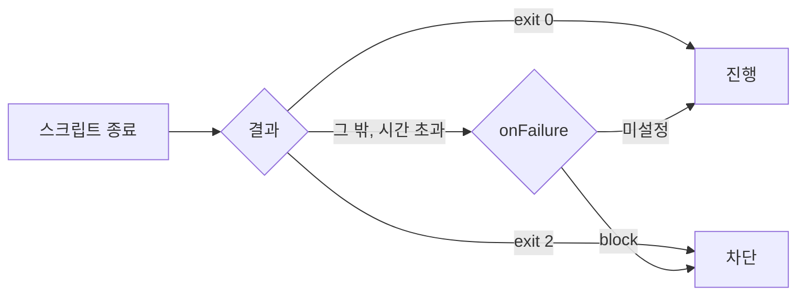

> **기준 출처:** [Claude Code Docs, Hooks reference](https://code.claude.com/docs/en/hooks) · [Automate actions with hooks](https://code.claude.com/docs/en/hooks-guide) / 확인일 2026-11-12 · Claude Code 2.1.322
> **시리즈:** [목차](/posts/00-ccsetup-series/) | 이전 → [03. MCP 적용법](/posts/03-apply-mcp/) | 다음 → [05. 서브에이전트 적용법](/posts/05-apply-subagent/)

hook 이 왜 모델 판단과 다른 층인지는 [06편](/posts/06-hooks/)에서 다뤘다. 이 편은 붙이는 순서다. 예제는 파일명에 공백이 들어가면 쓰기를 막는 hook 이다.

## 1. 어디에 적나

| 위치 | 범위 |
| --- | --- |
| `~/.claude/settings.json` | 내 모든 프로젝트 |
| `.claude/settings.json` | 이 프로젝트. 커밋하면 팀 공유 |
| `.claude/settings.local.json` | 이 프로젝트, 나만 |
| plugin `hooks/hooks.json` | plugin 이 켜진 동안 |
| skill, 서브에이전트 frontmatter | skill 은 호출 뒤 세션 끝까지, 서브에이전트는 도는 동안 |

범위끼리 덮어쓰지 않고 합쳐진다. 대화형 세션은 폴더 신뢰를 수락하기 전까지 `~/.claude/settings.json` 을 포함한 **모든** settings 파일의 hook 을 보류한다. `-p` 와 SDK 세션은 신뢰한 것으로 치므로, 남의 저장소에 `claude -p` 를 돌리기 전에는 `.claude/` 를 먼저 읽는다.

## 2. 붙이는 순서

| 단계 | 정할 것 |
| --- | --- |
| 이벤트 | 막기 `PreToolUse`, 고치기 `PostToolUse`, 맥락 주입 `SessionStart`, 끝내기 전 확인 `Stop` |
| matcher | 도구 이름, 대소문자 구분. `Write\|Edit` 처럼 영문, 숫자, `_`, `-`, `,`, `\|` 만 쓰면 정확 일치 목록. 다른 문자가 섞이면 부분 일치 정규식이라 `^Edit$` 처럼 고정한다 |
| 스크립트 | stdin 으로 JSON 이 온다 (`tool_name`, `tool_input.file_path` 등) |
| 결과 | exit 2, 또는 exit 0 에 `hookSpecificOutput.permissionDecision: "deny"` |

exit 0 은 진행, exit 2 는 차단이고 stderr 가 사유로 모델에게 간다. 그 밖의 코드는 비차단 오류라서 **진행된다.** exit 1 은 막지 않는다. hook 의 `deny` 는 `bypassPermissions` 모드에서도 막는다.

`.claude/settings.local.json`:

```json
{
  "hooks": {
    "PreToolUse": [{
      "matcher": "Write|Edit",
      "hooks": [{
        "type": "command",
        "command": "powershell.exe",
        "args": ["-NoProfile", "-ExecutionPolicy", "Bypass", "-File", "${CLAUDE_PROJECT_DIR}/.claude/hooks/name-guard.ps1"],
        "timeout": 20
      }]
    }]
  }
}
```

`args` 가 있으면 셸 없이 띄우는 exec form 이라 따옴표 문제가 없다. settings 는 엄격한 JSON 이라 주석과 끝 쉼표가 오류다.

`.claude/hooks/name-guard.ps1` (한글이 있으니 UTF-8 BOM 으로 저장, 6절):

```powershell
[Console]::InputEncoding = [System.Text.UTF8Encoding]::new($false)
$in   = [Console]::In.ReadToEnd() | ConvertFrom-Json
$leaf = Split-Path ([string]$in.tool_input.file_path) -Leaf
if ($leaf -match ' ') {
  $b = [System.Text.Encoding]::UTF8.GetBytes("파일명에 공백이 있다: $leaf")
  $e = [Console]::OpenStandardError(); $e.Write($b, 0, $b.Length); $e.Flush()
  exit 2
}
exit 0
```

## 3. 실패했을 때 막을지 정한다



대부분의 이벤트에서 hook 이 실패하거나 시간을 넘기면 동작은 진행된다. `"onFailure": "block"`(v2.1.295 이상)을 주면 실패도 exit 2 처럼 막는다.

| hook 의 성격 | `onFailure` | 이유 |
| --- | --- | --- |
| 위험 명령, 보안 판정 같은 가드 | `"block"` | 고장 난 가드가 조용히 통과시키면 안 된다 |
| 파일명 같은 이름 규칙 | 두지 않는다 | 놓쳐도 되돌리기 쉽다. block 이면 hook 고장 한 번에 모든 쓰기가 멈춘다 |

위 예시도 이름 검사라서 일부러 fail-open 으로 둔다.

Windows 에서 Git Bash 가 없으면 `PreToolUse` command hook 은 0, 2 외의 종료를 실패로 보고 막는다. Git Bash 를 설치하면 이 동작이 사라지므로 막아야 하는 PowerShell 가드에는 `block` 을 적어 둔다.

## 4. 켜졌는지 확인하는 법

| 확인 | 방법 |
| --- | --- |
| 등록 | `/hooks` 에 출처와 함께 보인다 |
| 스크립트 단독 | 가짜 JSON 을 파이프로 넣어 종료 코드 2 (아래) |
| 결과 | `Ctrl+O` transcript. 차단은 사유가, 비차단 오류는 `hook error` 가 보인다 |
| 속도 | `claude --debug` 로그(`~/.claude/debug/`)의 `finished with status 0 (31ms)` 줄 |

```powershell
'{"tool_name":"Write","tool_input":{"file_path":"C:\\tmp\\a b.md"}}' |
  powershell -NoProfile -File .\.claude\hooks\name-guard.ps1; $LASTEXITCODE   # 2
```

## 5. 끄기와 되돌리기

- **하나만:** settings 에서 그 항목을 지운다. 설정에 둔 채 하나만 끄는 스위치는 없다.
- **전부 잠시:** `"disableAllHooks": true`. 설정 우선순위를 따르므로 프로젝트의 `false` 가 사용자의 `true` 를 이긴다. 이번 실행만이면 `claude --settings '{"disableAllHooks": true}'`.
- 파일을 고치면 보통 자동 반영된다. 안 보이면 재시작한다.

## 6. 자주 걸리는 것

- **`PostToolUse` 는 되돌리지 못한다.** 도구는 이미 실행됐다.
- **JSON 이 조용히 무시된다.** stdout 이 `{` 로 시작하지 않으면 평문으로 읽는다. 셸 프로필의 `echo` 가 앞에 끼는 경우가 많다.
- **`Stop` 이 끝없이 이어 간다.** 입력의 `stop_hook_active` 가 `true` 면 바로 exit 0 한다.
- **`Write|Edit` 만 걸면 셸로 만든 파일은 못 본다.**
- **PowerShell 셸형 명령에서 맨 `$CLAUDE_PROJECT_DIR` 표기는 `$null` 이 된다.** `$env:` 를 붙인다.
- **한글 주석 다음 줄이 사라진다.** Windows PowerShell 5.1 은 BOM 없는 `.ps1` 을 ANSI 코드 페이지로 읽는다. 한글이 든 스크립트는 UTF-8 BOM 으로 저장한다.
- 예시의 입력 인코딩 줄과 UTF-8 바이트 stderr 는 실측 환경에서 stdin 이 비고 사유가 깨졌던 것을 고친 것이다.

## 참고

- [Claude Code Docs: Hooks reference](https://code.claude.com/docs/en/hooks)
- [Claude Code Docs: Automate actions with hooks](https://code.claude.com/docs/en/hooks-guide)
- [Claude Code Docs: Settings files and precedence](https://code.claude.com/docs/en/settings)
- [Microsoft Learn: about_Character_Encoding](https://learn.microsoft.com/en-us/powershell/module/microsoft.powershell.core/about/about_character_encoding)
