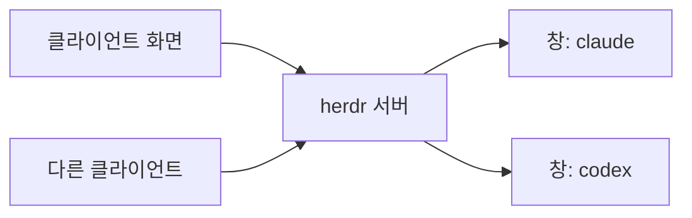

> **기준 출처:** [herdr Docs, Concepts](https://herdr.dev/tui/docs/concepts/) · [Session state](https://herdr.dev/tui/docs/session-state/) · [Orca Docs, Worktrees](https://orca.dev/docs/model/worktrees) / 확인일 2026-11-12 · Claude Code 2.1.322 · Codex CLI 0.167.0 · herdr 0.9.5
> **시리즈:** [목차](/posts/00-ccsetup-series/) | 이전 → [09. 남의 하네스와 같은 과제로 겨뤄 보기](/posts/09-harness-bakeoff/)

Claude 가 쓰는 동안 옆에서 Codex 가 검토하고 다른 창에서는 빌드가 돈다. 에이전트를 여럿 돌리면 두 가지가 필요해진다. 어느 에이전트가 나를 기다리는지 한눈에 보는 것, 그리고 창을 실수로 닫아도 일이 끊기지 않는 것이다. 이 일을 처음에는 Orca 로, 지금은 herdr 로 한다.

## 1. 두 갈래

| | Orca | herdr |
| --- | --- | --- |
| 생김새 | 데스크톱 앱 | 터미널 안의 화면(TUI) |
| 묶는 단위 | 작업 하나 = git worktree 하나 | 워크스페이스, 탭, 창(pane) |
| 파일 격리 | 폴더가 갈라져 구조로 격리된다 | 없음. 같은 폴더를 쓴다 |

Orca 문서는 작업마다 `git worktree` 로 디스크 사본을 따로 주므로 병렬 에이전트가 서로의 파일을 밟지 않는다고 설명한다. 대가로 새 worktree 마다 gitignore 된 파일과 의존성을 다시 갖춰야 하고, worktree 를 지우면 폴더와 브랜치가 함께 지워진다.

## 2. Orca 를 뺀 이유

2026-09 에 붙였다가 2026-11-10 에 완전히 뺐다.

| 이유 | 내용 |
| --- | --- |
| 격리를 못 썼다 | 주로 일하는 노트 폴더가 git 이 아니라 worktree 격리가 생기지 않았다 |
| hook 부담 | 설치 때 Claude Code 사용자 설정에 상태 보고용 hook 12개가 들어왔다. `PreToolUse`, `PostToolUse` 가 모든 도구에 걸려 도구 호출마다 프로세스가 두 번 떴고, Orca 밖 세션에서도 돌았다 |
| 숨은 기동 경로 | 전역 Orca skill 세 개가 앱이 꺼져 있으면 `orca open --json` 으로 켜라고 안내하고 있었다. 실제 자동 실행의 원인이었는지는 재현하지 않았다 |

hook 은 2026-09-15 에 지우고 Orca 는 보류했다가 11-10 에 프로그램과 skill, 데이터까지 지웠다. 지금 Orca 문서는 상태 hook 을 `orca agent hooks status|on|off` 로 끄고 켜는 법을 안내한다.

## 3. herdr — 서버가 터미널을 쥔다

백그라운드 서버가 창과 그 안의 프로세스를 소유하고, 사람이 보는 화면은 서버에 붙는 클라이언트다. 그래서 터미널 창을 닫아도 그 안의 Claude 는 계속 돈다.



층은 Session(서버 하나, 보통 `default`), Workspace(저장소나 과제 하나), Tab(화면 배치), Pane(진짜 터미널 하나), Agent(창 안에서 알아본 프로그램) 순이다.

| 상황 | 돌던 프로그램 | 배치와 작업 폴더 | Claude 대화 |
| --- | --- | --- | --- |
| 분리(`prefix` → `q`), 터미널 창 닫기 | 계속 돈다 | 그대로 | 그대로 |
| `herdr server stop` 뒤 재시작 | 끝난다 | `session.json` 에서 복원, 새 셸로 열림 | 연동 hook 이 세션 참조를 알렸으면 이어진다 |

창의 지난 출력은 `[experimental] pane_history` 를 켰을 때만 돌아오는데, 비밀값이 저장될 수 있어 기본으로 꺼져 있다. 종료 직전 저장은 문서상 Linux(systemd-logind) 에만 있어 Windows 재부팅은 서버 재시작과 같다고 본다. 내 PC 에서는 재부팅 뒤 배치와 Claude 대화가 이어졌다.

### 에이전트 상태

| 상태 | 뜻 | 할 일 |
| --- | --- | --- |
| `working` | 일하는 중 | 기다린다 |
| `blocked` | 승인, 질문, 결정을 기다린다 | 가서 답한다 |
| `done` | 끝났고 아직 안 봤다 | 결과를 본다 |
| `idle` | 끝났거나 기다리는 중이고 이미 봤다 | 다음 일을 준다 |
| `unknown` | 판정 못 함 | 화면을 직접 본다 |

herdr 는 창의 프로세스에서 에이전트를 찾고 화면 맨 아래 글자를 감지 규칙과 대조해 상태를 정한다. Claude 와 Codex 연동 hook 이 알리는 것은 세션 참조뿐이다.

### 키

기본 prefix 는 `ctrl+b` 이고, 눌렀다 뗀 뒤 다음 키 하나를 누른다. 처음 익힐 것은 `c` 새 탭, `v` 와 `-` 분할, `h j k l` 창 이동, `w` 워크스페이스 이동, `q` 분리다. `g` 로 여는 Goto picker 에서 `b` 를 누르면 `blocked` 만 남는다.

## 4. 함정

| 함정 | 내용 |
| --- | --- |
| prefix 충돌 | Claude Code 의 `Ctrl+B` 는 실행 중인 Bash 명령과 에이전트를 백그라운드로 보내는 키다. 기본 prefix 와 같아서 `[keys] prefix = "ctrl+q"` 로 바꿨다 |
| `idle` 이 승인 가능을 뜻하지 않는다 | `blocked` 는 알려진 승인 화면과 맞을 때만 잡혀서 처음 보는 승인 화면은 `idle` 로 보일 수 있다. `done` 도 「끝났다」지 「성공했다」가 아니다 |
| 연동 hook 은 herdr 밖에서도 돈다 | Claude 세션이 시작할 때마다 돈다. 내 PC 에서는 PowerShell 을 띄우느라 한 번에 1.3~2.3초 |
| Codex 대화 복원 | 그냥 `codex` 로 켠 창은 세션 참조가 남지 않아 복원되지 않았다. Codex 연동은 빼고 손으로 이어 연다 |
| Windows 제약 | 실행 중 프로세스를 넘기는 handoff 미지원, 서명 없는 바이너리라 SmartScreen 경고, 관리자 서버에는 기본적으로 관리자 클라이언트만 붙는다 |
| 한글 입력 | 기본 `host_cursor = "auto"` 는 한글 조합 위치가 어긋날 수 있다. `"native"` 는 맞추는 대신 커서가 깜박일 수 있다 |
| 같은 폴더 | 창이 여럿이어도 같은 폴더를 여러 세션이 쓰는 것과 같다. [08편](/posts/08-claude-and-codex/)의 파일 단위 규칙이 그대로 필요하다 |

## 5. 에이전트가 옆 창을 부리기

herdr 는 CLI 와 로컬 소켓 API 를 준다. 창 안의 Claude 가 옆 창에 Codex 를 띄워 검토를 맡기고, 끝나기를 기다렸다가 결과를 읽을 수 있다.

```powershell
herdr pane split --current --direction right --cwd "$PWD" --no-focus   # 응답의 pane ID 를 읽는다
herdr agent start reviewer --kind codex --pane <새 창 ID>
herdr agent prompt reviewer "현재 변경을 검토하고 고칠 것만 보고" --wait --timeout 120000
herdr agent read reviewer --source recent-unwrapped --lines 120
```

herdr skill 문서의 안전 규칙도 같이 지킨다. 배경 작업은 `--no-focus` 로 하고, 내가 만들지 않은 창은 닫지 않고, 창 안에서 `herdr server stop` 을 치지 않는다. 상대가 `blocked` 면 화면을 읽고 사람에게 묻고, 시간 초과가 났다고 같은 지시를 다시 보내지 않는다.

## 참고

- [herdr Docs: Concepts](https://herdr.dev/tui/docs/concepts/)
- [herdr Docs: Session state](https://herdr.dev/tui/docs/session-state/)
- [herdr Docs: Keyboard](https://herdr.dev/tui/docs/keyboard/)
- [herdr Docs: Agents](https://herdr.dev/tui/docs/agents/)
- [herdr Docs: Integrations](https://herdr.dev/tui/docs/integrations/)
- [herdr Docs: Windows](https://herdr.dev/tui/docs/windows-beta/)
- [herdr skill (SKILL.md)](https://raw.githubusercontent.com/herdrdev/herdr/master/skills/herdr/SKILL.md)
- [herdrdev/herdr](https://github.com/herdrdev/herdr)
- [stablyai/orca](https://github.com/stablyai/orca)
- [Orca Docs: Worktrees](https://orca.dev/docs/model/worktrees)
- [Orca Docs: Agent hooks & memory](https://orca.dev/docs/agents/hooks-memory)
- [Claude Code Docs: Interactive mode](https://code.claude.com/docs/en/interactive-mode)
