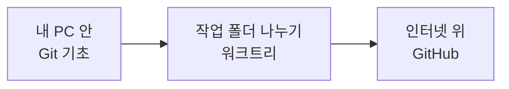

> **기준 출처:** [Pro Git 2판 한국어판](https://git-scm.com/book/ko/v2) · [Git Reference](https://git-scm.com/docs) · [GitHub Docs, About GitHub and Git](https://docs.github.com/en/get-started/start-your-journey/about-github-and-git) / 확인일 2026-11-12 · git 2.55.0.windows.2

## 이 연재가 답하는 질문

에이전트 여러 개를 한 저장소에서 나란히 돌리려면 무엇을 알아야 하나. 답의 대부분은 GitHub 가 아니라 내 PC 안의 Git 에 있다. 브랜치가 무엇인지, 작업 폴더를 어떻게 나누는지, 잘못 만졌을 때 어디까지 되돌릴 수 있는지가 먼저다.

## 두 층

모든 예시는 버려도 되는 연습 저장소에서 실제로 돌린 명령과 출력이다. 경로는 `~` 로 줄였다. 원격은 로컬 bare 저장소로 흉내 내어 인터넷 없이 재현했다.

## 읽는 순서

### 1부. Git 기초 — 내 PC 안에서

| # | 글 | 무엇을 얻나 |
| --- | --- | --- |
| 01 | [Git, GitHub, 그 위의 도구는 다른 층이다](/posts/01-git-layers/) | 어느 층의 문제인지부터 가르기 |
| 02 | [저장소, 커밋, 스냅샷](/posts/02-git-repo-commit/) | `.git` 폴더와 세 영역, 커밋이 변경분이 아니라 스냅샷인 이유 |
| 03 | [이력 읽기](/posts/03-git-history/) | `log`, `show`, HEAD, 해시, `HEAD~2` 가 가리키는 것 |
| 04 | [브랜치는 포인터다](/posts/04-git-branch-pointer/) | 브랜치를 만들고 바꿀 때 `.git` 안에서 실제로 바뀌는 한 줄 |
| 05 | [합치기](/posts/05-git-merge/) | fast-forward 와 3-way merge, 충돌 풀기, rebase 를 공유한 커밋에 쓰지 않는 이유 |
| 06 | [되돌리기와 안전망](/posts/06-git-undo/) | `restore`, `reset`, `revert`, `stash` 를 건드리는 곳으로 고르기, reflog 로 되찾기 |
| 07 | [**워크트리 — 브랜치 하나에 폴더 하나**](/posts/07-git-worktree/) | 저장소 하나에서 작업 폴더를 여럿 꺼내 브랜치 둘을 동시에 열기 |
| 08 | [워크트리의 제약과 함정](/posts/08-git-worktree-pitfalls/) | 같은 브랜치 두 곳 불가, 따라오지 않는 파일, prunable |
| 09 | [브랜치 전략](/posts/09-git-branch-strategy/) | 작업 하나에 브랜치 하나, 워크트리 하나로 에이전트 여럿을 나란히 |

### 2부. GitHub — 인터넷 위에서

| # | 글 | 무엇을 얻나 |
| --- | --- | --- |
| 01 | [원격 저장소](/posts/01-github-remote/) | `push`, `fetch`, `pull`, ahead 와 behind, 거부된 push 를 푸는 순서 |
| 02 | [GitHub 가 얹는 것](/posts/02-github-what-it-adds/) | git 명령으로 되는 것과 GitHub 에만 있는 것, 이 블로그의 Actions → Pages 배포 경로 |
| 03 | [PR 흐름](/posts/03-github-pr-flow/) | GitHub flow 여섯 단계와 merge 방식 셋, merge 뒤 로컬 정리 |

2부는 폴더가 따로라 번호를 01 부터 다시 센다.

**급하면** 1부 07~09 만 읽어도 된다. 워크트리 글마다 필요한 앞 개념을 그 자리에서 짧게 풀었다.

## 이 연재가 안 다루는 것

**워크트리 위에 얹는 에이전트 관리 도구.** 써 보다가 뺀 경위는 [터미널에서 에이전트 여럿 돌리기](/posts/10-agent-multiplexer/)에 있다.

**두 에이전트를 같은 저장소에서 운영하는 규칙.** [Claude Code 와 Codex 같이 쓰기](/posts/08-claude-and-codex/)에 있다. 이 연재는 그 밑바닥인 Git 쪽이다.

## 참고

- [Pro Git 2판 한국어판](https://git-scm.com/book/ko/v2)
- [Git Reference](https://git-scm.com/docs)
- [GitHub Docs: About GitHub and Git](https://docs.github.com/en/get-started/start-your-journey/about-github-and-git)
