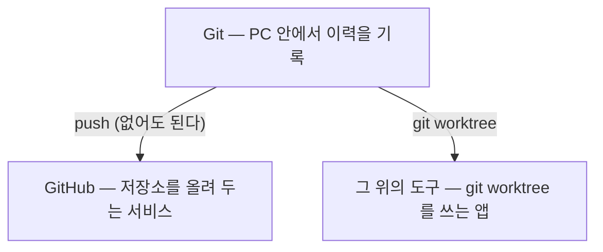

> **기준 출처:** [Pro Git 1.3 Git 기초](https://git-scm.com/book/ko/v2/시작하기-Git-기초) · [GitHub Docs, About GitHub and Git](https://docs.github.com/en/get-started/start-your-journey/about-github-and-git) · [git-worktree](https://git-scm.com/docs/git-worktree) / 확인일 2026-11-12 · git 2.55.0.windows.2
> **시리즈:** [목차](/posts/00-git-series/) | 다음 → [02. 저장소, 커밋, 스냅샷](/posts/02-git-repo-commit/)

Git, GitHub, 그리고 Git 위에서 도는 도구는 이름이 비슷해 한 덩어리로 보이지만 서로 다른 층에 있다. 이 편은 명령 없이 셋의 자리만 잡는다. 다음 편부터는 연습 저장소에서 명령을 직접 실행하고 그 출력을 그대로 싣는다.

## 1. 세 층

| 층 | 무엇인가 | 어디서 도나 |
| --- | --- | --- |
| Git | 파일 변경 이력을 기록하는 프로그램. 명령줄 도구다 | PC 안. 네트워크 없이 된다 |
| GitHub | Git 저장소를 인터넷에 올려 두고 이슈, PR 같은 협업 기능을 얹은 서비스 | 인터넷 위의 서버 |
| 그 위의 도구 | `git worktree` 같은 Git 기능을 써서 작업 폴더를 나눠 주는 앱 | PC 안의 앱 |

Pro Git 1.1 은 버전 관리 시스템을 파일 변화를 시간에 따라 기록했다가 나중에 특정 시점의 버전을 다시 꺼내 올 수 있는 시스템으로 정의한다. Git 은 2005년 Linux 커널 개발 커뮤니티가 쓰던 상용 도구와 관계가 틀어진 뒤 직접 만든 것이다(Pro Git 1.2).

GitHub Docs 는 Git 을 파일 변경을 추적하는 버전 관리 시스템으로, GitHub 를 그 Git 저장소를 클라우드에 호스팅하고 계획과 협업 도구를 더한 것으로 설명한다. 문서의 표현대로 GitHub 는 Git 위에 얹힌다(builds on). GitHub 계정이 없어도 Git 은 다 쓸 수 있다.

## 2. 커밋과 push 는 다른 명령이다

Pro Git 1.3 에 따르면 Git 은 거의 모든 명령이 로컬 파일과 데이터만 쓴다. 저장소는 `git init` 한 줄로 PC 안에 생기고(Pro Git 2.1), 커밋은 그 안의 `.git` 폴더에 기록된다. 다른 곳으로 보내는 것은 `git push` 라는 별개 명령이다(Pro Git 2.5).

| 흔한 오해 | 실제 |
| --- | --- |
| Git 을 쓰려면 GitHub 계정이 필요하다 | `git init` 만으로 저장소가 생긴다. 계정은 GitHub 같은 서비스에 올릴 때 필요하다 |
| 커밋하면 인터넷에 올라간다 | 커밋은 PC 안의 `.git` 에 쓰인다. 올리는 것은 `push` 다 |
| 원격은 GitHub 를 말한다 | 원격은 네트워크 어딘가의 저장소이고, 같은 PC 안의 다른 폴더여도 된다(Pro Git 2.5) |
| 워크트리 도구의 작업 폴더는 그 도구만의 것이다 | 실제 git 워크트리라서 `git worktree list` 로 도구 밖에서도 보인다(07편) |

## 3. 그 위의 도구

`git worktree` 는 저장소 하나에 작업 폴더를 여러 개 붙여 관리하는 명령이다([git-worktree](https://git-scm.com/docs/git-worktree)). 브랜치마다 폴더를 따로 두면 코딩 에이전트 여럿이 서로의 파일을 건드리지 않고 나란히 일할 수 있고, 이 점을 이용한 앱들이 Git 위에 선다.

이 블로그에서 써 본 Orca 는 git 워크트리 위에 얹은 에이전트 작업 관리 도구로, 문서는 작업마다 `git worktree` 로 저장소의 디스크 사본을 하나씩 준다고 설명한다. 써 본 경위와 뺀 이유는 [10. 터미널에서 에이전트 여럿 돌리기](/posts/10-agent-multiplexer/) 에 정리했다.

이런 도구가 기대는 것은 GitHub 가 아니라 Git 이다. `git worktree` 는 원격이 없는 연습 저장소에서도 그대로 동작한다(07편). GitHub 와 이어지는 기능이 있더라도 그것은 있으면 쓰는 쪽이다.

## 4. PC 안의 저장소들은 어느 층에 있나

2026-09-15 에 폴더마다 `.git` 이 있는지와 `git -C <경로> remote -v` 출력을 확인했다.

| 폴더 | `.git` | 원격 | 층 |
| --- | --- | --- | --- |
| 노트 폴더 | 없음 | — | Git 이 아니다. 그냥 폴더 |
| 로컬 실습 저장소 | 있음 | 없음 | Git 만 |
| 블로그 저장소 `genie4youu.github.io` | 있음 | GitHub | Git + GitHub |

확인한 저장소는 모두 브랜치가 `main` 하나, 작업 폴더도 하나였다. 이력을 쌓는 데만 쓰고 있었다는 뜻이고, 04편 이후가 그다음 단계다.

## 5. 이 시리즈가 가는 순서

| 구간 | 다루는 것 |
| --- | --- |
| Git 기초 02~06 | 저장소와 커밋, 이력 읽기, 브랜치, 합치기, 되돌리기 |
| Git 기초 07~09 | 워크트리, 그 제약, 작업 하나에 브랜치 하나를 두는 전략 |
| GitHub 01~03 | 원격 저장소, GitHub 가 얹는 기능, PR 흐름 |

Git 기초 구간은 인터넷 없이 PC 안에서 끝난다. 워크트리 위의 도구를 이해하려면 GitHub 보다 Git 의 브랜치와 워크트리가 먼저 필요하기 때문에 이 순서로 둔다.

## 6. 정리

- Git 은 PC 안의 프로그램이다. 계정도 네트워크도 필요 없다
- GitHub 는 Git 저장소를 올려 두고 협업 기능을 얹은 서비스다. 원격 자리에 다른 서버가 와도 된다
- 워크트리 기반 도구는 Git 위에 선다. GitHub 는 있으면 쓰는 쪽이다

## 참고

- [Pro Git 1.1 시작하기 - 버전 관리란?](https://git-scm.com/book/ko/v2/시작하기-버전-관리란%3F)
- [Pro Git 1.2 시작하기 - 짧게 보는 Git의 역사](https://git-scm.com/book/ko/v2/시작하기-짧게-보는-Git의-역사)
- [Pro Git 1.3 시작하기 - Git 기초](https://git-scm.com/book/ko/v2/시작하기-Git-기초)
- [Pro Git 2.1 Git의 기초 - Git 저장소 만들기](https://git-scm.com/book/ko/v2/Git의-기초-Git-저장소-만들기)
- [Pro Git 2.5 Git의 기초 - 리모트 저장소](https://git-scm.com/book/ko/v2/Git의-기초-리모트-저장소)
- [GitHub Docs: About GitHub and Git](https://docs.github.com/en/get-started/start-your-journey/about-github-and-git)
- [git-worktree](https://git-scm.com/docs/git-worktree)
- [Orca Docs: Worktrees](https://orca.dev/docs/model/worktrees)
