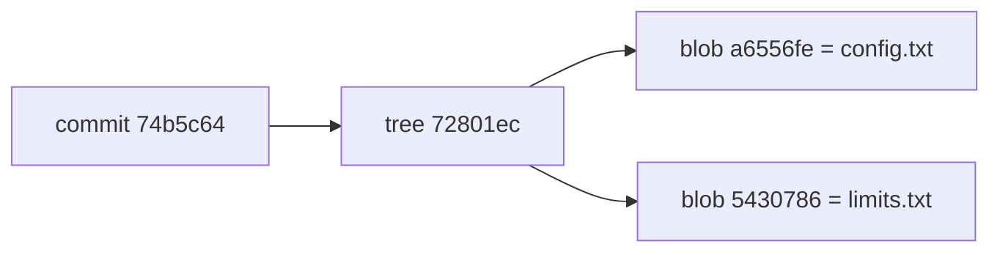

> **기준 출처:** [Pro Git 1.3 Git 기초](https://git-scm.com/book/ko/v2/시작하기-Git-기초) · [Pro Git 2.2 수정하고 저장소에 저장하기](https://git-scm.com/book/ko/v2/Git의-기초-수정하고-저장소에-저장하기) · [Pro Git 10.2 Git 개체](https://git-scm.com/book/ko/v2/Git의-내부-Git-개체) / 확인일 2026-11-12 · git 2.55.0.windows.2
> **시리즈:** [목차](/posts/00-git-series/) | 이전 → [01. Git, GitHub, 그 위의 도구는 다른 층이다](/posts/01-git-layers/) | 다음 → [03. 이력 읽기](/posts/03-git-history/)

출력은 연습 저장소 `~/git-practice/demo` 에서 실행한 그대로다. 해시는 따라 해도 다르게 나온다. 커밋 시각과 작성자가 해시 계산에 들어가기 때문이다(03편).

## 1. `git init` 이 만드는 것

```text
$ git init demo
Initialized empty Git repository in ~/git-practice/demo/.git/

$ ls -A .git
HEAD  config  description  hooks  info  objects  refs
```

`git init` 은 `.git` 이라는 하위 폴더를 만들고 저장소의 뼈대 파일을 넣는다. 이 시점에는 아직 어떤 파일도 관리하지 않는다(Pro Git 2.1). 이력과 설정은 전부 이 `.git` 안에 쌓이므로 `.git` 을 지우면 파일만 남고 이력은 사라진다.

```text
$ git status
On branch main

No commits yet

nothing to commit (create/copy files and use "git add" to track)
```

계정도 네트워크도 쓰지 않았다.

## 2. 세 구역

Pro Git 1.3 은 파일 상태를 Committed, Modified, Staged 셋으로 나누고, 이에 맞춰 세 구역을 둔다.

| 구역 | 무엇 | 파일 상태 |
| --- | --- | --- |
| 작업 폴더 (워킹 트리) | 편집기로 여는 실제 파일 | Modified: 고쳤지만 아직 올리지 않음 |
| 스테이징 (Staging Area, index) | 다음 커밋에 넣을 것의 목록. `.git` 안의 파일 하나 | Staged: `add` 로 올려 둠 |
| 저장소 (`.git` 디렉토리) | 커밋된 스냅샷이 쌓이는 객체 데이터베이스 | Committed: 기록됨 |


스테이징이 따로 있어서 고친 파일 열 개 중 셋만 골라 한 커밋으로 묶을 수 있다. `git commit -a` 는 추적 중인 파일을 자동으로 스테이징에 넣어 이 단계를 건너뛴다(Pro Git 2.2).

### 한 번 지나가 보기

```text
$ printf 'motor_speed = 100\n' > config.txt
$ git status --short
?? config.txt

$ git add config.txt
$ git status --short
A  config.txt

$ git commit -m "config.txt 추가 — 모터 속도 기본값"
[main (root-commit) f0a3a92] config.txt 추가 — 모터 속도 기본값
 1 file changed, 1 insertion(+)
 create mode 100644 config.txt
```

`??` 는 Git 이 모르는 파일, `A` 는 스테이징에 새로 올라간 파일이고, `f0a3a92` 는 이 커밋의 해시 앞 7자리다.

### 고치면 세 구역이 갈린다

```text
$ printf 'motor_speed = 120\n' > config.txt
$ git status
On branch main
Changes not staged for commit:
  (use "git add <file>..." to update what will be committed)
  (use "git restore <file>..." to discard changes in working directory)
	modified:   config.txt
```

작업 폴더의 `config.txt` 는 120, 스테이징과 마지막 커밋의 `config.txt` 는 100 이다. 같은 이름의 파일이 구역마다 한 벌씩 있다고 보면 `git diff` 가 무엇을 비교하는지 헷갈리지 않는다(Pro Git 2.2).

| 명령 | 비교 대상 | 이때 출력 |
| --- | --- | --- |
| `git diff` | 작업 폴더 ↔ 스테이징 | `-motor_speed = 100` / `+motor_speed = 120` |
| `git diff --staged` | 스테이징 ↔ 마지막 커밋 | 없음 (아직 `add` 하지 않았다) |
| `add` 뒤 `git diff --staged` | 스테이징 ↔ 마지막 커밋 | `-100` / `+120` |

`--staged` 와 `--cached` 는 같은 옵션이다.

## 3. 커밋은 diff 가 아니라 스냅샷이다

흔한 오해는 커밋이 그때 바뀐 줄의 목록이라는 것이다. Pro Git 1.3 은 Git 이 데이터를 파일 시스템 스냅샷의 연속으로 다룬다고 설명한다. 커밋을 셋 쌓은 뒤 커밋 개체를 열어 보면 그 순간의 폴더 전체를 가리키는 tree 가 들어 있다.

```text
$ git cat-file -p HEAD
tree 72801ec7479ef1d63638782b1a8dab633eb283ba
parent 405377850ea7c3b692f42065d3581a4799a8b97f
author genie4youu <...> 1789431288 +0900
committer genie4youu <...> 1789431288 +0900

limits.txt 추가 — 타임아웃

$ git cat-file -p HEAD^{tree}
100644 blob a6556feb36b5282ffef911b50863f08ccf629212	config.txt
100644 blob 54307869ad697138643284c8eaa7fe183bf6a3ab	limits.txt
```

| 개체 | 무엇 | 위 출력에서 |
| --- | --- | --- |
| blob | 파일 내용. 파일 이름은 들어 있지 않다 | `a6556fe` 는 `motor_speed = 120` 이라는 내용 |
| tree | 폴더 한 단계. 이름, 모드, 가리키는 blob 이나 하위 tree | `72801ec` 는 `config.txt`, `limits.txt` 두 줄 |
| commit | 최상위 tree, 부모 커밋, 작성자와 시각, 메시지 | `HEAD` 가 가리키는 `74b5c64` |



스냅샷을 매번 찍어도 저장 공간이 크게 늘지 않는 것은 달라지지 않은 파일을 새로 저장하지 않고 이전 것을 가리키기 때문이다(Pro Git 1.3). `git diff` 가 보여 주는 변경분은 저장된 것이 아니라 스냅샷 둘을 비교해 그때 계산한 것이다.

이 시리즈의 명령은 Git Bash 같은 POSIX 셸 기준이다. PowerShell 에서는 `'HEAD^{tree}'` 처럼 따옴표로 감싸고, CMD 에서는 `HEAD^^{tree}` 로 쓴다(Pro Git 10.2 의 주석).

## 4. `git status --short` 의 두 글자

왼쪽 글자는 스테이징, 오른쪽 글자는 작업 폴더의 상태다([git-status](https://git-scm.com/docs/git-status), Pro Git 2.2).

| 표시 | 뜻 |
| --- | --- |
| `??` | 추적하지 않는 파일 |
| `A ` | 스테이징에 새로 올라감 |
| ` M` | 작업 폴더에서 고쳤고 아직 `add` 하지 않음 |
| `M ` | 고친 것을 `add` 함 |
| `MM` | `add` 한 뒤 또 고침. 스테이징과 작업 폴더가 다르다 |
| `UU` | 합치다 충돌이 난 채 해결하지 않음 (05편) |

## 5. Windows 의 `LF will be replaced by CRLF`

```text
warning: in the working copy of 'config.txt', LF will be replaced by CRLF the next time Git touches it
```

거의 모든 `add` 에서 찍혔지만 오류가 아니다. 실습 환경의 Git 은 `core.autocrlf=true` 여서, 저장소에는 LF 로 두고 작업 폴더로 꺼낼 때 Windows 줄 끝인 CRLF 로 바꾸겠다고 알리는 것이다.

| 설정 | 커밋할 때 | Checkout 할 때 | 쓰는 곳 (Pro Git 8.1) |
| --- | --- | --- | --- |
| `true` | CRLF → LF | LF → CRLF | Windows |
| `input` | CRLF → LF | 그대로 | Linux, macOS |
| `false` | 그대로 | 그대로 | Windows 에서만 개발할 때. CR 이 저장소에 그대로 들어간다 |

## 6. 정리

- 저장소는 `.git` 폴더다. 만드는 데 네트워크도 계정도 필요 없다
- 파일은 작업 폴더, 스테이징, 저장소 세 구역을 지난다. `status` 의 두 글자가 그 자리를 말해 준다
- 커밋은 스냅샷이다. tree 가 그 순간의 폴더 전체를 가리키고, diff 는 그때그때 계산된다

## 참고

- [Pro Git 1.3 시작하기 - Git 기초](https://git-scm.com/book/ko/v2/시작하기-Git-기초)
- [Pro Git 2.1 Git의 기초 - Git 저장소 만들기](https://git-scm.com/book/ko/v2/Git의-기초-Git-저장소-만들기)
- [Pro Git 2.2 Git의 기초 - 수정하고 저장소에 저장하기](https://git-scm.com/book/ko/v2/Git의-기초-수정하고-저장소에-저장하기)
- [Pro Git 8.1 Git맞춤 - Git 설정하기](https://git-scm.com/book/ko/v2/Git맞춤-Git-설정하기)
- [Pro Git 10.2 Git의 내부 - Git 개체](https://git-scm.com/book/ko/v2/Git의-내부-Git-개체)
- [git-init](https://git-scm.com/docs/git-init)
- [git-status](https://git-scm.com/docs/git-status)
