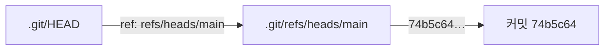

> **기준 출처:** [Pro Git 2.3 커밋 히스토리 조회하기](https://git-scm.com/book/ko/v2/Git의-기초-커밋-히스토리-조회하기) · [Pro Git 7.1 리비전 조회하기](https://git-scm.com/book/ko/v2/Git-도구-리비전-조회하기) · [Pro Git 10.3 Git Refs](https://git-scm.com/book/ko/v2/Git의-내부-Git-Refs) · [git-log](https://git-scm.com/docs/git-log) / 확인일 2026-11-12 · git 2.55.0.windows.2
> **시리즈:** [목차](/posts/00-git-series/) | 이전 → [02. 저장소, 커밋, 스냅샷](/posts/02-git-repo-commit/) | 다음 → [04. 브랜치는 포인터다](/posts/04-git-branch-pointer/)

02편의 연습 저장소에 커밋을 셋 쌓은 상태에서 시작한다.

## 1. `git log` — 최신이 위

```text
$ git log
commit 74b5c648bbd8244ecaeb93e1d392a46f553aaf92
Author: genie4youu <...>
Date:   Tue Sep 15 09:14:48 2026 +0900

    limits.txt 추가 — 타임아웃

commit 405377850ea7c3b692f42065d3581a4799a8b97f
Author: genie4youu <...>
Date:   Tue Sep 15 09:14:33 2026 +0900

    모터 속도 100 -> 120

commit f0a3a9218fad09d4b9cc4dc1898364d7f7759c2b
...
```

인자 없이 실행하면 가장 최근 커밋이 맨 위에 온다(Pro Git 2.3). 매일 쓰는 것은 줄인 형태다.

```text
$ git log --oneline
74b5c64 limits.txt 추가 — 타임아웃
4053778 모터 속도 100 -> 120
f0a3a92 config.txt 추가 — 모터 속도 기본값
```

| 옵션 | 무엇 | 언제 |
| --- | --- | --- |
| `--oneline` | `--pretty=oneline --abbrev-commit` 의 줄임. 짧은 해시와 제목 | 거의 항상 |
| `--graph` | 갈라지고 합쳐진 모양을 글자 그림으로 | 브랜치가 둘 이상일 때 (04편부터) |
| `--all` | `refs/` 아래 모든 이름과 `HEAD` 에서 닿는 커밋 | 다른 브랜치가 어디까지 갔는지 볼 때 |
| `--decorate` | 커밋에 붙은 브랜치 이름 표시 | 기본값 `auto` 는 출력이 터미널일 때만 켜진다. 파이프로 넘기면 빠진다 |
| `-5` | 최근 5개만 | 이력이 길 때 |
| `--stat` | 커밋마다 바뀐 파일과 줄 수 | 무엇을 건드렸는지 볼 때 |

옵션 설명은 [git-log](https://git-scm.com/docs/git-log) 를 따랐다. 이 시리즈는 `git log --oneline --all --graph --decorate` 를 기본으로 쓴다.

## 2. `git show` 와 `git diff` — 커밋을 펼친다

```text
$ git show HEAD --stat
commit 74b5c648bbd8244ecaeb93e1d392a46f553aaf92
Author: genie4youu <...>
Date:   Tue Sep 15 09:14:48 2026 +0900

    limits.txt 추가 — 타임아웃

 limits.txt | 1 +
 1 file changed, 1 insertion(+)
```

`--stat` 을 빼면 실제 diff 까지 나온다. `git show <해시>:config.txt` 처럼 `<커밋>:<경로>` 를 주면 그 커밋의 tree 에서 그 경로의 파일 내용만 꺼낸다([gitrevisions](https://git-scm.com/docs/gitrevisions)). 커밋이 스냅샷이라서 되는 일이다(02편).

두 커밋 사이의 차이는 `diff` 로 본다.

```text
$ git diff HEAD~2 HEAD --stat
 config.txt | 2 +-
 limits.txt | 1 +
 2 files changed, 2 insertions(+), 1 deletion(-)
```

## 3. HEAD 는 파일이다

`HEAD` 는 흔히 현재 위치라고 부르지만 실제로는 `.git/HEAD` 라는 텍스트 파일이다.

```text
$ cat .git/HEAD
ref: refs/heads/main

$ cat .git/refs/heads/main
74b5c648bbd8244ecaeb93e1d392a46f553aaf92
```



| 파일 | 내용 | 뜻 |
| --- | --- | --- |
| `.git/HEAD` | `ref: refs/heads/main` | 지금 어느 브랜치에 있나. 다른 이름을 가리키는 간접(symbolic) 참조다 |
| `.git/refs/heads/<브랜치>` | 해시 한 줄 | 그 브랜치의 끝 커밋 |

표의 구분은 Pro Git 10.3 을 따랐다. 새 커밋은 HEAD 가 가리키던 커밋을 부모로 삼고(Pro Git 10.3), 커밋할 때마다 현재 브랜치가 그 새 커밋을 가리키게 된다(Pro Git 3.1). 04편은 이 파일이 브랜치의 실체라는 데서 출발한다.

## 4. 해시 — 이름이자 체크섬

`74b5c648bbd8244ecaeb93e1d392a46f553aaf92` 는 SHA-1 로 만든 40자 16진수 체크섬이다(Pro Git 1.3). 커밋 개체에는 tree, 부모, 작성자와 시각, 메시지가 들어가고 해시는 그 내용으로 계산된다(Pro Git 10.2).

- 하나라도 다르면 다른 해시가 된다. 따라 하면 시각과 작성자가 달라 이 글과 다른 값이 나온다
- 저장소 안에서 겹치지 않으면 앞 4자만으로도 부를 수 있다. `--abbrev-commit` 은 기본 7자를 보여 주고 겹치면 늘린다(Pro Git 7.1)

```text
$ git show --oneline --no-patch 4053778
4053778 모터 속도 100 -> 120
```

### 상대 표기

| 표기 | 뜻 | 이 저장소에서 |
| --- | --- | --- |
| `HEAD` | 지금 브랜치의 끝 커밋 | `74b5c64` |
| `HEAD~1`, `HEAD~`, `HEAD^` | 첫 번째 부모 | `4053778` |
| `HEAD~2` | 첫 번째 부모를 두 번 따라감 | `f0a3a92` |
| `main` | 브랜치 이름. 그 끝 커밋 | `74b5c64` |
| `<커밋>^2` | merge 커밋의 두 번째 부모 | 05편에서 나온다 |

`~n` 은 첫 번째 부모만 n 번 따라가고, `^n` 은 n 번째 부모를 고른다([gitrevisions](https://git-scm.com/docs/gitrevisions)). 부모가 하나인 커밋에서는 둘이 같고, 부모가 둘인 merge 커밋에서 갈린다.

## 5. 다른 저장소 읽기 — 이 블로그 저장소

GitHub 에 올라가 있는 이 블로그 저장소를 읽기만 했다(2026-09-15). `-C <경로>` 는 그 폴더에서 시작한 것처럼 git 을 실행한다([git](https://git-scm.com/docs/git)).

```text
$ git -C ~/genie4youu.github.io log --oneline -5
f02c65a 문서: README 검사 개수 표기 정정 (6~10 5종 -> 6~11 6종)
0380029 수정: http:// 출처 링크 하나를 https 로 고치고 검사 11번을 붙였다
75e5adc 업계 읽기: 밀린 로보틱스 뉴스 5편 발행 (08-12, 08-19, 08-21, 08-24, 08-25)
4e33403 정비: 이름·번호·목차 규칙을 정하고 검사기 5종을 붙였다
75f7fdc 쉬어가기: 새벽 4시, 로봇 팔에게 뮤지컬을 알려준 이야기 발행

$ git -C ~/genie4youu.github.io log -1 --format='%H%n%an <%ae>%n%ad%n%s'
f02c65acabdbad643634c21e32a51cf53cce834f
genie4youu <...>
Tue Aug 25 15:13:59 2026 +0900
문서: README 검사 개수 표기 정정 (6~10 5종 -> 6~11 6종)

$ git -C ~/genie4youu.github.io rev-list --count HEAD
82
```

그 시점에 커밋 82개, 마지막 커밋은 2026-08-25, 작성자는 블로그 계정이라는 것을 세 명령으로 읽었다. `%H`(전체 해시), `%an`(작성자 이름), `%ae`(작성자 메일), `%ad`(작성 시각), `%s`(제목)는 git-log 의 PRETTY FORMATS 에 있다. Pro Git 2.3 은 이 형식이 다른 프로그램으로 결과를 파싱할 때 쓸모 있다고 설명한다.

## 6. 정리

- 기본은 `git log --oneline --all --graph --decorate`. 파이프로 넘길 때는 `--decorate` 를 빼먹지 않는다
- HEAD 는 `.git/HEAD` 파일 한 줄로 브랜치 이름을 가리키고, 브랜치는 `.git/refs/heads/<이름>` 파일 한 줄로 커밋 해시를 가리킨다
- 해시는 커밋 내용에서 계산된 이름이다. 짧게 부르고, `HEAD~n` 으로 거슬러 간다

## 참고

- [Pro Git 1.3 시작하기 - Git 기초](https://git-scm.com/book/ko/v2/시작하기-Git-기초)
- [Pro Git 2.3 Git의 기초 - 커밋 히스토리 조회하기](https://git-scm.com/book/ko/v2/Git의-기초-커밋-히스토리-조회하기)
- [Pro Git 3.1 Git 브랜치 - 브랜치란 무엇인가](https://git-scm.com/book/ko/v2/Git-브랜치-브랜치란-무엇인가)
- [Pro Git 7.1 Git 도구 - 리비전 조회하기](https://git-scm.com/book/ko/v2/Git-도구-리비전-조회하기)
- [Pro Git 10.2 Git의 내부 - Git 개체](https://git-scm.com/book/ko/v2/Git의-내부-Git-개체)
- [Pro Git 10.3 Git의 내부 - Git Refs](https://git-scm.com/book/ko/v2/Git의-내부-Git-Refs)
- [git-log](https://git-scm.com/docs/git-log)
- [git-show](https://git-scm.com/docs/git-show)
- [gitrevisions](https://git-scm.com/docs/gitrevisions)
- [git](https://git-scm.com/docs/git)
