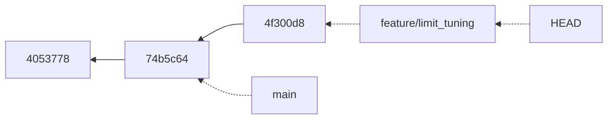
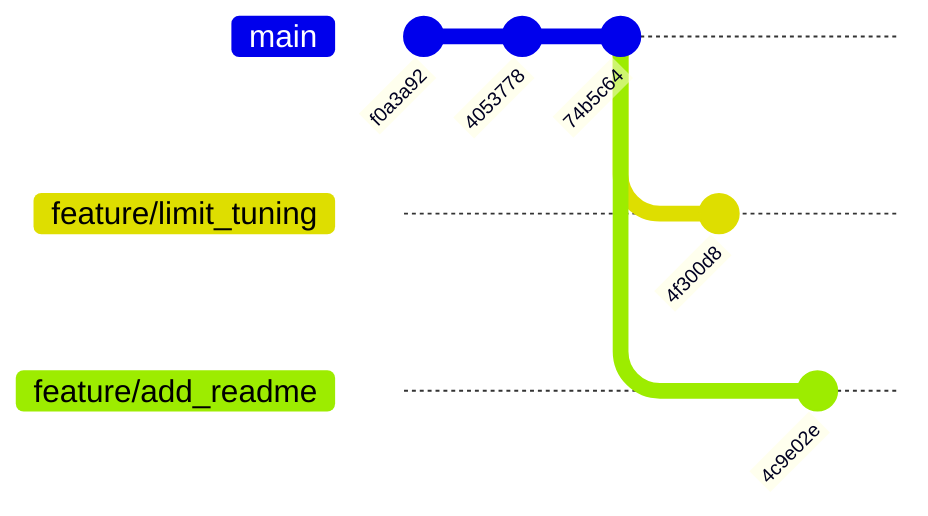

> **기준 출처:** [Pro Git 3.1 브랜치란 무엇인가](https://git-scm.com/book/ko/v2/Git-브랜치-브랜치란-무엇인가) · [git-switch](https://git-scm.com/docs/git-switch) · [git-branch](https://git-scm.com/docs/git-branch) / 확인일 2026-11-12 · git 2.55.0.windows.2
> **시리즈:** [목차](/posts/00-git-series/) | 이전 → [03. 이력 읽기](/posts/03-git-history/) | 다음 → [05. 합치기](/posts/05-git-merge/)

03편에서 `HEAD` 가 `refs/heads/main` 을 가리키는 파일이라는 것을 봤다. 이 편은 브랜치를 만들면 그 `refs/heads/` 아래에 파일이 하나 더 생길 뿐이라는 것을 연습 저장소에서 확인한다.

## 1. 브랜치를 만들면 파일 하나가 생긴다

Pro Git 3.1 은 Git 의 브랜치를 커밋 사이를 가볍게 이동하는 포인터 같은 것으로 설명한다. `.git` 을 열어 보면 그대로다.

```text
$ git branch
* main

$ git branch feature/limit_tuning
$ ls .git/refs/heads/
feature  main

$ cat .git/refs/heads/main
74b5c648bbd8244ecaeb93e1d392a46f553aaf92
$ cat .git/refs/heads/feature/limit_tuning
74b5c648bbd8244ecaeb93e1d392a46f553aaf92
```

`git branch <이름>` 은 만들기만 하고 옮겨 가지는 않으며, 인자 없이 실행하면 브랜치 목록을 보여 준다(Pro Git 3.3). 두 파일의 내용이 같다. 새 브랜치는 지금 커밋을 가리키는 파일이 하나 늘어난 것이고 커밋은 복사되지 않았다. Pro Git 3.1 의 표현으로 브랜치 하나를 만드는 것은 40자 해시와 줄바꿈, 41바이트 파일 하나를 만드는 것에 불과하다.

브랜치 이름의 `/` 는 폴더가 된다. `feature/limit_tuning` 이 `refs/heads/feature/limit_tuning` 에 생긴 것을 위 출력에서 볼 수 있다.

> 이 모양은 새로 만든 저장소에서 본 것이다. 참조가 많은 저장소에서는 `git pack-refs` 로 참조를 `.git/packed-refs` 한 파일에 모아 둘 수 있어서([git-pack-refs](https://git-scm.com/docs/git-pack-refs)), `refs/heads/` 에 파일이 없어도 브랜치는 있을 수 있다. 목록은 `git branch` 로 본다.
{: .prompt-info }

## 2. `switch` 하면 HEAD 의 한 줄이 바뀐다

```text
$ git switch feature/limit_tuning
Switched to branch 'feature/limit_tuning'

$ cat .git/HEAD
ref: refs/heads/feature/limit_tuning
```

03편에서 본 `ref: refs/heads/main` 이 다른 브랜치 이름으로 바뀌었다. 여기서 커밋하면 HEAD 가 가리키는 브랜치만 앞으로 간다.

```text
$ printf 'timeout_ms = 800\n' > limits.txt
$ git commit -am "타임아웃 500 -> 800"

$ git log --oneline --all --graph
* 4f300d8 타임아웃 500 -> 800
* 74b5c64 limits.txt 추가 — 타임아웃
* 4053778 모터 속도 100 -> 120
* f0a3a92 config.txt 추가 — 모터 속도 기본값
```

커밋 뒤 두 브랜치 파일의 내용은 이렇게 됐다.

```text
main                  74b5c648bbd8244ecaeb93e1d392a46f553aaf92
feature/limit_tuning  4f300d8e375a0d1272535bcf33c73c37e536a81a
```



`main` 은 그대로 `74b5c64` 에 있다. Pro Git 3.1 의 그림과 같은 결과다. 새로 커밋한 브랜치는 앞으로 가고 다른 브랜치는 이전 커밋을 가리킨 채 남는다. 브랜치가 갈라졌다는 말은 두 포인터가 서로 다른 커밋을 가리키게 됐다는 뜻이다.

## 3. 작업 폴더의 파일도 바뀐다

처음 쓰면 가장 놀라는 부분이다.

```text
$ cat limits.txt
timeout_ms = 800

$ git switch main
Switched to branch 'main'
$ cat limits.txt
timeout_ms = 500
```

`switch` 는 HEAD 파일만 바꾸지 않는다. git-switch 문서는 작업 폴더와 스테이징을 그 브랜치에 맞게 갱신한다고 적고 있고, Pro Git 3.1 도 브랜치를 옮기면 워킹 디렉토리의 파일이 그 브랜치의 마지막 작업 내용으로 바뀐다고 설명한다. 편집기에 `limits.txt` 를 열어 둔 채 전환하면 편집기 내용이 그 자리에서 바뀐다.

이 성질에서 두 가지가 따라 나온다.

| 결과 | 무엇 | 대응 |
| --- | --- | --- |
| 작업 폴더 하나에 브랜치 하나 | 한 폴더에서 두 브랜치를 동시에 펼쳐 둘 수 없다 | 07편 워크트리 |
| 커밋하지 않은 수정이 있으면 전환이 멈출 수 있다 | 로컬 수정을 잃게 되는 전환이면 git 이 중단한다(git-switch) | 커밋하거나 `stash` 로 치운 뒤 옮긴다 (06편) |

## 4. `switch -c` — 만들고 바로 옮기기

```text
$ git switch -c feature/add_readme
Switched to a new branch 'feature/add_readme'
$ printf '# demo\n' > README.md
$ git add README.md && git commit -m "README 추가"
$ git switch main

$ git log --oneline --all --graph
* 4c9e02e README 추가
| * 4f300d8 타임아웃 500 -> 800
|/
* 74b5c64 limits.txt 추가 — 타임아웃
```

`git switch -c <새 브랜치>` 는 `git branch <새 브랜치>` 와 `git switch <새 브랜치>` 를 한 번에 하되, 전환이 성공할 때만 브랜치를 만든다([git-switch](https://git-scm.com/docs/git-switch)).



`main` 에서 두 갈래가 나갔다. 둘을 다시 하나로 만드는 것이 05편이다.

## 5. `checkout` 과 `switch`

예전 문서와 많은 글은 `git checkout <브랜치>` 를 쓴다. Git 2.23 에서 `checkout` 이 하던 두 가지 일을 `switch` 와 `restore` 두 명령으로 나눴다([2.23.0 릴리스 노트](https://github.com/git/git/blob/master/Documentation/RelNotes/2.23.0.adoc)).

| 예전 명령 | 지금 명령 | 무엇 |
| --- | --- | --- |
| `git checkout <브랜치>` | `git switch <브랜치>` | 브랜치 옮기기 |
| `git checkout -b <새 브랜치>` | `git switch -c <새 브랜치>` | 만들고 옮기기 |
| `git checkout -- <파일>` | `git restore <파일>` | 파일 되돌리기 (06편) |

예전 명령도 그대로 동작한다. 이 시리즈는 뜻이 갈려 있어 헷갈릴 일이 적은 새 이름을 쓴다.

## 6. 정리

- 브랜치는 `.git/refs/heads/<이름>` 파일 한 줄이다. 만드는 데 드는 비용이 거의 없다
- `switch` 는 HEAD 한 줄을 바꾸고 작업 폴더를 그 브랜치 끝 커밋의 스냅샷으로 바꾼다
- 그래서 작업 폴더 하나에는 브랜치 하나만 펼쳐진다. 이 제약을 푸는 것이 07편 워크트리다

## 참고

- [Pro Git 3.1 Git 브랜치 - 브랜치란 무엇인가](https://git-scm.com/book/ko/v2/Git-브랜치-브랜치란-무엇인가)
- [Pro Git 3.3 Git 브랜치 - 브랜치 관리](https://git-scm.com/book/ko/v2/Git-브랜치-브랜치-관리)
- [git-branch](https://git-scm.com/docs/git-branch)
- [git-switch](https://git-scm.com/docs/git-switch)
- [git-pack-refs](https://git-scm.com/docs/git-pack-refs)
- [Git 2.23.0 릴리스 노트](https://github.com/git/git/blob/master/Documentation/RelNotes/2.23.0.adoc)
