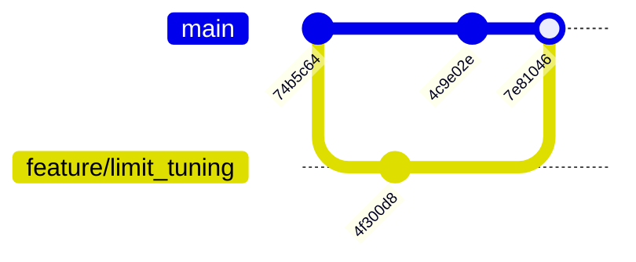
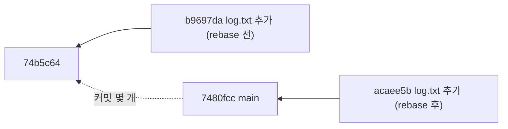

> **기준 출처:** [Pro Git 3.2 브랜치와 Merge 의 기초](https://git-scm.com/book/ko/v2/Git-브랜치-브랜치와-Merge-의-기초) · [Pro Git 3.6 Rebase 하기](https://git-scm.com/book/ko/v2/Git-브랜치-Rebase-하기) · [git-merge](https://git-scm.com/docs/git-merge) / 확인일 2026-11-12 · git 2.55.0.windows.2
> **시리즈:** [목차](/posts/00-git-series/) | 이전 → [04. 브랜치는 포인터다](/posts/04-git-branch-pointer/) | 다음 → [06. 되돌리기와 안전망](/posts/06-git-undo/)

04편 끝에서 `main` 의 `74b5c64` 로부터 두 갈래가 나갔다. 이 편은 둘을 `main` 으로 다시 합친다.

## 1. Fast-forward — 포인터만 옮긴다

`feature/add_readme` 의 `4c9e02e` 는 `main` 이 가리키는 `74b5c64` 바로 위에 있다.

```text
$ git switch main
$ git merge feature/add_readme
Updating 74b5c64..4c9e02e
Fast-forward
 README.md | 1 +
 1 file changed, 1 insertion(+)

$ git log --oneline --all --graph --decorate
* 4c9e02e (HEAD -> main, feature/add_readme) README 추가
| * 4f300d8 (feature/limit_tuning) 타임아웃 500 -> 800
|/
* 74b5c64 limits.txt 추가 — 타임아웃
```

`main` 이 합칠 브랜치의 조상이었으므로 새 커밋 없이 `main` 을 앞으로 밀기만 했다. 두 이름이 같은 커밋 `4c9e02e` 에 붙어 있다. Pro Git 3.2 가 말하는 Fast forward 다. 그래도 merge 커밋을 남기려면 `--no-ff` 를 준다([git-merge](https://git-scm.com/docs/git-merge)).

## 2. 3-way merge — 새 커밋이 생긴다

이번에는 `feature/limit_tuning` 의 `4f300d8` 을 합친다. 지금 `main` 의 `4c9e02e` 는 이 브랜치의 조상이 아니다. 둘 다 `74b5c64` 에서 갈라져 한 걸음씩 갔다.

```text
$ git merge feature/limit_tuning -m "feature/limit_tuning 을 main 에 합친다"
Merge made by the 'ort' strategy.
 limits.txt | 2 +-
 1 file changed, 1 insertion(+), 1 deletion(-)

$ git log --oneline --all --graph --decorate
*   7e81046 (HEAD -> main) feature/limit_tuning 을 main 에 합친다
|\
| * 4f300d8 (feature/limit_tuning) 타임아웃 500 -> 800
* | 4c9e02e (feature/add_readme) README 추가
|/
* 74b5c64 limits.txt 추가 — 타임아웃
```

Git 은 공통 조상 `74b5c64`, 지금 브랜치 끝 `4c9e02e`, 합칠 브랜치 끝 `4f300d8` 세 스냅샷을 써서 합친 결과를 새 커밋으로 만든다(Pro Git 3.2). 그래서 3-way 이고, 결과 `7e81046` 은 부모가 둘인 merge 커밋이다.



`'ort'` 는 지금 한 브랜치를 합칠 때의 기본 전략 이름이다. Git 2.33 까지는 `recursive` 가 기본이었다([merge-strategies](https://git-scm.com/docs/merge-strategies)). 그래서 Pro Git 한국어판 예제에는 `'recursive' strategy` 로 찍혀 있다.

| | Fast-forward | 3-way |
| --- | --- | --- |
| 조건 | 지금 브랜치가 합칠 브랜치의 조상 | 둘이 갈라져 있음 |
| 새 커밋 | 없음 | merge 커밋 하나 (부모 둘) |
| 이력 모양 | 직선 | 갈라졌다 다시 만난다 |
| 충돌 | 생기지 않는다 | 생길 수 있다 |

## 3. 충돌 — 같은 곳을 양쪽이 다르게 고쳤을 때

같은 파일의 같은 부분을 양쪽이 다르게 고쳤으면 Git 은 자동으로 합치지 못하고 merge 커밋도 만들지 않는다(Pro Git 3.2). `main` 에서 `fix/speed_a`(속도 150)와 `fix/speed_b`(속도 90)를 갈라 `config.txt` 의 같은 줄을 고친 뒤, A 를 먼저 합치고 B 를 합쳤다.

```text
$ git merge fix/speed_b
Auto-merging config.txt
CONFLICT (content): Merge conflict in config.txt
Automatic merge failed; fix conflicts and then commit the result.

$ git status --short
UU config.txt

$ cat config.txt
<<<<<<< HEAD
motor_speed = 150
=======
motor_speed = 90
>>>>>>> fix/speed_b
```

종료 코드는 1 이었고, `UU` 는 양쪽이 고친 채 풀리지 않았다는 표시다(02편). `=======` 위는 지금 브랜치(`HEAD`) 쪽, 아래는 합치려는 브랜치 쪽 내용이다([git-merge](https://git-scm.com/docs/git-merge)).

푸는 절차는 셋이다. 파일을 열어 표시를 지우고 남길 내용만 둔다. `git add` 로 해결했다고 알린다. `git commit` 으로 merge 커밋을 만든다. `git commit` 대신 `git merge --continue` 를 써도 된다.

```text
$ printf 'motor_speed = 150\n' > config.txt
$ git add config.txt
$ git commit -m "충돌 해결 — A안(150) 채택"

$ git log --oneline --graph --decorate -4
*   7480fcc (HEAD -> main) 충돌 해결 — A안(150) 채택
|\
| * 58a7fd3 (fix/speed_b) 속도 90 (B안)
* | 0cad026 (fix/speed_a) 속도 150 (A안)
|/
```

> Git 은 `git add` 를 충돌이 풀렸다는 표시로 받아들인다(Pro Git 3.2). 표시를 지우지 않고 `add` 하면 `<<<<<<<` 가 그대로 커밋된다. `git diff --cached --check` 는 새로 들어가는 줄에 충돌 표시가 있으면 경고한다([git-diff](https://git-scm.com/docs/git-diff)).
{: .prompt-warning }

그만두려면 `git merge --abort` 로 합치기 전 상태로 돌아간다. 시작할 때 커밋하지 않은 수정이 있었다면 그것은 되살리지 못할 수 있으니 합치기 전에 커밋하거나 stash 해 둔다([git-merge](https://git-scm.com/docs/git-merge)).

## 4. rebase — 갈라진 커밋을 끝에 다시 만든다

merge 커밋 없이 직선 이력으로 합치고 싶을 때 쓴다. 지금 브랜치의 커밋들이 만든 변경을 상대 브랜치 끝에 차례로 다시 적용한다(Pro Git 3.6, [git-rebase](https://git-scm.com/docs/git-rebase)).

`74b5c64` 에서 `feature/rebase_demo` 를 갈라 `log.txt` 를 추가한 뒤 `main` 위로 옮겼다.

```text
--- rebase 전
* b9697da (HEAD -> feature/rebase_demo) log.txt 추가
| *   7480fcc (main) 충돌 해결 — A안(150) 채택
| |\
...

$ git rebase main
Successfully rebased and updated refs/heads/feature/rebase_demo.

--- rebase 후
* acaee5b (HEAD -> feature/rebase_demo) log.txt 추가
*   7480fcc (main) 충돌 해결 — A안(150) 채택
|\
...
```

같은 "log.txt 추가" 인데 해시가 `b9697da` 에서 `acaee5b` 로 바뀌었다. 커밋 개체에는 부모가 들어가고 해시는 그 내용으로 계산되는데(Pro Git 10.2), 부모가 `74b5c64` 에서 `7480fcc` 로 바뀌었으니 다른 커밋이다. Pro Git 3.6 도 rebase 가 내용은 같지만 다른 커밋을 새로 만든다고 설명한다.



이 뒤에 `git switch main` 과 `git merge feature/rebase_demo` 를 하면 Fast-forward 가 되어 직선 이력이 남는다.

### merge 와 rebase 고르기

Pro Git 3.6 의 규칙은 이미 공개 저장소에 Push 한 커밋을 Rebase 하지 말라는 것이다. 남이 옛 커밋을 받아 간 뒤에 바꿔 버리면 상대 쪽에는 같은 내용의 커밋이 둘 생기고 다시 합쳐야 한다. 로컬 브랜치를 정리할 때는 써도 된다는 것이 같은 절의 결론이다.

| 상황 | 고르는 것 |
| --- | --- |
| PC 안에서만 있던 브랜치를 `main` 끝으로 옮겨 직선으로 합치고 싶다 | rebase 뒤 fast-forward |
| 이미 남과 공유한 브랜치이거나, 언제 합쳤는지를 이력에 남기고 싶다 | merge |
| 판단이 서지 않는다 | merge. 기존 커밋을 바꾸지 않으므로 잃는 것이 없다고 판단된다 |

## 5. 정리

- Fast-forward 는 이름만 앞으로 민다. 3-way 는 공통 조상과 양쪽 끝으로 merge 커밋을 만든다. 출력의 `Fast-forward` 와 `Merge made by` 로 어느 쪽인지 구분한다
- 충돌은 같은 곳을 양쪽이 다르게 고친 것이다. 표시를 지우고 `add` 한 뒤 `commit` 한다
- rebase 는 커밋을 상대 끝에 새로 만든다. 해시가 바뀌므로 공유한 커밋에는 쓰지 않는다

## 참고

- [Pro Git 3.2 Git 브랜치 - 브랜치와 Merge 의 기초](https://git-scm.com/book/ko/v2/Git-브랜치-브랜치와-Merge-의-기초)
- [Pro Git 3.6 Git 브랜치 - Rebase 하기](https://git-scm.com/book/ko/v2/Git-브랜치-Rebase-하기)
- [Pro Git 10.2 Git의 내부 - Git 개체](https://git-scm.com/book/ko/v2/Git의-내부-Git-개체)
- [git-merge](https://git-scm.com/docs/git-merge)
- [merge-strategies](https://git-scm.com/docs/merge-strategies)
- [git-rebase](https://git-scm.com/docs/git-rebase)
- [git-diff](https://git-scm.com/docs/git-diff)
