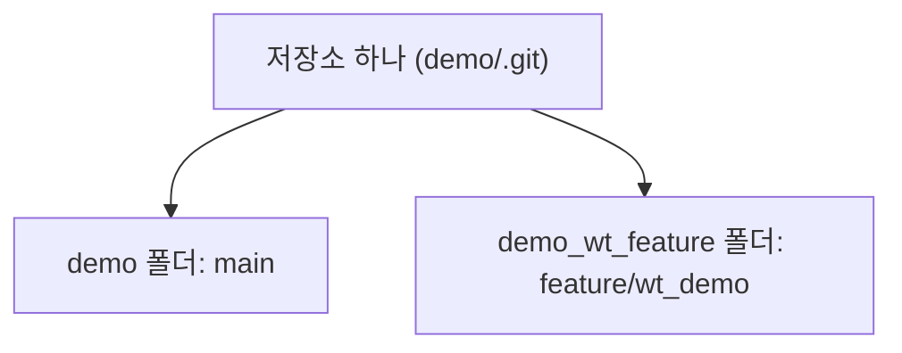

> **기준 출처:** [git-worktree](https://git-scm.com/docs/git-worktree) / 확인일 2026-11-12 · git 2.55.0.windows.2
> **시리즈:** [목차](/posts/00-git-series/) | 이전 → [06. 되돌리기와 안전망](/posts/06-git-undo/) | 다음 → [08. 워크트리의 제약과 함정](/posts/08-git-worktree-pitfalls/)

04편에서 본 대로 `switch` 는 작업 폴더의 파일을 그 브랜치 내용으로 바꾼다. 그래서 폴더 하나는 한 번에 브랜치 하나만 보여준다. 06편의 `stash` 는 이 제약 안에서 버티는 방법이고, 워크트리는 폴더를 더 만들어 제약을 없앤다. 명령은 `worktree add`, `list`, `remove` 셋이다.

## 1. 저장소 하나, 작업 폴더 여럿

`main` 에서 빌드가 도는 동안 다른 브랜치에서 급한 수정을 하고 싶을 때, 또는 두 브랜치를 나란히 열어 비교하고 싶을 때 쓴다. git-worktree 문서의 예도 같다. 리팩터링 도중 급한 수정이 들어오면 `stash` 대신 임시 워크트리를 만들어 고치고, 끝나면 지운다.



문서의 용어로 `git init` 이나 `git clone` 이 만든 원래 폴더가 main worktree, `worktree add` 로 더 꺼낸 폴더가 linked worktree 다. 저장소 하나에 main worktree 는 하나, linked worktree 는 0개 이상이다.

## 2. `worktree add` — 폴더를 하나 더 꺼낸다

```text
$ git worktree add -b feature/wt_demo ../demo_wt_feature
Preparing worktree (new branch 'feature/wt_demo')
HEAD is now at a0d9ec0 Revert "log.txt 추가 (로그 레벨 기본값 2)"

$ git worktree list
~/git-practice/demo            a0d9ec0 [main]
~/git-practice/demo_wt_feature a0d9ec0 [feature/wt_demo]
```

출력의 경로는 홈 폴더를 `~` 로 줄여 적었다.

| 형태 | 하는 일 |
| --- | --- |
| `git worktree add -b <새 브랜치> <폴더> [시작점]` | 브랜치를 새로 만들어 꺼낸다. 시작점을 빼면 HEAD 에서 딴다 |
| `git worktree add <폴더> <브랜치>` | 이미 있는 브랜치를 꺼낸다 |
| `git worktree add <폴더>` | 폴더 이름과 같은 브랜치를 꺼낸다. 없으면 HEAD 에서 새로 만든다 |

문서의 예처럼 저장소 옆(`../`)에 둔다. 이제 두 폴더가 서로 다른 브랜치를 동시에 들고 있다.

```text
$ git -C ../demo rev-parse --abbrev-ref HEAD
main
$ git -C ../demo_wt_feature rev-parse --abbrev-ref HEAD
feature/wt_demo
```

## 3. 새 폴더의 `.git` 은 파일이다

```text
$ ls -la ../demo_wt_feature
-rw-r--r-- 1 user group 72 Sep 15 09:16 .git
-rw-r--r-- 1 user group  8 Sep 15 09:16 README.md
-rw-r--r-- 1 user group 19 Sep 15 09:16 config.txt
-rw-r--r-- 1 user group 18 Sep 15 09:16 limits.txt

$ cat ../demo_wt_feature/.git
gitdir: ~/git-practice/demo/.git/worktrees/demo_wt_feature
```

`.git` 줄의 맨 앞 글자가 `d` 가 아니라 `-` 다. 저장소를 복사하지 않았고, 새 폴더에는 원래 저장소 안의 전용 폴더를 가리키는 한 줄만 있다. 그 전용 폴더에는 이 워크트리 몫의 작은 파일만 있다.

```text
$ ls .git/worktrees/demo_wt_feature/
HEAD  ORIG_HEAD  commondir  gitdir  index  logs  refs
$ cat .git/worktrees/demo_wt_feature/HEAD
ref: refs/heads/feature/wt_demo
```

git-worktree 문서는 linked worktree 안에서 `$GIT_DIR` 은 이 전용 폴더를, `$GIT_COMMON_DIR` 은 main worktree 의 `.git` 을 가리키고, 그 설정이 새 폴더 맨 위의 `.git` 파일에 들어 있다고 설명한다. `HEAD`, `index` 같은 워크트리별 파일을 빼면 나머지는 공유한다.

| 워크트리마다 따로 | 저장소에 하나 (공유) |
| --- | --- |
| `HEAD` (지금 어느 브랜치인가) | 커밋 개체 (`objects/`) |
| `index` (스테이징) | `refs/` 아래 전부: 브랜치, 태그, `refs/stash` |
| | 설정 파일 `config` (기본값) |

문서에 따르면 `refs/` 로 시작하는 ref 는 공유하고 `HEAD` 같은 pseudo ref 는 워크트리마다 따로 둔다(`refs/bisect`, `refs/worktree`, `refs/rewritten` 은 예외로 따로 둔다). 설정을 워크트리마다 다르게 하려면 `extensions.worktreeConfig` 를 켠다.

## 4. 커밋은 모두에게 보이고 파일은 그 폴더에만 있다

워크트리에서 커밋한 뒤 원래 폴더에서 이력을 본다.

```text
$ cd ../demo_wt_feature
$ printf 'ramp_ms = 300\n' > ramp.txt
$ git add ramp.txt && git commit -m "ramp.txt 추가 (워크트리에서)"

$ cd ../demo
$ git log --oneline --all --graph --decorate -3
* 5f2892a (feature/wt_demo) ramp.txt 추가 (워크트리에서)
* a0d9ec0 (HEAD -> main) Revert "log.txt 추가 (로그 레벨 기본값 2)"
* c604dcf log.txt 추가 (로그 레벨 기본값 2)

$ ls
README.md  config.txt  limits.txt
```

`demo` 폴더에서 새 커밋은 보이는데 `ramp.txt` 는 없다. 커밋은 공유하는 저장소에 있고, 파일은 그 브랜치를 꺼낸 폴더에만 있기 때문이다. `feature/wt_demo` 를 `main` 에 합치면(05편) 그때 나타난다. 커밋이 어디 있는가와 파일이 어디 있는가는 다른 질문이다.

## 5. `worktree remove` — 폴더와 등록을 지운다

```text
$ git worktree remove ../demo_wt_feature
$ git worktree list
~/git-practice/demo a0d9ec0 [main]

$ git branch
  feature/wt_demo
* main
```

폴더와 그 등록이 지워지고 브랜치와 커밋은 남는다. 워크트리는 브랜치를 꺼내 놓은 자리일 뿐이다. 브랜치까지 지우려면 `git branch -d feature/wt_demo` 를 따로 한다.

`remove` 는 깨끗한 워크트리만 지운다. 추적하지 않는 파일이나 커밋하지 않은 수정이 있으면 거부하고, `--force` 를 줘야 지운다. main worktree 는 지울 수 없다.

## 6. 에이전트를 나란히 돌릴 때

에이전트 둘이 같은 폴더에서 일하면 한쪽이 고치는 파일을 다른 쪽이 읽거나 덮어쓴다. 워크트리로 폴더를 나누면 저장소는 하나로 두고 파일만 갈라진다. 각자 자기 브랜치에서 커밋하고, 끝나면 그 브랜치를 `main` 에 합친다. Claude Code 와 Codex 를 한 저장소에 붙일 때의 구성은 [08. Claude Code 와 Codex 같이 쓰기](/posts/08-claude-and-codex/) 에 있다.

git 워크트리 위에 얹은 에이전트 작업 관리 도구 Orca 는 작업마다 이 워크트리를 하나씩 만들어 준다. 쓰다가 뺀 이유는 [10. 터미널에서 에이전트 여럿 돌리기](/posts/10-agent-multiplexer/) 에 적었다.

## 7. 정리

- `git worktree add -b <브랜치> ../<폴더>` 로 저장소 하나에서 폴더를 더 꺼낸다. `switch` 도 `stash` 도 필요 없다
- 새 폴더의 `.git` 은 파일이고 원래 저장소를 가리킨다. `HEAD` 와 스테이징은 폴더마다, 커밋과 브랜치는 공유한다
- 커밋은 모든 폴더에서 보이고 파일은 그 브랜치를 꺼낸 폴더에만 있다
- `remove` 는 폴더와 등록만 지운다. 브랜치는 남는다

## 참고

- [git-worktree](https://git-scm.com/docs/git-worktree)
- [Orca Docs: Worktrees](https://orca.dev/docs/model/worktrees)
