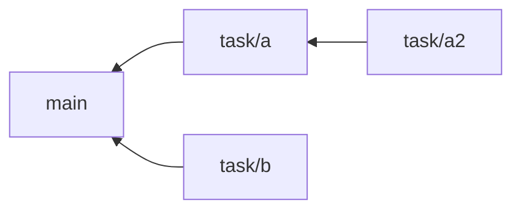

> **기준 출처:** [Pro Git 3.4 브랜치 워크플로](https://git-scm.com/book/ko/v2/Git-브랜치-브랜치-워크플로) · [Pro Git 3.3 브랜치 관리](https://git-scm.com/book/ko/v2/Git-브랜치-브랜치-관리) · [GitHub Docs, GitHub flow](https://docs.github.com/en/get-started/using-github/github-flow) / 확인일 2026-11-12 · git 2.55.0.windows.2
> **시리즈:** [목차](/posts/00-git-series/) | 이전 → [08. 워크트리의 제약과 함정](/posts/08-git-worktree-pitfalls/) | 다음 → [01. 원격 저장소](/posts/01-github-remote/)

04편부터 08편까지가 브랜치와 워크트리가 어떻게 움직이는지였다면, 이 편은 브랜치를 언제 따고, 어디서 따고, 언제 지우는지를 정한다. 새로 나오는 명령은 `git branch --merged` 하나다.

## 1. 작업 하나에 브랜치 하나

Pro Git 3.4 는 한 가지 주제나 작업을 위해 만드는 짧은 브랜치를 토픽 브랜치라고 부른다. Git 에서는 브랜치를 만들고 합치고 지우는 일이 일상이고, 주제별로 나눠 두면 검토와 테스트가 쉬우며 합치는 순서도 자유롭다. GitHub flow 도 같은 것을 두 문장으로 적는다.

> *"Make a separate branch for each set of unrelated changes."*
> *"After you merge your pull request, delete your branch."*
> — [GitHub Docs, GitHub flow](https://docs.github.com/en/get-started/using-github/github-flow)

관련 없는 변경 둘을 한 브랜치에 섞으면 하나만 합치거나 하나만 되돌리고 싶을 때 나눌 수 없다. 여기에 07편의 워크트리를 얹으면 이 편의 규칙이 된다. **작업 하나에 브랜치 하나, 그 브랜치를 꺼낸 워크트리 하나.**

## 2. 어디서 따나 — 독립과 쌓기

같은 `main` 에서 작업 둘을 따고, 하나는 다른 작업 위에서 딴다.

```text
$ git switch -c task/a main      # a.txt 커밋
$ git switch -c task/b main      # b.txt 커밋
$ git switch -c task/a2 task/a   # a2.txt 커밋

$ git log --oneline --all --graph --decorate -7
* 2eb4676 (task/a2) 작업 A 의 후속 A2
* 4818107 (task/a) 작업 A
| * a05c1af (task/b) 작업 B
|/
| * 5f2892a (feature/wt_demo) ramp.txt 추가 (워크트리에서)
|/
* a0d9ec0 (HEAD -> main) Revert "log.txt 추가 (로그 레벨 기본값 2)"
```



| | 독립 (`task/a`, `task/b`) | 쌓기, stacked (`task/a2`) |
| --- | --- | --- |
| 시작점 | `main` | 다른 작업 브랜치 |
| 서로의 관계 | 모른다. 어느 순서로 합쳐도 된다 | A2 는 A 를 포함한다. A2 를 합치면 A 도 들어간다 |
| A 가 반려되면 | B 는 영향이 없다 | A2 도 같이 막힌다 |
| 쓸 때 | 기본값 | A 의 결과 위에서만 할 수 있는 후속 작업 |

기본은 독립이다. 새 브랜치는 시작점을 주지 않으면 지금 HEAD 에서 따지므로(git-branch), 작업 브랜치에 있는 채로 `switch -c` 하면 의도하지 않게 쌓기가 된다. 따기 전에 `git branch` 로 지금 위치를 보거나 시작점을 적는다. 워크트리로 딸 때도 같다.

```text
$ git switch -c <새 브랜치> main
$ git worktree add -b <새 브랜치> ../<폴더> main
```

## 3. 언제 지우나 — 합친 뒤 바로

```text
$ git merge task/a
$ git branch --merged main
* main
  task/a
$ git branch --no-merged main
  feature/wt_demo
  task/a2
  task/b

$ git branch -d task/a
Deleted branch task/a (was 4818107).
```

`--merged` 는 끝 커밋이 기준 커밋에서 닿는 브랜치만 보여준다. 그 커밋이 전부 `main` 에 있으니 지워도 잃는 것이 없다(Pro Git 3.3). `-d` 는 합쳐지지 않은 브랜치를 거부하고 `-D` 는 강제로 지우므로, `--no-merged` 에 나오는 브랜치는 지우기 전에 한 번 더 본다.

지우지 않으면 어느 브랜치가 진행 중인지 알기 어렵고 끝난 브랜치 위에서 새 작업을 따게 된다. GitHub flow 도 지운 브랜치는 작업이 끝났다는 표시이고 옛 브랜치를 실수로 쓰는 일을 막는다고 설명한다. 워크트리를 쓰면 순서가 하나 늘어난다. `git worktree remove` 가 먼저, `git branch -d` 가 나중이다(08편).

## 4. 한 작업의 수명

| 단계 | Git | GitHub |
| --- | --- | --- |
| ① 시작 | `git worktree add -b <작업> ../<폴더> main` | — |
| ② 작업 | 그 폴더에서 `add`, `commit` | — |
| ③ 검토 | `git diff main...<작업>` | Pull Request |
| ④ 합치기 | `git merge <작업>` | PR 의 merge |
| ⑤ 정리 | `git worktree remove ../<폴더>`, `git branch -d <작업>` | 브랜치 삭제 |

`git diff main...<작업>` 은 두 브랜치가 갈라진 지점부터 그 작업 브랜치가 바꾼 것만 보여준다(git-diff). GitHub 열은 [03. PR 흐름](/posts/03-github-pr-flow/) 에서 다룬다. 도구가 바뀌어도 다섯 단계는 같다.

## 5. `main` 에는 합쳐진 것만

이 방식은 `main` 에 직접 커밋하지 않고 합친 것만 둔다는 전제 위에 선다. Pro Git 3.4 의 long-running 브랜치 설명도 안정된 코드만 `master` 에 합쳐 두는 방식을 소개한다. 그래야 ①에서 어느 작업이든 동작하는 상태에서 출발하고, 문제 있는 작업은 ③에서 걸러진다.

혼자 쓰는 저장소라면 `main` 에 바로 커밋해도 크게 문제 되지 않지만, 에이전트가 `main` 에 직접 커밋하면 ③ 검토가 빠진다.

## 6. 코딩 에이전트 여럿을 나란히 돌릴 때

이 규칙에서 에이전트 하나가 워크트리 하나를 맡으면 여럿을 나란히 돌리는 구성이 된다.

| 지키는 것 | 막는 것 |
| --- | --- |
| 에이전트마다 워크트리 하나 | 같은 파일을 둘이 동시에 고치는 일 |
| 워크트리마다 새 브랜치 (`-b`, 시작점 `main`) | 같은 브랜치 두 곳 거부(08편), 의도하지 않은 쌓기 |
| 합치는 쪽은 하나 | 검토 없이 `main` 이 바뀌는 일 |
| 끝나면 `remove` 다음 `branch -d` | 남은 브랜치와 등록 |

Claude Code 와 Codex 를 한 저장소에서 같이 쓸 때 폴더와 브랜치를 가르는 법은 [08. Claude Code 와 Codex 같이 쓰기](/posts/08-claude-and-codex/) 에 있다. 이 규칙을 앱으로 만든 것이 git 워크트리 위에 얹은 에이전트 작업 관리 도구 Orca 이고, 쓰다가 뺀 이유와 지금의 구성은 [10. 터미널에서 에이전트 여럿 돌리기](/posts/10-agent-multiplexer/) 에 적었다.

## 7. 정리

- 작업 하나에 브랜치 하나, 워크트리 하나, 에이전트를 쓰면 에이전트 하나
- `main` 에서 딴다. 쌓기는 일부러 할 때만 쓰고 시작점을 적는다
- 합친 뒤 바로 지운다. `--merged` 로 고르고, 워크트리가 있으면 `remove` 가 먼저다

## 참고

- [Pro Git 3.4 Git 브랜치 - 브랜치 워크플로](https://git-scm.com/book/ko/v2/Git-브랜치-브랜치-워크플로)
- [Pro Git 3.3 Git 브랜치 - 브랜치 관리](https://git-scm.com/book/ko/v2/Git-브랜치-브랜치-관리)
- [GitHub Docs: GitHub flow](https://docs.github.com/en/get-started/using-github/github-flow)
- [git-branch](https://git-scm.com/docs/git-branch)
- [git-worktree](https://git-scm.com/docs/git-worktree)
- [git-diff](https://git-scm.com/docs/git-diff)
- [Orca Docs: Worktrees](https://orca.dev/docs/model/worktrees)
