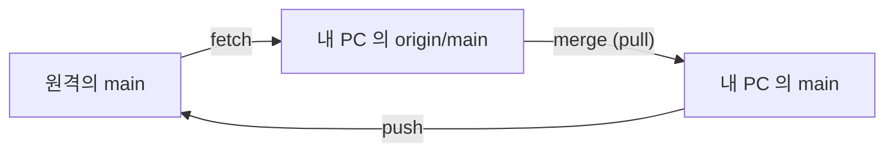

> **기준 출처:** [Pro Git 2.5 리모트 저장소](https://git-scm.com/book/ko/v2/Git의-기초-리모트-저장소) · [Pro Git 3.5 리모트 브랜치](https://git-scm.com/book/ko/v2/Git-브랜치-리모트-브랜치) · [git-push](https://git-scm.com/docs/git-push) / 확인일 2026-11-12 · git 2.55.0.windows.2
> **시리즈:** [목차](/posts/00-git-series/) | 이전 → [09. 브랜치 전략](/posts/09-git-branch-strategy/) | 다음 → [02. GitHub 가 얹는 것](/posts/02-github-what-it-adds/)

GitHub Docs 는 원격 URL 을 *"the place where your code is stored"* 라고 부른다. 그곳이 인터넷이든 옆 폴더든 Git 은 같은 명령을 쓰므로, 이 편은 원격을 PC 안의 bare 저장소로 흉내 내 네트워크 없이 실습했다. 출력은 실제 실행 결과이고(긴 줄은 `...` 로 줄였다), 해시는 따라 해도 다르게 나온다.

## 1. 원격 만들기 — `--bare` 와 `remote add`

Bare 저장소는 워킹 디렉토리가 없는 저장소이고, 서버에 두는 저장소는 이 형태로 만든다(Pro Git 4.2). `demo` 는 커밋 하나가 있는 연습 저장소다.

```text
$ cd ~/git-practice
$ git init --bare remote_demo.git
Initialized empty Git repository in ~/git-practice/remote_demo.git/
$ ls remote_demo.git
HEAD  config  description  hooks  info  objects  refs
$ cd demo
$ git remote add origin ../remote_demo.git
$ git remote -v
origin	../remote_demo.git (fetch)
origin	../remote_demo.git (push)
```

`origin` 은 원격의 별명이다. `clone` 하면 이 이름으로 자동 등록되고, `git remote add <이름> <주소>` 로 더 둘 수 있다.

## 2. push 와 `origin/main`

```text
$ git push -u origin main
To ../remote_demo.git
 * [new branch]      main -> main
branch 'main' set up to track 'origin/main'.
$ git branch -a -vv
* main                0497970 [origin/main] 작업 A
  remotes/origin/main 0497970 작업 A
$ cat .git/refs/remotes/origin/main
04979706af2486f21e61a0547ecd0b31b18a7083
```

원격에는 `main` 이 생겼고, 내 PC 에는 `origin/main` 이 생겼다. `-u` 는 `.git/config` 의 `[branch "main"]` 에 upstream 을 적어 다음부터 `git push`, `git pull` 만 쳐도 되게 한다.

`origin/main` 은 원격에 있는 것이 아니라 내 `.git/refs/remotes/` 아래의 파일이고, 내용은 해시 한 줄이다. Pro Git 3.5 는 리모트 트래킹 브랜치를 로컬에 있지만 임의로 움직일 수 없고, 리모트에 연결할 때마다 갱신되는 북마크라고 설명한다.



## 3. fetch 와 pull — 다른 곳에서 push 했을 때

같은 원격을 `demo_clone` 으로 한 번 더 clone 해 동료 PC 로 쓰고, 거기서 커밋하고 push 했다.

```text
$ git clone remote_demo.git demo_clone
Cloning into 'demo_clone'...
done.
(demo_clone 에서 커밋한 뒤)
$ git push
To ~/git-practice/remote_demo.git
   0497970..a9a469e  main -> main

(demo 로 돌아와서)
$ git status -sb
## main...origin/main
$ git fetch
From ../remote_demo
   0497970..a9a469e  main       -> origin/main
$ git status -sb
## main...origin/main [behind 1]
$ git pull
Updating 0497970..a9a469e
Fast-forward
 limits.txt | 1 +
 1 file changed, 1 insertion(+)
 create mode 100644 limits.txt
```

fetch 전의 `status` 는 차이가 없다고 나온다. `origin/main` 이 옛 위치 그대로이기 때문이다.

| 명령 | 내 `main` | 작업 폴더 | 하는 일 |
| --- | --- | --- | --- |
| `fetch` | 그대로 | 그대로 | 원격의 커밋을 가져와 `origin/main` 만 옮긴다 |
| `pull` | 움직인다 | 바뀐다 | `fetch` 뒤 upstream 을 현재 브랜치에 합친다 |

## 4. `[ahead N, behind M]` 읽기

| 표시 | 뜻 | 할 일 |
| --- | --- | --- |
| `[ahead 1]` | push 안 한 커밋이 1개 | `push` |
| `[behind 1]` | 안 받은 커밋이 1개 | `pull` |
| `[ahead 1, behind 1]` | 양쪽이 각자 커밋했다 | 5절 |

Pro Git 3.5 가 짚듯이 이 숫자는 마지막 fetch 시점 기준이라, `status` 전에 `fetch` 한다.

## 5. `! [rejected]` — 갈라진 뒤의 push

`demo` 와 `demo_clone` 에서 같은 줄을 각자 고쳐 커밋했고, `demo_clone` 이 먼저 push 했다.

```text
$ git push
To ../remote_demo.git
 ! [rejected]        main -> main (fetch first)
error: failed to push some refs to '../remote_demo.git'
hint: Updates were rejected because the remote contains work that you do not ...
$ git pull
From ../remote_demo
   ef0f43c..b1d22dd  main       -> origin/main
hint: You have divergent branches and need to specify how to reconcile them.
...
fatal: Need to specify how to reconcile divergent branches.
$ git status -sb
## main...origin/main [ahead 1, behind 1]
$ git log --oneline --graph --all -4
* df5a23a gain 2.5 (나)
| * b1d22dd gain 3.0 (동료)
|/
* ef0f43c gain 1.5 -> 2.0
* a9a469e limits.txt 추가 (동료 PC)
```

git-push 문서의 규칙으로 브랜치로의 push 는 fast-forward 일 때만 된다. 원격의 `main` 이 내 커밋의 조상이어야 하는데 동료의 커밋이 먼저 들어가 그 조건이 깨졌다. 옵션 없는 `git pull` 은 기본이 `--ff-only` 라서 fetch 만 하고 멈췄다. 3절은 fast-forward 가 되는 경우였다. 합치는 방식을 정해 준다.

```text
$ git pull --no-rebase
Auto-merging gain.txt
CONFLICT (content): Merge conflict in gain.txt
Automatic merge failed; fix conflicts and then commit the result.
(gain.txt 를 2.5 로 고치고 add, commit)
$ git push
To ../remote_demo.git
   b1d22dd..a9b1f79  main -> main
$ git status -sb
## main...origin/main
```

충돌은 [05편](/posts/05-git-merge/)과 같은 방법으로 푼다. `--rebase` 로 내 커밋을 원격 끝에 다시 쌓아도 된다. 매번 고르기 싫으면 hint 대로 `pull.rebase` 를 설정에 둔다.

> `git push --force` 는 fast-forward 검사를 끄고, git-push 문서는 원격이 커밋을 잃을 수 있다고 경고한다. 여기서 쓰면 동료의 커밋이 원격에서 사라진다. 덮어써야 한다면 원격 브랜치가 내 `origin/main` 과 같을 때만 덮는 `--force-with-lease` 를 쓴다.
{: .prompt-danger }

## 6. 실제 GitHub 저장소 — 주소와 인증만 다르다

이 블로그 저장소에서 읽기 명령만 돌렸다.

```text
$ cd ~/genie4youu.github.io
$ git remote -v
origin	https://github.com/genie4youu/genie4youu.github.io.git (fetch)
origin	https://github.com/genie4youu/genie4youu.github.io.git (push)
$ git branch -vv
* main d6e7e3d [origin/main] 글: Claude Code 세팅 4부 ...
$ git config --global credential.helper
manager
```

| 항목 | 로컬 bare 원격 | GitHub |
| --- | --- | --- |
| 주소 | `../remote_demo.git` | `https://github.com/<계정>/<저장소>.git` |
| 인증 | 없음 | HTTPS 는 비밀번호 자리에 개인 액세스 토큰, SSH 는 계정에 등록한 공개키 |
| 자격 증명 저장 | — | Git Credential Manager 같은 credential helper 가 기억한다. 이 PC 의 값은 `manager` |

## 7. 정리

- 원격은 다른 곳의 저장소이고 `origin` 은 별명이다. 옆 폴더의 bare 저장소로도 전부 연습할 수 있다
- `origin/main` 은 내 PC 의 파일이고 `fetch` 가 갱신한다. ahead, behind 는 마지막 fetch 기준이다
- push 는 fast-forward 만 된다. 거부되면 먼저 합치고 push 한다

## 참고

- [Pro Git 2.5 리모트 저장소](https://git-scm.com/book/ko/v2/Git의-기초-리모트-저장소)
- [Pro Git 3.5 리모트 브랜치](https://git-scm.com/book/ko/v2/Git-브랜치-리모트-브랜치)
- [Pro Git 4.2 서버에 Git 설치하기](https://git-scm.com/book/ko/v2/Git-서버-서버에-Git-설치하기)
- [git-fetch](https://git-scm.com/docs/git-fetch)
- [git-pull](https://git-scm.com/docs/git-pull)
- [git-push](https://git-scm.com/docs/git-push)
- [GitHub Docs: About remote repositories](https://docs.github.com/en/get-started/git-basics/about-remote-repositories)
