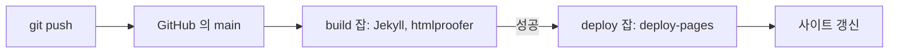

> **기준 출처:** [GitHub Docs, About GitHub and Git](https://docs.github.com/en/get-started/start-your-journey/about-github-and-git) · [What is GitHub Pages?](https://docs.github.com/en/pages/getting-started-with-github-pages/what-is-github-pages) · [Understanding GitHub Actions](https://docs.github.com/en/actions/about-github-actions/understanding-github-actions) / 확인일 2026-11-12 · git 2.55.0.windows.2
> **시리즈:** [목차](/posts/00-git-series/) | 이전 → [01. 원격 저장소](/posts/01-github-remote/) | 다음 → [03. PR 흐름](/posts/03-github-pr-flow/)

[01편](/posts/01-github-remote/)에서 원격은 다른 곳의 저장소일 뿐이었다. GitHub Docs 는 GitHub 가 그 저장소를 클라우드에 호스팅하고 계획과 협업 도구를 더한다고 설명한다. 이 편은 두 층을 가르고, 이 블로그가 push 뒤에 사이트가 되는 경로를 따라간다.

## 1. 가르는 기준 — `git` 명령으로 되는가

| 화면에 보이는 것 | 층 | 무엇인가 |
| --- | --- | --- |
| 저장소, 브랜치, 커밋 목록 | Git | 01편의 원격 저장소 자리에 GitHub 가 있고, 그 브랜치와 커밋을 웹으로 보여준다 |
| 이슈 | GitHub | 할 일 한 건. `#12` 같은 번호가 붙는다 |
| Pull Request | GitHub | 한 브랜치의 변경을 다른 브랜치에 합치자는 제안 |
| 포크 | GitHub | GitHub 안에서 자기 계정 아래로 복사한 저장소. push 권한이 없으면 포크에 push 하고 PR 을 보낸다 |
| Pages, Actions | GitHub | 저장소를 정적 사이트로 서빙 / 이벤트에 맞춰 러너가 작업을 실행 |

## 2. 이슈와 PR — 작업의 번호와 검토 자리

GitHub Docs 는 이슈를 작업을 계획하고 논의하고 추적하는 단위로, PR 을 *"proposals to merge code changes into a project"* 로 정의한다. [09편](/posts/09-git-branch-strategy/)의 "작업 하나에 브랜치 하나"에서 그 작업의 번호가 이슈이고, 그 브랜치를 `main` 에 넣기 전에 diff 를 보고 승인하는 자리가 PR 이다.

브랜치 이름에 번호를 넣고(`fix/12-timeout`) PR 본문에 `Closes #12` 처럼 닫는 키워드(`close`, `fix`, `resolve` 와 그 활용형)를 쓰면, 그 PR 이 기본 브랜치에 merge 될 때 이슈가 같이 닫힌다.

| PR 탭 | 보여주는 것 |
| --- | --- |
| Conversation | 설명, 댓글, 리뷰 |
| Commits | PR 브랜치에 쌓인 커밋 |
| Checks | 자동 테스트, 빌드 결과 |
| Files changed | 리뷰어가 읽는 diff |

여는 것부터 지우는 것까지는 [03편](/posts/03-github-pr-flow/)에서 따라간다.

## 3. Pages 와 Actions — 이 블로그가 배포되는 길

Pages 는 저장소의 HTML, CSS, JavaScript 를 그대로, 또는 빌드를 거쳐 내보내는 정적 호스팅이다. 계정 사이트는 `<owner>.github.io` 라는 이름의 저장소에 두고, 게시는 브랜치에서 바로 하거나 Actions 워크플로로 한다. 이 블로그는 `genie4youu.github.io` 저장소의 워크플로로 게시한다.

```text
$ cd ~/genie4youu.github.io
$ ls
Gemfile  LICENSE  README.md  _config.yml  _data  _includes  _layouts  _plugins  _posts  _tabs  assets  index.html  tools
$ ls .github/workflows
pages-deploy.yml
```

`_posts`, `_layouts`, `_config.yml` 은 Jekyll 사이트 구조다(`theme: jekyll-theme-chirpy`). 워크플로를 줄이면 이렇다.

```yaml
on:
  push:
    branches: [main, master]
    paths-ignore: [.gitignore, README.md, LICENSE]
  workflow_dispatch:          # Actions 탭에서 손으로 실행
concurrency:
  group: "pages"
  cancel-in-progress: true
jobs:
  build:
    runs-on: ubuntu-latest    # GitHub 가 제공하는 러너
    # checkout → Ruby → jekyll b → htmlproofer → upload-pages-artifact
  deploy:
    needs: build
    # actions/deploy-pages
```

| 키 | 동작 |
| --- | --- |
| `paths-ignore` | 바뀐 파일이 전부 여기 걸리면 돌지 않는다. `README.md` 만 고친 커밋은 배포하지 않는다 |
| `needs: build` | build 가 성공해야 deploy 가 돈다. 실패하면 deploy 는 건너뛴다 |
| `cancel-in-progress` | 같은 그룹에서 진행 중인 실행을 취소한다 |



push 까지가 Git 이고, 그 뒤는 GitHub 가 push 이벤트를 보고 돌리는 일이라 사이트는 워크플로가 끝나야 바뀐다. `Test site` 스텝의 htmlproofer 가 빌드된 HTML 에서 문제를 찾으면(외부 링크는 `--disable-external` 로 제외) build 가 실패하고 사이트는 이전 상태로 남는다.

> push 했는데 사이트가 그대로면 저장소의 Actions 탭에서 이 워크플로가 끝났는지, 어느 스텝에서 멈췄는지부터 본다.
{: .prompt-tip }

## 4. GitLab 에서는

Git 층은 같고 원격 주소만 다르다. Pro Git 4.8 은 GitLab 에서 브랜치를 merge 해 달라고 요청하는 단위를 Merge 요청으로 설명한다.

| GitHub | GitLab |
| --- | --- |
| Pull Request | Merge Request (MR) |
| Issue, Fork | Issue, Fork |

## 5. 정리

- `git` 명령으로 되면 Git, GitHub 에만 있으면 위층이다
- 이슈는 작업의 번호, PR 은 merge 앞의 검토 자리다. 둘 다 작업마다 브랜치를 딴다는 전제 위에 있다
- 이 블로그는 push(Git) 뒤에 Actions 가 빌드와 검사를 하고 Pages 로 배포한다(GitHub). 검사가 실패하면 배포되지 않는다

## 참고

- [GitHub Docs: About GitHub and Git](https://docs.github.com/en/get-started/start-your-journey/about-github-and-git)
- [GitHub Docs: About issues](https://docs.github.com/en/issues/tracking-your-work-with-issues/about-issues)
- [GitHub Docs: Linking a pull request to an issue](https://docs.github.com/en/issues/tracking-your-work-with-issues/using-issues/linking-a-pull-request-to-an-issue)
- [GitHub Docs: About pull requests](https://docs.github.com/en/pull-requests/collaborating-with-pull-requests/proposing-changes-to-your-work-with-pull-requests/about-pull-requests)
- [GitHub Docs: What is GitHub Pages?](https://docs.github.com/en/pages/getting-started-with-github-pages/what-is-github-pages)
- [GitHub Docs: Configuring a publishing source](https://docs.github.com/en/pages/getting-started-with-github-pages/configuring-a-publishing-source-for-your-github-pages-site)
- [GitHub Docs: Understanding GitHub Actions](https://docs.github.com/en/actions/about-github-actions/understanding-github-actions)
- [GitHub Docs: Workflow syntax](https://docs.github.com/en/actions/reference/workflows-and-actions/workflow-syntax)
- [HTMLProofer](https://github.com/gjtorikian/html-proofer)
- [Pro Git 6.2 GitHub 프로젝트에 기여하기](https://git-scm.com/book/ko/v2/GitHub-GitHub-프로젝트에-기여하기)
- [Pro Git 4.8 GitLab](https://git-scm.com/book/ko/v2/Git-서버-GitLab)
