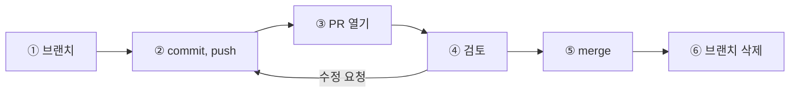

> **기준 출처:** [GitHub Docs, GitHub flow](https://docs.github.com/en/get-started/using-github/github-flow) · [About pull request merges](https://docs.github.com/en/pull-requests/collaborating-with-pull-requests/incorporating-changes-from-a-pull-request/about-pull-request-merges) / 확인일 2026-11-12 · git 2.55.0.windows.2
> **시리즈:** [목차](/posts/00-git-series/) | 이전 → [02. GitHub 가 얹는 것](/posts/02-github-what-it-adds/)

PR 하나가 열려서 닫힐 때까지를 따라간다. merge 버튼은 GitHub 에만 있으므로 Git 쪽에서 벌어지는 일만 [01편](/posts/01-github-remote/)처럼 로컬 bare 저장소로 확인했고, 버튼 자리는 다른 clone 에서 merge 하고 push 하는 것으로 대신했다. 출력은 일부 줄을 덜어 냈고, 해시는 따라 해도 다르게 나온다.

## 1. GitHub flow 여섯 단계와 Git 명령

| # | GitHub flow | Git 쪽에서 하는 일 | 어디서 |
| --- | --- | --- | --- |
| ① | Create a branch | `git switch -c fix/12-timeout` | 내 PC |
| ② | Make changes | commit 뒤 `git push -u origin fix/12-timeout` | 내 PC → GitHub |
| ③ | Create a pull request | 없음. GitHub 가 `main` 으로의 제안을 연다 | GitHub |
| ④ | Address review comments | 같은 브랜치에 commit, push. PR 이 자동으로 갱신된다 | 둘 다 |
| ⑤ | Merge your pull request | GitHub 가 원격 `main` 에 합친다. 내 `main` 은 그대로 | GitHub |
| ⑥ | Delete your branch | 원격은 GitHub 에서, 로컬은 `git branch -d` | 둘 다 |



## 2. ①② 브랜치를 올린다

```text
$ git switch -c fix/12-timeout
Switched to a new branch 'fix/12-timeout'
(커밋 둘)
$ git push -u origin fix/12-timeout
To ~/git-practice/remote.git
 * [new branch]      fix/12-timeout -> fix/12-timeout
branch 'fix/12-timeout' set up to track 'origin/fix/12-timeout'.
$ git log --oneline main..fix/12-timeout
49fce69 wip: 800 으로
ef3e18b timeout 값 추가
$ git diff --stat main...fix/12-timeout
 timeout.txt | 1 +
 1 file changed, 1 insertion(+)
```

PR 의 Files changed 탭은 점 셋 diff 를 보여준다. `git diff A...B` 는 A 와 B 의 공통 조상(merge base)부터 B 까지의 변경이라, 그 사이 `main` 에 다른 커밋이 들어와도 이 브랜치가 바꾼 것만 나온다.

## 3. ③④ 검토 — 혼자 쓰는 저장소에서도

리뷰는 Comment(의견), Approve(merge 해도 된다), Request changes(고칠 것이 있다) 중 하나로 남긴다. 관리자는 보호 브랜치에 승인 수와 필수 검사를 걸어 조건을 채우기 전의 merge 를 막을 수 있고, 보호 브랜치는 기본으로 force push 와 삭제도 막는다.

동료가 없어도 PR 을 쓰면 커밋 여럿의 변경을 Files changed 에서 모아 보고, 필수 검사로 깨진 변경을 막고, merge 뒤에도 댓글과 커밋 이력이 남는다. 에이전트에게 브랜치에서만 일하게 하고 `main` 에는 PR 로만 들어가게 하면 merge 전에 사람이 diff 를 보는 자리가 생긴다. 에이전트 둘이 한 저장소를 나눠 쓰는 방법은 [08편](/posts/08-claude-and-codex/)에서 다뤘다.

## 4. ⑤ merge 버튼 셋

| 버튼 | `main` 에 남는 것 | GitHub Docs |
| --- | --- | --- |
| Create a merge commit | 브랜치 커밋 전부와 merge 커밋 하나 | `--no-ff` 로 합친다 |
| Squash and merge | 브랜치 커밋을 뭉친 새 커밋 하나 | 짧게 사는 브랜치에 맞다 |
| Rebase and merge | 커밋 각각을 `main` 끝에 다시 만든 직선 이력 | 항상 새 SHA 를 만든다 |

`wip` 같은 중간 커밋이 섞였으면 Squash, 커밋을 뜻 있게 나눠 두었으면 Rebase 나 merge commit, 언제 합쳤는지를 이력에 남기려면 merge commit 을 고른다.

## 5. ⑤⑥ merge 뒤 내 PC 정리

GitHub 의 merge 버튼과 삭제 버튼 자리는 `server` clone 이 맡았다.

```text
(server 에서 squash 커밋을 push 한 뒤)
$ git push origin --delete fix/12-timeout
To ~/git-practice/remote.git
 - [deleted]         fix/12-timeout

(내 PC)
$ git switch main
Your branch is up to date with 'origin/main'.
$ git fetch --prune
From ~/git-practice/remote
 - [deleted]         (none)     -> origin/fix/12-timeout
   9a26ec7..f9416e1  main       -> origin/main
$ git branch -vv
  fix/12-timeout 49fce69 [origin/fix/12-timeout: gone] wip: 800 으로
* main           9a26ec7 [origin/main: behind 1] 작업 A
$ git pull
Updating 9a26ec7..f9416e1
Fast-forward
$ git branch -d fix/12-timeout
error: the branch 'fix/12-timeout' is not fully merged
hint: If you are sure you want to delete it, run 'git branch -D fix/12-timeout'
$ git branch -D fix/12-timeout
Deleted branch fix/12-timeout (was 49fce69).
```

`switch` 직후의 "up to date" 는 fetch 전의 판단이다. `fetch --prune` 은 원격에서 사라진 브랜치의 `origin/...` 을 지우고, 그래서 `branch -vv` 에 `gone` 이 뜬다.

`git branch -d` 는 브랜치가 upstream 에, upstream 이 없으면 `HEAD` 에 다 합쳐져 있어야 지운다. squash 는 브랜치의 커밋 대신 새 커밋 하나를 `main` 에 만들었으므로, 브랜치의 커밋(`49fce69`)은 `main` 에도 원격에도 없다. 그래서 거부된다. PR 이 merge 된 것을 확인했으면 `-D` 로 지운다.

같은 순서로 `fix/13-retry` 는 merge commit 으로 합쳤다(메시지는 GitHub 형식을 흉내 냈다). 브랜치 커밋이 그대로 `main` 의 조상이 되어 `-d` 가 통한다.

```text
$ git branch -d fix/13-retry
Deleted branch fix/13-retry (was 9f3f277).
$ git log --oneline --graph -6
*   bec8aa8 Merge pull request #13 from fix/13-retry
|\
| * 9f3f277 retry 5 로
| * d2acf22 retry 추가
|/
* f9416e1 timeout 설정 추가 (#12)
* 9a26ec7 작업 A
```

`#12` 는 커밋 하나로, `#13` 은 브랜치 커밋 둘과 merge 커밋으로 남았다.

> squash 로 합친 브랜치에서 계속 작업해 다음 PR 을 열면, 이미 뭉쳐 들어간 커밋이 다시 실려 충돌이 나기 쉽다(GitHub Docs). 다음 작업은 갱신된 `main` 에서 새 브랜치로 딴다.
{: .prompt-warning }

## 6. 정리

- ①②⑥ 은 Git 이, ③④⑤ 는 GitHub 가 한다. ⑤ 뒤에 내 PC 는 `git fetch --prune` 과 `git pull` 을 해야 따라온다
- Squash 와 Rebase 는 새 커밋을 만든다. squash 뒤의 로컬 브랜치는 `-d` 가 거부하니 merge 를 확인하고 `-D` 로 지운다

## 참고

- [GitHub Docs: GitHub flow](https://docs.github.com/en/get-started/using-github/github-flow)
- [GitHub Docs: About comparing branches in pull requests](https://docs.github.com/en/pull-requests/collaborating-with-pull-requests/proposing-changes-to-your-work-with-pull-requests/about-comparing-branches-in-pull-requests)
- [GitHub Docs: About pull request reviews](https://docs.github.com/en/pull-requests/collaborating-with-pull-requests/reviewing-changes-in-pull-requests/about-pull-request-reviews)
- [GitHub Docs: About protected branches](https://docs.github.com/en/repositories/configuring-branches-and-merges-in-your-repository/managing-protected-branches/about-protected-branches)
- [GitHub Docs: About pull request merges](https://docs.github.com/en/pull-requests/collaborating-with-pull-requests/incorporating-changes-from-a-pull-request/about-pull-request-merges)
- [git-diff](https://git-scm.com/docs/git-diff)
- [git-branch](https://git-scm.com/docs/git-branch)
- [git-fetch](https://git-scm.com/docs/git-fetch)
