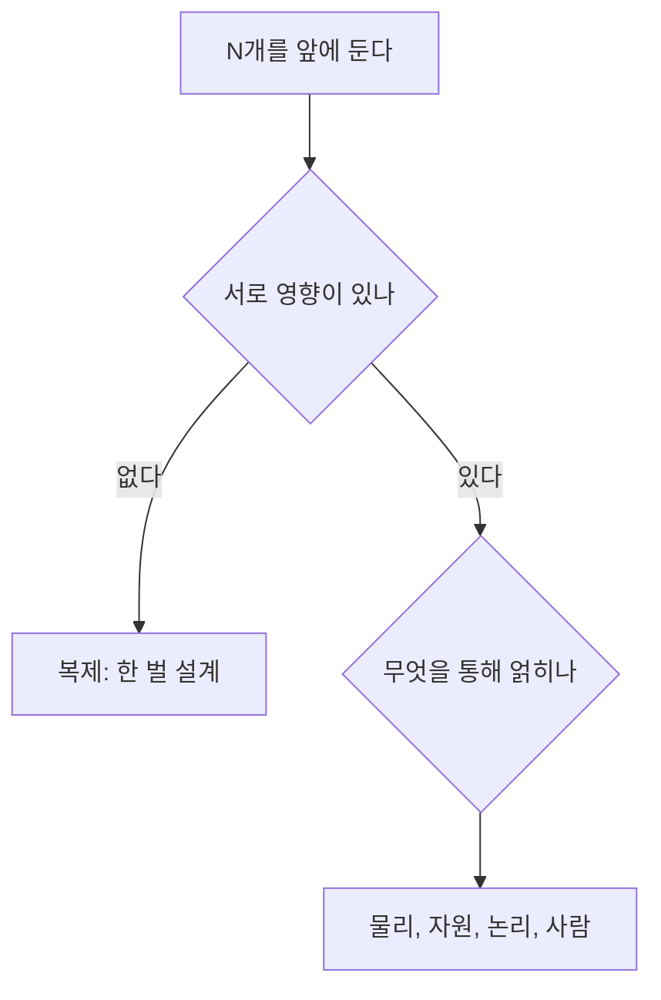
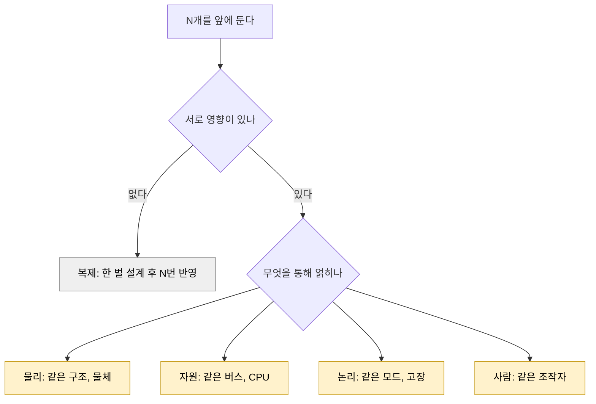

> **기준 출처:** [Modern Robotics 8.1](https://modernrobotics.northwestern.edu/nu-gm-book-resource/8-1-lagrangian-formulation-of-dynamics-part-2-of-2/) · [UPC, Motion Control](https://sir.upc.edu/projects/ris_tutorials/advanced/motion_control/motion_control.html) · [Uhlmann, RGA (arXiv:1805.10312)](https://arxiv.org/abs/1805.10312) · [PLCopen Motion Control](https://www.plcopen.org/standards/motion-control/) / 확인일 2026-11-12
> **시리즈:** [목차](/posts/00-multiaxis-series/) | 다음 → [02. 다축은 MIMO 다](/posts/02-mimo-coupling/)

「여러 개를 동시에 제어한다」는 문장 하나가 서로 다른 네 문제를 가리킨다. 이 글은 그 넷을 층으로 가르고, 눈앞의 시스템이 다축 문제인지 같은 제어기를 N벌 복제한 것인지를 결합(coupling)으로 판정하는 기준을 세운다. 제어기가 여러 개인 경우는 [다중 모드 제어](/posts/00-multimode-series/) 시리즈가 다룬다.

| 이 글이 답하는 질문 | 읽고 나면 |
| --- | --- |
| 「여러 개를 동시에 제어한다」가 정확히 무엇을 어렵게 만드는가. 개수인가, 다른 것인가 | 눈앞의 시스템이 축이 여러 개인 문제인지, 루프가 겹친 문제인지, 팔이 여러 대인 문제인지 층으로 갈라 말하고, 그것이 애초에 다중 제어 문제인지를 결합으로 판정한다 |

층을 먼저 갈라 놓지 않으면 관성 행렬 이야기와 조작권 이양 이야기가 한 바구니에 들어가고, 「지금 병목이 어느 층에 있는가」를 물을 수 없게 된다. 이 시리즈의 나머지 편은 각각 다른 층의 「여러 개」를 다룬다.

| 이 글에 나오는 말 | 뜻 |
| --- | --- |
| SISO / MIMO | 입력 하나, 출력 하나인 제어 문제 / 입력과 출력이 여러 개인 제어 문제 |
| 결합(coupling) | 한쪽을 건드렸을 때 다른 쪽이 따라 반응하는 성질. 없으면 둘은 서로 남남이다 |
| 관성 행렬 | 각 관절을 얼마나 세게 밀면 얼마나 가속되는지를 모은 표. 대각이 자기 몫, 비대각이 옆 축으로 새는 몫이다 |
| 캐스케이드 | 제어 루프를 겹쳐 쌓은 구조. 바깥 루프의 출력이 안쪽 루프의 지령이 된다 |

## 1. 네 층 — 얽히는 통로가 다르다

| 층 | 무엇이 여러 개인가 | 무엇을 통해 얽히나 | 대표 질문 | 편 |
| --- | --- | --- | --- | --- |
| 축 | 한 팔 안의 관절 N개 | 같은 링크 구조. 한 관절의 가속이 이웃 관절에 토크로 나타난다 | 축 하나를 움직였는데 왜 옆 축에 토크가 걸리나 | 02, 03 |
| 루프 | 한 축 안의 제어 루프 여러 겹 | 같은 구동기. 위치, 속도, 전류 루프가 결국 하나의 모터 전류를 정한다 | 왜 위치를 한 루프로 직접 잡지 않고 세 겹으로 쌓나 | 04 |
| 매니퓰레이터 | 팔 여러 대 | 같은 물체, 같은 작업공간 | 둘이 하나를 같이 들면 서로를 어떻게 밀게 되나 | 08, 09 |
| 로봇 | 따로 움직이는 로봇 여러 대 | 같은 목표, 같은 통신망, 같은 조작자 | 누가 무엇을 맡고, 하나가 멎으면 나머지는 어떻게 되나 | 10~12 |

네 층은 규모가 아니라 얽히는 통로가 다르다. 같은 시계, 같은 버스, 같은 CPU 를 나눠 쓰는 문제(05~07편)는 어느 층에서나 생긴다.

층이 다르면 답이 나오는 분야도 다르다. 축은 강체 동역학, 루프는 고전 제어의 루프 정형, 매니퓰레이터는 폐연쇄 역학과 힘 분배, 로봇은 다중 로봇 조정과 통신의 문제다. 그래서 층을 섞어서 물으면 어느 쪽 문헌을 봐도 답이 잘 나오지 않는다고 본다.

산업 규격에도 이 구분이 보인다. PLCopen 모션 제어 규격은 단축(single axis)과 다축(multi-axes) 모션 제어용 함수 블록을 정의하고, 좌표를 함께 쓰는 운동은 Part 4 Coordinated Motion 으로 따로 둔다. 축이 N개라는 사실과 그 N개가 좌표를 함께 쓴다는 사실이 다른 문제라는 것을, 규격이 파트를 나누는 방식으로 보여 주는 셈이다.

## 2. 층마다 막히는 곳

**축.** 운동방정식 $$\tau = M(\theta)\ddot{\theta} + c(\theta,\dot{\theta}) + g(\theta)$$ 에서 $$\tau$$ 는 관절 토크 벡터, $$\theta$$ 는 관절 각도 벡터, $$M$$ 은 질량(관성) 행렬, $$c$$ 는 속도 곱 항(원심력과 코리올리), $$g$$ 는 중력 항이다. $$M$$ 은 상수가 아니라 자세 $$\theta$$ 의 함수다. Modern Robotics 8.1 은 다관절 로봇처럼 질량이 자세에 따라 달라지면 연쇄법칙에서 자세 미분 항이 하나 더 남아 속도 곱 항이 생긴다고 설명한다. 이 항과 $$M$$ 의 비대각 성분이 축과 축을 잇는 통로다(02편).

**루프.** 캐스케이드에서 안쪽 루프가 있는 이유는 외란을 바깥으로 번지기 전에 국소적으로 잡는 것이다. MathWorks 는 캐스케이드의 안쪽 제어기를 외란이 바깥 플랜트로 번지기 전에 국소적으로 제거하는 이차 제어기로 설명하고, 이 구조가 제대로 동작하려면 안쪽 루프가 바깥 루프보다 훨씬 빨리 응답해야 한다고 적는다. 이 조건이 이 층의 병목이다(04편).

**매니퓰레이터.** 팔 두 대가 같은 물체를 잡는 순간 둘은 그 물체를 통해 기구학적으로 묶인다. 한쪽이 밀면 다른 쪽이 그 힘을 받는다. 그래서 이 층의 고유 질문은 「어디로 움직일까」보다 「물체를 부수지 않으면서 하중을 어떻게 나눠 질까」가 된다. 이 문단은 기구학적 구속에서 곧바로 따라 나오는 서술이고, 하중 분배와 내력의 문헌 근거는 08편에서 다룬다.

**로봇.** 여기서는 물리적 연결이 없어도 문제가 생긴다. Karam 등의 서베이는 협업을 협력, 조정, 능력 상보성(혼자서는 못 하는 작업을 서로의 능력으로 해내는 것)이 함께 있는 상태로 정의한다. 조직 구조는 중앙집중, 분산, 계층 셋이고, 중앙집중은 전역 최적해를 낼 수 있지만 단일 장애점을 갖는다.

| 층 | 병목 |
| --- | --- |
| 축 | 관성 행렬 $$M(\theta)$$ 가 자세의 함수라서 생기는 비대각 결합과 속도 곱 항 |
| 루프 | 안쪽이 바깥쪽보다 훨씬 빨라야 한다는 조건 |
| 매니퓰레이터 | 물체를 통한 하중 분배 |
| 로봇 | 조정 구조와 단일 장애점 |

## 3. 판정 기준은 개수가 아니라 결합이다

N개가 서로 영향을 주지 않으면 같은 제어기를 N벌 복제한 것이고, 설계와 검증과 튜닝을 한 벌만 하고 N번 반영하면 된다. 「영향이 없다」는 행렬로 적을 수 있다. 다입력 다출력(MIMO) 시스템의 입출력 상호작용을 재는 상대 이득 행렬(RGA)은 이득 행렬 $$G$$ 에 대해 이렇게 정의된다.

$$\Lambda = G \circ (G^{-1})^{\mathsf{T}}$$

$$G$$ 는 입력 $$j$$ 를 한 단위 넣었을 때 출력 $$i$$ 가 정상상태에서 얼마나 변하는지를 $$(i,j)$$ 성분에 모은 행렬이고, $$\circ$$ 는 같은 자리끼리 곱하는 성분별(Hadamard) 곱, $$(G^{-1})^{\mathsf{T}}$$ 는 역행렬의 전치다. Uhlmann 은 $$G$$ 가 정칙이면 $$\Lambda$$ 의 각 행과 각 열의 합이 1이고, 성분을 개루프 이득 대 폐루프 이득의 비로 읽어 제어기 짝짓기에 쓸 수 있다고 적는다. 성분이 1에 가까운 짝은 다른 루프가 닫히든 열리든 이득이 거의 같다는 뜻이므로 간섭이 적은 짝으로 읽는다.

$$G$$ 가 대각이면 $$G^{-1}$$ 도 대각이므로 정의에 대입하면 $$\Lambda = I$$ 가 바로 나온다. 이 경우 입력이 N개, 출력이 N개여도 그 시스템은 독립 SISO 루프 N개이고 다중 제어 문제가 아니다. 결합이 없다는 말은 막연한 느낌이 아니라 이득 행렬이 대각이라는 말과 같다.

> 로봇 팔의 관성 행렬은 자세마다 달라 상수 이득 행렬 하나로 적히지 않는다. 여기서 RGA 는 짝짓기 도구가 아니라 「결합 없음」이 「대각」이라는 것을 보이는 정의로만 쓴다.
{: .prompt-info }

결합이 있는 시스템을 일부러 복제 문제로 낮춰 푸는 방법도 있다. UPC 튜토리얼의 분산(decentralized) 제어는 매니퓰레이터를 n개의 독립 SISO 시스템으로 보고 결합을 외란으로 취급한다. 조건은 큰 감속비와 낮은 속도, 가속도다. 로봇 제어는 대개 이 낮춤에서 출발한다고 보고, 언제 그 낮춤이 정당한지는 03편이 다룬다.

## 4. 결합 4종 — 물리, 자원, 논리, 사람

> 아래 네 갈래는 이 시리즈가 쓰는 정리용 분류이고 문헌의 표준 용어가 아니다. 각 갈래의 근거는 개별 공개 출처에서 왔지만 넷으로 묶은 것은 이 시리즈의 정리다.
{: .prompt-info }

| 결합 | 함께 쓰는 것 | 예 | 이 결합이 있으면 생기는 질문 | 편 |
| --- | --- | --- | --- | --- |
| 물리 | 구조, 물체, 공간 | 관성 행렬의 비대각 성분, 속도 곱 항 | 한쪽의 가속이 다른 쪽에 힘으로 나타난다. 상쇄할 것인가, 외란으로 밀어낼 것인가 | 02, 03, 08, 09 |
| 자원 | 버스, CPU, 잠금, 전원 | Mars Pathfinder 의 우선순위 역전 | 축이 늘면 계산량과 프레임이 늘어난다. 주기 안에 다 들어가는가 | 06, 07 |
| 논리 | 모드, 상태, 고장 판정 | 한 축의 고장 판정이 다른 축의 동작 허용을 바꾸는 경우 | 하나가 멎었을 때 나머지를 세우나, 계속 가나 | 12 |
| 사람 | 조작자 | 원격조작의 안정성과 투명성 상충 | 조작 입력을 어느 대상에 매핑하는가. 대상이 바뀔 때 무슨 일이 생기나 | 10, 11 |

**물리 결합**의 통로는 2절의 축 문단에서 본 관성 행렬의 비대각 성분과 속도 곱 항이다.

**자원 결합**은 가장 자주 간과되는 결합으로 본다. 축 두 개가 기구적으로 완전히 분리되어 있어도, 같은 프로세서 위에서 돌고 같은 잠금을 거치면 서로의 응답 시간에 영향을 준다. Mike Jones 가 정리한 Mars Pathfinder 기록에서 기상 데이터 태스크(낮은 우선순위)가 쥔 버스 뮤텍스를 버스 관리 태스크(높음)가 기다리는 사이, 뮤텍스와 무관한 통신 태스크(중간)가 먼저 돌았다. 버스 태스크가 한동안 실행되지 않은 것을 본 워치독이 시스템 전체를 재시작했다. 세 태스크는 하는 일이 서로 달랐고, 공유 자원 하나가 그 셋을 한 시스템으로 묶었다([RTOS 08편](/posts/08-priority-inversion-mars-pathfinder/)).

**논리 결합**은 물리도 자원도 공유하지 않는데 판정 결과를 통해 생긴다. 고장 판정 하나가 다른 축의 동작 허용 여부를 바꾸도록 짜여 있으면 축들은 그 판정으로 묶인다. 이 결합은 설계자가 만든 것이라 설계로 없앨 수도 있다. 다만 없애면 「하나가 멎었는데 나머지가 그것을 모른 채 계속 간다」로 바뀐다. 공짜로 사라지지 않고, 어느 쪽이 나은지는 층이 아니라 작업이 정한다(12편).

**사람 결합**은 사람이 루프 안에 들어올 때 생긴다. 이산시간 양방향 원격조작 리뷰(arXiv:2008.06685)는 안정성과 투명성의 상충과, 표본화 주기가 그 상충에 주는 영향을 다룬다. 조작자가 원격 환경을 있는 그대로 느끼게 하려 할수록(투명성) 안정성 쪽 여유를 내주게 된다는 것이 그 상충이다. 조작 대상이 여럿이면 「이 입력이 지금 누구에게 가는가」라는 질문이 하나 더 붙는다(10, 11편).

## 5. 지배적 결합이 설계를 정한다

결합이 하나라도 있으면 다중 제어 문제다. 그다음에는 네 결합 중 어느 것이 지배적인지가 실제로 할 일을 정한다. 판정은 개수가 아니라 이 순서로 한다.

회색은 다중 제어 문제가 아닌 경우다. 노란 넷은 각각 다른 해결 수단을 요구하고, 수단을 잘못 고르면 문제가 그대로 남는다.

| 지배적 결합 | 하는 일 | 잘못 골랐을 때 |
| --- | --- | --- |
| 물리 | 모델로 상쇄하거나(역동역학) 감속비와 외란 억제로 밀어낸다 | 주기를 줄여도 궤적 오차가 줄지 않는다 |
| 자원 | 주기 예산을 나누고 최악 실행시간과 스케줄 가능성을 본다 | 제어 이론을 더 정교하게 만들어도 마감을 계속 놓친다 |
| 논리 | 모드와 고장 전파 범위를 명시적으로 적는다 | 정상 동작은 문제없는데 이상 상황에서 동작이 갈린다 |
| 사람 | 조작 매핑과 이양 규칙을 정하고 지연을 예산에 넣는다 | 성능 지표는 좋은데 조작자가 쓰기 어렵다 |

> 「잘못 골랐을 때」 열은 문헌 인용이 아니라 각 결합의 정의에서 따라 나오는 대비를 정리한 것이다. 특정 사례의 관측 기록이 아니다.
{: .prompt-warning }

자원 결합인데 제어 이론을 더 정교하게 만들거나, 물리 결합인데 주기만 줄이는 것이 수단을 잘못 고른 대표적인 경우로 본다.

## 6. 정리

- 「여러 개」는 축, 루프, 매니퓰레이터, 로봇 네 층이다. 넷은 규모가 아니라 얽히는 통로가 다르고, 그래서 답이 나오는 분야도 다르다. PLCopen 이 단축, 다축 함수 블록과 좌표 협조 운동을 별도 파트로 나누는 것이 같은 구분이다
- 층별 병목: 축은 자세에 따라 변하는 관성 행렬의 비대각 결합, 루프는 안쪽이 바깥쪽보다 훨씬 빨라야 한다는 조건, 매니퓰레이터는 물체를 통한 하중 분배, 로봇은 조정 구조와 단일 장애점
- 개수는 판정 기준이 아니다. 이득 행렬이 대각이면 RGA 가 단위행렬이고, 그 시스템은 독립 SISO 루프 N개, 곧 복제다
- 결합이 있는 시스템을 결합을 외란으로 취급해 복제 문제로 낮춰 푸는 것이 흔한 출발점이다. 언제 정당한지는 03편이 다룬다
- 결합은 이 시리즈에서 물리, 자원, 논리, 사람 넷으로 나눈다. 자원 결합은 기능상 무관한 태스크도 묶고, 논리 결합은 없애면 「멎은 것을 나머지가 모른다」로 바뀐다
- 지배적 결합이 수단을 정한다. 자원 결합에 제어 이론으로, 물리 결합에 주기 단축으로 대응하면 문제가 남는다

## 참고

- [K. M. Lynch, F. C. Park, Modern Robotics 8.1 — Lagrangian Formulation of Dynamics (Part 2 of 2)](https://modernrobotics.northwestern.edu/nu-gm-book-resource/8-1-lagrangian-formulation-of-dynamics-part-2-of-2/)
- [UPC, Motion Control — Service and Industrial Robotics Tutorials](https://sir.upc.edu/projects/ris_tutorials/advanced/motion_control/motion_control.html)
- [MathWorks, Designing Cascade Control System with PI Controllers](https://www.mathworks.com/help/control/ug/designing-cascade-control-system-with-pi-controllers.html)
- [R. Karam et al., Collaboration in Multi-Robot Systems: Taxonomy and Survey over Frameworks for Collaboration (arXiv:2603.23898)](https://arxiv.org/html/2603.23898v1)
- [A. A. Ghavifekr et al., Discrete-time control of bilateral teleoperation systems: a review (arXiv:2008.06685)](https://arxiv.org/abs/2008.06685)
- [M. Jones, What really happened on Mars?](https://www.cs.unc.edu/~anderson/teach/comp790/papers/mars_pathfinder_short_version.html)
- [J. Uhlmann, On the Relative Gain Array (RGA) with Singular and Rectangular Matrices (arXiv:1805.10312)](https://arxiv.org/abs/1805.10312)
- [PLCopen, Motion Control](https://www.plcopen.org/standards/motion-control/)
