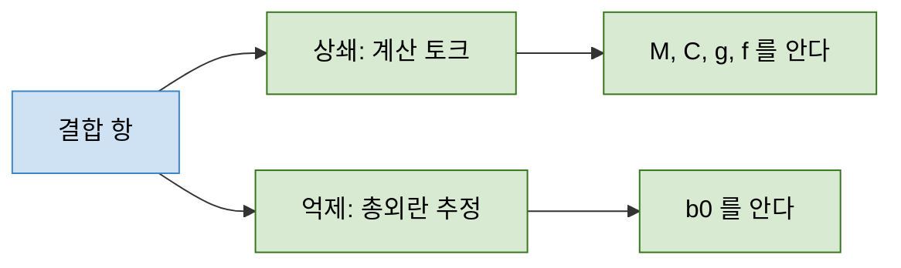

> **기준 출처:** [Kallel & Iqbal, Sensors 25(22):6831](https://pmc.ncbi.nlm.nih.gov/articles/PMC12656155/) · [Modern Robotics 8.1](https://modernrobotics.northwestern.edu/nu-gm-book-resource/8-1-lagrangian-formulation-of-dynamics-part-2-of-2/) · [MathWorks, ADRC](https://www.mathworks.com/help/slcontrol/ug/active-disturbance-rejection-control.html) / 확인일 2026-11-12
> **시리즈:** [목차](/posts/00-multiaxis-series/) | 이전 → [01. 무엇이 여러 개인가](/posts/01-what-is-multiple/) | 다음 → [03. 조인트 독립제어](/posts/03-independent-joint-control/)

01편이 「물리 결합」이라고만 부른 것을 식으로 연다. 결합이 운동방정식의 어느 자리에 있는지, 언제 커지는지, 그것을 다루는 두 방식이 각각 무엇을 알아야 하는지를 본다. 다음 편은 반대 방향의 사실, 곧 많은 산업용 로봇이 이 결합을 무시하고도 잘 돈다는 점을 다루는데, 그 이유를 보려면 먼저 무시되는 대상이 무엇인지가 정확해야 한다.

| 이 글에 나오는 말 | 뜻 |
| --- | --- |
| 관절 공간 | 각 관절의 각도(또는 변위)를 성분으로 갖는 벡터로 로봇의 자세를 적는 방식. 말단의 위치와 자세로 적는 작업 공간과 대비된다 |
| 원심력 항 | 한 관절이 빠르게 돌 때 생기는, 그 속도의 제곱에 비례하는 힘 성분 |
| 코리올리 항 | 서로 다른 두 관절이 동시에 움직일 때만 생기는, 두 속도의 곱에 비례하는 힘 성분 |
| 되먹임 선형화 | 비선형 항을 제어 입력으로 상쇄해 닫힌 루프가 선형 시스템처럼 보이게 만드는 기법 |

## 1. 결합이 적힌 자리

N관절 강체 매니퓰레이터의 운동방정식을 Kallel 과 Iqbal(2025)의 표기로 쓴다.

$$\tau = M(q)\,\ddot{q} + C(q,\dot{q})\,\dot{q} + g(q) + f(q,\dot{q})$$

| 기호 | 크기 | 뜻 |
| --- | --- | --- |
| $$q, \dot{q}, \ddot{q}$$ | $$N \times 1$$ | 관절 변수, 속도, 가속도 |
| $$\tau$$ | $$N \times 1$$ | 각 관절에 실제로 가하는 토크(또는 힘) |
| $$M(q)$$ | $$N \times N$$ | 관성 행렬. 대칭 양정부호 |
| $$C(q,\dot{q})\,\dot{q}$$ | $$N \times 1$$ | 코리올리, 원심력 항. 속도에 대해 2차 |
| $$g(q)$$ | $$N \times 1$$ | 중력 항 |
| $$f(q,\dot{q})$$ | $$N \times 1$$ | 마찰 항. 모델에 따라 넣기도 하고 빼기도 한다 |

Modern Robotics 는 관절 변수를 $$\theta$$ 로 쓰고 속도 곱 항을 $$c(\theta,\dot{\theta})$$ 하나로 묶는데 같은 식이다. Corke 의 강의는 관절 J 의 모터가 느끼는 토크가 모든 관절의 가속도, 모든 관절의 속도, 그리고 중력의 영향을 받는다고 정리한다. 셋이 각각 $$M\ddot{q}$$, $$C\dot{q}$$, $$g$$ 다. 이 글은 앞의 둘, 곧 다른 축의 **운동**을 통한 결합을 본다. $$g(q)$$ 도 다른 관절의 각도에 따라 값이 달라지지만 속도나 가속도와는 무관하다.

## 2. 비대각 관성 — 옆 축의 가속이 내 축에 토크를 요구한다

$$i$$ 번째 줄의 관성 항만 떼어 쓴다.

$$\underbrace{M_{ii}(q)\,\ddot{q}_i}_{\text{내 축 가속에 드는 몫}} + \underbrace{\sum_{j \ne i} M_{ij}(q)\,\ddot{q}_j}_{\text{옆 축 가속이 요구하는 몫}}$$

둘째 합이 결합이다.

- 축 $$j$$ 를 가속하면 축 $$i$$ 는 제자리를 지키는 데만도 $$M_{ij}\ddot{q}_j$$ 만큼 토크를 더 내야 한다
- 그 토크를 내지 않으면 축 $$i$$ 가 끌려간다. 축 $$i$$ 의 제어기에게는 지령 없이 생긴 오차라 외란과 구분되지 않는다
- $$M$$ 이 대칭이므로 $$M_{ij} = M_{ji}$$ 다. 끌어당김은 양방향이고, 한쪽만 영향을 주는 일은 없다
- 이 항은 속도가 아니라 가속도에 비례한다. 아주 느리게 움직여도 가속하는 동안에는 생기고, 출발, 정지, 방향 전환처럼 가속도가 큰 순간에 가장 크다

## 3. 속도 곱 항 — 원심력과 코리올리

$$C(q,\dot{q})\dot{q}$$ 는 속도에 대해 2차다. 속도가 0이면 0이라 저속 작업에서는 작지만, 속도를 두 배로 하면 네 배가 된다. Modern Robotics 8.1 은 이 항이 질량 분포가 자세에 따라 바뀌기 때문에 생긴다고 설명한다. 질량 행렬이 자세의 함수이면 시간 미분에서 연쇄법칙 항이 하나 더 남고, 그 항을 속도의 이차식으로 정리한 것이 $$C\dot{q}$$ 다.

| 종류 | 형태 | 언제 생기나 | 결합인가 |
| --- | --- | --- | --- |
| 원심력 | $$\dot{q}_j^2$$ 에 비례 | 관절 $$j$$ 하나만 돌아도 생긴다 | 축 $$j$$ 의 속도가 축 $$i$$ 의 식에 나타나면 결합이다 |
| 코리올리 | $$\dot{q}_j \dot{q}_k\ (j \ne k)$$ 에 비례 | 서로 다른 두 관절이 함께 움직일 때만 생긴다 | 정의상 항상 결합이다 |

코리올리 성분은 두 속도의 곱이므로 한 관절만 움직이는 동안에는 0이다. Modern Robotics 의 평면 2R 팔 예가 이 차이를 보여 준다.

| 관절 속도 | 질량에 생기는 가속도 | 관절 1 에 필요한 토크 |
| --- | --- | --- |
| $$\dot{\theta}_1 > 0,\ \dot{\theta}_2 = 0$$ | 관절 1 을 향하는 구심 가속도($$\dot{\theta}_1^2$$ 에 비례) | 그 힘이 관절 1 에 모멘트를 만들지 않아, 그 자세에서는 토크가 필요 없다 |
| $$\dot{\theta}_1 > 0,\ \dot{\theta}_2 > 0$$ | 관절 2 를 향하는 코리올리 가속도가 더해진다 | 두 속도를 일정하게 유지하려면 관절 1 에 음의 토크가 필요하다 |

### 여러 축을 같이 시험해야 보이는 항

> 아래는 문헌의 문장이 아니라 위 성질에서 따라 나오는 시험 설계상의 판단이다.
{: .prompt-info }

축을 하나씩 따로 움직여 튜닝하면 코리올리 항은 원리적으로 0이라 한 번도 나타나지 않는다. 두 축을 동시에 움직이는 순간 처음 나타난다. 그래서 이 항을 보려면 여러 축을 동시에, 속도를 실어서 움직이는 시험이 따로 있어야 한다고 본다. 단축 시험만 통과한 튜닝은 코리올리 결합에 대해서는 검증되지 않은 상태다.

## 4. 결합의 세기는 자세마다 다르다

$$M$$ 과 $$C$$ 는 모두 $$q$$ 의 함수다. 자세가 바뀌면 각 축이 느끼는 관성과 비대각 성분의 값이 달라진다. 그래서 한 자세에서 잘 맞춘 게인이 다른 자세에서도 잘 맞는다는 보장이 없다.

직관은 이렇다. 팔을 접으면 회전축에서 본 질량이 가까이 모이고, 뻗으면 멀리 퍼진다. 회전 관성은 거리의 제곱으로 들어가므로 같은 로봇이라도 뿌리 쪽 축이 느끼는 유효 관성이 자세에 따라 크게 달라진다. 비대각 성분도 함께 변한다.

| 자세 | 뿌리 축에서 본 질량 | 뿌리 축의 유효 관성 |
| --- | --- | --- |
| 접었을 때 | 회전축 가까이 모인다 | 작다 |
| 뻗었을 때 | 회전축에서 멀리 퍼진다 | 크다(거리의 제곱으로 커진다) |

Tedrake 의 Robotic Manipulation 2장은 다관절 팔에서 링크 관성 $$I_{\text{arm}}$$ 이 상태의 함수이며 다른 관절과의 관성 결합까지 담는다고 적는다. 같은 절은 감속비가 크면 이 상태 의존성이 상대적으로 작아진다고 덧붙인다. 뒤집어 읽으면 그 조건이 아닐 때는 동역학이 작업 공간 안에서 일정하지 않다는 뜻이 된다. 그 조건이 무엇인지가 03편의 주제다.

## 5. 대응 두 갈래 — 상쇄하거나 추정해서 빼거나

파랑은 물리가 주는 항이라 설계자가 없앨 수 없고, 초록은 설계자가 만드는 대응이다. 두 대응은 같은 항을 지우지만 요구하는 정보의 양이 다르다.

**상쇄: 계산 토크 제어(computed torque control).** 모델을 제어 입력에 그대로 넣어 비선형 항을 지운다.

$$\tau = M(q)\,a + C(q,\dot{q})\,\dot{q} + g(q) + f(q,\dot{q}), \qquad a = \ddot{q}_d + K_d(\dot{q}_d - \dot{q}) + K_p(q_d - q)$$

$$a$$ 는 바깥 루프가 만드는 원하는 가속도, 아래첨자 $$d$$ 는 목표값, $$K_p, K_d$$ 는 PD 게인이다. 이것이 성립하면 닫힌 루프는 축마다 독립인 선형 오차 방정식이 된다. Kallel 과 Iqbal 은 이 방식이 정확한 모델로 비선형 항을 없애 닫힌 루프를 PD 게인으로 제어되는 선형 시스템으로 바꾼다고 설명하고, 그 전제로 $$M, C, g, f$$ 를 정확히 안다고 가정한다. 모르는 만큼 상쇄가 덜 되고, 덜 된 만큼은 그대로 남는다. UPC 튜토리얼은 같은 구조를 역동역학 제어 $$u = B(q)\,y + n(q,\dot{q})$$ 로 쓰고, 비선형 상태 되먹임으로 입출력 선형화를 얻는 방법이라 부른다.

**억제: 총외란으로 묶어 추정한다.** 결합 항이 무엇인지 계산하지 않고, 모르는 동역학과 외란을 하나로 묶어 관측기로 추정한 뒤 입력에서 뺀다. MathWorks 의 ADRC 문서는 모르는 동역학과 그 밖의 외란을 묶어 총외란 $$f(t)$$ 로 둔다(위 식의 마찰 항과 다른 기호다). 확장 상태 관측기(ESO)가 그것을 추정하고, 추정한 외란이 모델의 알려진 부분에 주는 영향을 줄인다. 사용자가 넣는 모델 정보는 입력 이득 추정치 $$b_0$$(Critical gain) 하나이고, 개루프 계단 시험에서 출력의 기울기를 맞춰 얻는다. 총외란이라는 발상 자체는 [ADRC 02편](/posts/02-total-disturbance/)에 있다.

| | 상쇄 (계산 토크) | 억제 (총외란) |
| --- | --- | --- |
| 결합을 보는 방식 | 아는 항. 계산해서 뺀다 | 모르는 항. 추정해서 뺀다 |
| 필요한 모델 정보 | $$M, C, g, f$$ 전부 | $$b_0$$ |
| 매 스텝 계산량 | 역동역학 전부 | 관측기 한 벌 |
| 잘 안 될 때의 원인 | 모델이 실제와 다르다 | 관측기 대역폭이 결합의 변화 속도를 따라가지 못한다 |
| 결합이 빨리 변하면 | 모델이 맞으면 그대로 따라간다 | 추정이 늦은 만큼 남는다 |
| 출처 | Kallel, Iqbal 2025 / UPC | MathWorks ADRC 문서 |

> 표의 「매 스텝 계산량」부터 「결합이 빨리 변하면」까지 세 줄은 비교 실험 결과가 아니라 두 방식의 정의에서 따라 나오는 대비를 정리한 것이다. 특정 로봇에서 어느 쪽이 낫다는 주장이 아니다.
{: .prompt-warning }

셋째 길도 있다. 결합을 외란으로 두되 계산도 추정도 하지 않고 축마다 독립 루프의 강인성으로 버티는 분산 제어다(UPC). 산업용 로봇에서 가장 흔한 출발점은 이쪽으로 본다. 그것이 언제 통하는지가 다음 편이다.

## 6. 정리

- 운동을 통한 결합은 $$M$$ 의 비대각 성분과 $$C\dot{q}$$ 두 자리에 있다. 중력 항은 다른 관절의 각도에 따라 변하지만 속도나 가속도와는 무관하다
- $$M_{ij}$$ 는 축 $$j$$ 를 가속할 때 축 $$i$$ 가 제자리를 지키려고 내야 하는 토크의 계수다. 가속도에 비례해 느린 동작에서도 가감속 순간에 생기고, 대칭이라 양방향이다
- $$C\dot{q}$$ 는 속도에 대해 2차다. 그중 코리올리 성분은 두 관절이 함께 움직일 때만 생기므로 축을 하나씩 움직이는 시험으로는 드러나지 않는다
- $$M$$ 과 $$C$$ 가 자세의 함수라 결합의 세기도 자세마다 다르다. 한 자세에서 맞춘 게인이 다른 자세에서 맞는다는 보장이 없다
- 상쇄는 $$M, C, g, f$$ 를 정확히 알아야 하고, 총외란 억제는 $$b_0$$ 하나를 요구하는 대신 추정 지연에 걸린다
- 셋째 길은 결합을 외란으로 두고 아무 보상도 하지 않는 축별 독립 제어다. 왜 대체로 통하는지가 다음 편이다

## 참고

- [H. Kallel, K. Iqbal, Online Estimation of Manipulator Dynamics for Computed Torque Control of Robotic Systems, Sensors 25(22):6831, 2025](https://pmc.ncbi.nlm.nih.gov/articles/PMC12656155/)
- [K. M. Lynch, F. C. Park, Modern Robotics 8.1 — Lagrangian Formulation of Dynamics (Part 2 of 2)](https://modernrobotics.northwestern.edu/nu-gm-book-resource/8-1-lagrangian-formulation-of-dynamics-part-2-of-2/)
- [P. Corke, Advanced Joint Control Strategies, QUT Robot Academy](https://robotacademy.net.au/lesson/advanced-joint-control-strategies/)
- [R. Tedrake, Robotic Manipulation, Ch. 2 Let's get you a robot](https://manipulation.csail.mit.edu/robot.html)
- [Institute of Robotics and Industrial Informatics (UPC), Motion Control — Service and Industrial Robotics Tutorials](https://sir.upc.edu/projects/ris_tutorials/advanced/motion_control/motion_control.html)
- [MathWorks, Active Disturbance Rejection Control](https://www.mathworks.com/help/slcontrol/ug/active-disturbance-rejection-control.html)
