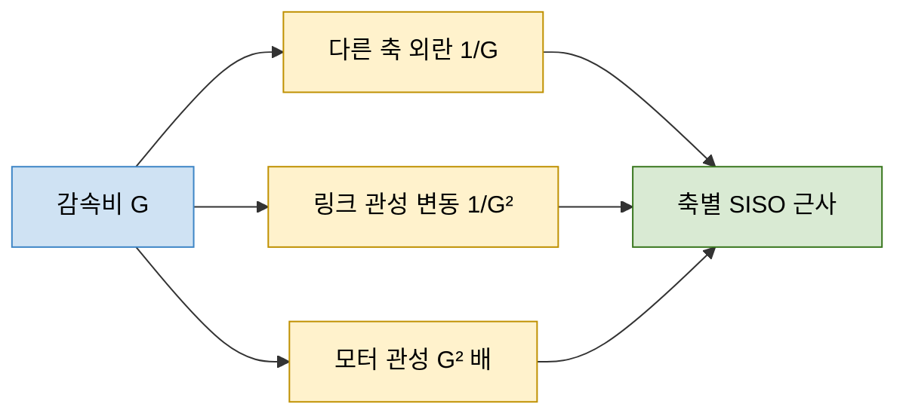
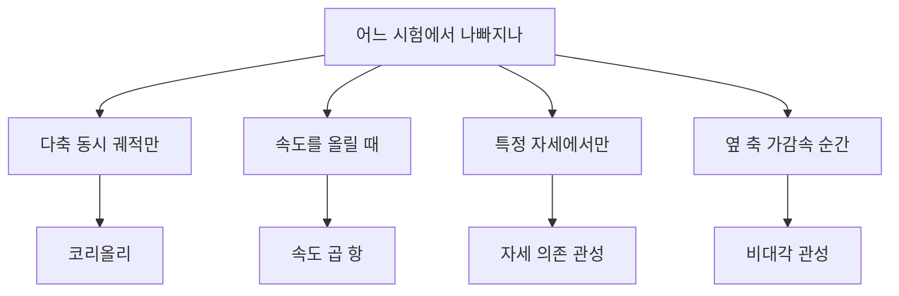

> **기준 출처:** [Corke, Advanced Joint Control Strategies](https://robotacademy.net.au/lesson/advanced-joint-control-strategies/) · [Modern Robotics 8.9](https://modernrobotics.northwestern.edu/nu-gm-book-resource/8-9-actuation-gearing-and-friction/) · [Tedrake, Robotic Manipulation 2장](https://manipulation.csail.mit.edu/robot.html) · [UPC, Motion Control](https://sir.upc.edu/projects/ris_tutorials/advanced/motion_control/motion_control.html) / 확인일 2026-11-12
> **시리즈:** [목차](/posts/00-multiaxis-series/) | 이전 → [02. 다축은 MIMO 다](/posts/02-mimo-coupling/) | 다음 → [04. 캐스케이드 다중 루프](/posts/04-cascade-loops/)

02편은 축들이 원래 얽혀 있다는 것을 운동방정식으로 보였다. 비대각 관성과 속도 곱 항이 그 통로였다. 그런데 UPC 튜토리얼이 소개하는 분산 제어는 그 결합 항을 하나도 계산하지 않고 축마다 독립 루프를 건다. 산업용 로봇의 상당수가 이 방식으로 도는 것으로 본다. 이 글은 그 방식이 무엇을 가정하는지, 그 가정을 감속기가 어떻게 만들어 주는지, 언제 깨지는지를 본다. 답은 제어보다 기계 쪽에 있다. 다음 편(04)은 이렇게 얻은 「독립 루프 하나」를 열어 그것이 세 겹이라는 것을 본다.

| 이 글에 나오는 말 | 뜻 |
| --- | --- |
| 감속비 G | 모터가 G 바퀴 돌 때 관절이 1바퀴 도는 비율. 속도를 G 로 나누고 토크를 G 배로 키운다 |
| 반사 관성 | 변속기 반대편의 관성이 이쪽에서 얼마로 느껴지는가. 변속비의 제곱으로 환산된다 |
| 직결 구동(direct drive) | 감속기 없이 모터가 관절을 바로 돌리는 방식. G = 1 인 경우 |
| 결합을 외란으로 본다 | 다른 축 때문에 생기는 토크를 모델로 계산하지 않고, 밖에서 들어온 정체를 모르는 토크로 취급해 제어기의 강인성으로 버티는 것 |

## 1. 독립 조인트 제어가 가정하는 것

> 매니퓰레이터를 n개의 독립 시스템으로 보고 각각을 SISO 로 제어하며, 결합은 외란으로 취급한다.
> — UPC, Motion Control

이 방식은 결합이 없다고 주장하지 않는다. 결합이 있다는 것을 인정하고 그것을 외란 칸으로 옮길 뿐이다. Corke 는 독립 조인트 제어를 실제 세계의 이상화라고 부른다. 이상화된 모델에서는 모터가 내야 하는 토크가 자기 관성과 마찰만으로 이루어지지만, 실제로는 관절 J 의 모터가 느끼는 토크가 모든 관절의 가속도, 속도, 그리고 중력의 영향을 받는다. 그 차이 전체가 외란 칸에 들어간다. 그러니 이 근사가 성립하려면 외란 칸에 들어간 것이 실제로 작아야 한다. UPC 는 그 조건으로 큰 감속비, 효율이 높은 서보모터, 그리고 요구되는 속도와 가속도가 높지 않을 것을 든다. 다음 절이 그 칸이 왜 작아지는지를 설명한다.

## 2. 감속비 G 가 하는 일 셋

Modern Robotics 8.9 에 따르면 이상적인 감속기는 속도를 G 로 나누고 토크를 G 배로 키운다. 여기까지는 널리 알려진 이야기이고, 결합을 감추는 효과는 그 다음에 나온다.

| 항 | G 의 효과 | G = 50 일 때 | 출처 |
| --- | --- | --- | --- |
| 다른 축이 만드는 외란 토크 | 모터 쪽에서 $$1/G$$ 로 줄어든다 | 50배 덜 중요해진다 | Corke |
| 자세에 따라 변하는 링크 관성 | $$1/G^2$$ 로 줄어든다 | 2500배 줄어든다 | Corke |
| 모터 회전자 관성 | 관절 쪽에서 $$G^2$$ 배로 보인다 | 2500배로 보인다 | Modern Robotics 8.9, Tedrake |

외란 토크와 관성의 지수가 다른 이유는 이렇다. 관절 쪽에서 들어온 토크는 모터 쪽에서 보면 G 로 한 번 나뉜다. 관성은 속도의 제곱을 통해 에너지에 들어가므로 환산할 때 G 가 한 번 더 붙는다.

Tedrake 는 관절 하나에 감속비 $$n$$ 이 걸린 경우를 모터 좌표로 이렇게 쓴다(이 글의 G 와 같은 뜻이다).

$$\left(I_{\text{motor}} + \frac{I_{\text{arm}}}{n^2}\right)\ddot{q}_{\text{motor}} = \cdots$$

링크 쪽 관성은 감속비의 제곱으로 나뉘어 모터에 보인다. Modern Robotics 8.9 는 반대 방향에서 같은 말을 한다. 회전자의 겉보기 관성은 $$G^2 I_{\text{rotor}}$$ 이고, $$I_{\text{rotor}}$$ 가 링크 관성보다 작아도 $$G^2 I_{\text{rotor}}$$ 는 작지 않을 수 있으며, 감속비 100 이상이 흔하다는 점을 생각하면 더욱 그렇다.

방해가 되는 항은 $$1/G$$ 와 $$1/G^2$$ 로 줄고, 도움이 되는 항인 모터 자신의 관성은 $$G^2$$ 로 커진다. 같은 G 하나가 지수가 다른 세 효과를 동시에 낸다.

## 3. 결과 둘 — 대각화와 자세 무관화

파랑은 기계 설계에서 이미 정해져 넘어오는 값이고, 노랑 셋은 그 값이 동역학에 주는 서로 다른 효과, 초록은 제어 쪽이 얻는 결과다. 제어기가 한 일이 아니라 감속기가 한 일이다.

Tedrake 는 감속비가 크면 모터 관성 항이 지배해 매니퓰레이터 방정식이 사실상 대각화되고(관성 결합 항이 상대적으로 작다) 동역학이 작업 공간 전체에서 비교적 일정해진다고 적는다. 그래서 축마다 따로 고정 게인을 잡아도 모든 자세에서 잘 동작하게 맞추기가 비교적 쉽다. Modern Robotics 8.9 도 감속비가 커질수록 로봇의 결합된 동역학이 n개의 독립 관절 동역학에 점점 가까워진다고 쓴다.

두 결과는 따로 적어 두는 편이 낫다. 하나만 기억하면 나머지 절반을 놓친다.

| 결과 | 뜻 | 이것이 없으면 |
| --- | --- | --- |
| 대각화 | 관성 행렬의 비대각 성분이 상대적으로 작아져 축들이 서로 거의 밀지 않는다 | 축 하나를 움직일 때마다 옆 축이 끌려간다 |
| 자세 무관화 | 자세 의존 항이 상대적으로 작아져 동역학이 작업 공간 전체에서 비슷해진다 | 한 자세에서 맞춘 고정 게인이 다른 자세에서 맞는다는 근거가 없다. 자세마다 게인을 다시 잡아야 한다 |

결합을 작게 만든 것은 제어기가 아니라 감속기다. 축별 독립 루프가 널리 통하는 이유를, 제어 이론이 결합을 이겨서가 아니라 기계가 결합을 작게 만들어 놓았기 때문으로 본다.

## 4. 깨지는 조건

성립 조건을 뒤집으면 깨지는 조건이 된다.

| 조건 | 무엇이 무너지나 | 근거 |
| --- | --- | --- |
| 직결 구동, 낮은 감속비 | $$1/G$$, $$1/G^2$$ 감쇠가 사라진다. G = 1 이면 감쇠가 아예 없다. 직결 구동은 동역학의 비선형성과 결합을 그대로 겪는다 | UPC |
| 큰 속도, 가속도 요구 | 속도 곱 항이 커진다. 감속기가 줄인 것은 비율이지 절대량이 아니다. UPC 는 큰 속도, 가속도가 요구되고 직결 구동까지 쓰면 분산 제어 구조를 쓸 수 없다고 적는다 | UPC |
| 링크와 부하의 관성이 $$G^2 I_{\text{rotor}}$$ 에 비해 작지 않다 | 모터 관성이 지배한다는 전제가 약해진다 | Modern Robotics 8.9 의 비교 |
| 높은 정밀도 요구 | 외란 칸에 남은 잔여분이 허용 오차보다 커진다 | 「작아졌다」는 상대적 진술이라 기준이 있어야 판정된다(위 조건에서 따라 나오는 판단) |

앞의 셋은 출처에 적힌 조건이고, 마지막 줄은 같은 근거에서 따라 나오는 판단이다. 이런 조건이 걸리면 UPC 의 중앙집중 제어 절은 게인을 더 세게 잡는 쪽이 아니라 구조를 바꾸는 쪽으로 간다. 비선형 결합 항의 영향이 크다고 보고 동역학 모델을 쓰는 제어로 넘어가는 것이다. 그 대표가 02편의 계산 토크 제어이고, Kallel 과 Iqbal(2025)의 설명대로 $$M, C, g, f$$ 를 안다는 가정이 붙는다.

## 5. 결합을 무시했을 때 나타나는 모양

> 이 절은 관측 기록이 아니다. 2~4절의 항별 성질에서 「그렇다면 증상은 이런 모양이어야 한다」를 끌어낸 것이다. 진단 목록이 아니라 어디를 먼저 볼지 정하는 순서로 읽는 편이 맞다.
{: .prompt-warning }

| 나타나는 모양 | 어느 항에서 오나 | 왜 그 모양인가 |
| --- | --- | --- |
| 축을 하나씩 움직이는 시험은 다 통과하는데 여러 축을 동시에 움직이는 궤적에서만 오차가 커진다 | 코리올리 항 | 서로 다른 두 관절 속도의 곱이라 한 축만 움직이면 원리적으로 0이다 |
| 같은 궤적에서 속도만 올렸는데 오차가 훨씬 크게 늘어난다 | 속도 곱 항(원심력, 코리올리) | 속도에 2차이므로 두 배 빠르면 네 배가 된다 |
| 특정 자세 영역에서만 응답이 흔들리거나 발진한다 | 자세 의존 관성 | 유효 관성이 자세에 따라 변하므로 한 자세에서 맞춘 게인의 실효 루프 이득이 다른 자세에서 달라진다 |
| 옆 축이 급가속, 급정지하는 순간에만 오차 펄스가 나타난다 | 비대각 관성 항 | 가속도에 비례하고 속도와 무관하므로 저속에서도 가감속 순간에 나타난다 |

네 줄이 서로 다른 항을 가리킨다는 점이 이 표의 쓸모다. 어떤 시험에서 나빠지는가가 어느 항이 남았는지를 좁혀 준다.

## 6. 감속비로 산 것의 대가

Modern Robotics 8.9 는 감속기를 쓰는 이유부터 적는다. 적정 출력의 전기 모터는 고속, 저토크로 돌고 로봇 관절은 큰 토크가 필요하다. 속도를 내주고 토크를 얻는 거래다. 같은 절의 제목이 「구동, 기어, 마찰」이고, 기어 이야기와 마찰 이야기가 한 절에 묶여 있다.

| | 큰 감속비 | 직결 구동 (G = 1) |
| --- | --- | --- |
| 결합, 자세 의존성 | 상대적으로 작아진다 | 그대로 남는다 |
| 관절 속도 | G 로 나뉜다 | 나뉘지 않는다 |
| 토크 증폭 | 마찰, 기어 이의 충격 같은 손실로 이상값 G 보다 작다 | 증폭이 없다 |
| 관절 마찰 | 감속비가 클수록 커지는 경우가 흔하다 | 감속기 마찰이 없다 |

UPC 는 직결 구동의 장점으로 백래시가 없다는 점을 든다. 관절 유연성 같은 그 밖의 대가는 이 글의 출처가 다루지 않아 이름만 적어 둔다.

그래서 감속비 선택은 제어만의 문제가 아니라 기계와 제어가 함께 정하는 문제로 본다. 큰 G 는 결합을 감추는 대신 속도를 깎고 전달계의 비이상성을 키운다. 작은 G 는 반대다. 어느 쪽을 고르든 남는 문제가 다르고, 그 남는 문제를 다루는 것이 제어의 몫이다.

## 7. 정리

- 축별 독립 제어는 결합을 없애지 않고 외란 칸으로 옮긴다. 근사가 성립하려면 그 칸이 작아야 한다
- 그 전제를 만드는 것은 제어기가 아니라 감속기다. 감속비 G 는 다른 축의 외란 토크를 $$1/G$$, 자세 의존 링크 관성을 $$1/G^2$$ 로 줄이고, 모터 회전자 관성을 $$G^2$$ 배로 보이게 한다. G = 50 이면 50배, 2500배다
- 결과는 대각화와 자세 무관화 둘이고 둘 다 필요하다. 그래서 축마다 고정 게인으로 모든 자세를 다룰 수 있다(Tedrake)
- 깨지는 조건은 직결 구동이나 낮은 감속비, 큰 속도와 가속도 요구, 링크와 부하의 관성이 $$G^2 I_{\text{rotor}}$$ 에 비해 작지 않은 경우, 그리고 잔여 오차보다 엄격한 정밀도 요구다
- 깨졌을 때의 모양은 어느 항이 남았는지에 따라 다르다. 다축 동시 궤적에서만 나빠지면 코리올리, 속도를 올릴 때 급격히 나빠지면 속도 곱 항, 특정 자세에서만 흔들리면 자세 의존 관성, 옆 축 급가속 순간의 오차 펄스는 비대각 관성 항이다(항의 성질에서 끌어낸 대응이다)
- 큰 감속비는 속도를 G 로 나누고 마찰과 손실을 더한다. 직결 구동은 백래시가 없는 대신 결합을 그대로 겪는다. 감속비는 기계와 제어가 함께 정하는 값이다

## 참고

- [Institute of Robotics and Industrial Informatics (UPC), Motion Control — Service and Industrial Robotics Tutorials](https://sir.upc.edu/projects/ris_tutorials/advanced/motion_control/motion_control.html)
- [P. Corke, Advanced Joint Control Strategies, QUT Robot Academy](https://robotacademy.net.au/lesson/advanced-joint-control-strategies/)
- [K. M. Lynch, F. C. Park, Modern Robotics 8.9 — Actuation, Gearing, and Friction](https://modernrobotics.northwestern.edu/nu-gm-book-resource/8-9-actuation-gearing-and-friction/)
- [R. Tedrake, Robotic Manipulation, Ch. 2 Let's get you a robot — An aside: link dynamics with a transmission](https://manipulation.csail.mit.edu/robot.html)
- [H. Kallel, K. Iqbal, Online Estimation of Manipulator Dynamics for Computed Torque Control of Robotic Systems, Sensors 25(22):6831, 2025](https://pmc.ncbi.nlm.nih.gov/articles/PMC12656155/)
