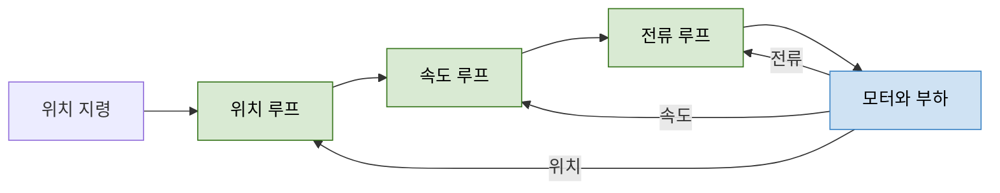

> **기준 출처:** [MathWorks, Designing Cascade Control System with PI Controllers](https://www.mathworks.com/help/control/ug/designing-cascade-control-system-with-pi-controllers.html) · [MathWorks, Tuning Multiloop Control Systems](https://www.mathworks.com/help/control/ug/tuning-multi-loop-control-systems.html) · [Design World, servo loops FAQ](https://www.designworldonline.com/faq-what-are-servo-motor-current-velocity-and-position-loops-and-bandwidths/) / 확인일 2026-11-12
> **시리즈:** [목차](/posts/00-multiaxis-series/) | 이전 → [03. 조인트 독립제어](/posts/03-independent-joint-control/) | 다음 → [05. 「동시에」란 무엇인가](/posts/05-axis-synchronization/)

03편까지 오면 감속비 덕분에 축 하나를 독립 루프 하나로 볼 수 있다. 이 글은 그 루프 하나를 연다. 안에 루프가 세 겹 있고, 이것이 이 시리즈에서 「여러 개」의 두 번째 뜻이다. 위치 오차를 곧바로 토크 지령으로 바꾸면 될 것을 왜 세 겹으로 쌓는지, 그 구조가 성립하려면 무엇이 참이어야 하는지를 본다. 한 축 안에서도 시간 축이 이미 세 층으로 갈려 있다는 것을 알아야, 다음 편에서 축들 사이의 「동시에」를 어느 층에서 말하는지 정할 수 있다.

| 이 글에 나오는 말 | 뜻 |
| --- | --- |
| 대역폭 | 루프가 지령 변화를 따라갈 수 있는 주파수의 대략적 한계. 루프가 얼마나 빠른지를 수 하나로 적은 것 |
| 안쪽 루프 / 바깥 루프 | 바깥 루프의 출력이 안쪽 루프의 지령이 되는 관계. 안쪽이 먼저 닫히고 바깥이 그 위에 얹힌다 |
| 외란 | 지령이 아닌데 출력에 영향을 주는 입력. 부하 토크 변동, 마찰, 전원 변동 같은 것 |
| 위상 지연 | 신호가 시스템을 지나며 시간적으로 밀리는 정도. 되먹임 루프 안에서 쌓이면 안정 여유가 깎인다 |

## 1. 캐스케이드의 목적 — 외란을 들어온 자리 가까이서 잡는다

루프를 겹치는 이유를 성능 향상 일반으로 설명하면 왜 하필 이 구조인지가 나오지 않는다. 문헌은 목적을 더 좁게 적는다.

> 안쪽 루프의 제어기 C2 는 외란 d2 가 P1 으로 번지기 전에 국소적으로 제거하는 이차 제어기다.
> — MathWorks, Designing Cascade Control System with PI Controllers

MathWorks 의 다른 문서인 다중 루프 튜닝 예제는 목적을 이렇게 적는다. 캐스케이드는 부드러운 추종과 빠른 외란 제거를 함께 얻으려고 쓰고, 안쪽 루프가 더 빠른 것은 외란이 바깥 루프에 닿기 전에 상쇄하기 위해서다.

캐스케이드가 하는 일은 「빨라지는 것」이 아니라 「국소적으로 잡는 것」이다. 외란이 들어오는 자리 가까이에 되먹임을 하나 더 두는 구조다. 외란이 들어온 지점과 그것을 감지하는 지점 사이에 플랜트가 많이 끼어 있을수록 대응이 늦어지므로, 가까운 곳에서 먼저 잡는다.

모터 축에서는 이 논리가 적용되는 자리가 분명하다. 부하 토크가 변하거나 마찰이 달라지면 그 영향은 전류에서 먼저 나타나고, 다음에 속도로, 마지막에 위치로 번진다. 위치만 보고 있으면 이미 두 단계를 지난 뒤에야 알게 된다.

## 2. 세 겹의 구성

초록 셋은 설계자가 만드는 루프, 파랑은 물리다. 오른쪽으로 가는 화살표는 바깥 루프의 출력이 안쪽 루프의 지령이 된다는 뜻이고, 되돌아오는 화살표 셋은 각 루프가 자기 층의 양을 따로 측정한다는 뜻이다. 되먹임이 하나가 아니라 셋이다.

| 루프 | 무엇을 비교하나 | 무엇을 내보내나 | 흔한 형태 |
| --- | --- | --- | --- |
| 위치 (가장 바깥) | 지령 위치와 실제 위치의 차이(추종 오차) | 그것을 줄이는 속도 지령 | 비례(P) 게인만 |
| 속도 (중간) | 지령 속도와 실제 속도(타코미터나 엔코더) | 전류(토크) 지령 | PI |
| 전류 (가장 안쪽) | 지령 전류와 실제 전류 | 전압 지령 | PI |

표는 Design World 의 정리를 따른다. 전류가 가장 안쪽인 이유도 같은 글의 문장에 들어 있다. 전류 루프의 목적은 토크 제어이고, 토크가 속도를, 속도가 위치를 움직인다. 제어기가 물리적으로 직접 만들 수 있는 것은 위치도 속도도 아니고 전류이며, 전류가 곧 토크다. 캐스케이드는 물리적 인과 사슬을 뒤집어 쌓은 구조로 읽을 수 있다.

이 순서를 되먹임으로 한 층씩 되짚는 것이 세 겹 루프다. 전류 루프가 전압에서 전류까지, 속도 루프가 토크에서 속도까지, 위치 루프가 속도에서 위치까지를 맡는다.

로봇 관절에서도 같은 생각이 쓰인다. UPC 튜토리얼의 분산 제어에서는 위치 되먹임 단에 PI 제어기를 두고, 비례 게인을 크게 하면 외란의 영향이 줄고, 적분 항은 정상상태에서 중력이 위치에 주는 영향을 상쇄하게 해 준다고 설명한다. 모터 조인트에서 각 루프에 무엇을 넣고 어떻게 튜닝하는지는 [ADRC 17편](/posts/17-motor-joint-loops/)이 다룬다. 이 글은 루프가 겹치는 구조만 본다.

## 3. 대역폭 분리 — 몇 배인가

> 캐스케이드 제어 시스템이 제대로 동작하려면 안쪽 루프가 바깥 루프보다 훨씬 빨리 응답해야 한다.
> — MathWorks, Designing Cascade Control System with PI Controllers

「훨씬」이 얼마인지는 출처마다 맥락이 다르다. 수치를 쓸 때는 출처와 맥락을 함께 적는다.

| 출처 | 맥락 | 배수 |
| --- | --- | --- |
| Design World | 서보 드라이브의 세 겹 루프 | 속도 루프는 위치 루프의 5~10배, 전류 루프는 속도 루프의 5~10배 |
| MathWorks, 캐스케이드 설계 예제 | 두 겹 루프 | 안쪽 2 rad/s, 바깥 목표 0.2 rad/s. 10배 |
| MathWorks, 다중 루프 튜닝 예제 | 두 겹 루프 동시 튜닝 | 바깥 최소 0.2 rad/s, 충분한 외란 제거를 위해 안쪽은 10배 |

세 줄은 서로 다른 실험 결과가 아니라 같은 설계 지침을 다르게 적은 것이다. 5배와 10배 중 어느 쪽이 옳으냐는 질문은 성립하지 않는다. 지침이 말하는 것은 배수가 충분히 커야 한다는 것이고, 충분한지는 그 시스템에서 확인한다. 세 겹 구조에서는 배수가 곱해진다. Design World 의 범위를 그대로 곱하면 위치 루프와 전류 루프 사이가 25~100배다.

## 4. 배수와 순서가 필요한 이유

두 방향에서 설명된다. 하나는 출처의 문장이고, 하나는 그 문장과 되먹임 루프의 일반 성질에서 끌어낸 설명이다.

**안쪽이 느리면 안쪽 루프가 있을 이유가 없어진다.** Design World 는 안쪽 루프의 대역폭이 충분하지 않으면 안쪽 루프가 바깥 루프에 거의 영향을 주지 못한다고 적는다. 1절로 돌아가면 뜻이 분명하다. 안쪽 루프의 일은 외란이 바깥으로 번지기 전에 잡는 것인데, 안쪽이 바깥과 비슷한 속도면 「번지기 전」이라는 시간 여유가 없다.

**바깥 루프에게 안쪽 루프는 「플랜트의 일부」여야 한다.** 바깥 루프를 설계할 때는 이미 닫힌 안쪽 루프를 하나의 블록으로 놓고 본다. 안쪽 루프가 충분히 빠르면 바깥이 다루는 주파수 대역에서 그 블록은 거의 1(지령대로 나온다)에 가깝고, 바깥 설계에서 사실상 사라진다. 배수가 작으면 그 블록이 바깥의 관심 대역 안으로 자기 동역학과 위상 지연을 그대로 들고 들어오고, 바깥 루프의 위상 여유가 그만큼 깎인다.

> 위 두 번째 설명은 출처의 문장이 아니라, 대역폭 분리 지침과 되먹임 루프의 일반 성질(루프 안의 위상 지연이 안정 여유를 깎는다)에서 끌어낸 것이다.
{: .prompt-info }

이 설명을 뒤집으면 튜닝 순서가 나온다. MathWorks 는 안쪽 루프 제어기를 먼저 설계하고, 안쪽 루프를 닫은 상태에서 바깥 루프 제어기를 설계하는 것을 모범 절차로 든다. 바깥 루프가 설계 때 보는 플랜트에는 이미 닫힌 안쪽 루프가 들어 있다는 뜻이다. 순서를 뒤집어 바깥을 맞춰 놓고 안쪽을 건드리면, 바깥이 설계 때 본 플랜트가 달라져 다시 틀어지고 왕복이 끝나지 않는다.

## 5. 세 루프는 어디서 도는가

세 루프가 같은 장치에서 같은 사람 손으로 맞춰지는 것은 아니다. Design World 는 전류 제어 파라미터를 보통 제조사가 설정해 두므로 사용자가 이 루프를 튜닝할 일이 줄어든다고 적는다. 가장 안쪽 루프는 사용자가 만지는 층이 아니라 드라이브가 들고 있는 층이다.

세 루프는 대개 같은 주기로 돌지도 않는다.

| 층 | 왜 주기가 달라야 하나 |
| --- | --- |
| 전류 | 대역폭이 가장 높으므로 표본화도 가장 촘촘해야 한다. 전력 스위칭과 직접 맞물려 있어 구동 회로 옆에 있어야 한다 |
| 속도 | 전류보다 느리고 위치보다 빠르다. 전류 루프와 같은 드라이브 안에 있는 경우가 많다 |
| 위치 | 대역폭이 가장 낮다. 표본화도 가장 느려도 된다 |

> 이 표의 「왜」는 인용이 아니라 3절의 대역폭 지침에서 따라 나오는 판단이다.
{: .prompt-info }

드라이브와 상위 제어기의 경계는 운전 모드가 정한다. Synapticon 의 CSP(Cyclic Synchronous Position) 문서에서 궤적 생성기는 상위 제어 장치에 있고, 상위는 주기적으로 동기된 방식으로 목표 위치를 드라이브에 준다. 드라이브는 위치 제어, 속도 제어, 토크 제어를 모두 수행하고 추종 오차를 감시하며, 실제 위치값을 상위로 돌려준다.

| 자리 | CSP 모드에서 하는 일 |
| --- | --- |
| 상위 제어 장치 | 궤적 생성, 매 주기 목표 위치 전송 |
| 버스 | 목표 위치와 실제 위치값이 오간다 |
| 드라이브 | 위치, 속도, 토크(전류) 루프를 닫는다 |

이 모드에서 버스를 건너는 것은 루프 내부 신호가 아니라 주기마다 갱신되는 목표 위치다. 축이 여럿이면 그 목표 위치가 축마다 언제 반영되는지가 문제가 되고(05편), 주기마다 모든 축의 값을 실어 나르는 데 드는 시간이 주기의 하한을 정한다(06편). 반대로 위치 루프를 상위 제어기에서 닫는 구성이라면 위치 루프 안에 통신이 끼고, 통신 주기와 지연이 곧 위치 루프 대역폭의 상한이 된다고 본다.

전류 루프가 드라이브 안에 있다는 것은 03편의 감속기와 짝을 이룬다. Modern Robotics 8.9 가 적듯 감속기가 토크를 G 배로 키우고 속도를 G 로 나눠 관절에 전달한다면, 전류 루프는 토크 지령을 실제 토크로 만드는 층이다. 위쪽 두 루프는 그 층이 제대로 동작한다는 전제 위에서 설계된다.

## 6. 어겼을 때

| 어긴 것 | 결과 | 근거 |
| --- | --- | --- |
| 안쪽 대역폭이 충분히 높지 않다 | 안쪽 루프가 바깥 루프에 거의 영향을 주지 못한다. 캐스케이드로 얻으려던 것을 얻지 못한다 | Design World |
| 바깥부터 설계했다 | 바깥이 전제한 안쪽 루프가 나중에 바뀐다. 안쪽을 손볼 때마다 바깥이 틀어진다 | MathWorks 절차의 반대 |
| 두 루프의 대역폭이 가까워졌다 | 바깥 루프의 관심 대역 안으로 안쪽 동역학과 위상 지연이 들어와 안정 여유가 깎인다 | 4절의 설명에서 끌어낸 판단(인용 아님) |

세 번째 줄은 헷갈리기 쉬운 형태로 본다. 바깥 루프 게인만 올렸는데 진동이 안쪽 루프 쪽 신호에서 보이는 상황이 여기 해당한다. 원인이 바깥에 있는데 증상이 안쪽에 나타나므로, 안쪽 게인을 다시 만지는 대응은 문제를 옮기기만 할 수 있다.

## 7. 정리

- 캐스케이드의 목적은 빨라지는 것이 아니라 외란을 들어온 자리 가까이서, 바깥으로 번지기 전에 잡는 것이다. 안쪽 제어기는 외란을 국소적으로 제거하는 이차 제어기다
- 세 겹은 바깥에서 안으로 위치, 속도, 전류이고 되먹임도 셋이다. 위치는 P, 속도와 전류는 PI 가 흔하다
- 전류가 가장 안쪽인 이유는 제어기가 직접 만들 수 있는 것이 전류이고 전류가 곧 토크이기 때문이다. 캐스케이드는 전압, 전류, 토크, 가속도, 속도, 위치로 이어지는 인과 사슬을 되먹임으로 되짚은 구조다
- 대역폭 분리는 서보 드라이브 문헌에서 단계마다 5~10배, MathWorks 예제에서 10배다. 세 겹이면 배수가 곱해진다. 이 수들은 실험 결과가 아니라 설계 지침이다
- 배수가 필요한 이유는 둘이다. 안쪽이 느리면 「번지기 전에 잡는다」는 시간 여유가 없고, 배수가 작으면 안쪽 루프가 바깥의 관심 대역에 위상 지연을 들고 들어와 바깥의 안정 여유를 깎는다(뒤쪽은 지침에서 끌어낸 설명이다)
- 설계는 안쪽부터 하고, 안쪽을 닫은 상태에서 바깥을 설계한다
- 세 루프는 같은 주기로 돌지 않는다. 전류 루프 파라미터는 보통 제조사가 잡는다. CSP 모드에서는 드라이브가 세 루프를 모두 닫고, 버스로는 주기마다 목표 위치가 간다

## 참고

- [MathWorks, Designing Cascade Control System with PI Controllers](https://www.mathworks.com/help/control/ug/designing-cascade-control-system-with-pi-controllers.html)
- [MathWorks, Tuning Multiloop Control Systems](https://www.mathworks.com/help/control/ug/tuning-multi-loop-control-systems.html)
- [Design World, FAQ: What are servo motor current, velocity and position loops and bandwidths?](https://www.designworldonline.com/faq-what-are-servo-motor-current-velocity-and-position-loops-and-bandwidths/)
- [Synapticon, Cyclic Synchronous Position Control (CSP)](https://doc-legacy.synapticon.com/software/40/motion_control/operation_modes/csp/index.html)
- [Institute of Robotics and Industrial Informatics (UPC), Motion Control — Service and Industrial Robotics Tutorials](https://sir.upc.edu/projects/ris_tutorials/advanced/motion_control/motion_control.html)
- [K. M. Lynch, F. C. Park, Modern Robotics 8.9 — Actuation, Gearing, and Friction](https://modernrobotics.northwestern.edu/nu-gm-book-resource/8-9-actuation-gearing-and-friction/)
