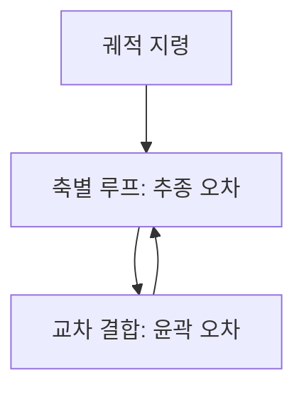

> **기준 출처:** [Beckhoff, Synchronization modes of an EtherCAT slave](https://infosys.beckhoff.com/content/1033/ethercatsystem/2469122443.html) · [ETG, EtherCAT Technology](https://www.ethercat.org/en/technology.html) · [Wang, Chen, Zhang, Science Progress 2021](https://pmc.ncbi.nlm.nih.gov/articles/PMC10454866/) / 확인일 2026-11-12
> **시리즈:** [목차](/posts/00-multiaxis-series/) | 이전 → [04. 캐스케이드 다중 루프](/posts/04-cascade-loops/) | 다음 → [06. 통신이 정하는 상한](/posts/06-communication-cycle-budget/)

02~04편은 제어 법칙의 문제였다. 축끼리 서로 미는 힘, 그것을 무시해도 되는 조건, 루프를 세 겹으로 쌓는 이유가 그랬다. 이 글은 제어 법칙이 완벽해도 남는 문제, 곧 축마다 목표값이 언제 도착하고 언제 반영되는가를 다룬다. 이것은 게인을 아무리 잘 잡아도 좋아지지 않는다. 「동시에」를 두 요구로 나누고, 어긋남이 궤적에 무엇을 남기는지 계산한다. 다음 편이 그 시각을 정하는 통신 예산을 계산하므로, 무엇이 어긋나면 무엇이 나빠지는지를 여기서 먼저 정해 둔다.

| 이 글에 나오는 말 | 뜻 |
| --- | --- |
| 추종 오차 (tracking error) | 한 축에서 그 축의 지령과 실제 위치의 차이. 축마다 따로 정의된다 |
| 보간 (interpolation) | 하나의 경로를 매 주기 축별 목표값 한 벌로 잘라 나누는 계산. 상위 제어기가 한다 |
| 지터 (jitter) | 주기가 일정하지 않고 흔들리는 정도. 1 ms 마다 와야 하는데 0.9 ms 나 1.2 ms 에 오는 것 |

이 글에서는 축이 몇 개든 각 축이 매 주기 스칼라 목표 위치 하나를 받는다고만 본다.

## 1. 「동시에」는 요구가 둘이다

「축들이 동시에 움직인다」를 요구 사항으로 적으려 하면 곧바로 두 갈래로 갈라진다. 이 글에서는 두 요구를 이렇게 부른다.

| 요구 | 묻는 것 | 깨지는 곳 |
| --- | --- | --- |
| 지령 동기 | 축들이 받는 목표값이 같은 시각의 경로 위 한 점에서 나왔는가 | 경로를 나누는 계산 구조 |
| 시간 동기 | 그 목표값들이 같은 순간에 실제로 반영되는가 | 통신과 시계 |

**지령 동기**가 깨진 예: 축 1 은 $$t_k$$ 시점의 경로 점을 받고 축 2 는 $$t_{k-1}$$ 시점의 경로 점을 받으면, 두 값이 아무리 정확히 실행되어도 합쳐진 결과는 원하는 경로가 아니다.

**시간 동기**가 깨진 예: 값은 같은 벌인데 축 1 은 지금 반영하고 축 2 는 30 µs 뒤에 반영하면, 그 30 µs 동안 두 축은 서로 다른 시각의 경로 위에 있다.

둘은 다른 층에서 깨지고 다른 방법으로 고친다. 아래 사슬에서 어느 칸이 어느 쪽인지 보면 구분이 분명해진다.

파랑 두 칸에서 지령 동기가 정해진다. 여기서 한 벌이 만들어지지 않으면 뒤에서 시계를 아무리 맞춰도 소용없다. 노랑 두 칸은 그 한 벌이 흩어지는 자리이고, 초록 칸에서 시간 동기가 정해진다. 도착과 반영은 다른 칸이다.

## 2. 지령 동기 — 한 벌로 만들어야 한 벌로 움직인다

지령 동기를 만드는 구조는 단순하다. 경로를 축별로 따로 계산하지 않고, 하나의 보간기가 매 주기 축별 목표값을 한 벌씩 낸다.

Synapticon 의 CSP(Cyclic Synchronous Position) 문서에서 궤적 생성기는 드라이브가 아니라 상위 제어 장치에 있다. 상위는 주기적으로 동기된 방식으로 목표 위치를 드라이브에 주고, 드라이브는 그 값을 따라 위치, 속도, 토크 제어를 한다. 경로를 만드는 계산이 한 군데에 모여 있고 드라이브는 그것을 실행하므로, 같은 주기에 나간 값들은 같은 경로 점에서 나온 한 벌이다. 이 배치가 지령 동기를 구조적으로 보장한다.

반대 배치를 생각해 보면 차이가 보인다. 축마다 자기 프로파일 생성기를 갖고, 각자 「3초 동안 90도 돌아라」 식의 지령을 받는다고 하자. 시작과 끝은 맞출 수 있어도 축마다 가감속 프로파일의 모양이 조금씩 다르면 중간 구간에서는 각 축의 위치가 같은 경로 점에 대응하지 않는다. 경로가 직선이어야 하는데 축별 프로파일이 서로 다른 곡선을 그리면 합성 경로는 휘어진다.

| 배치 | 경로를 나누는 계산 | 중간 구간의 지령 동기 |
| --- | --- | --- |
| 보간기 하나 (CSP 처럼 상위에서 주기마다 목표 위치) | 한 군데 | 매 주기 한 벌이므로 유지된다 |
| 축별 프로파일 생성기 (축마다 「T 초에 목표까지」) | 축마다 따로 | 프로파일 모양이 다르면 깨진다 |

> 축별 프로파일 생성기 쪽 서술은 출처의 문장이 아니라 지령 동기의 정의에서 따라 나오는 판단이다.
{: .prompt-info }

대신 주기마다 모든 축에 값을 보내야 하고, 주기마다 오가는 데이터가 축 수에 비례한다. 그것이 주기의 하한을 어떻게 정하는지가 06편이다.

## 3. 시간 동기 — 도착과 반영은 다른 사건이다

한 벌로 잘 만들어 보내도, 각 노드가 받자마자 출력에 반영하면 반영 시각이 흩어진다. ETG 는 EtherCAT 프레임이 하드웨어 전파 지연만큼만 늦어진다고 설명하고, 분산 클록을 맞출 때 이 전파 지연을 노드마다 측정해 보상해야 한다고 적는다. 프레임은 노드를 차례로 지나가므로 앞쪽 노드와 뒤쪽 노드의 수신 시각이 다르고, 노드마다 내부 처리 시간도 다르다. 그래서 「언제 반영할 것인가」가 별도 설정 항목이 된다. Beckhoff 가 정리한 슬레이브 동기 모드는 셋이다.

| 모드 | 로컬 주기를 시작시키는 것 | 반영 시각의 성질 |
| --- | --- | --- |
| Free Run | 응용 컨트롤러의 로컬 타이머 인터럽트. EtherCAT 사이클과 동기되지 않는다 | 통신 주기와 무관하게 돈다. 노드끼리 맞을 이유가 없다 |
| SM-Synchronous | SyncManager 2 이벤트(입력만 있으면 SM3). 지나가는 프레임을 처리할 때 생긴다 | 반영이 프레임 처리에 묶인다. 프레임이 노드를 지나며 생기는 수신 시각 차이가 그대로 남는다 |
| DC-Synchronous | 분산 클록의 SYNC0 이벤트. SYNC1 로 출력 유효 시각이나 입력 래치 시각을 옮길 수 있다 | 반영을 프레임 도착에서 떼어 공통 시각에 묶는다. 노드 전체가 같은 시각에 맞춰진다 |

세 번째 줄이 이 절의 답이다. 데이터는 미리 도착시켜 두고, 반영은 모두가 공유하는 시각에 한다. 분산 클록의 내부 동작은 [EtherCAT 09편](/posts/09-distributed-clocks/)에 있다.

ETG 는 결과 지터가 1 µs 보다 훨씬 작다고 적고, Beckhoff 제품 개요는 보통 두 자리 나노초 범위라고 덧붙인다. 벤더가 공개한 사양이므로 실제 구성의 값은 그 구성에서 잰다.

같은 발상을 네트워크 일반으로 넓힌 것이 IEEE 1588 PTP 다. NIST 의 소개 문서는 이 표준이 측정, 제어 시스템의 시계 동기 요구를 다루며, 그런 시스템의 시각 정확도 요구가 흔히 마이크로초 이하라고 적는다. 시스템이 분산될수록 노드마다 시계를 따로 갖게 되고, 그 시계들을 맞추는 일 자체가 별도의 문제가 된다.

## 4. 오차가 두 종류가 된다 — 추종 오차와 윤곽 오차

축이 여러 개일 때는 오차가 두 종류다.

| | 추종 오차 (tracking error) | 윤곽 오차 (contour error) |
| --- | --- | --- |
| 무엇의 차이 | 한 축의 지령과 그 축의 실제 위치 | 실제 위치에서 기준 궤적까지의 최단 거리 |
| 정의되는 곳 | 축마다 따로 | 축들이 함께 그리는 경로 위 |
| 줄이는 방법 | 그 축의 루프를 조인다 | 축들 사이의 관계를 조인다 |

Wang, Chen, Zhang(2021)은 윤곽 오차를 실제 위치에서 기준 위치의 접선까지의 최단 거리로 추정한다. 같은 논문은 단일 축의 추종 성능만 개선해서는 다축 시스템의 가공 정밀도를 보장할 수 없고, 축 사이의 게인 파라미터 차이와 동특성 불일치도 윤곽 오차를 만든다고 적는다. 축 A 와 축 B 가 각자는 잘 따라가는데 응답 속도가 서로 다르면, 두 축이 함께 그리는 경로는 원하는 모양이 아니게 된다.

그래서 다축 제어에는 축별 루프 위에 축 사이의 관계를 직접 되먹이는 층이 하나 더 붙는다. 논문이 소개하는 Koren 의 교차 결합 제어(cross-coupled control)는 추종 오차와 기준 윤곽의 기하 관계로 윤곽 오차를 추정하고, 그것으로 각 축의 보상량을 계산한다.

축이 여러 개인 순간 목표가 하나 늘어난다. 각 축을 잘 따라가게 하는 것과, 축들이 서로 맞게 움직이게 하는 것은 별개의 목표다.

## 5. 시각 어긋남을 윤곽 오차로 환산하기

> 이 절의 유도는 출처에서 인용한 것이 아니라 3절의 시각 어긋남과 4절의 윤곽 오차 정의를 이어 이 글에서 계산한 것이다.
{: .prompt-info }

두 축이 평면 위에 직선을 그린다.

| 기호 | 뜻 |
| --- | --- |
| $$v = (v_1, v_2)$$ | 경로 위 지령 속도 벡터. 두 성분이 각 축의 속도다 |
| $$\lVert v \rVert$$ | 경로 방향 합성 속도의 크기 |
| $$\Delta t$$ | 축 1 의 반영 시각이 축 2 보다 늦은 양 |
| $$\varepsilon$$ | 그 결과로 생기는 윤곽 오차 |

축 1 만 $$\Delta t$$ 늦게 반영하면 그 축의 위치는 $$\Delta t$$ 전의 값이다. 속도가 그 사이 일정하면 위치 오차 벡터는 $$e = (-v_1\Delta t,\ 0)$$ 이다. 경로의 접선 단위 벡터가 $$\hat{t} = (v_1, v_2)/\lVert v \rVert$$ 이므로 수직 단위 벡터는 $$\hat{n} = (-v_2, v_1)/\lVert v \rVert$$ 이고, 윤곽 오차는 오차 벡터의 수직 성분이다.

$$\varepsilon = \left\lvert e \cdot \hat{n} \right\rvert = \frac{\lvert v_1 v_2 \rvert}{\lVert v \rVert}\,\Delta t$$

- 한 축만 움직이면 $$v_2 = 0$$ 이라 $$\varepsilon = 0$$ 이다. 경로 위에서 늦을 뿐 경로를 벗어나지 않는다. 윤곽 오차는 축이 둘 이상 함께 움직일 때만 생기고, 그래서 다축 고유의 문제다
- $$\lVert v \rVert$$ 가 같을 때 $$\lvert v_1 v_2 \rvert$$ 는 45도 직선에서 가장 크고, 이때 $$\varepsilon = \lVert v \rVert\,\Delta t / 2$$ 다. 합성 속도와 시각 어긋남의 곱에 비례한다

| 합성 속도 | $$\Delta t$$ | 45도 직선의 $$\varepsilon$$ |
| ---: | ---: | ---: |
| 0.5 m/s | 20 µs | 5 µm |
| 0.5 m/s | 1 ms | 250 µm |

$$\Delta t$$ 의 50배 차이가 그대로 오차 50배로 나온다. 분산 클록의 1 µs 급 수치와 통신 주기의 밀리초 급 수치가 왜 서로 다른 층의 이야기인지가 여기서 보인다.

전제는 속도가 그 구간에서 일정하고, 어긋남이 축 하나에만 있고, 축의 추종 오차는 0 이라는 것이다. 실제로는 축마다 다른 양이 어긋나고 추종 오차도 겹치므로 이 식은 규모를 가늠하는 용도다.

## 6. 식에 제어 게인이 없다 — 인프라의 문제

위 식의 $$\varepsilon$$ 은 속도와 $$\Delta t$$ 만으로 정해지고 루프 게인은 들어 있지 않다. 각 축의 루프를 아무리 조여도 $$\Delta t$$ 가 줄지 않으면 $$\varepsilon$$ 은 그대로다. $$\Delta t$$ 를 정하는 것들은 모두 제어 법칙 바깥에 있다.

| $$\Delta t$$ 를 정하는 것 | 묻는 것 | 관련 절 |
| --- | --- | --- |
| 경로 생성의 위치 | 한 군데에 모여 있는가, 축마다 흩어져 있는가 | 2절 |
| 반영 시각의 기준 | 프레임 도착인가, 공통 시계인가 | 3절 |
| 주기의 흔들림 | 지터가 그대로 $$\Delta t$$ 의 일부가 된다 | [RTOS 11편](/posts/11-jitter-sources/) |
| 주기 안의 전송 | 한 주기 안에 모든 축의 값을 보낼 수 있는가. 못 보내면 어떤 축은 지난 주기 값을 쓰고, 그것은 $$\Delta t$$ 가 한 주기만큼 커진 것과 같다 | 06편 |

그래서 이 문제의 처방은 게인 튜닝보다 구조 선택이라고 본다. 보간을 한 군데로 모으고, 반영 시각을 공통 시계에 묶고, 주기 예산을 지키는 것이다. 다만 시각이 완벽히 맞아도 4절의 축 사이 동특성 불일치는 남고, 이쪽은 교차 결합 제어처럼 제어 층에서 다룬다. 윤곽 오차의 원인은 시계와 통신 쪽, 축 사이의 응답 차이 쪽 두 갈래이고, 두 층을 다 봐야 하며 지금 어느 쪽이 지배적인지를 먼저 판정해야 한다.

## 7. 정리

- 「동시에」는 두 요구다. 지령 동기는 목표값이 같은 시각의 경로 점에서 나왔는가, 시간 동기는 그 값이 같은 순간에 반영되는가다. 깨지는 층도 고치는 방법도 다르다
- 지령 동기는 구조로 만든다. CSP 모드는 궤적 생성기를 상위에 두고 드라이브에 주기마다 목표 위치를 준다. 축마다 프로파일 생성기를 따로 두면 중간 구간에서 한 벌이 깨질 수 있다. 대가로 주기마다 오가는 데이터가 축 수에 비례한다
- 도착과 반영은 다른 사건이다. SM-Synchronous 는 반영이 프레임 처리에 묶이고, DC-Synchronous 는 SYNC0 라는 공통 시각에 묶인다. 공개 사양의 지터는 1 µs 보다 훨씬 작다
- 다축에서는 추종 오차와 별도로 윤곽 오차가 생기고, 축 사이 게인 차이와 동특성 불일치도 윤곽 오차를 만든다. 그래서 교차 결합처럼 축 사이 관계를 되먹이는 층이 따로 붙는다
- 반영 시각이 $$\Delta t$$ 어긋나면 윤곽 오차는 $$\lvert v_1 v_2 \rvert \Delta t / \lVert v \rVert$$, 45도 직선에서 $$\lVert v \rVert \Delta t / 2$$ 다(이 글의 유도). 한 축만 움직이면 0 이다
- 이 식에 제어 게인이 없다. 시각 어긋남은 보간 배치, 반영 시각 기준, 주기 예산의 문제이고, 동특성 불일치는 제어 층의 문제다. 두 층을 나눠 판정한다

## 참고

- [Synapticon, Cyclic Synchronous Position Control (CSP)](https://doc-legacy.synapticon.com/software/40/motion_control/operation_modes/csp/index.html)
- [Beckhoff, Synchronization modes of an EtherCAT slave](https://infosys.beckhoff.com/content/1033/ethercatsystem/2469122443.html)
- [EtherCAT Technology Group, EtherCAT Technology](https://www.ethercat.org/en/technology.html)
- [Beckhoff, EtherCAT — the Ethernet Fieldbus](https://www.beckhoff.com/en-us/products/i-o/ethercat/)
- [NIST, Introduction to IEEE 1588](https://www.nist.gov/el/intelligent-systems-division-73500/introduction-ieee-1588)
- [S. Wang, Y. Chen, G. Zhang, Adaptive fuzzy PID cross coupled control for multi-axis motion system based on sliding mode disturbance observation, Science Progress 104(2), 2021](https://pmc.ncbi.nlm.nih.gov/articles/PMC10454866/)
