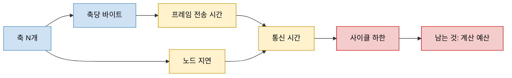

> **기준 출처:** [acontis, EtherCAT Cycle Time Calculator Walkthrough](https://www.acontis.com/en/ethercat-cycle-time-calculator-walkthrough.html) · [Beckhoff, EtherCAT General](https://infosys.beckhoff.com/content/1033/tc3_io_intro/1257993099.html) · [QEC, EtherCAT CiA 402 User Manual](https://www.qec.tw/ethercat/api/cia402/) / 확인일 2026-11-12
> **시리즈:** [목차](/posts/00-multiaxis-series/) | 이전 → [05. 「동시에」란 무엇인가](/posts/05-axis-synchronization/) | 다음 → [07. 자원 경합과 실행시간 예산](/posts/07-execution-time-budget/)

05편의 요구는 목표값 한 벌을 매 주기 전부 보낼 수 있어야 성립한다. 이 글은 축 수가 늘 때 그것이 가능한 주기의 하한을 EtherCAT 의 공개 수치로 계산한다. 축 수에서 바이트, 전송 시간, 사이클 하한으로 가는 사슬을 숫자로 따라가고, 사이클을 줄이지 못하는 이유가 통신인지 계산인지 가를 수 있게 하는 것이 목표다. 다음 편(07)이 같은 주기 안의 계산 몫을 보는데, 통신이 쓰고 남은 것이 계산 예산이므로 이쪽을 먼저 본다. 프로토콜 자체는 다루지 않는다. 프레임 구조는 [EtherCAT 04편](/posts/04-frame-datagram-wkc/), PDO 매핑은 [10편](/posts/10-process-data-pdo-mapping/)에 있다.

| 이 글에 나오는 말 | 뜻 |
| --- | --- |
| 프로세스 데이터 (PDO) | 매 주기 고정된 배치로 오가는 데이터. 축이면 보통 목표 위치, 상태 워드 같은 것 |
| 데이터그램 | 프레임 안에 실리는 읽기/쓰기 단위 한 덩이. 헤더와 워킹 카운터가 붙는다 |
| 워킹 카운터 (WKC) | 그 데이터그램을 실제로 처리한 노드 수를 세는 값. 기대치와 다르면 누가 빠진 것이다 |
| 사이클 타임 | 제어기가 한 바퀴 도는 주기. 이 글에서 계산하려는 대상 |
| 분산 클록 (DC) | 노드들의 시계를 맞춰, 프레임 도착과 무관한 공통 시각에 출력을 반영하게 하는 장치 |

## 1. 사슬의 모양

축이 늘어나는 것이 왜 곧바로 실시간 제약이 되는가. 주기마다 모든 축에 값을 보내야 하므로 데이터량이 축 수에 비례하고, 데이터량은 곧 시간이기 때문이다.

노랑의 두 갈래, 프레임 전송 시간과 노드 지연이 둘 다 N 에 비례한다. 하나만 비례하면 그 항만 관리하면 되지만 둘이 함께 자라므로, 축을 두 배로 늘리면 통신 시간도 대략 두 배가 된다. 빨강은 그 결과 남는 것이 계산 예산이라는 뜻이다. 계산 예산은 따로 정하는 값이 아니라 통신이 쓰고 남긴 값이다.

## 2. 축 하나가 몇 바이트인가

QEC 의 CiA 402 매뉴얼이 든 CSP(Cyclic Synchronous Position) 모드 PDO 매핑은 네 객체다.

| 방향 | 객체 | 이름 | 비트 |
| --- | --- | --- | ---: |
| 상위 → 드라이브 (RxPDO) | 0x6040 | Controlword | 16 |
| 상위 → 드라이브 (RxPDO) | 0x607A | Target position | 32 |
| 드라이브 → 상위 (TxPDO) | 0x6041 | Statusword | 16 |
| 드라이브 → 상위 (TxPDO) | 0x6064 | Position actual value | 32 |

양방향을 더하면 축 하나에 12 바이트다. 이 글은 입력과 출력이 같은 프레임에 실린다고 보고 12 바이트를 모두 센다. Synapticon 의 CSP 문서는 속도와 토크 실제값도 상위로 보고된다고 적으므로 실제 매핑은 이보다 클 수 있다. 실제 속도, 실제 토크, 오류 코드, 터치 프로브, 안전 관련 데이터가 더 붙으면 축당 20~40 바이트가 되어도 이상하지 않다고 본다. 그러므로 12 는 하한이고, 아래 계산은 가장 유리한 경우에도 이만큼은 든다는 것을 보는 것이다.

12 는 축이 하나 늘 때마다 통째로 더해진다. 축끼리 공유해서 줄일 수 있는 부분이 없으므로 이 항은 $$12N$$ 이다.

## 3. 바이트를 시간으로

100 Mbit/s 링크에서 1 바이트는 8 비트이므로 $$8 / (100 \times 10^6)$$ 초, 곧 80 ns 가 든다. acontis 의 사이클 타임 계산 안내도 같은 값을 적는다.

프레임에는 프로세스 데이터 말고도 고정 바이트가 붙는다. Beckhoff 문서의 구조로 이더넷 헤더, EtherCAT 헤더(2 바이트), 데이터그램 헤더(10 바이트), 워킹 카운터(2 바이트), FCS 가 있고, 물리 계층의 프리앰블과 프레임 간 간격이 더 붙는다. 이 합은 N 과 무관한 상수다. $$B_c$$ 라 쓰면

$$t_{\text{frame}} = (B_c + 12N) \times 80\ \text{ns}$$

이다. 이 글은 $$B_c = 50$$ 바이트로 둔다. 자릿수를 맞추려고 고른 값이고 규격 값이 아니다. $$B_c$$ 를 두 배로 잡아도 아래 결론은 크게 바뀌지 않는다. N 이 조금만 커지면 $$12N$$ 이 $$B_c$$ 를 넘어서기 때문이다.

Beckhoff 제품 개요는 가장 짧은 이더넷 텔레그램이 84 바이트(프레임 간 간격 포함)라서, 드라이브가 4 바이트를 주고받는 데 텔레그램을 따로 쓰면 유효 데이터율이 4/84 = 4.8 % 로 떨어진다고 설명한다. 한 프레임에 모으면 $$B_c$$ 를 모든 축이 나눠 쓴다.

| 한계 | 값 | 출처 |
| --- | --- | --- |
| 한 프레임의 데이터 | 최대 1,498 바이트 | acontis |
| 한 프레임의 데이터그램 | 최대 15개 | Beckhoff |
| 최소 길이 | 이더넷 프레임이 64 바이트 미만이면 1~32 바이트 패딩 | Beckhoff |

양 끝에서 모양이 바뀐다. 축이 아주 적으면 최소 길이 패딩 때문에 바이트를 줄여도 시간이 더는 줄지 않는다. 축이 아주 많으면 프레임이 나뉜다. 데이터그램 하나에 12 바이트 축을 실으면 $$10 + 12N + 2 \le 1498$$ 에서 $$N \le 123$$ 이다. 이를 넘으면 프레임이 여러 개가 되고, 프레임마다 오버헤드 바이트가 더 붙어 그 지점에서 통신 시간이 계단처럼 한 번 뛴다(acontis).

## 4. 통신 시간 — 프레임만 시간을 쓰는 것이 아니다

acontis 는 통신 시간을 프레임을 보내는 시간, 네트워크를 지나는 전파 지연, 프레임을 받는 시간의 합으로 설명한다. 노드마다 정적 지연이 있고, 표준 이더넷 MII/PHY 노드는 약 1 µs, LVDS(E-bus) 노드는 약 0.3 µs 다. 마스터 처리 시간은 잘 만든 구현이면 수 µs 이고, 응용이 입력을 다루는 시간은 이 결과에 들어 있지 않다.

> 아래 식은 위 세 성분을 겹침 없이 더한 이 글의 단순화이고 벤더 공식이 아니다. 출처는 노드 지연을 왕복에서 몇 번 세는지 적지 않는다. 규모를 보는 용도로만 쓴다.
{: .prompt-info }

$$t_{\text{comm}} \approx 2\,t_{\text{frame}} + N\,t_{\text{node}}, \qquad t_{\text{cycle}} \ge t_{\text{comm}} + t_{\text{calc}} + \text{여유}$$

| 기호 | 뜻 |
| --- | --- |
| $$t_{\text{frame}}$$ | 3절의 프레임 전송 시간 |
| $$t_{\text{node}}$$ | 노드 하나를 지나는 전달 지연 (MII 약 1 µs, E-bus 약 0.3 µs) |
| $$t_{\text{calc}}$$ | 마스터 쪽 계산 시간 (07편의 주제) |

축 하나에 드라이브 노드 하나가 붙는다고 보고 계산한다.

| 축 수 N | 프레임 바이트 | $$t_{\text{frame}}$$ | $$t_{\text{comm}}$$ (MII) | $$t_{\text{comm}}$$ (E-bus) |
| ---: | ---: | ---: | ---: | ---: |
| 6 | 122 | 9.8 µs | 25.5 µs | 21.3 µs |
| 12 | 194 | 15.5 µs | 43.0 µs | 34.6 µs |
| 24 | 338 | 27.0 µs | 78.1 µs | 61.3 µs |
| 32 | 434 | 34.7 µs | 101.4 µs | 79.0 µs |
| 48 | 626 | 50.1 µs | 148.2 µs | 114.6 µs |
| 64 | 818 | 65.4 µs | 194.9 µs | 150.1 µs |
| 100 | 1250 | 100.0 µs | 300.0 µs | 230.0 µs |

풀어 쓰면 MII 기준 $$t_{\text{comm}} \approx 8 + 2.92N$$ µs, E-bus 기준 $$8 + 2.22N$$ µs 다. 통신 시간은 축 수에 대해 1차이고 기울기는 축당 약 2~3 µs 다. [EtherCAT 02편](/posts/02-on-the-fly-processing/)처럼 프레임을 한 번, 노드 통과를 왕복 두 번 세면 MII 기준 $$4 + 2.96N$$ µs 로 기울기가 거의 같다.

표를 읽는 법은 셋이다.

**노드 지연 항은 바이트를 줄여도 줄지 않는다.** MII 기준으로 N = 6 에서는 노드 지연 합(6 µs)이 프레임 한 번의 시간(9.8 µs)보다 작지만, N = 48 이면 48 µs 대 50 µs 로 맞먹는다. 프레임을 한 번, 노드 통과를 왕복 두 번 세는 셈법에서는 노드 쪽이 오히려 더 크다. 이 항은 PDO 를 줄이는 최적화로는 줄지 않고, 물리 계층(E-bus)이나 토폴로지를 바꿔야 줄어든다.

**사이클을 정하면 축 수의 상한이 따라 나온다.**

| 사이클 | MII 기준으로 읽은 것 |
| --- | --- |
| 1 ms | 표의 어느 줄도 여유가 있다 |
| 250 µs | N = 48 에서 통신이 약 59 %, N = 64 에서 약 78 % 를 쓴다 |
| 100 µs | N = 24 에서 78 µs 를 써 계산과 여유에 22 µs 만 남고, N = 32 에서는 통신만으로 사이클을 넘는다 |

**대역폭이 남는 것과 시간이 남는 것은 다르다.** N = 24, 사이클 100 µs 에서 한 방향 링크가 프레임을 싣는 시간은 27 µs 로 주기의 3분의 1이 되지 않는다. 그런데도 빡빡한 이유는 프레임이 노드를 다 지나 돌아와야 그 주기의 입력이 갖춰지고, 그다음에야 계산을 시작할 수 있기 때문이다. 병목은 대역폭 점유율보다 왕복이 끝나야 한다는 순서 제약에 있다.

ETG 는 유효 데이터율을 90 % 초과로, 개발 목표를 100 µs 이하의 짧은 사이클로 적는다. 위 표와 이 수치는 어긋나지 않는다. 표의 값은 「가능한 최소」가 아니라 「이만한 구성에서는 이만큼 든다」이다.

## 5. 남는 것이 계산 예산이다

사이클 타임은 통신만의 예산이 아니다. 한 주기 안에서 순서대로 일어나야 하는 일이 최소한 셋이다.

1. 입력 프로세스 데이터를 받는다 (모든 축의 실제 위치와 상태)
2. 계산한다 (경로 보간, 축별 제어, 안전 판정)
3. 출력 프로세스 데이터를 보낸다 (모든 축의 목표 위치와 명령)

$$t_{\text{comm}}$$ 이 1과 3을 쓰고 남은 것이 2의 예산이다. 축별 계산도 축마다 한 벌씩 늘어나므로, 축을 늘리면 두 항이 같은 사이클을 놓고 함께 커진다. 어느 쪽이 먼저 벽에 닿는지는 구성마다 다르므로 둘을 각각 재서 비교해야 한다. 통신만 보고 「여유 있다」고 판정하는 것이 이 대목의 대표적인 실수로 본다. 계산 쪽 예산을 어떻게 적고 검사하는지는 07편, 마스터 쪽 지터는 [EtherCAT 15편](/posts/15-cycle-jitter-realtime-os/)에 있다.

## 6. 분산 클록과 워치독이 다루는 범위

05편에서 반영 시각을 프레임 도착에서 떼어 공통 시계에 묶는 것이 분산 클록이라고 했다. 무엇을 다루고 무엇을 다루지 않는지 갈라 두지 않으면 엉뚱한 기대를 하게 된다.

| | 다루는 것 | 다루지 않는 것 |
| --- | --- | --- |
| 분산 클록 | 노드들의 반영 시각 정렬(05편). 노드가 늘어도 정렬 정확도는 유지된다 | 데이터가 빨리 오는 것. $$t_{\text{comm}}$$ 은 그대로이고, 노드가 늘면 왕복 시간이 늘어난다 |
| SyncManager 워치독 | 프로세스 데이터 통신이 끊긴 것 | 한 주기 늦은 갱신 |

acontis 는 분산 클록을 켜면 데이터그램이 더해져 오버헤드가 늘어난다고 적는다. Beckhoff 의 워치독 안내에 따르면 SyncManager 워치독은 프로세스 데이터 통신이 성공할 때마다 리셋되고, 통신이 끊기면 동작해 출력을 FALSE 로 만든다. 기본값은 100 ms 이고, 응용 쪽을 감시하는 PDI 워치독도 기본 100 ms 다. 늦게라도 도착한 갱신은 워치독을 리셋하므로, 한 주기 늦은 반영은 워치독에 걸리지 않고 05편의 계산대로 윤곽 오차가 된다.

한 주기 늦는 것과 계속 오지 않는 것은 다른 사건이고 대응도 다르다. 워치독은 뒤쪽을 잡는 장치이고 그 시간 척도는 밀리초 이상이다. 앞쪽은 아무 경보 없이 궤적 오차로만 나타난다. 조용히 나빠지는 쪽이 더 찾기 어렵다고 본다.

## 7. 정리

- 사슬은 축 수, 바이트, 전송 시간, 사이클 하한, 남는 계산 예산 순이다. 축이 늘면 프레임 바이트($$12N$$)와 노드 지연($$N\,t_{\text{node}}$$) 두 항이 함께 커진다
- CSP 최소 매핑(Controlword, Target position, Statusword, Position actual value)은 축당 12 바이트다. 실제 구성은 이보다 커서 축당 20~40 바이트도 흔할 수 있고, 12 는 하한이다
- 100 Mbit/s 에서 1 바이트는 80 ns 다. 데이터는 프레임당 최대 1,498 바이트, 데이터그램은 최대 15개, 64 바이트 미만이면 패딩이 붙는다. 12 바이트 축이면 약 123 축에서 프레임이 나뉜다
- 노드 지연은 MII 약 1 µs, E-bus 약 0.3 µs 다. 이 글의 단순화로 통신 시간은 축당 약 2~3 µs 씩 늘어나고, 노드 지연 항은 바이트 최적화로 줄지 않는다
- 대역폭이 남는데도 사이클이 막힐 수 있다. 왕복이 끝나야 계산을 시작할 수 있다는 순서 제약 때문이다
- 통신과 계산은 같은 사이클을 놓고 함께 커진다. 통신만 보고 여유를 판정하지 않는다
- 분산 클록은 반영 시각을 맞출 뿐 통신 시간을 줄이지 않는다. 워치독(기본 100 ms)은 통신 두절을 잡고 한 주기 늦은 갱신은 잡지 않으며, 그 늦음은 조용히 궤적 오차가 된다

## 참고

- [QEC, EtherCAT CiA 402 User Manual](https://www.qec.tw/ethercat/api/cia402/)
- [Synapticon, Cyclic Synchronous Position Control (CSP)](https://doc-legacy.synapticon.com/software/40/motion_control/operation_modes/csp/index.html)
- [acontis, EtherCAT Cycle Time Calculator Walkthrough](https://www.acontis.com/en/ethercat-cycle-time-calculator-walkthrough.html)
- [acontis, What is the EtherCAT Communication Protocol?](https://www.acontis.com/en/what-is-ethercat-communication-protocol.html)
- [Beckhoff, EtherCAT General (TwinCAT 3 I/O)](https://infosys.beckhoff.com/content/1033/tc3_io_intro/1257993099.html)
- [Beckhoff, EtherCAT — the Ethernet Fieldbus](https://www.beckhoff.com/en-us/products/i-o/ethercat/)
- [EtherCAT Technology Group, EtherCAT Technology](https://www.ethercat.org/en/technology.html)
- [Beckhoff, General notes for setting the watchdog](https://infosys.beckhoff.com/content/1033/el6201/1036979339.html)
