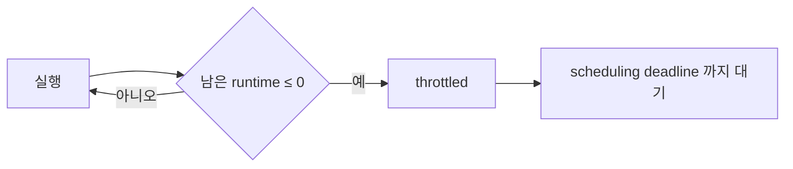
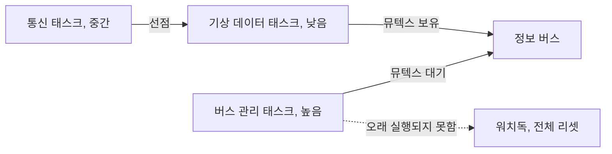

> **기준 출처:** [AbsInt, aiT](https://www.absint.com/ait/index.htm) · [Linux, SCHED_DEADLINE](https://www.kernel.org/doc/html/latest/scheduler/sched-deadline.html) · [Cervin 외, The Jitter Margin](https://portal.research.lu.se/en/publications/the-jitter-margin-and-its-application-in-the-design-of-real-time-/) / 확인일 2026-11-12
> **시리즈:** [목차](/posts/00-multiaxis-series/) | 이전 → [06. 통신이 정하는 상한](/posts/06-communication-cycle-budget/) | 다음 → [08. 다중 매니퓰레이터 협조](/posts/08-cooperative-manipulators/)

06편은 사이클 타임의 하한을 통신에서 계산했고, 통신이 쓰고 남은 시간이 계산 예산이라는 데서 끝났다. 이 편은 그 남은 예산 안에 계산이 들어가는지를 본다. 축이 늘 때 CPU 쪽에서 무엇이 먼저 부족해지는지, 그리고 "한 주기 안에 다 끝난다"를 돌려보기 전에 어떻게 확인하는지가 질문이다. 다음 편부터는 자원이 아니라 물리적 결합(둘이 같은 물체를 잡는 것)으로 넘어가므로, 같은 버스와 같은 CPU 를 나눠 쓰는 이야기는 이 편에서 닫는다.

스케줄링 이론 자체(RM, EDF, 응답시간 분석, 상속 프로토콜의 증명)는 [RTOS 이론](/posts/00-rtos-series/) 연재에 있다. 여기서는 축 수 $$N$$ 이 늘 때 그 이론을 어디에 적용하는지만 정리한다.

## 이 편에 나오는 말

| 말 | 뜻 |
| --- | --- |
| 주기와 마감 (period, deadline) | 태스크가 얼마마다 깨어나는가, 그리고 언제까지 끝나야 하는가. 둘은 같을 수도 다를 수도 있다 |
| WCET | 최악 실행 시간. "보통 이만큼"이 아니라 어떤 입력, 어떤 상태에서도 이보다 오래 걸리지 않는다는 상한 |
| 이용률 (utilization) | 한 태스크가 CPU 를 차지하는 비율 $$U = C/T$$. $$C$$ 는 실행 시간, $$T$$ 는 주기 |
| 선점 (preemption) | 우선순위가 높은 태스크가 돌고 있는 태스크를 중간에 밀어내고 CPU 를 가져가는 것 |
| 프로세스 이미지 | 모든 축의 입출력 데이터가 모여 있는 하나의 메모리 블록. 통신 쪽과 제어 쪽이 함께 쓴다 |

이 편이 다루는 질문은 넷이다.

- 사이클 하나 안에서 무엇이 순서대로 일어나는가 (수신, 계산, 송신)
- 축 수에 비례하는 계산과 비례하지 않는 계산을 어떻게 나누는가
- 마감을 놓치면 어떻게 되나. 제어에서 한 주기 누락은 지연이 아니라 결함이다
- 우선순위 역전이 다축 시스템에서 나타나는 형태 (공유 자원은 통신 버퍼, 로그 등)

## 1. 사이클 하나의 타임라인

다축 제어의 한 주기는 순서가 정해져 있다. 순서가 정해져 있기 때문에 예산 계산이 가능하다.

노랑 ②④는 06편에서 계산한 통신 몫이고, 초록 ③이 이 편의 대상이다. 빨강 ⑤의 여유는 남는 것이 아니라 예산 항목으로 본다. 여유가 0이면 실행 시간이 조금만 흔들려도 곧바로 마감을 넘긴다.

순서 제약이 하나 더 있다. ③은 ②가 끝나야 시작할 수 있고 ④는 ③이 끝나야 시작할 수 있다. 병렬로 겹칠 수 없는 구간이라 세 항목이 그대로 더해진다. "코어를 늘리면 되지 않나"가 곧바로 통하지 않는 이유가 여기 있다. 코어를 늘려도 이 사슬의 길이는 줄지 않고, 줄어드는 것은 ③ 안에서 서로 독립인 부분뿐이다.

## 2. 축 수에 비례하는 계산과 비례하지 않는 계산

③을 한 덩이로 보면 예산을 짤 수 없다. 축 수 $$N$$ 에 대해 어떻게 자라는지로 가른다.

| 자라는 방식 | 들어가는 계산의 예 | 축을 두 배로 하면 |
| --- | --- | --- |
| $$N$$ 에 무관 (상수) | 통신 스택의 고정 비용, 주기 타이머 처리, 상위 FSM, 모드 판정 | 그대로 |
| $$N$$ 에 비례 | 축별 제어 법칙 계산, 프로세스 이미지 패킹과 언패킹, 축별 단위 변환, 축별 한계 검사 | 두 배 |
| $$N$$ 보다 빨리 | 다물체 동역학의 일부 방식, 개체 쌍마다 하는 충돌 검사 | 두 배보다 크게 |

세 번째 줄은 들어 있는 계산의 차수가 정한다.

| 계산 | 차수 | 근거 |
| --- | --- | --- |
| 구속 없는 순동역학, 재귀 알고리즘(ABA 등) | 관절 수 $$n$$ 에 대해 $$O(n)$$ | Sathya 외 서론 |
| 작업 공간 관성 행렬을 관절 공간에서 그대로 계산 | $$O(n^3)$$ | 같은 논문 서론 |
| 개체 쌍마다 하는 검사 | 쌍의 수 $$N(N-1)/2$$ | 조합. 6개면 15쌍, 12개면 66쌍 |

첫 줄은 Vereshchagin 과 Featherstone 이 독립적으로 찾은 재귀 알고리즘이다([Sathya 외, arXiv:2310.00688](https://ar5iv.labs.arxiv.org/html/2310.00688)). 같은 물리를 계산하는데도 알고리즘 선택이 자라는 차수를 바꾼다. 쌍 검사는 6개에서 12개로 늘면 15쌍이 66쌍이 되어 네 배가 조금 넘는다.

여기서 예산을 적는 방식에 대한 판단이 하나 나온다. 예산표에 "계산 시간"을 한 줄로 적지 않고 위의 세 줄로 나눠 적는 것이 맞다고 본다. 그래야 축을 늘렸을 때 어디가 먼저 모자라는지 예측할 수 있다. 상수 항이 지배하는 구성에서는 축을 늘려도 계산이 별로 늘지 않고, 제곱 항이 있는 구성에서는 축을 조금만 늘려도 한계에 닿는다.

## 3. 예산에 적는 값은 WCET 다

마감은 평균에 대해 정의되지 않는다. 한 주기라도 넘기면 그 주기에서 문제가 생기므로 각 항목의 값은 평균이 아니라 최악 실행 시간(WCET)이다.

그런데 상한을 재는 일이 생각만큼 되지 않는다. AbsInt 의 aiT 설명은 측정만으로 정하는 방식의 한계를 둘로 적는다.

| 한계 | 문서의 서술 |
| --- | --- |
| 측정의 완전성 | 반복 측정은 번거롭고 안전하지 않다. 최대 실행 시간으로 이어지는 조건을 모두 고려했음을 증명하기가 대개 불가능하다 |
| 하드웨어 이력 | 캐시와 파이프라인 때문에 명령 하나의 실행 시간이 실행 이력에 따라 크게 달라진다 |

두 번째 줄은 같은 코드, 같은 입력이어도 그 직전에 무엇이 돌았는지에 따라 시간이 달라진다는 뜻이다. 다축 시스템에서는 이 성질이 불리하게 작용한다고 본다. 축이 늘수록 한 주기에 만지는 데이터가 늘어 캐시가 밀리기 때문이다. 축 6개로 잰 실행 시간에 2를 곱해 축 12개를 예측하면 실제보다 낙관적인 값이 나오기 쉽다.

그래서 세 가지를 함께 쓰는 것이 보통의 접근으로 본다.

| 방법 | 하는 일 |
| --- | --- |
| 측정 | 실제로 재되 가장 나쁜 경우를 일부러 만들어서 잰다. 모든 축이 동시에 한계에 닿는 상황, 고장 처리 경로, 로그가 꽉 찬 상태 |
| 여유 계수 | 측정값에 안전 계수를 곱해 예산에 넣는다. 계수를 왜 그 값으로 잡았는지를 함께 적는다 |
| 런타임 감시 | 매 주기 실제 소요를 재서 예산 초과를 문제가 생기기 전에 알아챈다 |

WCET 를 적는 방법은 [RTOS 이론 13편](/posts/13-wcet-execution-budget/) 에 있다.

## 4. 예산을 커널이 집행하는 형태 — SCHED_DEADLINE

런타임 감시는 커널 수준에서 지원되기도 한다. Linux 의 `SCHED_DEADLINE` 은 태스크를 runtime, deadline, period 세 값으로 기술한다. 남은 runtime 이 0 이하가 되면 태스크는 throttled 상태가 되어 자기 scheduling deadline 까지 다시 스케줄되지 않는다. 예산이 문서 속 약속이 아니라 스케줄러가 집행하는 값이 된다.

## 5. 다 들어가는가 — 이용률 시험

항목별 상한을 다 적었으면 다음 질문은 이것들이 한 CPU 에서 전부 마감을 지키는가다. 이것을 돌려보지 않고 미리 판정하는 것이 스케줄 가능성 시험이다.

태스크 $$i$$ 의 WCET 를 $$C_i$$, 주기를 $$T_i$$ 라 하면 이용률은 $$U_i = C_i / T_i$$ 이고 전체 이용률은 그 합이다. 주기가 짧을수록 우선순위가 높은 RM 에서 Liu 와 Layland(1973)의 시험은 다음과 같다.

$$\sum_{i=1}^{n} \frac{C_i}{T_i} \;\le\; n\left(2^{1/n} - 1\right)$$

| 태스크 수 $$n$$ | 1 | 2 | 3 | 4 | 5 | 10 | → ∞ |
| --- | ---: | ---: | ---: | ---: | ---: | ---: | ---: |
| 우변 | 1.000 | 0.828 | 0.780 | 0.757 | 0.743 | 0.718 | 0.693 |

우변은 $$n$$ 이 커질수록 줄어 $$\ln 2 \approx 0.693$$ 으로 내려간다. Chen 외도 자기 틀에서 얻은 $$\ln 2$$ 가 Liu 와 Layland 의 한계와 같다고 적는다. 유도는 [RTOS 이론 05편](/posts/05-rate-monotonic-utilization-bound/) 에 있다.

이 시험은 충분조건이지 필요조건이 아니다. 한계를 넘었다고 반드시 마감을 놓치는 것은 아니고, 그때는 [응답시간 분석](/posts/07-response-time-analysis/) 같은 더 정밀한 방법으로 다시 본다. 반대로 한계 안에 들어오면 더 볼 것 없이 마감이 지켜진다는 것이 이 시험의 쓸모다.

동적 우선순위 쪽은 조건이 더 느슨하다. Linux 문서가 적는 단일 CPU 조건은 다음과 같고, 역시 충분조건이다. 멀티코어는 [RTOS 이론 15편](/posts/15-multicore-realtime/) 에서 다룬다.

$$\sum_i \frac{\text{WCET}_i}{\min\{D_i, P_i\}} \;\le\; 1$$

축 수와의 연결은 태스크를 나눈 방식에 달려 있다.

| 배치 | 축을 늘리면 | 시험에 미치는 영향 |
| --- | --- | --- |
| 한 태스크가 모든 축을 순서대로 처리 | 그 태스크의 $$C_i$$ 가 커진다 | 한계선은 그대로. $$C_i$$ 를 2절처럼 분해해 적는 일이 중요해진다 |
| 축마다 태스크를 따로 둠 | 태스크 수 $$n$$ 이 는다 | 고정 우선순위 시험의 우변 자체가 내려간다. 컨텍스트 전환과 공유 자원 접근도 함께 는다 |

이 표로 보면 한 태스크가 모든 축을 순서대로 처리하는 배치가 스케줄 관점에서는 유리하다고 판단된다. 대신 그 태스크의 $$C_i$$ 가 커지므로 2절의 분해가 그만큼 중요해진다.

## 6. 마감을 놓치면 — 제어에서는 지연이 아니라 결함이다

일반적인 소프트웨어에서 마감을 놓치면 결과가 늦게 나온다. 제어 루프에서는 그렇지 않다. 놓친 주기는 늦게 처리되는 것이 아니라 그냥 없어진다. 다음 주기가 곧 오기 때문이다. 없어지면 생기는 일을 셋으로 나눠 본다.

| 무엇이 깨지나 | 내용 |
| --- | --- |
| 축들 사이의 시각 | 어떤 축은 새 목표값을 받고 어떤 축은 지난 목표값을 유지하면 축들이 서로 다른 시각의 경로 위에 있게 된다. [05편](/posts/05-axis-synchronization/) 의 계산대로 합성 속도 0.5 m/s 에서 1 ms 어긋나면 45도 직선의 윤곽 오차는 250 µm 다 |
| 제어 법칙의 시간 가정 | 이산 시간 제어기의 계수는 샘플 주기를 고정으로 두고 계산된 값이다. 주기가 갑자기 두 배가 되면 적분 항은 덜 쌓이고 미분 항은 과대평가된다 |
| 폐루프 안정성 | 지터 마진으로 정량화된다. 아래에서 본다 |

Cervin 외(RTCSA 2004)는 지터 마진을 제어 루프의 고정 지연량에 대한 함수로 정의하고, 루프가 불안정해지기 전까지 견딜 수 있는 추가 시변 지연을 나타낸다고 설명한다. 같은 논문은 이 값으로 태스크 마감을 정하자고 제안하고, 최선 응답시간 분석이 필요하다고 주장한다.

이 정의에서 읽을 점은 고정 지연과 흔들리는 지연이 다른 취급을 받는다는 것이다. 지연이 일정하면 제어 설계에서 그만큼을 모델에 넣어 보상할 수 있다. 흔들리면 보상할 대상이 없다. 그래서 실시간 제어에서는 평균이 빠른 것보다 최악이 예측되는 것이 더 쓸모 있다고 본다.

한 주기 어긋남과 통신 두절은 다른 사건이다. 통신 두절을 잡는 장치는 척도가 다르다. Beckhoff 단자 문서에서 SyncManager 워치독은 설정 시간 안에 프로세스 데이터 통신이 없으면 출력을 FALSE 로 두고, 기본값은 100 ms 다. 정의상 설정 시간보다 짧은 공백에는 반응하지 않는다. 밀리초 척도의 장치라 한 주기 어긋남은 여기에 걸리지 않으므로, 주기 누락은 제어 쪽에서 직접 세어 기록해야 알 수 있다. 지터의 발생원은 [RTOS 이론 11편](/posts/11-jitter-sources/) 에서 다룬다.

## 7. 우선순위 역전 — 이용률 시험이 보지 않는 경로

이용률이 한계 안에 들어와도 마감을 놓치는 경로가 하나 더 있다. 우선순위가 높은 태스크가 낮은 태스크에 막히는 것이다.

M. Jones 의 Mars Pathfinder 기록에서 공유 자원은 뮤텍스로 보호되는 정보 버스였다. 낮은 우선순위의 기상 데이터 태스크가 뮤텍스를 쥔 사이 중간 우선순위의 긴 통신 태스크가 스케줄되어, 높은 우선순위의 버스 관리 태스크가 한동안 실행되지 못했다. 그러자 워치독이 전체 시스템 리셋을 시작했다. 해결은 그 뮤텍스에 우선순위 상속을 켜는 것이었다. 낮은 태스크가 뮤텍스를 쥐고 있는 동안 자기를 기다리는 높은 태스크의 우선순위를 물려받아, 중간 우선순위 태스크에게 밀려나지 않게 한다.

다축 제어에서는 이 구조가 저절로 만들어질 수 있다. 축마다 태스크를 나눠 두고 하나의 프로세스 이미지를 함께 쓰는 배치가 그렇다. 공유될 수 있는 것들을 열거하면 이렇다.

| 공유 자원 | 누가 쥐나 | 왜 위험한가 |
| --- | --- | --- |
| 프로세스 이미지 | 통신 태스크와 제어 태스크 모두 | 주기마다 반드시 잡는다. 경합 빈도가 가장 높다 |
| 로그, 트레이스 버퍼 | 제어 태스크와 낮은 우선순위 기록 태스크 | 기록 태스크가 디스크나 네트워크에서 오래 잡을 수 있다 |
| 진단, 파라미터 접근 경로 | 비주기 요청 처리 | 요청이 들어온 그 주기에만 길어져 재현이 어렵다 |
| 동적 메모리 할당기 | 사실상 모든 태스크 | 락이 하나뿐인 구현이면 제어 주기 안에서 부르는 순간 위험해진다 |

대응은 셋이고 순서가 있다고 본다.

1. 공유를 없앤다. 제어 주기가 잡는 자료 구조는 락이 아니라 버퍼를 나눠 쓰는 방식으로 바꾼다. 락을 잡지 않으면 역전이 생길 자리가 없다
2. 없앨 수 없으면 상속을 켠다. 우선순위 상속은 커널 기능으로 제공된다
3. 주기 안에서 부르는 함수의 목록을 고정한다. 블로킹할 수 있는 호출은 목록으로 관리하고, 새로 들어오면 그때 검토한다

Zephyr 의 뮤텍스 문서는 상속을 이렇게 적는다.

| 항목 | 문서의 서술 |
| --- | --- |
| 상승과 복원 | 더 높은 스레드가 기다리면 소유자의 우선순위를 일시적으로 올리고, 풀면 되돌린다 |
| 상한 | `CONFIG_PRIORITY_CEILING` 이 올릴 수 있는 높이를 제한한다 |
| 사슬 | 상승은 뮤텍스 사슬을 따라 전파되지만, 따라가는 단계 수에 구현상의 제한이 있다 |

이 한계 서술에서 읽을 점은 우선순위 상속이 설계 실수를 덮어 주는 장치가 아니라는 것이다. 상속은 중간 태스크가 끼어드는 경로를 막을 뿐, 높은 태스크는 여전히 뮤텍스가 풀릴 때까지 기다린다. 최악 블로킹 시간을 유한하게 만들어 계산할 수 있게 할 뿐이고, 그 유한한 값은 여전히 5절의 예산에 더해 넣어야 한다. 그 블로킹을 응답시간에 넣는 방법은 [RTOS 이론 08편](/posts/08-priority-inversion-mars-pathfinder/) 과 [09편](/posts/09-priority-inheritance-ceiling/) 에 있다.

## 8. 정리

- 한 주기는 수신, 계산, 송신, 여유의 사슬이고 겹칠 수 없다. 여유는 남는 것이 아니라 예산 항목이다. 코어를 늘려도 사슬의 길이는 줄지 않고, 줄어드는 것은 계산 안에서 서로 독립인 부분뿐이다
- 계산은 $$N$$ 에 무관한 항, $$N$$ 에 비례하는 항, $$N$$ 보다 빨리 자라는 항으로 나눠 적는다. 쌍 검사는 $$N(N-1)/2$$ 로 자라고, 다물체 동역학은 알고리즘이 차수를 정한다(재귀 순동역학은 $$O(n)$$)
- 예산의 단위는 평균이 아니라 WCET 다. 측정만으로는 최대 실행 시간의 조건을 다 봤다고 증명하기 어렵고, 캐시와 파이프라인 때문에 명령 하나의 시간도 실행 이력에 좌우된다. 작은 $$N$$ 에서 잰 값에 비례식을 쓰면 낙관적으로 틀리기 쉽다
- 측정, 여유 계수, 런타임 감시를 함께 쓴다. `SCHED_DEADLINE` 은 runtime 을 다 쓴 태스크를 throttled 로 만들어 예산을 집행한다
- RM 이용률 한계 $$n(2^{1/n}-1)$$ 은 $$\ln 2$$ 로 내려가는 충분조건이다. 축마다 태스크를 쪼개면 $$n$$ 이 늘어 한계선 자체가 내려간다
- 놓친 주기는 없어진다. 축들 사이 시각이 벌어지고, 이산 제어기의 주기 가정이 깨지고, 시변 지연은 고정 지연과 달리 보상할 대상이 없어 안정성을 깎는다. 워치독은 설정 시간보다 짧은 공백을 보지 않으므로 주기 누락은 직접 센다
- 이용률이 통과해도 우선순위 역전으로 마감을 놓칠 수 있다. 대응 순서는 공유 제거, 상속, 주기 안 호출 목록 고정이다. 상속은 중간 태스크의 끼어듦을 막지만 블로킹을 없애지는 않는다

## 참고

- [AbsInt, aiT Worst-Case Execution Time Analyzers](https://www.absint.com/ait/index.htm)
- [Linux kernel, Deadline Task Scheduling](https://www.kernel.org/doc/html/latest/scheduler/sched-deadline.html)
- [Wikipedia, Rate-monotonic scheduling](https://en.wikipedia.org/wiki/Rate-monotonic_scheduling)
- [J.-J. Chen 외, Evaluate and Compare Two Utilization-Based Schedulability-Test Frameworks (arXiv:1505.02155)](https://ar5iv.labs.arxiv.org/html/1505.02155)
- [A. Cervin 외, The Jitter Margin and Its Application in the Design of Real-Time Control Systems, RTCSA 2004](https://portal.research.lu.se/en/publications/the-jitter-margin-and-its-application-in-the-design-of-real-time-/)
- [Beckhoff, General notes for setting the watchdog](https://infosys.beckhoff.com/content/1033/el6201/1036979339.html)
- [M. Jones, What really happened on Mars Rover Pathfinder, RISKS 19.49](https://catless.ncl.ac.uk/Risks/19.49.html)
- [Zephyr Project, Mutexes](https://docs.zephyrproject.org/latest/kernel/services/synchronization/mutexes.html)
- [A. S. Sathya 외, Efficient Constrained Dynamics Algorithms based on an Equivalent LQR Formulation (arXiv:2310.00688)](https://ar5iv.labs.arxiv.org/html/2310.00688)
