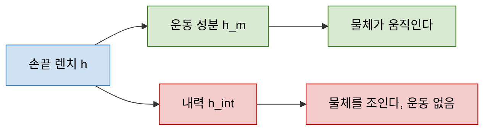

> **기준 출처:** [Verginis, Zelazo, Dimarogonas (arXiv:1911.01297)](https://ar5iv.labs.arxiv.org/html/1911.01297) · [Verginis, Mastellaro, Dimarogonas (arXiv:1710.11088)](https://ar5iv.labs.arxiv.org/html/1710.11088) · [Lin 외 (arXiv:1707.00484)](https://ar5iv.labs.arxiv.org/html/1707.00484) / 확인일 2026-11-12
> **시리즈:** [목차](/posts/00-multiaxis-series/) | 이전 → [07. 자원 경합과 실행시간 예산](/posts/07-execution-time-budget/) | 다음 → [09. 공유 작업공간과 충돌 회피](/posts/09-shared-workspace-collision/)

06편과 07편의 결합은 버스와 CPU 를 나눠 쓰는 자원 결합이었다. 이 편부터는 같은 물체를 함께 잡아서 생기는 물리적 결합이고, 그중 가장 강한 형태가 여기다. 둘 이상이 같은 물체를 잡는 순간 문제의 성질이 어떻게 바뀌는지, 왜 위치를 잘 맞추는 것만으로는 안 되는지가 질문이다.

[05편](/posts/05-axis-synchronization/) 이 세운 "축들이 같은 순간에 움직여야 한다"는 요구는 여기서 가장 비싸게 청구된다. 자유 공간에서는 시각이 어긋나면 궤적이 조금 벗어나고 끝이지만, 물체를 함께 잡고 있으면 그 어긋남이 곧바로 힘이 된다.

## 이 편에 나오는 말

| 말 | 뜻 |
| --- | --- |
| 렌치 (wrench) | 힘 3성분과 모멘트 3성분을 묶은 6차원 벡터. 한 점에 걸리는 하중 전체를 한 덩이로 쓴 것 |
| 폐연쇄 (closed kinematic chain) | 사슬의 양 끝이 이어져 고리가 된 구조. 로봇 둘이 같은 물체를 잡으면 로봇, 물체, 로봇, 바닥이 고리를 이룬다 |
| 영공간 (null space) | 행렬에 곱했을 때 0이 나오는 벡터들의 집합. 결과에 아무 영향을 주지 않는 입력들 |
| 강성 (stiffness) | 얼마나 밀어야 얼마나 밀리는가. 단위는 N/m. 값이 크면 조금만 밀려도 큰 힘이 난다 |
| 물리적 결합 | 같은 물체나 같은 공간을 공유해서 생기는 결합. 통신과 CPU 를 나눠 쓰는 자원 결합과 구분한다 |

이 편이 다루는 질문은 다음과 같다.

- 두 팔이 한 물체를 잡으면 폐연쇄가 되어 더 이상 독립적으로 움직일 수 없다
- 내력(internal force)은 물체를 움직이지 않으면서 서로 미는 힘이다. 왜 제어해야 하나
- 하중 분배에서 외력과 내력을 어떻게 나누나
- 위치 지령끼리 조금만 어긋나도 큰 힘이 생기는 이유
- 이 결합은 [01편](/posts/01-what-is-multiple/) 의 네 결합 중 물리적 결합의 가장 강한 형태다

## 1. 함께 잡으면 폐연쇄가 된다

두 대가 각자 허공에서 움직이는 동안에는 서로 남이다. 같은 CPU 와 같은 버스를 쓰는 자원 결합은 있어도, 한쪽이 위치를 조금 틀렸다고 다른 쪽에 힘이 걸리지는 않는다. 물체를 단단히 함께 잡는 순간 이것이 달라진다.

Verginis, Mastellaro, Dimarogonas 는 파지가 강체 접촉이면 전체 시스템을 하나의 폐연쇄 로봇으로 볼 수 있다고 적는다. 로봇 A, 물체, 로봇 B, 바닥을 거쳐 다시 로봇 A 로 고리가 닫힌다. Verginis, Zelazo, Dimarogonas 는 같은 가정에서 손끝 $$i$$ 의 속도를 물체 속도로 쓴다.

$$v_i = J_{O_i}(x_i)\, v_O$$

여기서 $$v_i$$ 는 손끝 $$i$$ 의 속도, $$v_O$$ 는 물체의 속도, $$J_{O_i}$$ 는 물체에서 손끝 $$i$$ 로 가는 자코비안이다. 물체 하나의 6차원 운동이 정해지면 모든 손끝의 운동이 따라 정해진다는 뜻이다.

고리가 닫히면 두 가지가 동시에 생긴다.

| 쪽 | 무엇이 정해지나 | 결과 |
| --- | --- | --- |
| 기구학 | 모든 손끝의 속도가 물체 속도 하나로 정해진다 | 손끝을 서로 독립으로 움직일 수 없다. 두 손끝의 상대 운동이 0으로 구속된다 |
| 정역학 | 손끝 렌치가 물체에서 합쳐진다 | 합이 정해져도 각자의 몫은 정해지지 않는다. 여기서 내력이 나온다 |

손끝이 $$N$$ 개면 손끝 쪽 자유도는 $$6N$$ 이고, 물체의 운동은 6차원이다. 나머지 $$6N-6$$ 개의 자유도는 사라진 것이 아니라 구속으로 바뀌었고, 구속된 방향에는 운동 대신 힘이 생긴다.

## 2. grasp matrix — 손끝 렌치를 물체로 모은다

1911.01297 은 grasp matrix 를 다음과 같이 둔다.

$$h_O = G(x)\, h, \qquad G(x) = \bigl[\,J_{O_1}^{\top}\ \cdots\ J_{O_N}^{\top}\,\bigr] \in \mathbb{R}^{6 \times 6N}$$

| 기호 | 뜻 |
| --- | --- |
| $$h \in \mathbb{R}^{6N}$$ | 손끝 $$N$$ 개의 렌치를 이어 붙인 벡터 |
| $$h_O \in \mathbb{R}^{6}$$ | 물체에 걸리는 합성 렌치 |
| $$G(x)$$ | 파지 기하로 정해지는 grasp matrix |

전치 규약은 논문마다 다르다. 1710.11088 은 $$G \in \mathbb{R}^{6N \times 6}$$ 으로 두고 $$f_O = G^{\top} f$$ 로 쓴다. 내용은 같다.

어느 규약이든 미지수는 $$6N$$ 개, 식은 6개다. 두 팔이면 미지수 12, 식 6이다. 물체를 원하는 대로 움직이게 하는 손끝 렌치의 조합은 하나가 아니라 무수히 많다.

## 3. 내력은 G 의 영공간에 있다

1911.01297 은 물체와 에이전트 사이의 상호작용 힘을 운동을 만드는 성분과 내력으로 나눈다.

$$h = h_m + h_{\text{int}}, \qquad G(x)\, h_{\text{int}} = 0$$

| 성분 | 하는 일 |
| --- | --- |
| $$h_m$$ | 운동을 만드는 성분. 물체의 가속도에 기여한다 |
| $$h_{\text{int}}$$ | 내력. $$G$$ 의 영공간에 있어서 아무리 크게 넣어도 물체는 움직이지 않는다 |

논문은 $$h_{\text{int}}$$ 를 에이전트들이 물체에 가하는 조이는 힘(squeezing forces)이라고 하고, $$G(x)$$ 의 영공간에 속한다고 적는다. Lin 외(1707.00484)도 접촉력을 grasp map 의 영공간에 사영한 성분을 물체에 알짜 렌치를 주지 않고 내력에만 기여하는 성분으로 설명한다.

같은 손끝 렌치 $$h$$ 가 두 갈래로 갈라지는데, 아래쪽 빨강 갈래는 물체의 위치만 보고 있어서는 보이지 않는다. 물체는 움직이지 않고 위치 오차도 늘지 않는다. 그런데 그 힘은 실재하고 물체와 로봇에 그대로 걸린다. 관측되지 않으면서 커질 수 있다는 것이 내력을 위험하게 만드는 성질이다.

차원으로 세면 규모가 잡힌다. 같은 논문의 정리 증명은 $$G$$ 의 행 계수가 꽉 차 있으므로 영공간의 차원이 $$6N-6$$ 이라고 적는다.

| 팔 수 $$N$$ | 손끝 자유도 $$6N$$ | 물체 운동 | 내력 공간 차원 $$6(N-1)$$ |
| ---: | ---: | ---: | ---: |
| 1 | 6 | 6 | 0 |
| 2 | 12 | 6 | 6 |
| 3 | 18 | 6 | 12 |

팔이 하나면 내력이 0이다. 이 편이 다중 매니퓰레이터 고유의 이론인 이유가 여기 있다. 하나일 때는 없던 6차원 공간이 둘이 되는 순간 통째로 생긴다. 그리고 그 방향들은 아무도 지령하지 않으면 아무 값이나 가질 수 있다. 제어하지 않는 것과 0인 것은 다르다.

## 4. 내력을 다루는 이유 — 필요한 조임과 원치 않는 조임

내력이 0이어야 한다는 말은 아니다. 물체를 떨어뜨리지 않으려면 마찰이 필요하고, 마찰을 쓰려면 눌러야 하므로 의도된 내력은 있어야 한다. 문제는 의도하지 않은 내력이다.

| 문헌 | 내력에 대한 서술 |
| --- | --- |
| 1911.01297 | 물체 손상과 에이전트의 불필요한 노력을 막기 위해 최소화해야 한다 |
| 1707.00484 실험 | 정지 상태에서 양팔이 상자를 70 N 으로 조이고, 사람이 상자를 아래로 누르면 미끄러지지 않도록 110 N 으로 더 세게 조인다. 물체가 무거워질수록 접촉력이 커진다 |
| 1710.11088 | 관련 연구 다수가 하중 분배 계수나 grasp matrix 의 Moore-Penrose 역행렬을 쓰면서 원치 않는 내력이 생기지 않음을 증명하지 않는다 |

원치 않는 내력을 줄여야 하는 이유를 셋으로 정리한다.

1. 물체가 상한다. 1911.01297 이 최소화의 이유로 든 첫째다. 물체가 무르거나 얇으면 이 항이 곧 파손 조건이다
2. 로봇이 낭비한다. 같은 논문의 "불필요한 노력"이다. 내력은 물체를 전혀 움직이지 않으면서 토크와 열을 쓴다. 구동기 한계를 이 성분이 먼저 차지하면 정작 필요한 운동 성분에 쓸 여유가 없어진다
3. 분배가 유일하지 않아서 저절로 생긴다. 합성 렌치만 맞추는 해는 무한히 많고, 그중 어느 것을 고르는지는 구현이 정한다. 1710.11088 의 지적이 이 점이다

3번에서 읽을 점은 "둘이 반씩 든다"처럼 자연스러워 보이는 배분도 그 자체로는 내력이 0이라는 보장이 아니라는 것이다. 내력은 손대지 않으면 0이 되는 값이 아니라, 손대지 않으면 결정되지 않는 값으로 본다.

## 5. 정렬 어긋남이 상호작용 렌치가 된다

여러 이동 매니퓰레이터의 협조를 다룬 Liu 외(2406.05613)는 긴밀한 결합 때문에 작은 불균형이나 정렬 어긋남도 서로 밀고 당기면서 과도한 상호작용 렌치를 만들 수 있다고 적고, 초록에서 그 결과로 물체 손상이나 비상 정지를 든다. 논문의 관계식은 이렇다.

$$h_i - h_i^{\text{ref}} \;=\; K \sum_{j \ne i} \bigl(\Delta e_j - \Delta e_i\bigr), \qquad \Delta e_i = e_i - e_i^{\text{ref}}$$

| 기호 | 뜻 |
| --- | --- |
| $$h_i$$, $$h_i^{\text{ref}}$$ | 물체가 로봇 $$i$$ 의 말단에 가하는 렌치와 그 계획값 |
| $$e_i$$, $$e_i^{\text{ref}}$$ | 로봇 $$i$$ 말단의 자세와 그 기준값 |
| $$K$$ | 양의 정부호 6×6 대각 행렬. 물체 또는 외부 환경의 강성 |

우변에는 로봇들 사이 오차의 차이만 들어 있다. 모두가 같은 만큼 벗어나면 우변은 0 이고, 서로 다르게 벗어날 때 $$K$$ 를 거쳐 렌치 오차가 된다.

## 6. 위치 어긋남이 힘으로 커지는 규모

> 아래 계산은 문헌 인용이 아니라, 1절의 구속 조건과 강성의 정의를 이어 붙인 규모 추정이다. 실제 값은 시스템마다 다르므로 자릿수를 가늠하는 용도로만 본다.
{: .prompt-warning }

폐연쇄에서 두 손끝의 상대 운동은 0으로 구속되어 있다. 그런데 두 팔에 각자 위치 지령을 주면 그 지령이 서로 완벽히 일관될 이유가 없다. 캘리브레이션 오차, 물체 치수 오차, 구조의 변형, 그리고 지령이 적용되는 시각 차이가 모두 상대 위치 오차 $$\Delta x$$ 를 만든다. 강체에 가까운 경로가 그 오차를 받으면 힘은 대략 이렇게 난다.

$$f \approx k \,\Delta x$$

여기서 $$k$$ 는 손끝, 물체, 손끝으로 이어지는 경로 전체의 등가 강성이다. 감속기와 금속 구조가 직렬로 이어진 경로면 $$k$$ 가 크다. $$k = 10^{5}$$ N/m 로 잡고 넣어 보면 이렇게 된다.

| 상대 위치 오차 $$\Delta x$$ | 생기는 내력 $$f$$ |
| ---: | ---: |
| 10 µm | 1 N |
| 100 µm | 10 N |
| 1 mm | 100 N |

1 mm 는 자유 공간의 위치 제어에서는 흔히 잘 맞았다고 보는 수치인데, 이 가정의 폐연쇄에서는 100 N 이 된다. "위치를 잘 맞추면 되지 않나"가 통하지 않는 이유가 이것이다. 위치 오차의 허용치는 자유 공간과 폐연쇄에서 다른 척도로 정해야 한다고 본다.

시각 어긋남과도 이어진다. 05편에서 시각 어긋남 $$\Delta t$$ 가 위치 오차 $$v\,\Delta t$$ 를 만든다고 했다. 여기에 넣으면 $$f \approx k\,v\,\Delta t$$ 다. $$v = 0.1$$ m/s, $$\Delta t = 1$$ ms, $$k = 10^{5}$$ N/m 이면 $$f \approx 10$$ N 이다. 한 주기 늦은 것이 힘 10 N 으로 나온다.

여기서 문제가 되는 것은 절대 시각이 아니라 상대 시각 어긋남이다. 두 팔의 지령이 똑같이 1 ms 늦으면 상대 오차는 0이라 내력이 생기지 않고, 한쪽만 늦을 때 생긴다. 5절의 Liu 외 관계식에서 우변이 오차의 차이만 담는 것과 같은 구조다. 그래서 협조 작업에서는 "빨리 반영한다"보다 "모두가 같은 순간에 반영한다"가 더 중요하다고 본다.

## 7. 무엇을 어떻게 제어하나

내력이 별도의 공간을 이루므로 제어도 그 공간을 따로 겨냥해야 한다. 접근을 크게 둘로 나눠 볼 수 있다.

| | 하중 분배를 명시적으로 설계 | 컴플라이언스를 넣어 흡수 |
| --- | --- | --- |
| 발상 | $$h = h_m + h_{\text{int}}$$ 로 쪼개고 두 성분을 따로 지령한다 | 손끝을 단단하게 두지 않고 밀리게 만들어 $$\Delta x$$ 가 큰 힘이 되지 않게 한다 |
| 요구 | 파지 기하($$G$$)를 알아야 한다 | 원하는 강성과 감쇠를 정해야 하고, 그만큼 위치 정확도를 내준다 |
| 남는 문제 | 파지 기하나 물체 치수가 틀리면 분배도 틀린다. 고른 분배가 원치 않는 내력을 만들지 않는다는 것은 따로 보여야 한다 | 강성을 낮춘 만큼 위치 오차가 커진다. 정밀 작업과 상충한다 |

두 접근은 배타적이지 않다. 운동 성분은 하중 분배로 나누고 내력 방향에는 낮은 강성을 둬서 남는 불일치를 흡수하는 구성도 가능하다고 본다. 어느 쪽이든 설계 항목이 하나 늘어난다는 점은 같다. 팔이 하나일 때는 적을 것이 없던 칸이다.

문헌이 택한 접근은 이렇다.

| 논문 | 접근 | 전제 |
| --- | --- | --- |
| 1911.01297 | grasp matrix 와 강성 이론(rigidity theory)의 rigidity matrix 를 치역과 영공간 관계로 잇고, 상호작용 힘과 내력, 에너지 최적 힘 분배에 대한 결과를 낸다 | 강체 파지 |
| 1710.11088 | 분산형 제어기 둘(쿼터니언 되먹임 적응 제어, 과도와 정상 성능을 미리 정한 제어). 하중 분배를 grasp matrix 유사역행렬로 넣어 에이전트마다 다른 출력 능력을 반영한다 | 강체 파지. 힘/토크 센서가 필요 없다 |
| 1707.00484 | 사영 역동역학 기반 양팔 직교 좌표 임피던스 제어. 접촉을 유지하는 데 필요한 토크를 최적화한다 | 외력을 직접 측정하지 않는다 |
| 2406.05613 | 분산 운동 제어로 상호작용 렌치를 줄인다 | 물체를 함께 다루는 여러 이동 매니퓰레이터 |

위치와 힘을 함께 다루는 제어 구조 일반은 [다중 모드 제어 07편](/posts/07-hybrid-position-force/) 에서 다룬다.

앞 편들과의 관계도 여기서 정리된다. 통신과 스케줄링을 조이는 이유가 여기서 물리량으로 나타난다. 자유 공간에서 주기 어긋남은 궤적이 조금 벗어나는 것으로 끝나지만, 폐연쇄에서는 같은 어긋남이 힘으로 나타난다. 같은 인프라 결함이라도 어느 작업 국면에 있느냐에 따라 결과의 크기가 크게 달라진다고 본다.

## 8. 주의

- 내력 공간의 차원 $$6(N-1)$$ 은 $$G$$ 의 행 계수가 꽉 찬 경우의 값이다.
- 5절의 관계식은 정상 운전 중의 렌치 저감을 다룬 논문의 것이다. 고장이나 정지 상황은 그 논문의 범위가 아니다.
- 6절의 수치는 등가 강성을 가정한 규모 추정이다.

## 9. 정리

- 강체 파지로 함께 잡으면 전체가 하나의 폐연쇄 로봇이 되고, 손끝 속도는 물체 속도 하나에서 정해진다($$v_i = J_{O_i} v_O$$). 사라진 자유도는 구속으로 바뀌고, 구속된 방향에는 운동 대신 힘이 생긴다
- grasp matrix $$G \in \mathbb{R}^{6 \times 6N}$$ 이 손끝 렌치를 물체 렌치로 모은다. 미지수 $$6N$$, 식 6 이라 분배가 유일하지 않다
- $$G$$ 의 영공간 성분이 내력이다($$h = h_m + h_{\text{int}}$$, $$G h_{\text{int}} = 0$$). 물체를 조이지만 움직이지 않으므로 위치만 봐서는 보이지 않는다
- 내력 공간의 차원은 $$6(N-1)$$ 이다. 팔 하나면 0, 둘이면 6, 셋이면 12. 지령하지 않으면 0이 되는 것이 아니라 결정되지 않는다
- 놓치지 않기 위한 조임은 필요하고, 원치 않는 내력은 물체 손상, 구동기 낭비, 분배의 비유일성 때문에 최소화 대상이다. "반씩 든다"도 그 자체로는 내력 0의 보장이 아니다
- 상호작용 렌치 오차는 로봇들 사이 자세 오차의 차이에 강성 $$K$$ 를 곱한 꼴이다. 등가 강성 $$10^5$$ N/m 를 가정하면 상대 위치 오차 1 mm 가 100 N 이 된다
- 문제가 되는 것은 상대 시각 어긋남이므로 협조 작업에서는 "모두가 같은 순간에 반영한다"가 "빨리 반영한다"보다 중요하다
- 하중 분배를 명시적으로 설계하거나 컴플라이언스로 흡수하는 두 접근이 있고 섞어 쓸 수 있다. 어느 쪽이든 팔이 하나일 때 없던 설계 항목이 생긴다

## 참고

- [C. K. Verginis, D. Zelazo, D. V. Dimarogonas, Cooperative Manipulation via Internal Force Regulation: A Rigidity Theory Perspective (arXiv:1911.01297)](https://ar5iv.labs.arxiv.org/html/1911.01297)
- [C. K. Verginis, M. Mastellaro, D. V. Dimarogonas, Robust Cooperative Manipulation without Force/Torque Measurements: Control Design and Experiments (arXiv:1710.11088)](https://ar5iv.labs.arxiv.org/html/1710.11088)
- [H.-C. Lin, J. Smith, K. K. Babarahmati, N. Dehio, M. Mistry, A Projected Inverse Dynamics Approach for Dual-arm Cartesian Impedance Control (arXiv:1707.00484)](https://ar5iv.labs.arxiv.org/html/1707.00484)
- [W. Liu 외, Distributed Motion Control of Multiple Mobile Manipulators for Reducing Interaction Wrench in Object Manipulation (arXiv:2406.05613)](https://arxiv.org/html/2406.05613v4)
