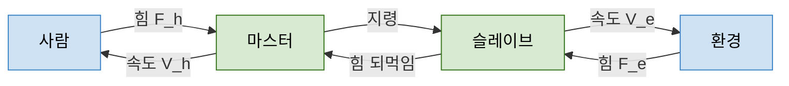

> **기준 출처:** [Salcudean 외, Bilateral Matched-Impedance Teleoperation (UBC 공개본)](https://people.ece.ubc.ca/~simond/Papers/CSM99Salcudean.pdf) · [Kim, Chang, Park, Two-Channel Transparency-Optimized Control Architectures (PMC 공개본)](https://pmc.ncbi.nlm.nih.gov/articles/PMC3702193/) · [Darvish 외, Teleoperation of Humanoid Robots: A Survey (arXiv:2301.04317)](https://ar5iv.labs.arxiv.org/html/2301.04317) / 확인일 2026-11-12
> **시리즈:** [목차](/posts/00-multiaxis-series/) | 이전 → [09. 공유 작업공간과 충돌 회피](/posts/09-shared-workspace-collision/) | 다음 → [11. single-master multi-slave](/posts/11-single-master-multi-slave/)

09편까지의 결합은 모두 기계끼리였다. 같은 물체를 잡거나(08편), 같은 공간을 쓰거나(09편), 같은 버스와 CPU 를 쓰거나(06편, 07편). 이 편에서는 결합의 한쪽 끝이 사람이다. [01편](/posts/01-what-is-multiple/) 이 나눈 결합 4종(물리, 자원, 논리, 사람) 중 마지막 하나가 여기서 열린다. 질문은 사람이 제어 루프 안에 들어오면 무엇이 새로 생기는지, 그리고 왜 원격을 더 생생하게 느끼게 할수록 불안정해지는지다. 다음 편은 이 구조에서 슬레이브만 여럿으로 늘린 것이라, 한 쌍의 성질을 먼저 정리해 둔다.

## 이 편에 나오는 말

| 말 | 뜻 |
| --- | --- |
| 임피던스 $$Z$$ | 이만큼 움직이려면 힘이 얼마나 드는가의 비. 딱딱한 벽은 임피던스가 크고 허공은 0에 가깝다 |
| 두 포트 (two-port) | 양쪽 끝에서 각각 힘과 속도 한 쌍이 드나드는 상자로 보는 표현. 전기의 2단자쌍 회로와 같은 형식이다 |
| 수동성 (passivity) | 그 시스템이 에너지를 새로 만들어내지 않는 성질. 쓰거나 버릴 수는 있어도 늘릴 수는 없다 |
| 마스터와 슬레이브 | 사람이 잡는 쪽 장치가 마스터, 원격에서 실제로 일하는 쪽이 슬레이브. 최근 문헌은 leader 와 follower 로도 쓴다 |

힘과 속도의 곱이 일률(power)이라는 사실을 함께 기억해 두면 끝까지 읽힌다. 이 편이 다루는 질문은 넷이다.

- 마스터와 슬레이브 사이에 무엇이 오가나 (위치, 속도, 힘)
- 투명성과 안정성의 상충. 반력을 그대로 전할수록 불안정해진다
- 시간 지연이 왜 치명적인가, 수동성 기반 접근이 무엇을 보장하나
- 임피던스, 어드미턴스 제어와의 관계. 마스터 쪽이 어드미턴스로 동작하는 구성

## 1. 출발점 — 기계 연결에서 전기 연결로

이 구조의 출발점은 제어 이론이 아니라 사람을 위험한 것에서 떼어 놓는 일이었다. Wikipedia 의 Raymond Goertz 항목은 다음을 적는다.

| 시점 | 내용 |
| --- | --- |
| 1948 | Goertz 가 7자유도 양방향(대칭형) 금속 테이프 전동 판토그래프 장치를 설계했다. 목적은 작업자를 방사선에서 보호하면서 물질을 정밀하게 다루는 것이었다 |
| 이후 | 최초의 전기식 마스터–슬레이브 조작 시스템을 만들었다 |
| 이후 | 섬세한 물체를 다루려면 촉각이 필요하다는 것을 알게 되어, 힘 되먹임으로 사람과 기계 조합의 능력을 높였다 |

판토그래프처럼 마스터와 슬레이브가 기계적으로 이어져 있으면 힘은 저절로 되돌아온다. 손잡이를 움직이면 슬레이브가 따라가고, 슬레이브가 무언가에 닿으면 손잡이가 밀린다. 그 연결을 전기 신호로 바꾸는 순간부터 힘을 되돌리는 일이 공짜가 아니게 되고, 설계 문제가 된다. 아래 절들은 이 마지막 단계, 힘과 운동이 양쪽으로 오가는 구성을 다룬다.

## 2. 무엇이 오가나 — 단방향과 양방향

연결이 신호가 되면 양쪽 끝에서 힘과 속도가 한 쌍씩 드나든다.

파랑은 제어하지 않는 것(사람과 환경), 초록은 설계 대상이다. 힘과 속도의 곱이 일률이므로 이 그림은 에너지가 오가는 경로이기도 하다. 가운데의 화살표 두 개(마스터에서 슬레이브로, 슬레이브에서 마스터로)가 통신 채널이고, 여기에 무엇을 실을지가 구조를 정한다.

Darvish 외의 서베이(2301.04317, II-A절)는 두 방식을 이렇게 나눈다.

| 방식 | 서베이의 서술 | 조작자가 받는 것 |
| --- | --- | --- |
| 단방향(unilateral) | 사람과 로봇의 결합이 한 방향으로만 일어난다 | 지령만 간다. 조작자는 화면 같은 다른 감각으로 판단한다 |
| 양방향(bilateral) | 사람과 로봇이 직접 결합된다 | 지령이 가고 힘이 되돌아온다 |

이 편의 주제는 양방향이다. 되돌아오는 화살표 하나가 생긴 대가로 무엇이 따라오는지가 나머지 절의 내용이다.

## 3. 두 포트와 투명성

"잘 느껴진다"를 말로 두면 설계할 수 없다. 두 포트 표현이 그것을 식으로 만든다. Salcudean 외는 마스터, 통신, 슬레이브를 사람과 환경 사이의 두 포트(two-port) 망으로 보고 hybrid 행렬로 쓴다. 기호를 이 글에 맞추면 다음과 같다.

$$\begin{bmatrix} F_h \\ -V_e \end{bmatrix} = \begin{bmatrix} h_{11} & h_{12} \\ h_{21} & h_{22} \end{bmatrix} \begin{bmatrix} V_h \\ F_e \end{bmatrix}$$

| 기호 | 뜻 |
| --- | --- |
| $$F_h$$ | 사람이 마스터에 가하는 힘 |
| $$V_h$$ | 마스터의 속도 (사람 손의 속도) |
| $$F_e$$ | 환경이 슬레이브에 가하는 힘 |
| $$V_e$$ | 슬레이브의 속도 |

| 원소 | Salcudean 외의 이름 | 조건 |
| --- | --- | --- |
| $$h_{11}$$ | 마스터 임피던스 $$Z_{m0}$$ | 슬레이브가 자유 공간일 때 |
| $$h_{21}$$ | 위치 이득 $$G_p$$ | 슬레이브가 자유 공간일 때 |
| $$h_{12}$$ | 역 힘 이득 $$G_f^{-1}$$ | 마스터가 완전히 구속될 때 |
| $$h_{22}$$ | 슬레이브 어드미턴스 $$Z_{s0}^{-1}$$ | 마스터가 완전히 구속될 때 |

환경을 $$F_e = Z_e V_e$$ 로 두면 사람이 느끼는 전달 임피던스 $$Z_t = F_h / V_h$$ 가 나온다.

$$Z_t = h_{11} - \frac{h_{12}\,h_{21}\,Z_e}{1 + h_{22}\,Z_e}$$

Salcudean 외는 투명성을 환경 임피던스와 손에 전달되는 임피던스의 완전한 일치($$Z_t = Z_e$$)로 정의하고, 슬레이브가 마스터를 따라갈 것을 함께 요구한다. 사람이 원격 환경을 왜곡 없이 그대로 느끼는 상태다. Kim 외(IEEE TCST 2013)는 같은 투명성 조건을 hybrid 파라미터로 이렇게 적는다.

$$h_{11} = 0,\qquad h_{22} = 0,\qquad h_{12} = 1,\qquad h_{21} = -1$$

| 조건 | 물리적 의미 (위 표의 원소 이름에서 읽은 것) |
| --- | --- |
| $$h_{11}=0$$ | 슬레이브가 자유 공간일 때 사람이 장치의 저항을 느끼지 않는다. 마스터의 관성과 마찰이 손에 잡히면 안 된다 |
| $$h_{21}=-1$$ | 사람의 운동이 그대로 슬레이브 운동이 된다. 부호는 좌변의 $$-V_e$$ 규약에서 온다 |
| $$h_{12}=1$$ | 환경의 힘이 그대로 손에 온다 |
| $$h_{22}=0$$ | 환경이 아무리 세게 밀어도 슬레이브 운동이 흐트러지지 않는다 |

검산해 보면 $$h_{11}=h_{22}=0$$ 을 넣을 때 위 식이 $$Z_t = -h_{12}h_{21}Z_e$$ 가 되고, 나머지 두 조건을 넣으면 $$Z_t = Z_e$$ 가 된다.

## 4. 투명성과 안정성의 상충

이제 문제가 보인다. 투명성이 요구하는 것과 안정성이 요구하는 것이 반대 방향이다.

투명성은 "사이에 있는 것을 없는 것처럼 만들어라"는 요구다. $$h_{11}=0$$ 은 마스터의 관성과 마찰을 지우라는 뜻이고, $$h_{22}=0$$ 은 슬레이브가 환경에 밀리지 않게 하라는 뜻이다. 둘 다 되먹임 이득을 키우는 방향이다.

안정성은 반대를 요구한다. 마스터와 슬레이브 사이는 닫힌 고리이고, 그 고리 안에 사람과 환경이라는 모르는 것 둘이 들어 있다. 사람의 손 임피던스는 사람마다 다르고 순간마다 변한다. 환경은 허공일 수도 있고 강철일 수도 있다. 그래서 이득을 키우면 모르는 조합 어딘가에서 고리가 발산할 수 있다.

두 요구가 충돌한다는 것은 문헌의 표준 서술이다.

| 문헌 | 서술 |
| --- | --- |
| Darvish 외, V-E절 | 안정성과 투명성은 상충하는 목표다. 수동성을 얻는다고 좋은 성능이 보장되지는 않는다 |
| Kim 외 | 두 채널 구조는 세 채널, 네 채널 구조보다 투명성이 높지만 안정성이 낮다. 추가 채널과 이득은 안정성에 필요하지만, 시간 지연이 있으면 투명성을 해치는 요소가 된다. 저자들은 이를 상충의 전형적인 예로 부른다 |
| Salcudean 외 | 고정 제어기로 투명성을 얻으려면 힘과 위치를 양방향으로 보내는 네 채널 구조가 필요하다는 연구들을 소개하고, 고정 투명 제어기의 설계를 미해결 문제로 적는다 |

그래서 설계에서 "투명성을 높인다"는 말은 대개 다음 셋 중 하나를 내주는 것과 함께 온다고 본다.

| 내주는 것 | 형태 |
| --- | --- |
| 환경의 범위 | "강성이 이 값 이하인 환경에서만 이만큼 투명하다"로 보장을 조건부로 만든다 |
| 주파수 대역 | 낮은 주파수에서만 투명하게 하고 높은 주파수에서는 되먹임을 줄인다. 사람이 느끼는 단단함의 상당 부분이 고주파에 있어 체감이 나빠진다 |
| 힘 전달비 | 되돌리는 힘을 그대로가 아니라 줄여서 보낸다. $$h_{12} < 1$$ 을 의도적으로 택하는 것이다 |

## 5. 지연과 수동성 — 지연은 늦는 것이 아니라 에너지를 만든다

지연이 왜 특별히 다뤄지는지는 수동성의 언어로 말할 때 분명해진다.

| 개념 | 서베이의 서술 (2301.04317) |
| --- | --- |
| 수동성 (V-D절) | 수동 시스템은 에너지를 소산할 수는 있어도 총 에너지를 늘릴 수는 없다 |
| 순수 지연 (V-E절) | 순수한 지연은 일률을 주입한다는 것을 보일 수 있다 |
| 파변수 (V-E절) | Niemeyer 등이 일률과 에너지로 파변수를 정의했고, 파변수의 입출력은 효력(effort)과 흐름(flow)의 조합이다 |
| 산란 이론 (V-D절) | 망의 효력과 흐름을 산란 연산자로 관계 짓는다 |
| 에너지 탱크 (V-E절) | 에너지 관측기로 쓰고, 그것을 전신 제어 층의 구속 조건으로 넣었다 |
| 위치 표류 (V-B절) | 이산 시간 속도 정보가 지연되면 속도가 왜곡되고 위치 표류가 생긴다 |

수동성이 원격조작에서 자주 쓰이는 이유는 이어 붙이기 성질에 있다. 수동적인 것들을 이어 붙이면 전체도 수동적이고, 수동성은 안정성을 보장하는 데 쓰인다. 사람과 환경을 대체로 수동적이라고 보면, 가운데의 원격조작기만 수동적으로 만들어도 사람과 환경이 무엇이든 전체가 안정하다는 논리가 선다.

통신에 지연이 들어가면 이 전제가 깨진다. 위 표의 둘째 줄과 첫째 줄을 나란히 두면, 지연이 있는 채널은 에너지를 늘리지 않는다는 보장을 잃는다. 힘과 속도를 그대로 주고받는 구조에서 한쪽이 보낸 신호가 늦게 도착하면, 그사이 상대 쪽 상태가 바뀌어 채널이 받은 것보다 많은 에너지를 내놓는 경우가 생긴다. 늦어서 성능이 나빠지는 것만이 아니라, 없던 에너지가 생겨서 발산할 수 있다는 점이 다르다.

파변수와 에너지 탱크는 서베이에서 이 문제에 대한 수동성 기반 대응으로 소개된다. 힘과 속도를 그대로 보내는 대신 그 둘을 섞은 변수를 보내면 통신 채널 자체를 수동적인 요소로 만들 수 있다. 에너지 탱크는 이름대로 에너지를 관측해 예산처럼 관리하는 쪽의 접근이다.

여기서 무엇이 보장되고 무엇이 보장되지 않는지를 구분해 둔다.

| | 수동성 기반 대응이 주는 것 | 주지 않는 것 |
| --- | --- | --- |
| 안정성 | 지연이 있어도 채널이 에너지를 만들지 않는다 | — |
| 투명성 | — | 수동성은 좋은 성능을 보장하지 않는다(Darvish 외). 지연만큼 늦게 느껴지는 것도 그대로다 |
| 위치 | — | 지연된 이산 시간 속도 정보로 생기는 위치 표류는 따로 다뤄야 한다 |

정리하면 수동성 기반 대응은 "발산하지 않게" 해 주는 것이지 "잘 느껴지게" 해 주는 것이 아니라고 본다. 4절의 상충이 지연 때문에 없어지는 것이 아니라, 지연이 있으면 균형점이 투명성 쪽에서 더 멀어진다.

## 6. 임피던스형과 어드미턴스형

마지막으로 마스터와 슬레이브 각각을 어떤 인과 방향으로 만드느냐가 남는다. 이 편을 물리적 상호작용 제어와 잇는 자리다. 서베이 IV-D절의 정의는 측정과 출력의 방향으로 구분된다.

| | 측정 | 제어 대상 | 하드웨어가 유리한 조건 |
| --- | --- | --- | --- |
| 어드미턴스 제어 | 힘 | 운동 | 강성이 크고 위치 제어가 정밀한 구조. 힘 센서가 필요하다 |
| 임피던스 제어 | 운동 | 힘 | 마찰과 관성이 작고 뒤로 밀리는(back-drivable) 구조 |

여기서 마스터가 어드미턴스로 동작하는 구성이 나온다. 조작 장치가 크고 무거워 사람이 직접 밀기 어려울 때, 손잡이에 힘 센서를 붙이고 측정한 힘으로 가상의 질량–스프링–감쇠계를 적분해 장치를 움직이는 방식이다. IV-C1절은 Peer 등이 HRP-2 원격조작에 어드미턴스 제어기를 썼다고 소개하고, 이런 제어기가 가상 질량–스프링–감쇠 시스템의 미분방정식으로 기준값을 만든다고 적는다. 운동 기준값을 정하는 질량은 장치의 실제 질량이 아니라 설계자가 정한 미분방정식의 가상 질량이다.

이렇게 보면 사람이 느끼는 관성이 설계자가 정한 가상 질량이 되므로, 3절의 $$h_{11}$$ 을 하드웨어를 바꾸지 않고 낮출 수 있다. 대가도 같은 자리에 있다고 본다. 사람이 느끼는 것이 소프트웨어가 만든 것이므로 그 소프트웨어의 지연, 양자화, 잡음이 그대로 감각이 된다. 그리고 가상 질량을 너무 작게 잡으면 힘 센서의 잡음이 커져 장치가 떨릴 수 있다.

> 아래는 위 표에서 따라 나오는 정리이지 인용이 아니다. 마스터와 슬레이브의 형은 따로 고를 수 있어서 조합이 네 가지다. 그리고 조합마다 3절의 $$h$$ 원소 중 무엇을 0에 가깝게 만들기 쉬운지가 다르다. 그래서 "투명성을 어떻게 높이나"라는 질문은 제어기를 고르기 전에 양쪽 장치를 어떤 형으로 만들 것인가에서 상당 부분 정해진다고 본다.
{: .prompt-info }

접촉 국면과 자유 이동 국면에서 제어량이 바뀌는 문제는 [다중 모드 제어 07편](/posts/07-hybrid-position-force/) 에서, 그 사이를 갈아탈 때 지령이 급변하는 문제는 [다중 모드 제어 03편](/posts/03-bumpless-transfer/) 에서 다룬다.

## 7. 주의

- hybrid 행렬의 부호 규약은 문헌마다 다르다. 이 글은 좌변에 $$-V_e$$ 를 둔 Salcudean 외의 형식을 따랐고, $$h_{21} = -1$$ 은 이 규약에서 나온다.
- Kim 외의 상충 서술은 시간 지연이 있는 투명성 최적 구조(TOCA)에 대한 것이다.
- 4절의 "내주는 것" 표와 6절의 네 조합은 문헌 인용이 아니라 정리한 판단이다.

## 8. 정리

- 원격조작의 출발점은 기계 연결이었다. Goertz 의 1948년 장치는 방사선 아래 작업용 기계식 판토그래프였고, 이후 전기식 마스터–슬레이브와 힘 되먹임이 더해졌다. 연결을 신호로 바꾼 순간부터 힘을 되돌리는 일이 설계 문제가 된다
- 양쪽 끝에서 힘과 속도가 한 쌍씩 드나든다. 힘과 속도의 곱이 일률이므로 이 구조는 에너지 흐름의 구조다
- 두 포트 hybrid 행렬에서 투명성 $$Z_t = Z_e$$ 의 조건은 $$h_{11}=h_{22}=0$$, $$h_{12}=1$$, $$h_{21}=-1$$ 이다. 자유 공간에서 저항이 없을 것, 환경에 밀리지 않을 것, 힘이 그대로 올 것, 운동이 그대로 갈 것이다
- 안정성과 투명성은 상충한다. 투명성은 이득을 키우게 하고, 안정성은 고리 안에 사람과 환경이라는 모르는 것 둘이 있어 이득을 줄이게 한다. 안정성을 위해 더한 채널과 이득이 지연 아래에서는 투명성을 해친다
- 순수 지연은 일률을 주입한다. 파변수와 에너지 탱크는 수동성 기반 대응이고, 보장하는 것은 안정성이지 성능이 아니다
- 어드미턴스 제어는 힘을 재고 운동을, 임피던스 제어는 운동을 재고 힘을 제어한다. 마스터를 어드미턴스로 만들면 사람이 느끼는 관성이 가상 질량이 되어 $$h_{11}$$ 을 낮출 수 있지만, 감각 전체가 소프트웨어 산물이 된다

## 참고

- [Wikipedia, Raymond Goertz](https://en.wikipedia.org/wiki/Raymond_Goertz)
- [S. E. Salcudean 외, Bilateral Matched-Impedance Teleoperation with Application to Excavator Control (UBC 공개본)](https://people.ece.ubc.ca/~simond/Papers/CSM99Salcudean.pdf)
- [J. Kim, P. H. Chang, H.-S. Park, Two-Channel Transparency-Optimized Control Architectures in Bilateral Teleoperation With Time Delay, IEEE TCST 21(1), 2013 (PMC 공개본)](https://pmc.ncbi.nlm.nih.gov/articles/PMC3702193/)
- [K. Darvish 외, Teleoperation of Humanoid Robots: A Survey (arXiv:2301.04317)](https://ar5iv.labs.arxiv.org/html/2301.04317)
