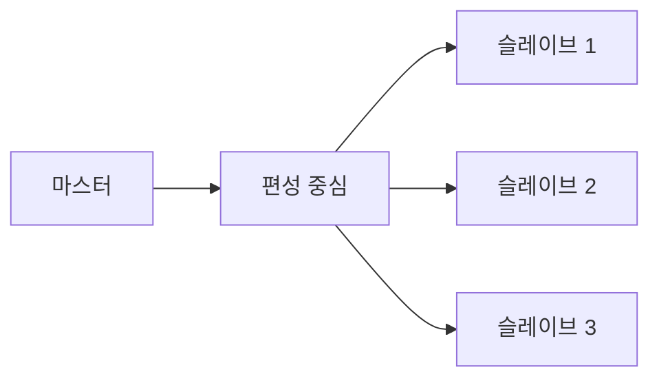
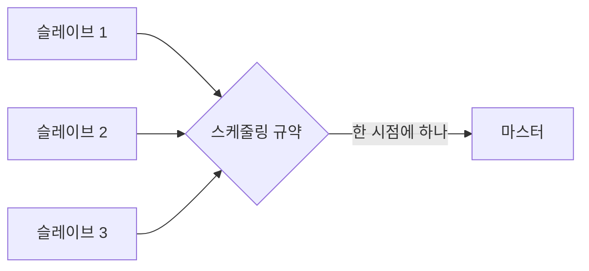
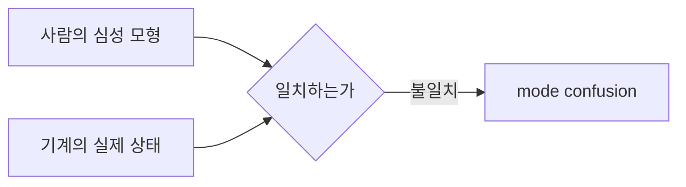

> **기준 출처:** [Li 외, SMMS teleoperation with Try-Once-Discard (arXiv:2510.02072)](https://arxiv.org/html/2510.02072v1) · [Li 외, Bilateral Teleoperation of Multiple Robots under Scheduling Communication (arXiv:1804.04290)](https://arxiv.org/abs/1804.04290) · [Gao 외, Motion Mappings for Continuous Bilateral Teleoperation (arXiv:2012.06268)](https://ar5iv.labs.arxiv.org/html/2012.06268) / 확인일 2026-11-12
> **시리즈:** [목차](/posts/00-multiaxis-series/) | 이전 → [10. 원격조작 기초](/posts/10-bilateral-teleoperation/) | 다음 → [12. 부분 고장](/posts/12-partial-failure-degraded/)

10편은 마스터 하나와 슬레이브 하나의 성질을 다뤘다. 사람이 느끼는 임피던스, 투명성과 안정성의 상충, 지연이 에너지를 만든다는 것이다. 이 편은 그 쌍을 그대로 둔 채 슬레이브만 $$N$$ 개로 늘린다. 단일 마스터–다중 슬레이브(single-master multi-slave, SMMS)라고 부른다. 질문은 조작 장치는 하나인데 움직일 대상이 여럿일 때 한 쌍짜리에는 없던 무엇이 새로 생기는가다.

늘리는 순간 연속 제어 문제 위에 이산 상태 문제가 얹힌다. 그래서 이 편은 이 시리즈와 [다중 모드 제어](/posts/00-multimode-series/) 시리즈가 만나는 자리다. 다음 편은 이 이산 상태가 계획 없이 바뀌는 경우, 즉 부분 고장을 다룬다.

## 이 편에 나오는 말

| 말 | 뜻 |
| --- | --- |
| 마스터와 슬레이브 | 사람이 잡는 쪽 장치가 마스터, 원격에서 실제로 일하는 쪽이 슬레이브. leader 와 follower 로도 쓴다 |
| 양방향 (bilateral) | 지령만 가는 것이 아니라 원격의 힘이 손으로 되돌아오는 구성 |
| 조작 중단과 장치 재배치 | 조작을 잠시 끊고 마스터를 다시 잡기 좋은 자리로 옮긴 뒤 다시 잇는 동작 |
| 무충격 전환 | 갈아타는 순간 제어 지령이 계단처럼 급변하지 않게 만드는 처리 ([다중 모드 제어 03편](/posts/03-bumpless-transfer/)) |

이 편이 다루는 질문은 다음과 같다.

- 마스터가 어느 슬레이브에 붙어 있는지가 하나의 이산 상태다
- 붙어 있지 않은 슬레이브는 무엇을 하나. 정지 유지, 자세 유지, 힘 유지 중 무엇인가
- 갈아타는 순간의 무충격 처리
- 조작자가 지금 어느 팔을 움직이는지 잘못 알면 어떻게 되나

## 1. 왜 하나로 여럿을 다루나

먼저 물을 것은 왜 굳이 하나로 여럿을 미는가다. 슬레이브가 $$N$$ 개면 조작자도 $$N$$ 명 두면 된다. 그렇게 하지 않는 이유는 두 갈래로 볼 수 있다.

첫째, 하나로 여럿을 다루는 것 자체가 목적인 경우가 있다. Li 외(2510.02072)는 SMMS 원격조작이 여러 작업을 원격에서 더 짧은 시간에 수행하고, 넓은 영역을 덮고, 단일 지점 고장에 대응할 수 있다는 점을 동기로 든다. 마지막 항목은 하나가 빠져도 나머지로 계속할 여지가 구성 자체의 이점으로 제시된다는 뜻이고, 12편의 주제와 이어진다.

둘째, 사람을 늘리는 것이 비싼 선택이다. 사람 쪽 비용을 재는 지표가 있다. Freedman 외(2010.04914)는 Goodrich 와 Olsen(2003)의 로봇 자율성 지표 여섯을 인용하는데, 그중 이 편과 닿는 넷은 다음과 같다.

| 지표 | 논문의 설명 |
| --- | --- |
| neglect tolerance | 사람의 관여 없이 시간이 지나는 동안의 로봇 성능 |
| robot attention demand | 이름만 나열된다 |
| fan-out | 한 사람이 여러 로봇과 동시에 얼마나 잘 일할 수 있는가 |
| interaction effort | 상호작용 동안 사람이 관여하는 양 |

같은 논문은 다른 문헌(2011)을 인용해 switching cost 를, 사람이 하던 일을 멈추고 명시적인 안내로 로봇을 도와야 하는 상황의 비용으로 설명한다.

이 지표들의 관계를 이 편의 문제 설정으로 읽을 수 있다. 내버려 둬도 오래 견디고(neglect tolerance 가 높고) 한 번 관여하는 데 드는 노력이 작을수록 한 사람이 더 많은 대상을 다룰 수 있다. 뒤집으면, 원격조작처럼 사람이 계속 붙어 있어야 하는 작업은 neglect tolerance 가 낮아서 한 사람이 동시에 감당할 수 있는 수가 작다고 본다. 그래서 SMMS 는 "사람 하나가 $$N$$ 개를 동시에 조종한다"보다 "사람 하나가 $$N$$ 개 사이를 오간다"에 가까워지고, 그 순간 switching cost 가 설계의 중심 항목이 된다.

## 2. 하나의 마스터가 여럿을 민다는 말의 세 가지 뜻

"하나의 마스터가 여럿을 민다"는 말은 서로 다른 구성을 가리킨다. 공개 연구에서 확인되는 것은 편성 전체를 미는 구성과, 통신으로 한 시점에 하나만 보내는 구성이다. 이 편이 뒤에서 다루는 "한 번에 하나에 붙는" 구성은 그 둘과 다르고, 4절의 사상 모드 전환에서 이어지는 정리다.

| 구성 | 지령이 가는 곳 | "어디에 붙어 있나"가 생기나 |
| --- | --- | --- |
| 편성 전체를 민다 (3절) | 편성 중심 | 생기지 않는다. 고를 것이 없다 |
| 한 시점에 하나만 보낸다 (3절) | 제어는 전체, 전송은 규약이 고른 하나 | 규약이 고른다. 사람이 고르지 않는다 |
| 한 번에 하나에 붙는다 (5절부터) | 사람이 고른 하나 | 생긴다. 이 편의 나머지가 여기서 나온다 |

## 3. 공개 연구의 두 구성

### 편성 전체를 하나처럼 민다

2510.02072 의 구성에서 각 슬레이브는 편성의 기하학적 중심으로부터 자기 거리와 방향 $$\gamma_i$$ 를 유지한다.

$$\bar{q}_s = \frac{1}{N}\sum_{i=1}^{N} q_{s_i}$$

마스터 쪽 관측기는 슬레이브들에서 재구성한 신호의 평균을 되먹임 항으로 쓴다. 사람은 개별 슬레이브가 아니라 편성 중심이라는 하나의 대상을 조작하는 셈이다.

### 한 시점에 하나만 보낸다

슬레이브 수는 통신 쪽에서 먼저 제약이 된다.

| 논문 | 서술 |
| --- | --- |
| Li 외 2018 (1804.04290) | 단일 마스터에 결합된 다중 슬레이브의 양방향 원격조작을 스케줄링 통신 아래에서 다룬다. 각 샘플 시점에 스케줄링 규약에 따라 슬레이브 하나만 마스터 쪽으로 현재 정보를 보낼 수 있다. Round-Robin 과 Try-Once-Discard 를 각각 쓰고, 제어기 이득 행렬, 샘플 간격, 통신 지연에 관한 충분 안정 조건을 얻는다 |
| Li 외 2025 (2510.02072) | 슬레이브 수가 늘면 통신 대역폭의 한계가 결정적이 된다. Try-Once-Discard 규약은 가중 전송 오차가 가장 큰 슬레이브를 골라, 그 하나만 통신망에 접근하게 한다 |

Round-Robin 은 정해진 순서로 돌아가며 보내고, Try-Once-Discard 는 위 기준으로 고른 하나를 보낸다. 어느 쪽이든 그 시점에 보내지 못한 슬레이브의 정보는 마스터 쪽에서 갱신되지 않는다.

여기서 시리즈 앞부분과 이어지는 판단이 하나 나온다. 슬레이브 수는 제어 문제이기 전에 통신 문제로 본다. $$N$$ 이 늘면 한 주기에 실을 수 있는 데이터가 나뉘고, 나눈 만큼 각자의 정보가 낡는다. 낡은 정보는 6절에서 다시 문제가 된다. 통신이 사이클의 하한을 정하는 이야기는 [06편](/posts/06-communication-cycle-budget/) 에 있다.

## 4. 사상 모드와 조작 중단

"지금 어디에 붙어 있나"가 켜지고 꺼지는 결합이라는 생각은 여럿 중 하나 고르기에서 처음 나온 것이 아니다. 한 쌍짜리 원격조작에도 조작을 멈추고 다시 잇는 동작이 있다. 이유는 작업 공간의 불일치다. Gao 외(2012.06268)의 정리는 이렇다.

| 방식 | 논문의 서술 |
| --- | --- |
| 위치 사상 | 자세 변위를 그대로 복사하거나 확대, 축소한다. 물리적 제약 때문에 사용자가 원격조작을 멈추고 햅틱 장치를 다시 놓아야 한다 |
| 속도 사상(rate control) | 원격 로봇의 속도를 국소 장치의 자세 변위에 비례시킨다. 정확한 위치 결정이 어렵다 |
| 불연속 조작의 결과 | 효율과 투명성이 낮아지고, 여러 물체가 관련된 작업에서 특히 그렇다 |
| 순차 작업 | 기존 방법들은 여전히 사상 모드 사이의 수동 전환을 요구한다 |

손잡이가 갈 수 있는 범위가 원격 로봇이 갈 수 있는 범위보다 좁으니, 손잡이가 끝에 닿으면 끊고, 손을 되돌리고, 다시 잇는다. 마지막 줄은 사상 방식 자체가 사람이 바꾸는 모드라는 뜻이다.

> 아래는 위 서술에서 따라 나오는 정리이지 그 논문의 주장이 아니다. 조작 중단과 장치 재배치는 원래 손잡이를 다시 잡기 위한 동작인데, 슬레이브가 여럿이면 같은 동작이 어느 것을 잡을지 고르는 데도 쓰일 수 있다. 둘은 구현이 거의 같고(끊고, 옮기고, 잇는다) 의미가 다르다. 앞쪽은 끊었다 이어도 대상이 그대로이고, 뒤쪽은 이었을 때 대상이 바뀌어 있다. 한 시스템 안에 두 종류가 같이 있으면 조작자는 그 둘을 구분해야 하고, 구분에 실패하는 것이 8절의 mode confusion 이다.
{: .prompt-info }

## 5. 「지금 어디에 붙어 있나」를 상태로 그린다

한 번에 하나에 붙는 구성에서 마스터와 슬레이브 사이의 결합은 켜지거나 꺼지는 것이다. 상태로 그리면 이렇게 된다.

초록은 사람의 손과 원격이 실제로 이어져 있는 상태, 노랑은 이어져 있지 않은 상태다. 중립을 반드시 거치게 그렸다. 슬레이브 1 에서 슬레이브 2 로 바로 가는 화살표를 그리지 않은 이유는 다음 절에 있다.

## 6. 갈아타는 순간에 무슨 일이 나나

갈아타는 순간에는 두 가지가 동시에 어긋난다.

첫째, 지령이 계단처럼 급변할 수 있다. 상태를 가진 제어기를 갈아탈 때 지령이 급변하는 이유는 제어기가 나빠서가 아니다. 루프 밖에 있던 쪽의 내부 상태(적분 항, 필터 상태, 관측기 상태)가 지금 실제로 인가되는 값과 관계가 없기 때문이다. 오차는 이어져 있으므로 도약의 크기를 정하는 것은 새로 들어오는 쪽의 내부 상태 초기값이다. 무충격 전환(bumpless transfer)이라는 이름으로 다뤄지는 문제이고, 처리 방식은 크게 셋이다.

| 방식 | 하는 일 | 대가 |
| --- | --- | --- |
| 출력 연속화 | 전환하는 순간, 새 쪽의 첫 출력이 옛 쪽의 마지막 출력과 같아지도록 내부 상태를 역산해 넣는다 | 계산이 전환 시점 한 스텝에 몰린다 |
| 상태 추종 | 대기 중인 쪽도 계속 돌리되, 그 출력이 지금 실제로 인가되는 값을 따라가게 내부 상태를 맞춘다 | 대기 중인 것도 계속 연산해야 한다. 대상이 $$N$$ 개면 연산량이 $$N$$ 배가 된다 |
| 램프 블렌딩 | 두 출력을 유한한 시간 동안 겹쳐서 넘긴다 | 겹치는 동안 인가되는 법칙이 이쪽도 저쪽도 아니라 그 구간에는 보장이 없다 |

두 번째 줄의 대가가 SMMS 에서 무겁다고 본다. 대기 중인 슬레이브 쪽 제어기까지 매 주기 돌려야 하는데, 3절에서 본 것처럼 그 슬레이브의 정보는 지금 통신 순서가 아니라서 낡아 있을 수 있다. "실제 인가값을 따라가라"의 그 실제 인가값이 언제 것인지가 불분명해진다. 방식별 자세한 내용은 [다중 모드 제어 03편](/posts/03-bumpless-transfer/) 과 [06편](/posts/06-state-reset-at-switch/) 에 있다.

둘째, 자세가 어긋나 있다. 이쪽이 한 쌍짜리에는 없는 문제다. 마스터를 슬레이브 1 에서 떼어 슬레이브 2 에 붙이는 순간, 마스터의 현재 자세와 슬레이브 2 의 현재 자세가 같을 이유가 없다. 위치 사상을 그대로 이으면 그 차이가 슬레이브 2 에 대한 위치 지령의 계단이 된다. 4절의 "사용자가 원격조작을 멈추고 장치를 다시 놓는다"가 여기서도 필요한 이유다. 붙이기 전에 정렬을 맞춰야 한다.

그래서 5절의 그림은 중립 상태를 반드시 거친다. 중립은 아무 일도 하지 않는 상태가 아니라 이 두 가지를 처리하는 상태로 본다. 여기서 정렬을 확인하고, 새로 붙을 쪽의 내부 상태를 맞추고, 그다음에 결합한다.

## 7. 붙어 있지 않은 쪽은 무엇을 하나

여기는 공개 출처에서 확인된 것이 적다는 사실을 먼저 적는다. 인용한 두 SMMS 연구 어느 쪽도 지령을 받지 않는 슬레이브를 따로 두지 않는다. 편성 구성에서는 모든 슬레이브가 늘 제어되고, 스케줄링 구성에서 한 번에 하나인 것은 제어가 아니라 전송이다.

> 아래 표는 두 논문의 서술이 아니라 제어량의 종류로부터 정리한 것이다. 세 선택지가 서로 무엇을 다르게 요구하는지만 적는다.
{: .prompt-warning }

| 무엇을 유지하나 | 요구하는 것 | 어긋날 때 |
| --- | --- | --- |
| 정지 (속도 0) | 브레이크 또는 속도 루프. 외력이 있으면 위치가 밀린다 | 밀린 채로 있다가 다시 붙을 때 정렬이 크게 어긋난다 |
| 자세 (위치 유지) | 위치 루프를 계속 돌린다. 외력에 저항한다 | 외력이 크면 힘이 계속 커진다 |
| 힘 (접촉력 유지) | 힘 루프를 계속 돌린다. 위치는 흘러간다 | 접촉이 끊어지면 지령이 발산한다 |

세 줄이 서로 배타적이라는 점을 본다. "그냥 가만히 있게 한다"는 지시가 되지 못한다. 무엇을 고정할지 정하는 것이 곧 무엇을 흘려보낼지 정하는 것이고, 그 선택이 다시 붙을 때 6절의 자세 어긋남을 결정한다.

이 선택은 다음 편의 주제와 바로 이어진다. 붙어 있지 않은 쪽은 고장 난 쪽과 구분되어야 한다. 지령을 받지 않는 것과 지령을 받지 못하는 것은 밖에서 보면 같아 보인다.

## 8. 조작자가 잘못 알면 — mode confusion

"지금 어디에 붙어 있나"가 이산 상태라는 말은, 사람이 그 상태를 틀리게 알 수 있다는 말이기도 하다. Wang 과 Pinto 의 사람–기계 시스템 검증 서베이(2307.15082)는 이 실패에 정의를 준다.

| 개념 | 서베이의 서술 |
| --- | --- |
| mode confusion (III-E절) | 사람 조작자가 가진 기계에 대한 심성 모형(mental model)과 기계의 실제 상태 사이의 불일치에서 생긴 결과 |
| 간접 모드 변경 (III-E절) | 사용자의 명시적 명령 없이 일어나는 자동화 모드 변경. 서베이는 이를 설계 결함의 하나로 든다 |
| 분석 방법 (IV-D절) | 모델 검사나 정리 증명으로 형식적으로 분석되어 왔다. 조작자가 생각하는 기계의 상태를 함께 모델링하는 접근도 있다 |

두 가지를 짚어 둔다.

첫째, 이것은 표시를 크게 하면 끝나는 문제가 아니다. 서베이가 이 문제를 다루는 방식이 그것을 보여 준다. 기계의 FSM 과 사람이 생각하는 FSM 을 나란히 놓고 둘이 어긋날 수 있는 경로를 찾는 형식 검증의 대상으로 다룬다. 표시는 그 어긋남을 줄이는 수단 중 하나다. 모드 전환의 형식 검증은 [다중 모드 제어 10편](/posts/10-mode-switch-verification/) 주제다.

둘째, 간접 모드 변경이 SMMS 에서 생길 수 있는 자리가 있다. 3절의 스케줄링은 어느 슬레이브가 지금 전송하는지를 규약이 정한다. 사람이 고르는 것이 아니다. 7절의 "비활성일 때 무엇을 유지하나"도 조건에 따라 자동으로 바뀌게 만들 수 있다. 사람이 명령하지 않았는데 시스템의 상태가 바뀌는 자리가 곧 위 정의의 간접 모드 변경이다.

> 아래 셋은 위 정의에서 따라 나오는 설계 요구로 보는 것이지 인용이 아니다.
> 1. 활성 대상은 조작 장치 쪽에서 확인할 수 있어야 한다. 화면보다 손이 있는 쪽에서 확인되는 것이 낫다. 사람이 보고 있는 곳이 거기다
> 2. 결합은 사람의 명시적 행위로만 시작한다. 해제는 자동이어도 되지만(안전 쪽), 결합이 자동이면 그것이 곧 간접 모드 변경이다
> 3. 중립 상태를 확인할 수 있게 만든다. "아무 데도 붙어 있지 않다"가 "붙어 있는데 움직이지 않는다"와 구분되지 않으면, 사람은 손을 움직여 보는 것으로 확인하려 한다
{: .prompt-info }

결합 상태가 경계에서 왕복하는 문제는 [다중 모드 제어 04편](/posts/04-chattering-hysteresis-dwell/) 에서, 이산 상태를 계층과 병렬로 명세하는 형식은 [다중 모드 제어 09편](/posts/09-stateflow-modes/) 에서 다룬다.

## 9. 주의 — 출처에서 확인하지 못한 것

- 인용한 두 SMMS 연구 어느 쪽도 지령을 받지 않는 슬레이브를 어떻게 둘지(정지, 자세 유지, 힘 유지)를 다루지 않는다. 7절의 표는 정리한 판단이다.
- 편성과 개별 선택을 섞는 구성은 이 편의 출처에서 확인하지 못했다.
- 1절의 지표 설명은 Freedman 외의 요약이다. Goodrich 와 Olsen 의 원 논문은 확인하지 않았다.
- 5절과 6절의 "한 번에 하나에 붙는" 구성과 중립 상태는 4절의 서술에서 이어 간 정리이고, 인용한 SMMS 연구의 구성이 아니다.

## 10. 정리

- 공개 연구가 드는 SMMS 의 동기는 짧은 작업 시간, 넓은 영역, 단일 지점 고장 대응이다. 사람이 계속 붙어 있어야 하는 원격조작에서는 "동시 조종"보다 "사이를 오가기"에 가까워지고, switching cost 가 설계의 중심이 된다
- 확인되는 구성은 둘이다. 편성 중심을 조작하고 평균을 되먹임하는 구성, 스케줄링 규약으로 한 시점에 슬레이브 하나만 보내는 구성. 스케줄링 구성의 안정 조건은 제어기 이득, 샘플 간격, 통신 지연에 함께 걸린다
- 슬레이브 수는 제어 문제이기 전에 통신 문제다. 보내지 못한 슬레이브의 정보는 갱신되지 않고 낡는다
- 위치 사상은 조작 중단과 장치 재배치를, 속도 사상은 위치 정확도 저하를 부르고, 순차 작업에서는 사상 모드의 수동 전환이 남는다. 같은 "끊고 다시 잇기"가 대상 선택에 쓰이면 의미가 달라진다
- 갈아타는 순간에는 내부 상태와 자세가 동시에 어긋난다. 출력 연속화, 상태 추종, 램프 블렌딩은 대가가 각각 다르고, 중립 상태는 쉬는 곳이 아니라 정렬과 상태 맞춤을 하는 곳이다
- 붙어 있지 않은 쪽의 정지, 자세, 힘 유지는 서로 배타적이다. 무엇을 고정할지 정하는 것이 무엇을 흘려보낼지 정하는 것이다
- mode confusion 은 사람의 심성 모형과 기계 상태의 불일치다. 간접 모드 변경은 이를 부르는 설계 결함의 하나로 꼽히고, 결합은 사람의 명시적 행위로 시작하는 것이 맞다고 본다

## 참고

- [Y. Li, C. Li, K. Liu, J. Dong, R. Johansson, Event-triggered control and communication for single-master multi-slave teleoperation systems with Try-Once-Discard protocol (arXiv:2510.02072)](https://arxiv.org/html/2510.02072v1)
- [Y. Li, K. Liu, W. He, Y. Yin, R. Johansson, K. Zhang, Bilateral Teleoperation of Multiple Robots under Scheduling Communication (arXiv:1804.04290)](https://arxiv.org/abs/1804.04290)
- [X. Gao, J. Silvério, E. Pignat, S. Calinon, M. Li, X. Xiao, Motion Mappings for Continuous Bilateral Teleoperation (arXiv:2012.06268)](https://ar5iv.labs.arxiv.org/html/2012.06268)
- [T. E. Wang, A. Pinto, Survey of Human Models for Verification of Human-Machine Systems (arXiv:2307.15082)](https://ar5iv.labs.arxiv.org/html/2307.15082)
- [R. G. Freedman, S. J. Levine, B. C. Williams, S. Zilberstein, Helpfulness as a Key Metric of Human-Robot Collaboration (arXiv:2010.04914)](https://ar5iv.labs.arxiv.org/html/2010.04914)
