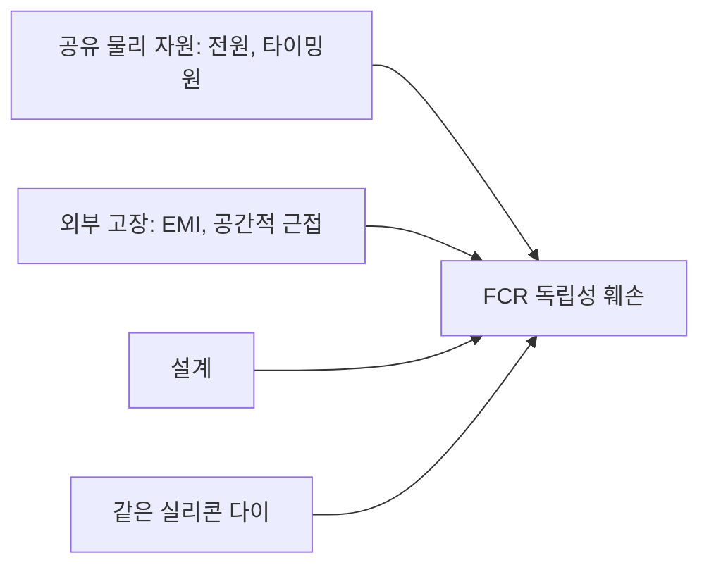
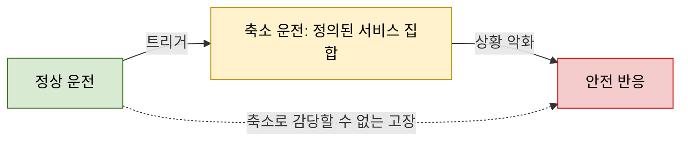

> **기준 출처:** [Quamar, Nasir (arXiv:2402.02980)](https://ar5iv.labs.arxiv.org/html/2402.02980) · [P. Koopman, Safety Requires No Single Points of Failure](https://betterembsw.blogspot.com/2014/03/safety-requires-no-single-points-of.html) · [Risknowlogy, Graceful Degradation](https://risknowlogy.com/articles/detail/17309/) · [GT Engineering, Stop Functions](https://www.gt-engineering.it/en/insights/machinery-safety/stop-functions/) / 확인일 2026-11-12
> **시리즈:** [목차](/posts/00-multiaxis-series/) | 이전 → [11. single-master multi-slave](/posts/11-single-master-multi-slave/)

08편부터 11편까지는 모두가 정상일 때의 결합이었다. 같은 물체(08편), 같은 공간(09편), 사람과의 결합(10편), 조작권이 어디에 있나(11편). 이 편은 그 결합이 남은 채로 한 요소만 빠지는 경우다. 11편에서 "지금 어디에 붙어 있나"를 계획적으로 바꿨다면, 여기서는 그 상태가 계획 없이 바뀐다. 질문은 여럿 중 하나만 고장 났을 때 전체를 세울 것인가 나머지로 계속할 것인가, 그리고 그 판단을 무엇으로 하는가다.

단일 계통의 고장 모드와 안전 상태는 [다중 모드 제어 11편](/posts/11-fault-modes-fdir/) 에서 다루고, 여기서는 대상이 여럿일 때 달라지는 점을 본다.

## 이 편에 나오는 말

| 말 | 뜻 |
| --- | --- |
| FDIR | 고장을 검출하고, 어디인지 격리하고, 무엇인지 식별한 뒤 복구하는 일련의 처리 |
| 폐연쇄 (closed chain) | 둘 이상이 같은 물체를 동시에 잡아 서로가 서로의 움직임을 구속하게 된 상태 ([08편](/posts/08-cooperative-manipulators/)) |
| 내력 (internal force) | 물체를 움직이지는 않으면서 서로 밀거나 당기는 힘. 위치 오차가 있으면 생긴다 |
| 안전 상태 (safe state) | 그 시스템이 "여기 있으면 위험하지 않다"고 정의해 둔 상태. 대개 정지이지만 항상 그렇지는 않다 |

이 편이 다루는 질문은 다음과 같다.

- 하나의 고장이 어디까지 번지게 둘 것인가. 고장 격리 구역(fault containment region)
- 전체를 세울 것인가, 나머지로 계속할 것인가. 무엇을 기준으로 정하나
- 세울 때도 방식과 순서가 있다. 동시에 세우는 것이 항상 안전하지는 않다
- 물리적으로 결합된 상태(08편의 폐연쇄)에서 하나만 멈추면 무슨 일이 생기나
- 고장 판정 자체가 틀리면 어떻게 되나

## 1. 검출, 격리, 식별 — 단일 계통과 무엇이 다른가

Quamar 와 Nasir 의 로봇 매니퓰레이터 고장 진단 리뷰(2402.02980)는 세 단계를 이렇게 정의한다.

| 단계 | 정의 |
| --- | --- |
| 검출(detection) | 시스템에 오작동이나 고장이 있는지, 언제 생겼는지를 판정한다 |
| 격리(isolation) | 고장난 구성 요소의 구체적 위치를 짚어낸다 |
| 식별(identification) | 고장의 종류, 형태, 크기를 분간한다 |

계통이 하나뿐이면 셋 중 격리는 비교적 단순하다. 고장 난 것이 하나밖에 없으니 "어디인가"는 그 안에서의 문제이고, 결정은 대개 계속할 것인가 세울 것인가의 둘 중 하나로 끝난다.

대상이 여럿이 되면 격리의 답이 "어느 것"과 "어디까지" 두 개가 된다고 본다. 두 번째가 더 어렵다. 하나가 고장 났다는 것을 알아도, 나머지가 그것과 얼마나 엮여 있는지를 알아야 다음 행동이 정해지기 때문이다. [01편](/posts/01-what-is-multiple/) 이 결합을 네 종류(물리, 자원, 논리, 사람)로 나눈 이유가 여기서 되돌아온다. 결합의 종류마다 고장이 번지는 경로가 다르다. 그래서 이 편은 "어떻게 판단하나"보다 "무엇이 어디까지 번질 수 있는가"를 먼저 그리는 순서로 간다.

## 2. 번짐의 경계를 먼저 그린다 — 고장 격리 구역

P. Koopman 의 글은 Lala 외(1994)를 인용해 고장 격리 구역(Fault Containment Region, FCR)을 정의한다. FCR 은 외부 고장에 취약하지 않고, FCR 밖으로 고장을 일으키지도 않는 시스템의 영역이다.

짚어 둘 것은 $$N$$ 개로 나눠 놓았다고 $$N$$ 개의 FCR 이 되는 것이 아니라는 점이다. 같은 글이 독립성을 깨는 것들을 인용한다.

| 출처 | 내용 |
| --- | --- |
| Obermaisser(2006), Koopman 글의 인용 | 독립성은 공유된 물리 자원(전원, 타이밍원), 외부 고장(EMI, 공간적 근접), 설계로 훼손될 수 있다 |
| Kopetz(2004), Koopman 글의 인용 | 같은 실리콘 다이 위의 두 부분 시스템의 상관된 고장은 모두 없앨 수 없다 |
| Koopman 본인 | 이중화된 구성 요소에는 공통 모드(common mode) 고장이 없어야 한다. 같은 원인으로 둘 다 고장 나는 경로가 있으면 안 된다 |
| Koopman 본인의 예 | 두 항공기 엔진이 같은 연료 펌프를 쓰면 그 펌프가 단일 고장점이 된다 |

같은 글은 FCR 마다 독립이어야 하는 것으로 컴퓨터 하드웨어, 전원, 타이밍원, 클록 동기화 서비스, 물리 공간을 든다.

다축 시스템에서 이 목록에 들어가는 것들은 시리즈 앞부분의 자원 결합([06편](/posts/06-communication-cycle-budget/), [07편](/posts/07-execution-time-budget/))에서 이미 나왔다.

| 공유하는 것 | 하나가 고장 나면 |
| --- | --- |
| 전원 | 전원 자체가 나가면 전부 나간다. FCR 이 하나다 |
| 통신 버스 | 한 노드가 버스를 점유하거나 잘못된 프레임을 보내면 나머지의 통신이 함께 무너질 수 있다 |
| 시간 기준(클록, 동기) | 동기가 깨지면 개별 축은 멀쩡한데 협조가 무너진다 |
| CPU, 스케줄러 | 한 태스크가 예산을 넘기면 다른 태스크의 마감이 함께 밀린다 |
| 같은 소프트웨어 | 이중화해도 같은 코드면 같은 입력에서 같이 틀린다. 공통 모드 고장이다 |

## 3. 하드웨어 이중화의 한계

같은 리뷰는 초기 내고장 시스템이 예비 모터, 센서, 기계 부품을 두었고, 이 방식이 상당한 비용과 복잡성을 더했으며 고장을 예방하거나 예측하지 못하는 사후 대응이었다고 적는다. 이후 내고장 제어는 모델 기반 방식으로 크게 옮겨 갔다.

> 아래는 2절과 3절의 인용에서 따라 나오는 판단이다. 경계를 그리는 일이 판단보다 먼저다. "하나가 고장 나면 나머지로 계속한다"는 정책은 나머지가 정말로 다른 FCR 에 있을 때만 성립한다. 공유 자원 목록을 먼저 만들지 않고 이 정책을 세우면, 실제로는 이미 같이 고장 난 것들로 계속하겠다는 말이 될 수 있다.
{: .prompt-info }

## 4. 축소 운전은 미리 정의된 상태다

경계를 그렸다면 다음은 정책이다. 흔한 오해는 축소 운전(degraded mode)을 "고장 난 것을 뺀 나머지"로 이해하는 것이다. 공개 자료의 정의는 그 반대를 말한다.

Risknowlogy 의 글은 우아한 축소(graceful degradation)를 부품이 고장나거나 자원이 부족해질 때 가장 중요한 안전 관련 기능을 계속 쓸 수 있게 유지하는 계획된 능력으로 정의한다. 축소 운전의 우선순위, 트리거, 동작은 미리 설계하고 검증한다. 그래서 축소된 상태는 우발적인 것이 아니라 의도되고 감사 가능한 것이다.

| 요구 | 글의 서술 |
| --- | --- |
| 서비스 집합 | 무엇이 돌고 무엇이 버려지는지가 한정되고 결정적인 집합 |
| 트리거 예 | CPU 사용률 초과, 저전압, 통신 두절, 메모리 압박, 자기 진단 실패 |
| 트리거마다 적을 것 | 유지, 버림, 단순화 중 무엇인지, 타이밍 한계, 상황이 더 나빠질 때의 안전 반응 |
| 참조 | IEC 61508-7:2010 Annex C |

초록은 정상, 노랑은 기능을 줄인 채 계속하는 구간, 빨강은 더 이상 작업을 하지 않는 구간이다. 점선은 축소 운전을 거치지 않고 바로 안전 반응으로 가는 경로다. 노란 상자는 정상과 정지 사이의 빈 구간이 아니라 이름과 내용이 있는 하나의 상태다.

그래서 판단의 기준은 "계속할 수 있는가"가 아니라 다음 셋이 미리 대답되어 있는가로 본다.

| 질문 | 대답에 들어갈 것 |
| --- | --- |
| 그 축소 상태가 무엇인가 | 이름과 내용. 무엇이 유지되고 무엇이 버려지는가 |
| 거기로 들어가는 트리거는 무엇인가 | 어떤 관측이 어떤 문턱을 넘을 때인가 |
| 거기서 더 나빠지면 어디로 가는가 | 축소 운전은 종착지가 아니다 |

셋 중 하나라도 비어 있으면 그 시스템은 "나머지로 계속한다"를 고를 근거가 없고, 그때의 답은 세우는 것이라고 본다.

## 5. 세우는 방식 — 정지 범주

"세운다"가 한 가지 동작이라고 생각하기 쉬운데, 기계 안전 표준은 이것을 세 범주로 나눈다. GT Engineering 의 글은 EN/IEC 60204-1 의 정지 범주를 이렇게 옮긴다.

| 범주 | 정의 | 전원 |
| --- | --- | --- |
| 0 | 기계 구동기의 전원을 즉시 제거해 세운다. 제어되지 않는 정지 | 즉시 끊는다 |
| 1 | 구동기에 전원이 있는 상태로 제어된 정지를 하고, 정지가 달성되면 전원을 제거한다 | 서고 나서 끊는다 |
| 2 | 구동기에 전원이 계속 공급되는 제어된 정지 | 끊지 않는다 |

같은 글은 비상 정지(ISO 13850)를 설명하는 부분에서, 범주는 위험성 평가로 정한다고 하면서 다음을 적는다.

| 기계의 성질 | 요구되는 범주 |
| --- | --- |
| 움직이는 부분에 관성이 없고, 정지가 추가 위험을 만들지 않는다 | 범주 0 |
| 관성을 가진 위험 요소가 있거나, 다른 안전 시스템이 필요하다 | 범주 1 |

범주 0 에 해당하는 STO(Safe Torque Off)에 대해서는 외부 영향이 있으면 위험을 막기 위해 추가 조치가 필요할 수 있다고 덧붙인다.

이 표에서 읽을 점은 범주 0 이 가장 안전한 정지라는 뜻이 아니라는 것이다. 이유는 물리다. 전원을 끊으면 구동기는 멈추는 것이 아니라 제어를 잃는다. 관성이 있으면 계속 가고, 중력 방향으로 하중이 걸려 있으면 내려온다. 범주 0 은 "빨리 서게 하는 것"이라기보다 "더 이상 시스템이 움직임에 관여하지 않게 하는 것"이고, 그 결과가 안전한지는 관성과 외부 영향에 달려 있다.

여기서 이 편의 질문이 하나 갈라져 나온다. 여러 개를 세울 때 전부 같은 범주로, 같은 순간에 세워야 하는가.

## 6. 결합된 상태에서 하나가 벗어나면

[08편](/posts/08-cooperative-manipulators/) 에서 본 Liu 외(2406.05613)의 관계식이 여기서도 쓰인다.

$$h_i - h_i^{\text{ref}} \;=\; K \sum_{j \ne i} \bigl(\Delta e_j - \Delta e_i\bigr)$$

여기서 $$h_i$$ 는 물체가 로봇 $$i$$ 의 말단에 가하는 렌치, $$h_i^{\text{ref}}$$ 는 그 계획값, $$\Delta e_i$$ 는 로봇 $$i$$ 의 자세 오차, $$K$$ 는 물체 또는 외부 환경의 강성을 나타내는 양의 정부호 대각 행렬이다. 논문은 긴밀한 결합 때문에 작은 불균형이나 정렬 어긋남도 과도한 상호작용 렌치를 만들 수 있고, 초록에서 그 결과로 물체 손상이나 비상 정지를 든다.

| 식에서 읽히는 것 | 내용 |
| --- | --- |
| 모두 같은 만큼 벗어남 | 우변이 0. 렌치 오차가 생기지 않는다 |
| 하나만 다르게 벗어남 | 그 차이가 $$K$$ 를 거쳐 렌치 오차가 된다 |
| 강성이 큼 | 같은 차이가 더 큰 렌치가 된다. 강체를 잡고 있으면 작은 차이도 큰 힘이 된다 |

같은 논문은 서론에서 중앙집중 방식은 단일 고장점에 취약해지고, leader-follower 방식도 중앙집중 방식과 비슷하게 단일 고장점에 취약하다고 지적한다.

> 아래는 위 관계에서 따라 나오는 정리이지 그 논문이 다룬 시나리오가 아니다. 그 논문은 정상 운전 중의 렌치 저감을 다루고 고장 정지를 다루지 않는다.
>
> 이 관계를 정지에 적용하면, 하나만 멈추면 그 하나의 오차만 커진다. 나머지는 계속 자기 궤적을 따라가므로 오차의 차이가 계속 벌어지고, 그 차이가 $$K$$ 를 거쳐 렌치 오차로 계속 자란다. 폐연쇄에서 "하나를 즉시 세우는 것"은 그 하나를 멈추는 대신 물체와 나머지 로봇에 힘을 쌓는 동작이 될 수 있다.
>
> 그래서 이런 구성에서 정지는 동시성의 문제라기보다 협조의 문제로 본다. 필요한 것은 "모두가 정확히 같은 순간에 선다"보다 "서는 동안에도 서로의 상대 자세가 유지된다"이고, 그러려면 서는 동안에도 제어가 살아 있어야 한다(5절의 범주 1 이나 2). 전원을 즉시 끊는 범주 0 에서는 각자가 자기 관성과 하중에 따라 다르게 흘러가므로 상대 자세를 유지할 수단이 없다.
{: .prompt-info }

정지의 순서도 같은 판단에서 나온다. 결합을 먼저 풀 수 있으면 푸는 것이 낫고(잡은 것을 놓거나, 힘 제어로 바꿔 서로 밀지 않게 만들거나), 풀 수 없으면 결합된 무리 전체를 하나의 단위로 세운다. 어느 쪽이든 "고장 난 것만 즉시 세운다"는 선택지는 이 상황에서 나쁜 쪽에 든다고 본다.

## 7. 판정 자체가 틀릴 수 있다

지금까지의 결정은 모두 하나의 추정 위에 서 있다. 정상 운전의 전이 조건은 대개 실제로 측정한 물리량이지만, 고장 모드의 진입 조건은 "고장이 났다고 판정했을 때"다. 판정에는 두 종류의 오류가 있고, 대상이 늘면 둘 다 나빠진다고 본다.

| | 오경보 (false alarm): 멀쩡한데 고장으로 본다 | 미검출: 고장인데 정상으로 본다 |
| --- | --- | --- |
| 하나일 때 | 불필요한 정지 1회 | 위험 1건 |
| 여럿일 때 | 감시 대상이 $$N$$ 배라 오경보도 대략 $$N$$ 배로 늘고, 그때마다 전체가 서면 가동률이 떨어진다 | 놓친 것이 6절의 결합을 통해 나머지에 힘으로 전달될 수 있다 |
| 줄이는 방향 | 문턱을 올린다, 확정 지연을 건다, 히스테리시스를 건다 | 문턱을 내린다, 여러 신호를 교차로 본다 |

마지막 줄의 두 칸이 서로 반대 방향이다. 문턱 하나로 두 오류를 동시에 줄일 수 없다. 그래서 문턱을 조정하는 대신 판정의 근거를 늘리는 쪽이 맞다고 본다. 서로 다른 원리의 신호를 교차 확인하거나, 3절의 리뷰가 다루는 하드웨어 이중화와 모델 기반 방식을 함께 쓰는 것이다. 판정이 경계에서 왕복하는 문제와 확정 지연은 [다중 모드 제어 04편](/posts/04-chattering-hysteresis-dwell/) 에서 다룬다.

대상이 여럿일 때 생기는 문제가 하나 더 있다. 서로를 감시할 때 감시자가 고장 난 경우를 어떻게 다루는가다. 2절의 FCR 관점에서 보면 이것은 진단 기능이 어느 FCR 안에 있는가의 문제다. 어떤 대상의 고장을 그 대상 자신이 판정한다면, 그 판정은 대상과 같은 FCR 안에 있어 대상과 함께 고장 날 수 있다.

> 아래는 2절의 정의에서 따라 나오는 정리이지 인용이 아니다. "나머지로 계속한다"를 택하려면 판정 기능이 판정 대상과 다른 FCR 에 있어야 한다. 그것이 성립하지 않으면 판정을 믿을 수 없고, 판정을 믿을 수 없으면 4절의 세 질문 중 두 번째(트리거)가 비어 있는 것이므로 결론은 다시 세우는 것이다.
{: .prompt-info }

고장 모드로 넘어가는 순간의 지령 처리는 [다중 모드 제어 03편](/posts/03-bumpless-transfer/) 에서 다룬다.

## 8. 주의

- 6절의 관계식은 정상 운전 중의 렌치 저감을 다룬 논문의 것이다. 그 논문은 고장 허용, 고장 복구, 비상 정지 처리를 분석하지 않는다. 결합된 상태에서 어떤 순서와 범주로 세워야 하는지는 이 편의 출처에서 확인하지 못했고, 6절 뒷부분은 정리한 판단이다.
- 정지 범주의 정의는 EN/IEC 60204-1 을 옮긴 2차 자료에서 인용했다.
- Risknowlogy 의 트리거 목록은 예시다.
- 2절의 공유 자원 표, 4절의 세 질문, 7절의 오류 표는 문헌 인용이 아니라 정리한 판단이다.

## 9. 정리

- 고장 진단은 검출, 격리, 식별로 나뉜다. 계통이 하나면 격리가 비교적 단순하지만, 여럿이면 격리의 답이 "어느 것"과 "어디까지" 둘이 된다. 결합의 종류마다 번지는 경로가 다르다
- 판단보다 경계 그리기가 먼저다. FCR 은 외부 고장에 취약하지 않고 밖으로 고장을 내보내지 않는 영역이다. 공유 자원, 외부 간섭, 설계, 같은 다이가 독립성을 깨고, 이중화된 요소에는 공통 모드 고장이 없어야 한다. $$N$$ 개로 나눴다고 $$N$$ 개의 FCR 이 되지 않는다
- 축소 운전은 고장 난 것을 뺀 나머지가 아니라 우선순위, 트리거, 동작을 미리 설계하고 검증한 상태다. 그 상태의 내용, 들어가는 트리거, 더 나빠질 때 갈 곳 중 하나라도 비면 세운다
- 정지 범주는 0(즉시 전원 제거), 1(제어 정지 후 전원 제거), 2(전원 유지)다. 위험한 관성이 있으면 범주 1 이 요구된다. 전원 차단은 관성이나 하중이 있으면 정지가 아니라 제어의 상실이다
- 결합된 상태의 렌치 오차는 로봇들 사이 오차의 차이에 강성을 곱한 꼴이다. 하나만 즉시 세우면 그 차이가 벌어지므로, 정지는 동시성보다 협조의 문제로 본다. 결합을 먼저 풀거나 무리 전체를 한 단위로 세운다
- 판정 자체가 틀릴 수 있고, 대상이 늘면 오경보와 미검출이 함께 나빠진다. 문턱 하나로 둘을 같이 줄일 수 없으므로 근거를 늘린다
- 판정 기능이 판정 대상과 같은 FCR 안에 있으면 그 판정은 대상과 함께 고장 날 수 있다. 그 경우 "나머지로 계속한다"의 전제가 무너진다

## 참고

- [M. M. Quamar, A. Nasir, Review on Fault Diagnosis and Fault-Tolerant Control Scheme for Robotic Manipulators: Recent Advances in AI, Machine Learning, and Digital Twin (arXiv:2402.02980)](https://ar5iv.labs.arxiv.org/html/2402.02980)
- [P. Koopman, Safety Requires No Single Points of Failure, Better Embedded System SW (2014)](https://betterembsw.blogspot.com/2014/03/safety-requires-no-single-points-of.html)
- [Risknowlogy, Graceful Degradation — Degraded Mode in Safety Systems](https://risknowlogy.com/articles/detail/17309/)
- [GT Engineering, Stop Functions](https://www.gt-engineering.it/en/insights/machinery-safety/stop-functions/)
- [W. Liu 외, Distributed Motion Control of Multiple Mobile Manipulators for Reducing Interaction Wrench in Object Manipulation (arXiv:2406.05613)](https://arxiv.org/html/2406.05613v4)
