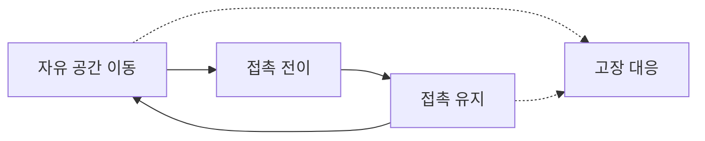

> **기준 출처:** [MathWorks, Gain Scheduling](https://www.mathworks.com/help/control/gain-scheduled-controller-tuning.html) · [Hespanha, Tutorial on Supervisory Control](https://web.ece.ucsb.edu/~hespanha/published/tr-tutorial-cdc01.pdf) · [Sidhik 외, arXiv:2106.10969](https://arxiv.org/html/2106.10969) / 확인일 2026-11-12
> **시리즈:** [목차](/posts/00-multimode-series/) | 다음 → [02. switched system 과 hybrid automaton](/posts/02-switched-hybrid-automaton/)

이 시리즈는 제어기를 여러 개 두고 상황에 따라 갈아타는 구조를 다룬다. 문헌에서는 switching control, switched system, mode switching 이라는 이름으로 찾는다. 각 모드 안의 제어기 설계는 [ADRC 시리즈](/posts/00-adrc-series/) 같은 단일 제어기 글의 몫이고, 이 편은 왜 하나로 안 되는지, 그리고 모드가 정확히 어디서 생기는지를 정리한다. 이 시리즈의 나머지 편은 모두 「모드가 여러 개 있다」를 전제로 전환을 다루므로, 그 전제를 먼저 따져 둔다. 나누지 않아도 될 것을 나누면 전환 문제만 늘어난다.

이 편에 필요한 앞 개념은 셋이다.

| 용어 | 뜻 |
| --- | --- |
| LTI 제어기 | 계수가 시간에 따라 변하지 않는 선형 제어기. 게인을 고정한 PID 가 이것이다 |
| 적분기 상태 | PID 의 I 항처럼 제어기가 과거를 누적해 들고 있는 내부 값. 제어기를 껐다 켤 때 이 값이 문제가 된다 |
| 구속 운동 (constrained motion) | 로봇 말단이 환경에 닿아 있어 어떤 방향으로는 움직이지 못하는 상태. 그 방향으로는 위치 대신 힘이 생긴다 |

## 1. 제어기 하나가 전제하는 것

게인이 고정된 제어기 하나가 전 구간에서 통하려면 둘 중 하나가 참이어야 한다고 이 글은 본다. 그 구간 내내 플랜트의 동역학이 사실상 같거나, 동역학이 다르더라도 하나의 고정 법칙이 모든 경우에 충분히 좋은 성능을 내거나. 깨지는 쪽은 대개 첫째다.

MathWorks 의 게인 스케줄링 문서는 대상을 시간이나 운전 조건에 따라 동역학이 바뀌는 시스템으로 정하고, 대응을 운전점마다 만족스러운 제어를 주는 선형 제어기의 계열(family)로 설명한다. 그리고 단서를 붙인다.

> 게인 스케줄 제어기의 튜닝은 각 설계점 근처에서만 적절한 성능을 보장한다.

그래서 같은 문서는 튜닝 결과를 전체 운전 조건 범위에서 검증하라고 적는다. 제어기 하나가 동작하지 않는다는 뜻이 아니라, 보장되는 범위가 설계점 근처로 좁다는 뜻이다. 운전 범위가 그 근방을 벗어나면 그다음부터 성능은 보장이 아니라 기대가 된다.

Hespanha 의 감독제어(supervisory control) 강의노트는 불확실성 쪽에서 본다. 단일 제어기에 기반한 전통적 방법으로 만족스러운 성능이 나오지 않는 시스템에서는 후보 제어기 묶음을 두고 온라인 측정에 따라 그 사이를 전환한다. 모델 불확실성이 환경 변화나 부품 고장에서 오면, 허용되는 플랜트 모델 전체에 대해 조절 문제를 푸는 제어기 하나는 대개 없다고 적는다.

두 서술을 합쳐 이 글은 이렇게 읽는다. 모드는 편의로 나누는 것이 아니라, 「하나로 덮는다」가 요구하는 전제가 실제로 깨지는 자리에서 생긴다. 아래 절들이 그 자리를 하나씩 본다.

## 2. 모드가 생기는 자리

| 자리 | 무엇이 바뀌나 | 출처 |
| --- | --- | --- |
| 운전 조건 | 동역학의 계수. 설계점에서 멀어질수록 보장이 사라진다 | MathWorks |
| 작업 국면 | 제어 목표. 제어량, 성능 지표, 한계가 구간마다 다르다 | 이 글의 정리 (3절) |
| 모델 불확실성 | 어느 모델이 맞는지 모른다. 후보마다 제어기를 둔다 | Hespanha |
| 환경과의 접촉 | 방정식 자체. 접촉이 생기거나 끊기는 순간 불연속이다 | Sidhik 외 |
| 고장 | 쓸 수 있는 구동기와 센서의 조합 | Quamar, Nasir |
| 상태 공간의 위상 | 연속 피드백 하나로는 전역 안정화가 안 된다 | Casau 외 |

이 글이 접촉 작업과 고장을 묶어 그린 예시다. 실선은 작업 순서에 따른 전환이고, 점선은 진단 결과로 들어가는 전환이다. 자유 이동과 접촉 유지는 정상 운전 구간, 접촉 전이는 동역학이 바뀌는 경계 구간, 고장 대응은 정상 동작이 더는 정의되지 않는 구간이다. 점선은 어느 구간에서나 들어올 수 있다.

## 3. 작업 국면 — 목표가 구간마다 다르다

> 이 절은 이 글의 정리다. 출처 하나에서 옮긴 것이 아니다.
{: .prompt-info }

같은 하드웨어가 시간에 따라 다른 목적을 수행하는 경우다. 이동할 때는 위치를 정확히 따라가는 것이 목표이고, 무언가를 눌러야 할 때는 힘을 정해진 값으로 유지하는 것이 목표다. 이 유형은 동역학이 그대로여도 모드가 생긴다. 바뀌는 것은 플랜트가 아니라 명세다.

| 바뀌는 것 | 내용 |
| --- | --- |
| 제어량 | 위치를 제어하다가 힘을 제어하게 되면 되먹임으로 들어오는 신호도, 오차의 정의도 바뀐다 |
| 성능 지표 | 이동 구간에서는 빠른 정착이 좋은 응답이다. 접촉 구간에서는 오버슈트가 곧 과대 힘이라 느리고 감쇠가 큰 응답이 좋은 응답이다. 게인 한 벌로 두 지표를 동시에 최적화하기 어렵다 |
| 포화 한계의 의미 | 같은 토크 한계라도 이동 중에는 여유이고, 접촉 중에는 안전 한계가 된다 |

이 유형의 모드는 플랜트가 아니라 작업 기술서에서 나온다. 작업을 국면으로 나눠 쓸 수 있으면 모드가 이미 있는 것이다.

## 4. 접촉 — 방정식이 바뀐다

Sidhik 등은 접촉이 바뀌는 조작 작업의 동역학을 「접촉이 생기거나 끊길 때 불연속이고 그 밖에서는 연속」이라고 적고, 그래서 동역학 모델 하나나 제어 전략 하나로 다루기가 매우 어렵다고 본다.

국면별로 무엇이 달라지는지를 이 글이 풀어 쓰면 다음과 같다.

| 국면 | 자유도 | 되먹임에 실제로 잡히는 것 | 위치 제어기를 그대로 두면 |
| --- | --- | --- | --- |
| 자유 이동 | 접촉 법선 방향으로도 움직인다 | 위치, 속도 | 정상 동작 |
| 접촉 전이 | 순간적으로 속도가 꺾인다 | 충격력 스파이크 | 오차를 없애려고 계속 밀어 넣는다 |
| 구속 이동 | 법선 방향 자유도가 사라진다 | 그 방향으로는 위치 대신 힘이 생긴다 | 위치 오차가 줄지 않으니 지령이 계속 커진다 |

마지막 열이 문제가 되는 자리다. 구속 상태에서 위치 오차는 더 세게 밀어도 줄지 않고, 대신 접촉력만 커진다. 적분 항이 있으면 그 힘이 시간에 비례해 계속 자란다.

같은 논문은 전환 방식도 문제 삼는다. 접촉을 검출한 뒤에 제어기를 바꾸는 기존 방식은 상호작용 동역학에 큰 불연속을 남겨 로봇이나 물체를 손상시킬 수 있다. 그래서 접촉을 예측하고, 예측한 접촉 영역에 들어가기 전에 속도와 강성을 낮춘 전이 제어기로 바꿔 충격력, 진동, 저크(jerk)를 줄인다. 전이를 한 순간이 아니라 구간으로 만드는 발상이고, 03편의 무충격 전환(전환 순간 제어 입력이 계단처럼 변하지 않게 하는 기법)과 뿌리가 같다. 모드를 나눈 뒤에도 전환하는 순간이 따로 설계 대상이 된다.

## 5. 고장 — 진단이 모드를 고른다

앞의 둘은 계획된 모드이고, 고장은 계획하지 않은 모드다. Quamar 와 Nasir 의 로봇 매니퓰레이터 고장 리뷰는 진단을 세 단계로 나눈다.

| 단계 | 정하는 것 |
| --- | --- |
| 검출 (detection) | 고장이 있는가, 언제 생겼는가 |
| 격리 (isolation) | 어느 구성요소인가 |
| 식별 (identification) | 고장의 종류, 형태, 크기 |

고장 허용 제어는 흔히 수동적(passive) 대응과 능동적(active) 대응으로 나눈다. 둘을 모드 관점에서 비교하면 다음과 같다.

| | 수동적 대응 | 능동적 대응 |
| --- | --- | --- |
| 구조 | 제어기 하나를 로버스트하게 설계해 버틴다 | 진단 결과에 따라 제어기를 바꾼다 |
| 모드 | 생기지 않는다 | 생긴다 |
| 대가 | 상정한 고장 범위 전체에 대해 보수적으로 설계해야 하므로 정상 시 성능을 깎는다 | 진단이 필요하고, 진단이 틀리면 잘못된 모드로 간다 |

같은 리뷰는 진단을 바탕으로 다른 구동기와 센서 조합을 쓰는 제어기로 전환할 수 있다고 적고, 센서 고장에서 건강한 센서의 추정치를 고르는 전환 제어기를 예로 든다. 고장 신호를 보상하거나, 게인을 다시 잡거나, 이중화된 구성요소로 갈아타는 것이 모두 이 범주다([11편](/posts/11-fault-modes-fdir/)).

이 글은 고장 모드가 앞의 유형과 다른 점을 하나로 본다. 진입 조건이 물리량이 아니라 추정치다. 접촉 모드는 힘 센서 값이 문턱을 넘으면 들어가지만, 고장 모드는 「고장이 났다고 판단했을 때」 들어간다. 판단은 틀릴 수 있고, 늦을 수 있고, 진동할 수 있다. 그래서 고장 모드의 전이 조건에는 다른 모드보다 히스테리시스와 확정 지연을 세게 거는 경우가 많다고 본다(04편).

## 6. 연속 피드백 하나로는 불가능한 경우

지금까지는 「하나로 하면 불편하다」에 가까웠다. 하나로 하는 것이 불가능한 부류도 있다. 상태가 구(球)나 강체 자세처럼 경계 없는 콤팩트 다양체 위에서 움직이는 경우다. Casau 등은 선행 연구를 인용해 두 가지를 정리한다.

- 콤팩트 다양체 위의 시스템은 연속 상태 피드백으로 목표점의 전역 점근 안정성을 얻을 수 없다
- 연속 상태 피드백으로 전역 점근 안정화할 수 없는 집합은 불연속 상태 피드백으로도 로버스트하게 전역 점근 안정화할 수 없다

둘째 항목의 직관을 이 글은 이렇게 읽는다. 불연속 피드백은 어딘가에 제어 법칙이 갈리는 경계를 두는데, 상태가 그 경계 근처에 있으면 작은 측정 잡음만으로도 법칙이 양쪽을 오가며 수렴을 막을 수 있다.

이 논문의 제어기는 흐르는 동안 국소 좌표계(chart)에서 PD 동작을 하고, 도약할 때 히스테리시스를 써서 좌표계 사이를 전환한다. 히스테리시스가 경계에서의 떨림을 막는다. 예제는 강체 자세 안정화다. 이런 문제에서 모드 전환은 설계자의 선택이 아니라 전역 안정화를 얻기 위한 필요조건이다.

## 7. 게인 스케줄링과 전환 제어

둘 다 제어기를 여러 개 쓰지만 성격이 다르다.

| | 게인 스케줄링 | 전환 제어 |
| --- | --- | --- |
| 제어기 | 운전점마다 설계한 선형 제어기의 계열 | 후보 제어기의 묶음 |
| 무엇이 바뀌나 | 같은 제어 구조의 계수 | 제어 법칙의 구조. 제어량, 신호 배선, 차수 |
| 바뀌는 방식 | 연속. 설계점 사이를 보간한다 | 이산 도약 |
| 무엇으로 고르나 | 측정 가능한 연속 스케줄링 변수(운전 조건) | 측정으로 후보의 성능을 평가하는 전환 논리 |
| 전환 순간 | 따로 정의하지 않는다. 늘 이어져 있다 | 정의해야 한다. 상태를 어떻게 넘길지가 설계 항목이다 |
| 보장의 한계 | 설계점 근처뿐이라 전체 범위를 검증한다 | 각 모드가 안정해도 전체 안정은 따로 보여야 한다 |
| 함께 넣는 장치 | 전체 운전 범위 검증 | 채터링을 막는 dwell time 이나 히스테리시스 (Hespanha) |

「무엇이 바뀌나」, 「바뀌는 방식」, 「전환 순간」 세 줄은 이 글의 정리이고, 마지막 두 줄은 04편과 05편에서 다시 다룬다. Hespanha 의 강의노트에서 히스테리시스 방식은 현재 루프에 있는 제어기의 감시 신호가 가장 작은 감시 신호보다 히스테리시스 상수로 정한 만큼 더 커졌을 때에만 전환한다. Mitra, Liberzon, Lynch 는 각 모드의 연속 동역학이 안정해도 hybrid automaton 전체가 안정하다는 보장이 없다는 데서 안정성 분석의 어려움을 찾는다.

> 이 문단은 이 글의 판단이다. 경계를 가르는 질문은 「제어기의 내부 상태를 그대로 이어 써도 말이 되는가」다. 계수만 바뀌면 적분기가 쌓고 있던 값의 의미가 그대로라 이어 쓸 수 있다(게인이 바뀔 때의 처리는 06편). 제어량이 바뀌면(위치 오차에서 힘 오차로) 그 값이 무엇의 누적인지가 달라져 이어 쓸 수 없다. 이어 쓸 수 없으면 그것은 보간이 아니라 도약이고, 도약이면 전환하는 그 순간 내부 상태를 무엇으로 둘지를 따로 정해야 한다.
{: .prompt-info }

## 8. 모드를 나누면 생기는 문제

모드를 나누면 문제가 사라지는 것이 아니라 자리를 옮긴다. 옮겨 간 자리에서 새로 생기는 것은 다음과 같다.

| 문제 | 왜 생기나 | 다루는 편 |
| --- | --- | --- |
| 전환 순간 제어 입력이 튄다 | 대기하던 제어기의 내부 상태는 지금 인가되는 입력과 관계가 없다 | [03. 무충격 전환](/posts/03-bumpless-transfer/) |
| 경계에서 모드가 빠르게 오간다 | 잡음과 양자화 때문에 전이 조건이 참과 거짓을 빠르게 오간다 | [04. 채터링](/posts/04-chattering-hysteresis-dwell/) |
| 각 모드가 안정해도 전체는 불안정할 수 있다 | 안정한 부분 시스템 사이를 임의로 갈아타는 전환 방식 자체가 원인이다. dwell time 제약이 이것을 막는다 | [05. 전환 안정성](/posts/05-switching-stability/) |
| 전환 순간 제어기 내부 상태를 무엇으로 둘지 | 이월, 리셋, 계산해 넣기 중 무엇이 맞는지가 전환마다 다르다 | [06. 전환 순간의 상태](/posts/06-state-reset-at-switch/) |

접촉 국면의 제어 구조는 [07편](/posts/07-hybrid-position-force/)에서 다룬다. 이것들을 따지려면 먼저 모드와 전환을 기호로 적어야 한다(02편).

## 9. 정리

- 제어기 하나가 요구하는 전제는 「구간 내내 동역학이 같다」이고, 게인 스케줄 제어기도 설계점 근처에서만 성능이 보장된다
- 모델 불확실성이 크면 플랜트 전체를 다루는 단일 제어기가 대개 없다
- 작업 국면은 플랜트가 그대로여도 제어량, 성능 지표, 한계를 바꾼다. 이 모드는 명세에서 나온다
- 접촉 순간 동역학은 불연속이다. 구속 방향에서는 위치 오차가 줄지 않고 힘만 커진다
- 고장 대응은 능동적 대응을 택할 때 모드가 생기고, 진입 조건이 추정치라 오판, 지연, 진동이 따라온다
- 콤팩트 다양체 위에서는 연속 피드백으로 전역 점근 안정화를 할 수 없다. 이때 모드는 필요조건이다
- 게인 스케줄링과 모드 전환의 경계는 「계수가 바뀌나, 구조가 바뀌나」다. 구조가 바뀌면 전환 순간 상태를 따로 정해야 한다
- 모드를 나누면 입력 도약, 채터링, 전환 안정성, 상태 처리가 남는다

## 참고

- [MathWorks, Gain Scheduling (Control System Toolbox 문서)](https://www.mathworks.com/help/control/gain-scheduled-controller-tuning.html)
- [J. P. Hespanha, Tutorial on Supervisory Control, UCSB, 2002](https://web.ece.ucsb.edu/~hespanha/published/tr-tutorial-cdc01.pdf)
- [S. Sidhik, M. Sridharan, D. Ruiken, Towards a Framework for Changing-Contact Robot Manipulation (arXiv:2106.10969)](https://arxiv.org/html/2106.10969)
- [M. M. Quamar, A. Nasir, Review on Fault Diagnosis and Fault-Tolerant Control Scheme for Robotic Manipulators (arXiv:2402.02980)](https://ar5iv.labs.arxiv.org/html/2402.02980)
- [P. Casau, R. Cunha, R. G. Sanfelice, C. Silvestre, Hybrid Feedback for Global Asymptotic Stabilization on a Compact Manifold, IEEE CDC 2017](https://hybrid.soe.ucsc.edu/sites/default/files/preprints/159.pdf)
- [S. Mitra, D. Liberzon, N. Lynch, Verifying Average Dwell Time of Hybrid Systems, ACM TECS 8(1), 2008](https://liberzon.csl.illinois.edu/research/ADT06.pdf)
