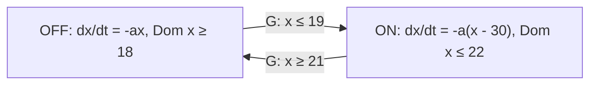

> **기준 출처:** [Lygeros, Lecture Notes on Hybrid Systems](https://prandini.faculty.polimi.it/file/LectureNotesJohnLygeros.pdf) · [Sanfelice, Feedback Control of Hybrid Dynamical Systems](https://hybrid.soe.ucsc.edu/sites/default/files/preprints/217.pdf) · [Mitra 외, Verifying Average Dwell Time of Hybrid Systems](https://liberzon.csl.illinois.edu/research/ADT06.pdf) / 확인일 2026-11-12
> **시리즈:** [목차](/posts/00-multimode-series/) | 이전 → [01. 왜 제어기 하나로 안 되는가](/posts/01-why-multiple-modes/) | 다음 → [03. 무충격 전환](/posts/03-bumpless-transfer/)

01편은 모드가 생기는 자리를 말로 정리했다. 말로는 다음 질문에 답하지 못한다.

- 이 전환 논리로 도달할 수 없는 모드가 있는가
- 어떤 상태에서 더 진행할 수 없는가
- 두 전이가 동시에 가능하면 어떻게 되는가
- 유한한 시간에 전환이 끝없이 일어나는가
- 전환을 아무리 자주 해도 전체가 안정한가

Lygeros 의 강의노트는 이 가운데 셋을 blocking, 비결정성(non-determinism), Zeno 라는 모델링 문제로 다룬다. 어느 질문이든 모드와 전환이 수학적 대상으로 적혀 있어야 답할 수 있다.

이 편에 필요한 앞 개념은 셋이다.

| 용어 | 뜻 |
| --- | --- |
| 모드 | 그 구간 동안 활성인 제어 법칙 하나. 01편의 자유 이동, 접촉 유지, 고장 대응이 각각 모드다 |
| 벡터장 | 「지금 상태가 x 면 다음 순간 어느 방향으로 얼마나 움직이는가」를 정하는 함수. 미분방정식 $$\dot{x} = f(x)$$ 의 우변 $$f$$ 다 |
| 조각별 상수 함수 | 값이 계단처럼 유지되다가 특정 시점에만 바뀌는 함수. 전환 신호가 이 모양이다 |

표기는 두 계열이다. 이 글은 둘을 경쟁 관계가 아니라 추상화 수준이 다른 것으로 보고, 설계에서는 둘 다 쓴다고 본다.

| 계열 | 전환을 어떻게 보나 | 잘 답하는 질문 |
| --- | --- | --- |
| switched system | 전환 신호를 밖에서 주어진 것으로 본다 | 어떤 전환 신호에 대해 안정한가 |
| hybrid automaton, hybrid dynamical system | 전환을 시스템 안에서 만든다 | 언제 전환되고 그 순간 상태가 어떻게 되는가 |

## 1. switched system — 전환 신호를 밖에 둔다

$$\dot{x} = f_{\sigma(t)}(x)$$

| 기호 | 뜻 |
| --- | --- |
| $$x$$ | 연속 상태. 위치, 속도, 제어기 내부 값이 모인 벡터 |
| $$\sigma(t)$$ | 전환 신호. 시각마다 활성 모드의 번호를 주는 조각별 상수 함수 |
| $$f_i$$ | $$i$$ 번 모드의 벡터장. 모드가 $$m$$ 개면 $$f_1, \dots, f_m$$ |

Mitra, Liberzon, Lynch 의 설명으로는 switched system 모델이 hybrid automaton 의 이산 장치, 곧 guard 와 reset map 을 무시하고, 외부에서 주어지는 전환 신호가 모드를 바꾸는 것으로 본다. 그래서 안정성 질문이 「어떤 부류의 $$\sigma$$ 에 대해 안정한가」로 바뀐다. 표기가 얇은 만큼 정리(theorem)가 잘 나온다.

이 표기 위에서 나오는 대표적인 결과가 있다. 부분 시스템이 하나하나 모두 안정해도 그 사이를 임의로 갈아타면 전체는 불안정할 수 있다. 원인은 각 모드가 아니라 전환 방식이다. 그래서 $$\sigma$$ 에 제약을 건다. 한 모드에 들어가면 최소 $$\tau_d$$ 만큼 머물게 하는 최소 체류시간(dwell time), 가끔은 빨리 바꿔도 되지만 평균 전환 빈도를 묶어 두는 평균 체류시간(average dwell time)이 그것이다(04편, 05편).

빠지는 것도 분명하다.

1. 왜 그 시각에 전환했는가. $$\sigma$$ 에는 결과만 있고 이유가 없다
2. 전환 순간 $$x$$ 가 어떻게 되는가. 이 표기는 전환 순간에도 $$x$$ 가 이어진다고 둔다

둘째가 이 시리즈에서 특히 걸린다. 제어기를 갈아탈 때 적분기 값을 이어받을지 0 으로 둘지가 바로 그 자리에 적혀야 하는데, switched system 표기에는 그 자리가 없다.

## 2. hybrid automaton — guard 와 reset 까지 적는다

Lygeros 의 정의 3.1 은 여덟 개의 묶음이다.

$$H = (Q,\ X,\ f,\ \mathrm{Init},\ \mathrm{Dom},\ E,\ G,\ R)$$

| 기호 | 이름 | 적는 것 |
| --- | --- | --- |
| $$Q$$ | 이산 상태 | 모드의 집합. 모드가 몇 개이고 이름이 무엇인가 |
| $$X$$ | 연속 상태 | $$\mathbb{R}^n$$. 연속 변수가 무엇인가 |
| $$f$$ | 벡터장 | 모드마다 푸는 미분방정식 |
| $$\mathrm{Init}$$ | 초기 상태 | 시작할 수 있는 (모드, 연속 상태) |
| $$\mathrm{Dom}$$ | domain | 그 모드에 머무는 동안 연속 상태가 있어야 하는 집합 (invariant 라고도 부른다) |
| $$E$$ | 에지 | 어느 모드에서 어느 모드로 갈 수 있나 |
| $$G$$ | guard | 그 에지를 탈 수 있는 연속 상태의 집합 |
| $$R$$ | reset map | 전이 순간 연속 상태를 어디로 보내나 |

실행(execution)은 연속 진행(flow)과 이산 전이(jump)가 번갈아 나오는 것이다. 연속 상태는 현재 모드의 벡터장을 따라 흐르고, $$\mathrm{Dom}$$ 안에 있는 동안 흐름을 이어갈 수 있다. 연속 상태가 어떤 에지의 guard 에 닿으면 이산 상태가 바뀔 수 있고, 그때 연속 상태는 $$R$$ 이 주는 값으로 바뀐다. 이산 상태와 에지만 떼어 보면 방향 그래프 $$(Q, E)$$ 이고, [FSM](/posts/01-why-fsm/) 그림과 같은 모양이다.

강의노트의 온도 조절기 예를 옮기면 다음과 같다.

그림의 노드 안이 그 모드에서 계속 성립해야 하는 것(벡터장과 domain)이고, 화살표 위가 그 전이의 조건(guard)이다. 목표는 20도 근처다. 조절기는 채터링, 곧 히터를 계속 켰다 껐다 하는 것을 피하려고 19도 아래로 내려가기 전에는 히터를 켜려 하지 않고, 히터 동역학의 불확실성 때문에 온도는 18도까지 내려갈 수 있다. 위쪽도 같은 방식으로 21도와 22도를 둔다. 두 전이 모두 reset 은 항등($$x := x$$)이라 온도는 전환 순간에 도약하지 않는다.

reset 이 항등이 아닌 예는 튀는 공이다. 연속 상태는 높이 $$x_1$$ 과 속도 $$x_2$$ 이고, 공이 바닥에 닿아 아래로 움직이는 순간 reset $$x_2 := -c\,x_2$$ ($$c \in [0, 1]$$)로 속도가 바뀐다. 연속 상태가 순간적으로 값을 바꾸는 것을 적을 수 있다는 점이 switched system 표기와 다르다.

## 3. Dom 과 G 를 둘 다 적는 이유

처음 보면 중복처럼 보이지만 묻는 것이 다르다. $$\mathrm{Dom}$$ 은 「이 모드에 머물러도 되는가」를, $$G$$ 는 「이 전이를 해도 되는가」를 묻는다. 둘을 조합하면 네 경우가 나온다.

| Dom 안인가 | G 가 참인가 | 일어나는 일 | 부르는 이름 |
| --- | --- | --- | --- |
| 예 | 아니오 | 계속 흐른다 | 정상 |
| 아니오 | 예 | 전이해야 한다. Dom 이 전이를 강제한다 | 정상 |
| 예 | 예 | 흐를 수도, 전이할 수도 있다 | 비결정성 |
| 아니오 | 아니오 | 흐를 수도 전이할 수도 없다 | blocking |

온도 조절기의 18도에서 19도, 21도에서 22도 구간이 세 번째 줄이다. ON 모드의 domain 은 $$x \le 22$$, ON 에서 나가는 guard 는 $$x \ge 21$$ 이라 21도와 22도 사이에서는 머무는 것도 나가는 것도 허용된다. Lygeros 는 같은 초기 조건에서 여러 궤적이 나오는 이 시스템을 비결정적이라 부르고, 비결정성은 불확실성을 모델링하는 데 쓸모가 있지만 추가로 주의가 필요하다고 적는다. 히스테리시스는 이 겹침으로 표현된다(04편). 이 글은 조건이 이렇게 겹치도록 적혀 있지 않으면 형식 안에서 히스테리시스를 나타낼 자리가 없다고 본다.

세 번째 줄은 구현 단계에서 한 번 더 결정해야 한다. 실제 코드는 매 스텝 하나의 답만 내므로, 비결정성을 남겨 두면 우선순위나 평가 순서처럼 형식에 없던 규칙이 동작을 정하게 된다.

네 번째 줄은 어떤 초기 상태에서 모델이 해를 갖지 않는 경우다. Lygeros 는 이것을 물리 시스템 모델로서 바람직하지 않은 성질로 보고, 흐름을 더 이어갈 수 없는 도달 가능 상태마다 guard 가 참인 에지가 있으면 blocking 이 아니라는 조건(보조정리 4.1)을 준다. 이 글은 네 번째 줄을 대개 명세 오류로 본다. 조건을 손으로 나눠 적다 보면 좁은 구간이 양쪽 모두에서 빠지는 일이 생기고, 이 표는 그런 빈 구간을 눈이 아니라 조건식으로 찾게 해 준다.

$$R$$ 은 03편과 06편에서 다시 나온다. 제어기를 갈아탈 때 새 제어기의 적분기 값을 무엇으로 둘지, 곧 이어받을지, 0 으로 둘지, 지금 인가되는 입력에서 역산할지가 이 자리에 적힌다.

## 4. flow set 과 jump set — 데이터 (C, F, D, G)

증명을 하는 쪽에서는 더 간결한 표기를 쓴다. Sanfelice 는 하이브리드 시스템을 네 가지 데이터로 적는다.

$$\mathcal{H} = (C,\ F,\ D,\ G)$$

| 기호 | 이름 |
| --- | --- |
| $$C$$ | flow set. 흐를 수 있는 상태의 집합 |
| $$F$$ | flow map. 흐르는 동안의 동역학이고 집합값 사상일 수 있다 |
| $$D$$ | jump set. 도약할 수 있는 상태의 집합 |
| $$G$$ | jump map. 도약 뒤의 상태. 2절의 guard 와는 다른 기호다 |

모드 $$q$$ 를 상태에 포함시키면 2절의 domain 이 $$C$$ 로, guard 가 $$D$$ 로, reset map 이 $$G$$ 로 옮겨 간 것으로 읽을 수 있다(이 글의 대응).

해는 $$(t, j)$$ 두 개로 매개변수화한다. $$t$$ 는 흐른 시간이고 $$j$$ 는 지금까지 일어난 도약의 횟수다. 하이브리드 시간 영역은 $$0 = t_0 \le t_1 \le \dots \le t_J$$ 인 구간들로 정의되는데, 부등호에 등호가 들어 있으므로 같은 $$t$$ 에서 여러 번 도약하는 해도 이 정의 안에 들어온다. 이 글이 정의에서 읽은 바로는, 전환 직후 곧바로 다시 전환되는 상황도 형식 밖으로 빠지지 않는다. 이것을 담지 못하면 잡음이 있을 때 경계에서 무슨 일이 생기는지를 같은 언어로 말할 수 없게 된다.

두 표기를 이 글은 이렇게 나눠 쓴다.

| 표기 | 쓰기 좋은 곳 |
| --- | --- |
| $$(Q, X, f, \mathrm{Init}, \mathrm{Dom}, E, G, R)$$ | 그림으로 그리고, 구현으로 옮기고, 조건을 검토할 때 |
| $$(C, F, D, G)$$ | 안정성과 로버스트성을 증명하거나 그 결과를 읽을 때 |

## 5. 전환을 일으키는 것 셋

전이를 일으키는 것은 셋으로 나눌 수 있고, 셋 모두 결국 guard 에 적힌다.

| 방아쇠 | 형식에서 어디에 적히나 | 예 |
| --- | --- | --- |
| 상태 | guard 가 연속 상태의 부등식 | 접촉력이 문턱을 넘음, 위치가 경계에 닿음 |
| 시간 | 타이머를 연속 상태에 넣어 상태 조건으로 바꾼다 | 최소 체류시간, 확정 지연 |
| 외부 사건 | 이산 입력으로 명시 | 조작자 명령, 진단 결과, 상위 계층의 지시 |

시간 조건이 상태 조건으로 바뀌는 예가 Mitra 등의 평균 dwell time 검증이다.

1. 원래 automaton 에 카운터 $$q$$ 와 타이머 $$y$$ 를 더한다
2. 모든 모드에 $$\dot{y} = 1$$ 을 붙인다
3. 모드가 바뀔 때마다 $$q$$ 를 1 늘린다
4. $$y$$ 가 정한 값 $$\tau_a$$ 에 닿으면 $$q$$ 를 1 줄이고 $$y := 0$$ 으로 되돌린다

이렇게 만든 automaton 에서 $$q \le N_0$$ 가 불변 조건인지를 검사하면, 원래 automaton 이 평균 dwell time $$\tau_a$$ 를 갖는지가 판정된다(정리 4.2). 04편의 최소 체류시간도 같은 방식으로 적는다.

세 번째 줄에 대해 이 글은 이렇게 본다. 외부 사건을 형식 안에 입력으로 적지 않으면 그 사건은 검증 대상 밖으로 나간다. 「조작자가 누르면 바뀐다」를 그림 밖 설명문에만 적어 두면, 도달성이나 blocking 을 아무리 조사해도 그 경로는 조사되지 않는다(10편).

## 6. Zeno 실행

Lygeros 는 유한한 시간 안에 무한히 많은 이산 전이를 하는 실행을 Zeno 실행이라 부른다. 물리 시스템은 Zeno 거동을 보이지 않는다고 볼 수 있지만, 모델링 추상화가 Zeno 모델을 만들 수 있다고 적는다. 같은 강의노트는 튀는 공 모델의 무한 실행이 모두 Zeno 라고 보이면서도, 공이 바닥 아래로 내려가지 않고 에너지를 소산한다는 점에서 여러모로 합리적인 모델이라고 적는다.

이 글은 Zeno 가 이론적 관심에서 끝나지 않는 이유를 둘로 본다.

| 어디서 | 어떤 모습 |
| --- | --- |
| 연속 시간 시뮬레이션 | 도약 처리에 갇혀 시간이 앞으로 가지 않는다 |
| 이산 시간 구현 | 매 스텝 전환하는 형태로 잘려서 나타난다. 채터링이 그 모습이다 |

구현에서 이 현상이 어떻게 보이고 무엇으로 막는지는 04편에서 본다.

## 7. 정리

- switched system $$\dot{x} = f_{\sigma(t)}(x)$$ 는 guard 와 reset map 을 무시하고 전환 신호를 밖에서 준다. 안정성 질문이 「어떤 $$\sigma$$ 에 대해」로 바뀌는 대신 전환 이유와 전환 순간의 상태 도약을 적을 자리가 없다
- 부분 시스템이 모두 안정해도 임의 전환은 전체를 불안정하게 할 수 있고, 그래서 $$\sigma$$ 에 dwell time 이나 평균 dwell time 제약을 건다
- hybrid automaton $$(Q, X, f, \mathrm{Init}, \mathrm{Dom}, E, G, R)$$ 은 전이 조건과 전이 순간의 상태 변화까지 적는다. 실행은 흐름과 도약이 번갈아 나오는 것이다
- Dom 과 G 가 겹치면 비결정성이 되고 히스테리시스가 이것으로 표현된다. 구현에서는 겹침에 우선순위를 정해야 한다. 둘 다 아니면 blocking 이다
- reset map 은 제어기를 갈아탈 때 내부 상태를 어떻게 할지가 적히는 칸이다
- Sanfelice 의 데이터 $$(C, F, D, G)$$ 는 해를 $$(t, j)$$ 로 세어, 같은 시각의 연속 도약도 다룬다
- 전환의 방아쇠는 상태, 시간, 외부 사건이다. 시간 조건은 타이머를 상태로 넣어 상태 조건으로 바꾸고, 외부 사건은 입력으로 적어야 검증 대상에 들어온다
- 유한 시간에 무한 번 도약하는 Zeno 실행은 모델링 추상화에서 생길 수 있고, 이산 구현에서는 채터링으로 나타난다

## 참고

- [J. Lygeros, Lecture Notes on Hybrid Systems, ETH Zürich, 2006](https://prandini.faculty.polimi.it/file/LectureNotesJohnLygeros.pdf)
- [R. G. Sanfelice, Feedback Control of Hybrid Dynamical Systems (UC Santa Cruz 프리프린트)](https://hybrid.soe.ucsc.edu/sites/default/files/preprints/217.pdf)
- [S. Mitra, D. Liberzon, N. Lynch, Verifying Average Dwell Time of Hybrid Systems, ACM TECS 8(1), 2008](https://liberzon.csl.illinois.edu/research/ADT06.pdf)
