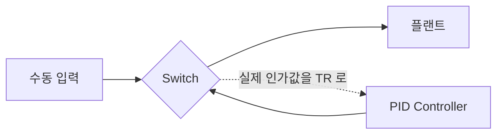

> **기준 출처:** [MathWorks, PID Controller](https://www.mathworks.com/help/simulink/slref/pidcontroller.html) · [Paxman, Vinnicombe, Stability of Reset Switching Systems](https://skoge.folk.ntnu.no/prost/proceedings/ecc03/pdfs/084.pdf) · [Pour Safaei 외, On Controller Initialization in Multivariable Switching Systems](https://web.ece.ucsb.edu/~hespanha/published/On_Controller_Initialization_in_multivariable_Switching.pdf) / 확인일 2026-11-12
> **시리즈:** [목차](/posts/00-multimode-series/) | 이전 → [02. switched system 과 hybrid automaton](/posts/02-switched-hybrid-automaton/) | 다음 → [04. 채터링](/posts/04-chattering-hysteresis-dwell/)

02편의 reset map 은 전이 순간 연속 상태를 무엇으로 바꿀지 적는 칸이었다. 이 편은 그 칸에 제어기 내부 상태를 어떻게 적어야 전환 순간 제어 입력이 계단처럼 튀지 않는지를 다룬다. 04편의 채터링은 「얼마나 자주 넘어가는가」의 문제이고, 그 전에 「한 번 넘어갈 때 무슨 일이 나는가」를 정해 둔다.

이 편에 필요한 앞 개념은 넷이다.

| 용어 | 뜻 |
| --- | --- |
| reset map | 모드가 바뀌는 순간 연속 상태를 어떤 값으로 바꿀지 정하는 규칙. 그대로 두면 항등, 값을 갈아 끼우면 도약 |
| 제어기 내부 상태 | PID 의 적분 항, 필터, 관측기처럼 제어기가 과거를 누적해 들고 있는 값 |
| windup | 구동기가 포화해 지령대로 내보내지 못하는 동안에도 적분 항이 계속 쌓이는 현상. 포화가 풀려도 한참 밀린다 |
| 구속 상태 | 로봇 말단이 환경에 닿아 그 방향으로 움직이지 못하는 상태. 제어 입력이 움직임 대신 힘으로 나온다 |

## 1. 도약의 크기를 정하는 것

상태를 가진 선형 제어기의 출력을 이렇게 쓴다.

$$u = C_K x_K + D_K e$$

| 기호 | 뜻 |
| --- | --- |
| $$u$$ | 제어기가 내는 지령. 토크, 전류, 밸브 개도 같은 것 |
| $$x_K$$ | 제어기 내부 상태. 적분기, 필터, 관측기 상태 |
| $$e$$ | 오차 (지령 − 측정값) |
| $$C_K, D_K$$ | 그 제어기의 출력 행렬과 직결항 |

시각 $$t_s$$ 에 제어기 A 에서 B 로 바꾸면 직후의 출력은 $$u_B(t_s) = C_B x_B(t_s) + D_B e(t_s)$$ 다.

> 이 문단은 이 글의 유도다. 오차 $$e(t_s)$$ 는 전환 전후로 같으므로 직결항 $$D_B e(t_s)$$ 는 이미 정해져 있고, 전환 순간에 고를 수 있는 것은 새 제어기의 상태 $$x_B(t_s)$$ 뿐이다. 그 값은 B 가 루프 밖에서 무엇을 하고 있었는지에 따라 정해진다. 마지막으로 꺼졌을 때 값이 남아 있거나, 0 이거나, 자기 나름대로 오차를 적분해 엉뚱하게 커져 있다. 어느 쪽이든 지금 실제로 인가되는 입력과는 관계없는 값이다.
{: .prompt-info }

Paxman 과 Vinnicombe 는 차이를 이렇게 설명한다. 전환이 없는 선형 제어에서는 초기 과도가 사라지면 입출력 전달함수만 남으므로 제어기의 실현(realization)과 초기화는 부차적이고, 초기값은 0 으로 두어도 되는 경우가 많다. 전환 제어에서는 전환할 때마다 새 과도 신호가 생기고, 그 신호는 제어기의 실현과 전환 시점의 제어기 상태에 직접 관련된다. 전달함수가 같아도 상태 공간 표현에 따라 상태 벡터가 가리키는 양이 달라지고, 같은 초기화 규칙을 써도 전환 과도가 달라진다는 뜻이다.

수동 운전에서 자동으로 넘기는 경우가 한 예다. Kantor 의 공정제어 강의 노트북은 이때 제어기 출력이 공정에 실제로 인가되는 값과 맞지 않을 수 있다는 데서 도약을 설명한다. 조작자가 출력을 손으로 일정하게 두는 동안에도 PID 를 그대로 돌려 두면 적분기는 수동 출력과 상관없이 오차를 쌓고, 자동으로 넘기는 순간 출력이 그 값으로 뛴다. 공정 쪽에서 보면 그것이 외란이다.

이 글은 이 문제를 제어기가 나빠서 생기는 것이 아니라 제어기를 어떻게 표현하고 어떻게 켜는가의 문제로 본다. 그래서 제어기 설계를 잘해도 사라지지 않고, 구현 단계에서 따로 처리해야 한다.

## 2. 도약이 남기는 것

Pour Safaei 등이 예로 드는 토크 구동 유연 보는 감쇠가 작은 모드를 여러 개 갖고 있고, 그 모드는 제어기 전환으로 쉽게 가진된다. Sidhik 등은 접촉 작업에서 접촉 검출 뒤의 제어기 전환이 상호작용 동역학에 큰 불연속을 남겨 로봇이나 물체를 손상시킬 수 있다고 적는다.

$$u$$ 가 토크나 전류 지령일 때 계단이 무엇으로 이어지는지를 이 글은 이렇게 정리한다.

| 순서 | 무슨 일이 생기나 |
| --- | --- |
| 광대역 가진 | 계단 신호는 주파수 성분이 넓게 퍼져 있어 기구의 공진 주파수가 어디에 있든 그 성분이 들어 있다. 구조가 울린다 |
| 속도와 가속도의 급변 | 자유 이동 중이면 진동과 위치 오차로 나타난다 |
| 구속 상태에서는 힘 | 말단이 환경에 닿아 있으면 토크 계단은 움직임으로 빠져나갈 곳이 없어 접촉력의 계단이 된다 |
| 포화와 windup | 계단 지령이 구동기 한계를 넘으면 그 순간부터 실제 인가값과 지령이 갈라지고, 적분 항은 그것을 모른 채 계속 쌓인다 |

마지막 줄 때문에 전환 문제와 windup 문제가 같은 구조로 풀린다. MathWorks 의 PID Controller 블록 문서에서 anti-windup 의 back-calculation 과 signal tracking 은 같은 꼴이다. 두 기능 모두 어떤 차이에 게인을 곱해 적분기 입력으로 되먹인다.

| 기능 | 적분기 입력으로 되먹이는 차이 | 게인 |
| --- | --- | --- |
| back-calculation (anti-windup) | 포화된 제어 신호와 포화 전 제어 신호의 차이 | $$K_b$$ |
| signal tracking | TR 포트의 추종 신호와 블록 출력의 차이 | $$K_t$$ |

같은 문서는 signal tracking 의 용도로 두 제어기 사이를 오가는 시스템의 무충격 전환과 다중 루프 구조의 windup 방지를 든다. 둘 다 「실제로 인가된 값과 제어기가 낸 값의 차이를 게인을 곱해 적분기로 되먹인다」는 얼개이고, 대상이 포화면 anti-windup, 대상이 다른 제어기나 수동 입력이면 bumpless transfer 가 된다.

## 3. 처방 ① 전환 순간에 상태를 계산해 넣는다

대기 중인 제어기는 돌리지 않고, 전환하는 스텝에서 새 제어기의 상태 $$x_B(t_s)$$ 를 정해 넣는다. 상태를 그대로 두는 항등이 아니라 값을 갈아 끼우는 도약이고, 02편의 reset map 에 들어가는 내용이 이것이다. 무엇을 기준으로 정하느냐에 따라 방법이 갈린다.

가장 단순한 기준은 새 제어기의 첫 출력을 옛 제어기의 마지막 출력에 맞추는 것이다.

$$C_B\,x_B(t_s) + D_B\,e(t_s) = u_A(t_s^-)$$

> 이 식은 1절의 출력 식에서 이 글이 세운 조건이다. 방정식의 수는 입력의 차원이고 미지수는 제어기 상태의 차원이므로, $$C_B$$ 의 행이 서로 독립이고 상태의 차원이 입력보다 크면 해가 여럿이다. 남는 자유도를 무엇에 쓸지는 따로 정해야 한다. 또 출력 일치는 그 순간의 도약만 없앤다. 새 제어기가 자기 평형으로 찾아가는 그 뒤의 과도는 따로 남으므로, 「그 순간 출력 연속」과 「전환 뒤 과도 최소화」는 다른 목표다.
{: .prompt-info }

Pour Safaei, Hespanha, Stewart 는 출력을 맞추는 기준을 쓰지 않는다. 이들은 루프 밖 제어기의 출력과 실제 제어 신호의 차이를 줄이는 기존 bumpless transfer 접근을 소개한 뒤, 무충격 전환이 더 나은 과도를 낳는다는 가정 없이 과도 성능을 직접 다룬다. 제어기가 루프에 들어갈 때마다 전환 시점부터의 구간에서 추종 오차, 피제어 출력, 제어 신호의 이차 비용을 최소화하는 초기 상태를 고른다. 이 reset map 은 직전 제어기 상태, 이전 제어기와 새 제어기의 번호, 현재 기준값에 의존한다. 단위 시간당 평균 전환 횟수가 정한 값보다 작으면 폐루프의 입력 대 상태 안정성(ISS)을 보장하고, 그렇지 않으면 최적화에 제약을 하나 더해 같은 성질을 얻는다.

Paxman 과 Vinnicombe 는 새 제어기의 상태를 그 시점의 플랜트 상태(측정값 또는 관측값)의 함수로 정한다. 전환이 한 번이면 일반화 출력의 제곱 적분을 최소로 하는 제어기 상태를 Lyapunov 방정식의 해로 구한다. 전환 순간 상태가 불연속으로 바뀌는 시스템을 reset switching system 이라 부르고, 임의 전환에서도 안정한 reset 규칙을 LMI 로 합성한다. 같은 논문은 매번 0 으로 되돌리거나, 차수가 같은 제어기들이 상태 하나를 끊김 없이 이어 쓰는 단순한 방식이 성능을 크게 떨어뜨리고 최악의 경우 불안정을 낳을 수 있다고 적는다.

이 방법의 대가를 이 글은 둘로 본다. 계산이 전환하는 한 스텝에 몰리므로 실시간 루프라면 그 스텝에 연산 여유가 있어야 한다. 그리고 직전 출력이나 직전 제어기 상태, 플랜트 상태처럼 기준이 요구하는 값을 읽을 수 있어야 한다. 제어기를 내부가 보이지 않는 블랙박스로 두면 쓸 수 없다.

## 4. 처방 ② 대기 중에도 추종시킨다

대기 중인 제어기를 끄지 않고 계속 돌리면서, 그 출력이 지금 실제로 인가되는 값을 따라가도록 내부 상태를 밀어 준다. 전환 시점에 이미 맞아 있으므로 도약할 것이 없다. 수동/자동 전환에서 흔히 쓰는 방식이다.

PID Controller 블록에서 tracking mode 를 켜면 TR 포트가 생기고, 추종 신호와 블록 출력의 차이가 게인 $$K_t$$ 로 적분기 입력에 되먹여진다. `Use I*Ts` 를 켠 이산 블록에서는 이 값을 $$K_t T_s$$ 로 넣는다. MathWorks 의 수동/PID 전환 예제는 배선을 이렇게 둔다.

Switch 하나가 플랜트로 가는 신호와 TR 로 돌아가는 신호를 함께 고른다. 수동 구간에는 수동 신호가 TR 로 들어가 PID 출력이 수동 신호를 따라가고, 전환 뒤에는 PID 가 자기 출력을 추종한다. 되먹임 경로가 끊기지 않으므로 전환 시점에 PID 출력이 수동 신호와 거의 같다. 예제에서 tracking mode 를 끈 경우에는 전환 때 큰 과도가 나온다.

Kantor 의 노트북은 같은 일을 코드 한 줄로 적는다. 매 스텝 `I = TR - MV_bar - P - D` 로 적분항을 다시 맞춰, 출력 $$\overline{MV} + P + I + D$$ 가 추종 입력 TR 과 같아지게 한다.

| 기호 | 뜻 |
| --- | --- |
| $$TR$$ | 추종 대상. 지금 실제로 인가되는 값 |
| $$\overline{MV}$$ (`MV_bar`) | 기본값이 0 인 매개변수로, 제어 출력의 초기값으로 쓰인다 |
| $$P, D$$ | 그 시점의 비례, 미분 기여 |
| $$I$$ | 출력이 $$TR$$ 과 같아지도록 정해지는 적분 기여 |

> 이 문단은 이 글의 해석이다. Kantor 의 한 줄은 매 스텝 적분항을 정확히 맞추는 경우, 곧 추종 게인을 아주 크게 둔 극한으로 읽을 수 있다. $$K_t$$ 를 유한하게 두면 적분기는 TR 과의 차이를 1차 지연처럼 따라가고, $$K_t$$ 가 클수록 빨리 맞는다.
{: .prompt-info }

이 방법의 대가를 이 글은 셋으로 본다.

| 대가 | 내용 |
| --- | --- |
| 상시 연산 | 대기 중인 제어기를 계속 돌려야 한다. 모드가 많으면 연산량과 메모리가 모드 수만큼 는다 |
| $$K_t$$ 와 잡음 | $$K_t$$ 를 키우면 빨리 맞지만 TR 신호에 섞인 잡음이 그대로 적분기로 들어간다 |
| 실제 인가값 | TR 로 넣을 값을 실제로 알아야 한다. 구동기 쪽에서 되읽을 수 없으면 포화와 율 제한을 반영한 모델값으로 대신하고, 그 모델이 틀린 만큼 어긋난다 |

## 5. 처방 ③ 두 출력을 구간에 걸쳐 잇는다

Sidhik 등은 제어기를 바꿀 때 두 제어기의 출력을 구간 $$[0, T]$$ 동안 선형 보간해 연속으로 잇는다. 식으로 쓰면 다음과 같다.

$$u(t) = \bigl(1 - \alpha(t)\bigr)\,u_A(t) + \alpha(t)\,u_B(t), \qquad \alpha: 0 \to 1$$

같은 논문은 각 제어기의 출력이 매끄러우면 보간한 출력도 매끄럽다고 적는다. 제어기 내부를 건드리지 않아도 된다는 점이 앞의 두 방법과 다르다. 구현이 단순하고, 제어기가 내부를 볼 수 없는 블랙박스여도 쓸 수 있다. 같은 논문은 예측한 접촉 영역에 들어가기 전에 속도와 강성을 낮춘 전이 제어기로 바꾸는 방식도 함께 쓴다. 두 방식 모두 전이를 한 순간이 아니라 구간으로 만든다. 전환을 시간 축에서 펴는 것과 물리적 전이를 미리 준비하는 것이 같은 발상이다.

대가는 가볍지 않다고 이 글은 본다.

- 보간 구간 동안 인가되는 입력은 A 의 출력도 B 의 출력도 아니다. A 의 안정성 증명도 B 의 안정성 증명도 그 구간을 덮지 않으므로, 그 구간은 따로 확인해야 한다
- 응답이 보간 구간만큼 늦어진다. 빨리 빠져나와야 하는 전환이라면 그 구간이 곧 위험에 노출된 시간이다
- 제어량이 서로 다르면 의미가 불분명하다. 위치 제어기의 출력과 힘 제어기의 출력을 가중 평균한 값이 물리적으로 무엇인지 말하기 어렵다
- 보간 중에도 각 제어기는 자기 오차로 계속 적분한다. 그래서 겹치는 동안 두 제어기를 실제 인가값에 추종시켜 두는 ②와 함께 쓰는 경우가 많다

## 6. 세 처방 비교

| | ① 전환 순간 계산 | ② 상시 추종 | ③ 출력 보간 |
| --- | --- | --- | --- |
| 계산 시점 | 전환하는 스텝 | 매 주기 | 보간 구간 동안 |
| 대기 제어기 | 돌리지 않아도 된다 | 계속 돈다 | 구간 동안 둘 다 돈다 |
| 그 순간 출력 연속 | 출력 일치를 기준으로 하면 맞춘다. 비용 최소화 기준이면 목표가 아니다 | 추종이 맞춰 둔 만큼 | 맞춘다 |
| 전환 뒤 과도 | 기준에 달렸다. Pour Safaei 등은 이 과도의 비용을 직접 줄인다 | 작다 | 구간이 끝날 때까지 두 출력이 섞여 있다 |
| 제어기 내부 접근 | 필요 | 필요 (TR 포트) | 불필요 |
| 제어량이 서로 다를 때 | 쓸 수 있다 | 쓸 수 있다 | 의미가 불분명하다 |
| 쓰는 정보 | 플랜트 상태 (Paxman, Vinnicombe), 직전 제어기 상태와 기준값 (Pour Safaei 외) | 실제 인가값 | 두 제어기의 출력 |
| 대표 대가 | 전환 시점 연산 부하 | 상시 연산량, $$K_t$$ 와 잡음의 절충 | 구간의 성능과 안정성이 따로 보장되지 않는다, 응답 지연 |
| 근거 | Paxman, Vinnicombe / Pour Safaei 외 | MathWorks / Kantor | Sidhik 외 |

「그 순간 출력 연속」부터 「제어량이 서로 다를 때」까지와 「대표 대가」 줄은 각 방법의 정의에서 이 글이 읽은 것이다.

## 7. 무충격 전환이 보장하지 않는 것

출력이 이어진다고 안정한 것은 아니다. Paxman 과 Vinnicombe 는 전환이 빠르면 각 루프가 따로는 안정해도 전환 과도끼리의 상호작용이 불안정을 만들 수 있고, 하나의 선형 플랜트에 대해 안정화 제어기들 사이를 전환해 궤적을 불안정하게 만드는 예도 만들 수 있다고 적는다. 매끄러운 응답 그림은 안정성의 증거가 아니다. 이것이 [05편](/posts/05-switching-stability/)의 주제다.

출력이 이어진다고 채터링이 사라지는 것도 아니다. Hespanha 의 감독제어 강의노트는 전환 논리 쪽에 dwell time 이나 히스테리시스를 따로 넣어 채터링을 막는다. 이 글은 전환이 매끄러울수록 자주 전환해도 신호에 티가 덜 나서, 경계에서 떨고 있다는 사실을 늦게 알아채게 된다고 본다. [04편](/posts/04-chattering-hysteresis-dwell/)에서 다룬다.

> 이 문단은 이 글의 판단이다. 모든 전환이 매끄러워야 하는 것은 아니다. 정상 국면 사이의 전환은 매끄러울수록 좋지만, 고장 대응처럼 즉시 빠져나와야 하는 전환에서는 보간 시간이 그대로 위험 노출 시간이 된다. 전환마다 목표가 다르므로 처방도 전환마다 고른다(06편, 11편).
{: .prompt-info }

## 8. 정리

- 전환 순간 오차는 이어져 있으므로, 그 순간에 고를 수 있는 것은 새 제어기의 내부 상태다. 아무것도 하지 않으면 그 값은 지금 인가되는 입력과 관계가 없다
- 전환 제어에서는 제어기의 실현과 전환 시점 상태가 과도를 정한다. 전환이 없을 때처럼 초기값 0 으로 충분하지 않다
- 물리적으로는 광대역 가진과 진동이 되고, 구속 상태에서는 접촉력의 계단이 된다. 포화에 걸리면 그 자리에서 windup 이 시작된다
- anti-windup 의 back-calculation 과 signal tracking 은 같은 구조다. 차이를 게인($$K_b$$, $$K_t$$)으로 적분기에 되먹인다
- ① 전환 순간 계산의 기준은 출력 일치만이 아니다. 출력 일치는 해가 여럿이고 그 순간만 맞춘다. Pour Safaei 등은 전환 뒤 구간의 이차 비용을 최소화하고, Paxman 과 Vinnicombe 는 플랜트 상태의 함수로 reset 하며 임의 전환에서도 안정한 규칙을 LMI 로 합성한다
- ② 상시 추종은 실제 인가값을 TR 로 넣어 대기 중에도 맞춰 둔다. Simulink PID 블록의 tracking mode 가 이것이고, 상시 연산량과 $$K_t$$ 와 잡음의 절충이 대가다
- ③ 출력 보간은 제어기 내부를 건드리지 않지만, 보간 구간의 입력은 어느 제어기의 출력도 아니고 그 구간은 따로 확인해야 한다
- 무충격 전환은 전환 안정성도, 채터링 대책도 대신하지 않는다. 즉시 빠져나와야 하는 전환에서는 매끄러움이 목표가 아닐 수 있다

## 참고

- [MathWorks, PID Controller (Simulink 블록 레퍼런스)](https://www.mathworks.com/help/simulink/slref/pidcontroller.html)
- [MathWorks, Bumpless Control Transfer Between Manual and PID Control (Simulink 예제)](https://www.mathworks.com/help/simulink/slref/bumpless-control-transfer-between-manual-and-pid-control.html)
- [J. Kantor, PID Control with Bumpless Transfer, CBE 30338 (Univ. of Notre Dame)](https://jckantor.github.io/CBE30338/04.03-PID_Control_with_Bumpless_Transfer.html)
- [J. P. Paxman, G. Vinnicombe, Stability of Reset Switching Systems, ECC 2003](https://skoge.folk.ntnu.no/prost/proceedings/ecc03/pdfs/084.pdf)
- [F. R. Pour Safaei, J. P. Hespanha, G. Stewart, On Controller Initialization in Multivariable Switching Systems](https://web.ece.ucsb.edu/~hespanha/published/On_Controller_Initialization_in_multivariable_Switching.pdf)
- [S. Sidhik, M. Sridharan, D. Ruiken, Towards a Framework for Changing-Contact Robot Manipulation (arXiv:2106.10969)](https://arxiv.org/html/2106.10969)
- [J. P. Hespanha, Tutorial on Supervisory Control, UCSB, 2002](https://web.ece.ucsb.edu/~hespanha/published/tr-tutorial-cdc01.pdf)
