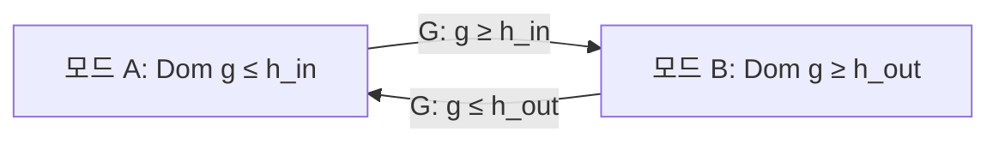

> **기준 출처:** [Hespanha, Tutorial on Supervisory Control](https://web.ece.ucsb.edu/~hespanha/published/tr-tutorial-cdc01.pdf) · [Hespanha, Liberzon, Morse, Automatica 39(2)](https://web.ece.ucsb.edu/~hespanha/published/journal-hhs-final.pdf) · [Della Rossa, Tanwani, arXiv:2405.03560](https://arxiv.org/html/2405.03560v1) / 확인일 2026-11-12
> **시리즈:** [목차](/posts/00-multimode-series/) | 이전 → [03. 무충격 전환](/posts/03-bumpless-transfer/) | 다음 → [05. 전환 안정성](/posts/05-switching-stability/)

03편은 한 번 전환할 때의 도약을 다뤘고, 매끄럽게 넘기는 것이 채터링 대책은 아니라는 데서 끝났다. 이 편은 전환이 얼마나 자주 일어나는가를 다룬다. 전이 조건의 경계 근처에서 모드가 빠르게 오가는 현상을 채터링(chattering)이라 부른다. 05편은 같은 질문에 안정성 쪽에서 답하고, 거기서 나오는 장치가 이 편의 체류시간이다.

이 편에 필요한 앞 개념은 넷이다.

| 용어 | 뜻 |
| --- | --- |
| 모드 | 그 구간 동안 활성인 제어 법칙 하나 |
| 전이 조건 (guard) | 그 전환이 가능해지는 조건식. 「접촉력 > 문턱」 같은 부등식 하나가 전형이다 |
| domain (invariant) | 그 모드에 머무는 동안 계속 성립해야 하는 조건. guard 와 겹치게 적으면 겹치는 구간이 히스테리시스가 된다 (02편) |
| 최소 체류시간 (dwell time) | 한 모드에 들어가면 최소 이만큼은 머문다는 시간 하한 |

## 1. 문턱이 하나면 떨린다

전이 조건을 부등식 하나로 적었다고 하자. 신호 $$g$$ 가 0 보다 크면 모드 B, 아니면 모드 A 다. $$g$$ 는 「접촉력 − 문턱」처럼 조건을 0 기준으로 옮겨 적은 값이다. 02편의 온도 조절기에서 Lygeros 가 히터를 켜는 온도(19도)와 끄는 온도(21도)를 따로 둔 이유가 채터링, 곧 히터를 계속 켰다 껐다 하는 것을 피하는 것이었다.

$$g$$ 가 0 근처에 있을 때 판정을 뒤집는 원인을 이 글은 넷으로 나눈다.

| 원인 | 무슨 일이 생기나 |
| --- | --- |
| 측정 잡음 | 참값이 0 이어도 측정값은 잡음 진폭 안에서 오간다. 판정도 같이 오간다 |
| 양자화 | ADC 한 눈금이 문턱에 걸치면 물리량이 그대로여도 최하위 비트가 흔들리며 부호가 바뀐다 |
| 경계 부근의 느린 동역학 | $$g$$ 가 0 을 느리게 지나가면 0 근처에 머무는 시간이 길어지고, 위의 둘이 작용할 시간도 길어진다 |
| 전환이 $$g$$ 를 되미는 구조 | 모드 A 가 $$g$$ 를 올리고 모드 B 가 $$g$$ 를 내리면, 경계는 잡음이 없어도 상태를 끌어당기는 면이 된다 |

앞의 셋은 신호 문제이고 넷째는 구조 문제다. 넷째에서는 잡음을 없애도 떨림이 남는다. 상태가 경계에 붙잡혀 양쪽을 계속 오가고, 그동안 실제로 인가되는 것은 두 모드를 매우 빠르게 번갈아 낸 평균이 된다. 연속 시간 이론에서 이것을 슬라이딩 모드라 부르고, 슬라이딩 모드 제어에서는 의도적으로 만드는 현상이다. 모드 전환 설계에서는 대개 의도한 것이 아니다.

감독제어도 같은 문제를 만난다. Hespanha 의 강의노트에서 전환 논리는 추정 오차가 가장 작은 후보 제어기를 고르는데, 이 규칙을 그대로 쓰지 않고 채터링을 막으려고 dwell time 이나 히스테리시스로 근사한다.

## 2. 이산 구현에서의 모습

> 이 문단은 이 글의 유도다. 제어 주기마다 조건을 한 번 판정하는 구현이라면 모드는 주기마다 최대 한 번 바뀐다. 전환 주파수의 상한이 샘플 주파수인 셈이다. 그런 구현에서 채터링은 무한히 빠른 전환이 아니라 매 스텝, 또는 몇 스텝마다의 전환으로 나타난다.
{: .prompt-info }

샘플 사이에는 다른 문제가 있다. Ovalle 등은 슬라이딩 모드 제어기의 이산 구현을 다루며 샘플-홀드 방식이 샘플 시점 사이에 개루프 거동을 만들고, 샘플링이 연속 시간 구현에서 성능을 보장하던 되먹임 메커니즘을 깨뜨린다고 적는다. 연속 시간에서 세운 전환 논리의 보장이 이산 구현으로 그대로 따라오지 않는다는 뜻이고, 시뮬레이션과 실제 장치의 거동이 갈라지는 한 원인이다.

## 3. 떨리면 무엇이 나빠지나

뒤에서 장치의 대가를 따질 때 기준이 되도록, 이 글은 피해를 다섯으로 정리한다.

| 피해 | 내용 |
| --- | --- |
| 구동기와 기구의 소모 | 전환마다 지령이 움직이면 그 성분이 계속 가진으로 들어간다. 열, 소음, 마모가 따라온다 |
| 어느 모드도 일을 끝내지 못한다 | 각 모드의 과도 응답이 매번 처음부터 다시 시작되어 정상 상태에 닿지 못한다 |
| 안정성 논증이 성립하지 않는다 | 개별 모드의 안정성은 전환이 충분히 느릴 때 전체 안정성으로 이어진다(05편) |
| 진단과 기록의 오염 | 모드 전환마다 이벤트를 남기면 로그가 불어나고, 봐야 할 사건이 묻힌다 |
| 계산이 진행되지 않는다 | 극단에서는 전환 처리에 갇혀 시간이 앞으로 가지 않는다(7절) |

## 4. 히스테리시스 — 문턱을 둘로 나눈다

노드 안이 그 모드에 머무는 조건, 화살표 위가 나가는 조건이다. $$h_{out} < h_{in}$$ 이면 $$[h_{out}, h_{in}]$$ 구간에서는 지금 있는 모드가 유지된다. 같은 $$g$$ 값에서 어느 모드에 있는지가 어느 쪽에서 들어왔느냐에 달린다. 02편에서 본 Dom 과 guard 의 겹침이 이것이다. 폭 $$h = h_{in} - h_{out}$$ 이 이 장치의 설계 값이다.

Wu 는 히스테리시스 전환이 dwell time 을 암묵적으로 강제하고, 전환 경계 근처의 채터링을 막고, 잡음과 불확실성에 대한 로버스트성을 높인다고 적는다. 감독제어 쪽 서술은 더 조심스럽다. Hespanha 의 강의노트는 히스테리시스 논리가 연속한 두 전환 사이의 최소 간격을 강제하지는 않지만, 전환 시스템을 불안정하게 만들지 않는 데 쓸 수 있다고 적는다. 거기서 소개하는 scale-independent 히스테리시스 논리는 현재 제어기의 감시 신호가 가장 작은 감시 신호의 $$(1+h)$$ 배를 넘을 때만 전환한다. Hespanha, Liberzon, Morse 는 이런 논리가 만드는 전환 횟수에 상한을 유도하고, 감시 신호가 0 에서 균등하게 떨어져 있으면 무한히 빠른 전환(채터링)이 일어나지 않는다고 적는다.

> 이 문단은 이 글의 해석이다. 두 서술은 조건의 차이로 읽힌다. 한 번 전환한 뒤 되돌아오려면 신호가 폭 $$h$$ 만큼을 다시 건너와야 하므로, $$g$$ 의 변화율에 상한이 있는 경우에는 되돌아오는 데 시간이 걸리고 체류시간이 암묵적으로 생긴다. 변화율에 그런 상한이 없으면 최소 간격은 보장되지 않는다.
{: .prompt-info }

폭 $$h$$ 를 정하는 기준을 이 글은 이렇게 본다.

| 한계 | 무엇이 정하나 |
| --- | --- |
| 아래 한계 | 잡음. 폭이 잡음 진폭보다 작으면 히스테리시스가 있으나 마나다. 여기에 양자화 한 눈금을 더한다 |
| 위 한계 | 요구 정밀도. 폭만큼 판정이 늦어지므로 그 늦음이 허용 오차 안이어야 한다 |
| 둘이 겹치지 않으면 | 폭으로 풀 문제가 아니다. 필터, 분해능, 센서 배치처럼 신호 쪽을 먼저 손본다 |

대가는 둘이다. 첫째, 반응이 늦어진다. 나가야 할 조건이 된 뒤에도 신호가 반대쪽 문턱까지 가야 실제로 전환된다. 둘째, 상태가 하나 늘어난다. 같은 $$g$$ 값에서 어느 모드에 있는지가 과거에 의존하므로 지금 값만으로는 모드를 알 수 없다. 시험을 설계할 때 같은 입력이라도 이력에 따라 결과가 다르므로, 시험 항목을 들어가는 방향과 나오는 방향으로 나눠야 한다.

## 5. 최소 체류시간 — 시간의 하한

Hespanha 의 dwell-time 전환 논리는 가장 좋아 보이는 후보를 고르되, 그 선택에 미리 정한 시간 $$\tau_D$$ 이상 머문다. 구성상 연속한 두 전환 사이의 간격은 $$\tau_D$$ 이상이다. hybrid automaton 으로 적을 때는 02편의 평균 dwell time 검증처럼 타이머를 상태에 넣는다. 아래는 이 글의 표기다. 모드에 들어갈 때 $$\tau := 0$$ 으로 두고 $$\dot{\tau} = 1$$ 로 흐르게 한 뒤, 나가는 guard 에 $$\tau \ge \tau_D$$ 를 더한다.

둘 다 「빨리 되돌아오지 못하게 한다」이지만 재는 자가 다르다.

| | 히스테리시스 | 최소 체류시간 |
| --- | --- | --- |
| 무엇의 하한인가 | 신호 값의 폭 | 경과 시간 $$\tau_D$$ |
| 전환 간격 | 최소 간격은 보장하지 않는다. 횟수 상한은 유도된다 | 항상 $$\tau_D$$ 이상 |
| 잘 막는 것 | 경계 근처의 빠른 잡음, 양자화 | 원인을 가리지 않고 전환 빈도 자체 |
| 못 막는 것 | 신호가 폭 $$h$$ 를 실제로 천천히 왕복하는 느린 표류 | 경계에 오래 붙어 있는 상태. $$\tau_D$$ 마다 한 번씩 규칙적으로 전환한다 |
| 대가 | 판정이 폭만큼 늦다 | 필요한 전환이 최대 $$\tau_D$$ 늦다 |
| 늘어나는 상태 | 현재 모드의 이력 | 타이머 |

전환 간격 줄은 Hespanha 의 강의노트와 Hespanha, Liberzon, Morse 를 따랐고, 나머지 줄은 두 정의에서 이 글이 읽은 것이다. 「못 막는 것」이 서로 반대쪽이라 이 글은 둘을 함께 거는 경우가 많다고 본다. Liang, Grigoletto, Ticozzi 도 두 장치를 나란히 놓고, 히스테리시스 전환과 고정 dwell time 이 채터링 같은 바람직하지 않은 거동을 막는 효과적인 방법이라고 쓴다.

조건이 일정 시간 이상 유지될 때만 받아들이는 debounce 도 시간으로 전환을 늦추는 장치다. Stateflow 의 `duration` 으로 구현한 예가 [12. debounce와 duration](/posts/12-debounce/) 에 있다.

> 이 문단은 이 글의 판단이다. 항상 $$\tau_D$$ 를 지키는 것이 곤란한 전환이 있다. 고장 대응처럼 즉시 빠져나와야 하는 전환에 하드 체류시간을 걸면, 그 $$\tau_D$$ 가 그대로 위험에 노출된 시간이 된다. 다음 절의 평균 체류시간이 이 제약을 평균으로 완화한 것이다.
{: .prompt-info }

## 6. 평균 체류시간 — 몇 번은 빨리 바꿔도 된다

매번 $$\tau_D$$ 를 채우는 조건을 평균으로 완화한 것이 평균 체류시간(average dwell time)이다.

$$N_\sigma(s, t) \le N_0 + \frac{t - s}{\tau_a}, \qquad t \ge s \ge 0$$

| 기호 | 뜻 |
| --- | --- |
| $$N_\sigma(s, t)$$ | 구간 $$[s, t)$$ 에서 일어난 전환 횟수 |
| $$\tau_a$$ | 평균 체류시간. 길게 보면 전환 사이 평균 간격이 이보다 짧지 않다 |
| $$N_0$$ | chattering bound. 이만큼은 연달아 빨리 전환할 수 있다 |

Della Rossa 와 Tanwani 는 $$N_0$$ 를 chattering bound 라고 부르고, $$N_0 = 1$$ 인 경우가 dwell time 조건과 같다고 적는다. 이름이 조건의 성격을 말해 준다. 이 글은 이 조건을 「급할 때 몇 번은 빨리 바꿔도 되지만, 그만큼은 나중에 천천히 바꿔서 메워야 한다」로 읽는다. 이 조건이 안정성과 연결되는 방식은 05편에서 부등식으로 본다.

## 7. 장치를 겹쳐 쓰는 배치

> 이 절은 이 글의 정리다. 앞 절들의 성질을 한 곳에 모은 것이고, 문헌에서 그대로 옮긴 배치가 아니다.
{: .prompt-info }

한 전환에 장치가 하나만 붙는 경우는 드물다고 이 글은 본다. 신호가 들어와서 모드 결정이 나갈 때까지 아래 순서로 통과시키는 배치를 생각할 수 있다.

| 단계 | 하는 일 | 막는 것 | 넣는 대가 |
| --- | --- | --- | --- |
| 필터, 불감대 | 판정 전에 신호를 다듬는다 | 고주파 잡음, 스파이크 | 위상 지연. 필터가 느리면 그 지연이 그대로 판정 지연이다 |
| 히스테리시스 | 문턱을 둘로 | 경계 근처 값의 떨림 | 폭만큼의 판정 지연, 이력 의존 |
| 확정 지연 | 조건이 연속 $$N$$ 스텝 참일 때만 인정한다 | 짧은 글리치. 값이 아니라 지속을 본다 | $$N$$ 스텝 지연 |
| 최소 체류시간 | 전환 뒤 $$\tau_D$$ 동안 잠근다 | 원인을 가리지 않는 전환 빈도 | 최대 $$\tau_D$$ 지연 |

네 단계 모두 지연을 만들고 그 지연은 더해진다. 그래서 전환마다 목표가 다르면 거는 것도 달라야 한다.

| 전환의 성격 | 어디에 무게를 두나 |
| --- | --- |
| 정상 국면 사이의 계획된 전환 | 넷 다 넉넉히. 늦어도 손해가 작다 |
| 닿는 순간 같은 물리적 전이 | 필터와 히스테리시스는 얇게, 체류시간은 짧게. 지연 자체가 위험을 키운다 |
| 안전 방향으로 나가는 전환 | 확정 지연만 최소한으로. 체류시간을 걸지 않는다 |
| 안전 상태에서 복귀하는 전환 | 가장 세게 건다. 잘못 복귀하는 쪽의 비용이 크다 |

마지막 두 줄이 짝이다. 나가는 방향과 들어오는 방향에 같은 장치를 걸 이유가 없고, 히스테리시스는 원래 그런 비대칭을 적는 도구다.

## 8. Zeno — 유한한 시간에 무한 번

Dashkovskiy 와 Feketa 는 완비(complete)이면서 시간 성분의 상한이 유한한 하이브리드 궤적을 Zeno 라고 정의하고(정의 2.4), 그 상한을 Zeno 시각이라 부른다. 반발 계수 $$\lambda \in (0, 1)$$ 인 튀는 공이 예다. 같은 논문은 유한한 시간에 무한히 많은 이산 사건이 생기면 시뮬레이터가 일부 사건을 무시하거나 끝없이 반복하게 된다고 적는다. Zeno 궤적은 Zeno 시각 너머로 정의되지 않으므로, 그 뒤를 말하려면 해를 연장(prolongation)하는 별도의 작업이 필요하다. 이 논문의 제목이 그 작업이다.

Liang 등은 Zeno 효과를 전환 간격이 점점 0 에 가까워지는 현상으로 설명하고, 구현을 위해서는 채터링과 Zeno 형태의 현상을 막아야 한다고 본다. 2절의 가정대로 주기마다 한 번 판정하는 이산 구현이라면 모드가 주기마다 최대 한 번 바뀌므로, 같은 현상이 매 스텝 전환으로 잘려서 나타난다(이 글의 유도). 이 어긋남 때문에 보이는 모습이 갈린다고 이 글은 본다.

| 어디서 보나 | 어떻게 보이나 |
| --- | --- |
| 연속 시간 시뮬레이션 | 진행이 멎는다. 원인이 비교적 분명하게 드러난다 |
| 고정 스텝 이산 시뮬레이션, 실제 장치 | 「모드가 자주 바뀐다」로만 보인다. 전환 횟수를 세어 보기 전에는 알아채기 어렵다 |

막는 장치도 앞의 둘, 곧 값의 폭을 두는 히스테리시스와 시간의 하한을 두는 dwell time 이다. Zeno 모델을 이렇게 고쳐 Zeno 가 없는 모델로 만드는 일을 흔히 규칙화(regularization)라고 부른다.

## 9. 정리

- 문턱이 하나면 신호가 경계 근처에 있을 때 판정이 뒤집힌다. 원인은 잡음, 양자화, 경계 부근의 느린 통과, 전환이 신호를 되미는 구조이고, 마지막은 잡음을 없애도 남는다
- 주기마다 한 번 판정하는 이산 구현에서 채터링은 매 스텝 전환으로 나타나고, 샘플 사이의 개루프 구간 때문에 연속 시간의 보장이 그대로 옮겨 오지 않는다
- 채터링은 구동기 소모, 모드가 일을 끝내지 못함, 안정성 논증 붕괴, 기록 오염, 계산 정지로 이어진다
- 히스테리시스는 값의 폭으로 막는다. 같은 신호 값에서 모드가 이력에 따라 달라지고 판정이 폭만큼 늦다. 폭의 아래 한계는 잡음과 양자화가, 위 한계는 요구 정밀도가 정한다
- 히스테리시스 논리는 최소 간격을 강제하지 않지만 전환 횟수의 상한을 준다
- 최소 체류시간은 시간의 하한으로 막는다. 연속한 전환 간격이 항상 $$\tau_D$$ 이상이고, 타이머를 상태로 넣어 적는다. 두 장치는 못 막는 것이 반대쪽이라 함께 건다
- 평균 체류시간 $$N_\sigma(s, t) \le N_0 + (t - s)/\tau_a$$ 에서 $$N_0$$ 는 chattering bound 이고, $$N_0 = 1$$ 이 dwell time 조건이다
- 필터, 히스테리시스, 확정 지연, 체류시간을 겹치면 지연이 더해지므로, 나가는 방향과 복귀하는 방향에 다른 장치를 건다
- Zeno 궤적은 유한한 시각까지 무한 번 도약하고, 시뮬레이터는 일부 사건을 무시하거나 끝없이 반복하게 된다. 이산 구현에서는 「자주 바뀐다」로만 보여 알아채기가 더 어렵다

## 참고

- [J. Lygeros, Lecture Notes on Hybrid Systems, ETH Zürich, 2006](https://prandini.faculty.polimi.it/file/LectureNotesJohnLygeros.pdf)
- [J. P. Hespanha, Tutorial on Supervisory Control, UCSB, 2002](https://web.ece.ucsb.edu/~hespanha/published/tr-tutorial-cdc01.pdf)
- [J. P. Hespanha, D. Liberzon, A. S. Morse, Hysteresis-based switching algorithms for supervisory control of uncertain systems, Automatica 39(2), 2003](https://web.ece.ucsb.edu/~hespanha/published/journal-hhs-final.pdf)
- [F. Wu, Hybrid Control Technique for Switched LPV Systems and Its Application to Active Magnetic Bearing System (arXiv:2602.01524)](https://arxiv.org/html/2602.01524)
- [W. Liang, T. Grigoletto, F. Ticozzi, Dissipative Feedback Switching for Quantum Stabilization (arXiv:2209.11709)](https://arxiv.org/html/2209.11709)
- [M. Della Rossa, A. Tanwani, Converse Lyapunov Results for Stability of Switched Systems with Average Dwell-Time (arXiv:2405.03560)](https://arxiv.org/html/2405.03560v1)
- [S. Dashkovskiy, P. Feketa, Prolongation and stability of Zeno solutions to hybrid dynamical systems (arXiv:1507.01382)](https://ar5iv.labs.arxiv.org/html/1507.01382)
- [L. Ovalle, A. Gonzalez, L. Fridman, H. Haimovich, Discrete implementations of sliding-mode controllers with barrier-function adaptations require a revised framework (arXiv:2502.15201)](https://arxiv.org/html/2502.15201)
