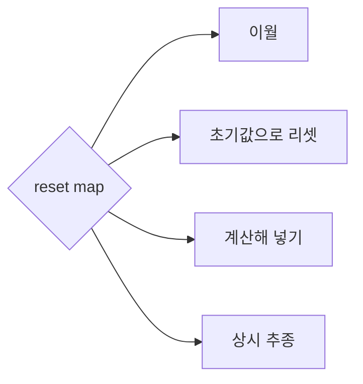
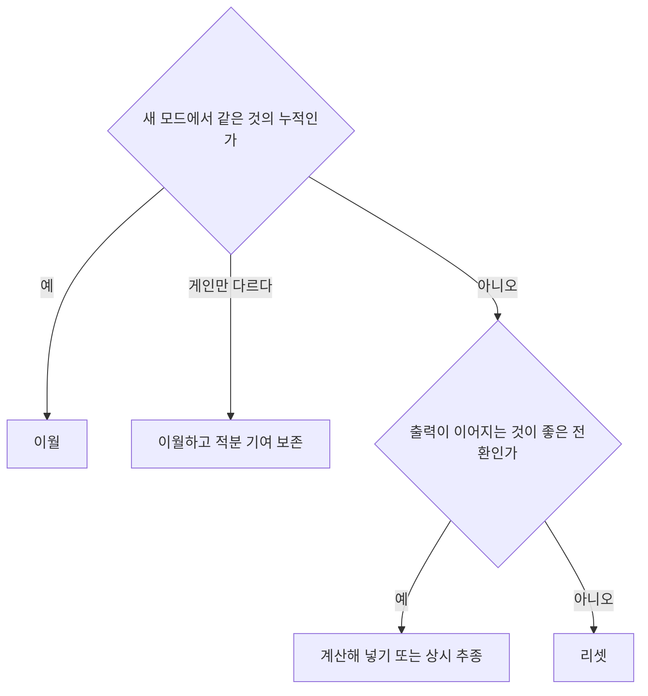

> **기준 출처:** [MathWorks, PID Controller](https://www.mathworks.com/help/simulink/slref/pidcontroller.html) · [MathWorks, Discrete-Time Integrator](https://www.mathworks.com/help/simulink/slref/discretetimeintegrator.html) · [Kong 외, The Salted Kalman Filter](https://arxiv.org/html/2007.12233) / 확인일 2026-11-12
> **시리즈:** [목차](/posts/00-multimode-series/) | 이전 → [05. 전환 안정성](/posts/05-switching-stability/) | 다음 → [07. 위치제어와 힘제어](/posts/07-hybrid-position-force/)

05편의 $$\mu$$ 는 전환 순간 Lyapunov 함수가 몇 배로 뛰는가였고, 그 값은 전환 순간 상태를 무엇으로 두느냐에 따라 달라진다. 05편이 「이 값을 줄여야 한다」까지 말했다면 이 편은 그 값을 실제로 정하는 자리다. 03편은 「출력이 튀지 않으려면」에서 출발했다. 이 편은 「이 값이 새 모드에서 의미가 있는가」에서 출발해, 제어기가 들고 있던 값을 새 모드에서 어떻게 할지를 상태의 종류별로 본다. 출발점이 다르면 답도 갈린다. 출력이 이어지는 것이 늘 옳지는 않기 때문이다(3절). 07편부터는 제어량이 서로 다른 모드를 다루는데, 그때 이 문제가 가장 분명하게 나온다.

이 편에 필요한 앞 개념은 다섯이다.

| 용어 | 뜻 |
| --- | --- |
| reset map | 모드가 바뀌는 순간 연속 상태를 어떤 값으로 바꿀지 정하는 규칙. 그대로 두면 항등, 값을 갈아 끼우면 도약 (02편) |
| 제어기 내부 상태 | PID 의 적분 항, 필터, 관측기처럼 제어기가 과거를 누적해 들고 있는 값 |
| windup | 구동기가 포화해 지령대로 내보내지 못하는 동안에도 적분 항이 계속 쌓이는 현상 |
| 관측기 | 직접 재지 못하는 내부 상태를 모델과 측정으로 추정하는 장치. 자기 상태를 들고 있다 |
| $$\mu$$ | 전환하는 순간 Lyapunov 함수 값이 최대 몇 배로 뛰는가. 작을수록 전환을 자주 해도 된다 (05편) |

## 1. 선택지 넷

| 선택 | 하는 일 | 전환 순간 출력 연속 | 계산 시점 | PID Controller 블록 |
| --- | --- | --- | --- | --- |
| 이월 | 마지막 값을 그대로 쓴다 | 보장하지 않는다 | 없음 | External reset 을 `none` 으로 |
| 리셋 | 정한 초기값(대개 0)으로 되돌린다 | 보장하지 않는다 | 없음 | External reset |
| 계산해 넣기 | 전환 순간 정한 기준으로 계산한 값을 넣는다 | 기준에 달렸다. 출력 일치를 기준으로 하면 맞춘다 | 전환하는 스텝 | 초기 조건 Source 를 `external` 로 |
| 상시 추종 | 대기 중에도 실제 인가값을 따라가게 둔다 | 추종이 맞춰 둔 만큼. MathWorks 예제에서는 거의 같다 | 매 주기 | tracking mode, TR 포트 |

출력 연속 열과 계산 시점 열은 각 방식의 정의에서 이 글이 읽은 것이다. 계산해 넣기와 상시 추종은 03편에서 무충격 전환의 처방으로 이미 나왔다. Paxman 과 Vinnicombe 는 전환이 없는 제어에서는 초기화가 크게 고민할 거리가 아니고 0 으로 두어도 되는 경우가 많지만, 전환 제어에서는 전환마다 생기는 과도가 제어기의 실현과 전환 시점 상태에 직접 관련된다고 적는다. 같은 논문은 매번 0 으로 되돌리거나 차수가 같은 제어기들이 상태 하나를 끊김 없이 이어 쓰는 단순한 방식이 성능을 크게 떨어뜨리고 최악의 경우 불안정을 낳을 수 있다고 본다. 이 표의 첫 두 줄이 그 두 방식이다.

## 2. 이월 — 같은 것의 누적일 때

> 이 문단은 이 글의 유도다. 적분기가 들고 있는 값은 특정 오차의 누적이다. 위치 오차를 적분하던 값과 힘 오차를 적분할 값은 단위부터 다르므로, 오차의 정의가 바뀌는 전환에서 이월한 값은 새 모드에서 같은 뜻을 갖지 않는다.
{: .prompt-info }

이 글은 적분기의 숫자 하나에 세 가지 약속이 붙어 있다고 본다.

| 약속 | 내용 |
| --- | --- |
| 무엇을 누적한 값인가 | 오차의 정의. 위치 오차인가, 힘 오차인가, 속도 오차인가 |
| 어떤 단위와 부호 규약인가 | 같은 힘 오차라도 기준 좌표계와 부호가 다르면 다른 값이다 |
| 밖에서 무엇이 곱해지는가 | 적분 게인 $$K_i$$. 출력에 기여하는 것은 누적값 자체가 아니라 게인을 곱한 값이다 |

셋이 모두 같을 때 이월이 이어받기가 된다. 하나라도 다르면 숫자만 넘어가고 뜻은 넘어가지 않는다. 판정을 한 문장으로 줄이면 「이 값은 무엇의 누적인가에 대한 답이 두 모드에서 같은가」다. 어느 약속이 깨지느냐에 따라 일어나는 일이 다르다.

| 무엇이 다른가 | 무슨 일이 생기나 | 대응 |
| --- | --- | --- |
| 오차의 정의 (위치에서 힘으로) | 이월값이 새 모드에서 뜻이 없다. 크기도 부호도 우연이다 | 이월하지 않는다. 리셋, 계산해 넣기, 상시 추종 가운데 고른다 |
| 게인만 다르다 (같은 구조, 게인 스케줄) | 적분 기여가 튄다 | 아래 표 |
| 셋 다 같다 | 이월이 맞다. 리셋하면 쌓아 둔 것을 버린다 | 이월 |

게인만 바뀌는 경우의 함정은 이렇다. 적분 기여가 $$K_i \sum e$$ 꼴로 계산되면 $$K_i$$ 만 바꿔도 출력이 $$(K_i^{new} - K_i^{old}) \sum e$$ 만큼 튄다. Beauregard 의 PID 구현 글은 운전 중 튜닝을 바꿀 때 생기는 도약의 원인을 적분항으로 짚고 해법 둘을 든다.

| 해법 | 하는 일 |
| --- | --- |
| 누적 합을 다시 잰다 | $$K_i$$ 가 두 배가 되면 누적 합을 절반으로. 일반적으로 $$\sum e \leftarrow (K_i^{old} / K_i^{new}) \sum e$$ |
| $$K_i e$$ 를 누적한다 | `ITerm += ki * error`. 과거 기여가 그때의 게인으로 이미 저장되어 있다 |

두 해법 모두 보존하는 것은 누적값이 아니라 적분 기여다. 게인이 바뀌는 전환에서는 상태를 그대로 두는 것이 「아무것도 하지 않는 것」이 아니라, 오히려 출력에 대한 기여를 바꾸는 일이다.

직전 모드에서 출력이 포화해 있었다면 다른 문제가 겹친다. PID Controller 블록의 anti-windup 은 포화를 다룬다. back-calculation 은 포화된 신호와 포화 전 신호의 차이를 적분기로 되먹이고, clamping 은 블록 성분의 합이 출력 한계를 넘고 적분기 입력과 포화 블록 입력의 부호가 같을 때 적분을 멈춘다. 이런 장치 없이 포화 구간을 지난 적분기를 이월하면 그 구간에 쌓인 값도 함께 넘어간다. 이 글은 이것을 windup 을 물려받는 것으로 본다. 새 모드에서는 포화가 아닐 수도 있는데, 부풀어 있는 적분값 때문에 곧바로 다시 포화로 밀려 들어간다. 그래서 이월을 고를 때는 직전에 포화 중이었는지를 함께 본다.

## 3. 리셋 — 적분 기여가 사라진다

적분기를 0 으로 되돌리면 그 순간 출력에서 적분 기여가 빠진다. Kantor 노트북의 출력 $$\overline{MV} + P + I + D$$ 에서 $$I$$ 를 0 으로 두는 것이므로, 출력은 직전의 $$I$$ 만큼 계단으로 바뀐다. 그 계단이 기구를 가진하거나 구속 상태에서 접촉력의 계단이 되는 것은 03편과 같다.

PID Controller 블록에서는 External reset 이 이 일을 한다. 트리거는 `rising`, `falling`, `either`, `level` 중에서 고르고, 트리거가 오면 적분기와 필터를 초기 조건으로 되돌린다.

> 이 절의 나머지는 이 글의 판단이다.
{: .prompt-info }

리셋은 아무것도 물려받지 않으니 안전해 보이지만, 계단 말고도 잃는 것이 하나 더 있다. 적분기가 들고 있던 것이 가만히 있기 위해 늘 필요한 양, 곧 중력 보상, 마찰 보상, 일정한 외란의 상쇄였다면 리셋은 그 보상을 없앤 것과 같다. 다시 쌓일 때까지 시스템은 그만큼 밀리고, 적분 게인이 작을수록 그 시간이 길다.

그럼에도 리셋이 맞는 경우가 있다. 위의 손해는 「출력이 이어지는 것이 좋다」를 전제로 한 손해이고, 그 전제가 성립하지 않는 자리가 있다.

| 경우 | 이유 |
| --- | --- |
| 오차의 정의가 바뀐 경우 | 이월값이 애초에 뜻이 없으므로 잃을 것이 없다 |
| 이전 값이 오염되었다고 볼 이유가 있는 경우 | 고장으로 들어가는 전환이 대표적이다. 고장 이전에 쌓인 누적은 잘못된 측정에 근거한 것일 수 있다 |
| 출력이 이어지는 것 자체가 위험한 경우 | 안전 방향으로 나가는 전환에서 옛 출력을 이어받는 것은 잘못된 지령을 매끄럽게 유지하는 일이다. 필요한 것은 무충격이 아니라 정해진 값으로의 즉시 이동이다 |

## 4. 계산해 넣기 — 남는 자유도를 쓴다

계산의 기준은 하나가 아니다(03편). 첫 출력을 직전 출력에 맞추는 조건은 상태의 차원이 입력보다 크면 해가 여럿이다. Pour Safaei, Hespanha, Stewart 는 출력 일치 대신 전환 뒤 구간의 추종 오차, 피제어 출력, 제어 신호의 이차 비용을 최소화하는 초기 상태를 고르고, Paxman 과 Vinnicombe 는 플랜트 상태의 함수로 reset 하면서 임의 전환에서도 안정한 reset 규칙을 LMI 로 합성한다. Paxman 과 Vinnicombe 의 안정 조건에는 reset 뒤 상태에서 잰 새 모드의 Lyapunov 함수 값이 옛 모드의 값보다 크지 않아야 한다는 부등식이 들어 있다. 전환 순간 Lyapunov 함수가 뛰는 정도가 reset 에 따라 달라진다는 뜻이다.

05편의 다중 Lyapunov 함수 조건도 같은 자리를 가리킨다. Huang, Li, Yin 은 전환할 때 새 모드의 함수 값이 옛 모드의 값보다 작기를 요구하고, Hafstein 과 Tanwani 의 $$\mu$$ 는 그 도약의 최대 배율이었다.

> 이 문단은 이 글의 생각이다. 위의 두 논문은 출력 일치 방정식의 남는 자유도를 쓰는 방식이 아니라 각자 다른 기준을 세운다. 그와 별개로, 출력 일치를 지키고 싶다면 그 해들 가운데 전환 직후 상태에서 잰 새 모드의 Lyapunov 함수 값을 가장 작게 하는 것을 고르는 방법을 생각할 수 있다. 그러면 출력 연속은 목적이 아니라 선택지를 좁히는 제약이 되고, 남은 자유도는 안정성 여유, 곧 작은 $$\mu$$ 에 쓰인다.
{: .prompt-info }

PID Controller 블록에서 초기 조건 Source 를 `external` 로 두면 입력 포트 `Io` 와 `Do` 가 생긴다. 블록은 초기 조건을 시뮬레이션 시작이나 지정한 트리거 시점에 적분기와 미분 필터에 적용하므로, External reset 트리거와 함께 쓰면 전환 시점에 계산한 값을 넣을 수 있다.

## 5. 상태의 종류마다 다르다

제어기 내부 상태를 한 덩어리로 다루면 답이 맞지 않는다.

| 상태 | 무엇을 보고 정하나 | 근거 |
| --- | --- | --- |
| 적분기 | 오차의 정의와 게인이 같은가 | 2절 |
| 저역통과 필터, 미분 필터 | 입력 신호가 같은가. 같으면 이월 | 이 글의 판단. 필터 상태는 그 신호의 최근 이력이다 |
| 미분 항 | 오차의 정의가 바뀌면 리셋 | 이 글의 판단. 오차가 계단으로 바뀌면 미분이 스파이크를 만든다. 오차 대신 측정값을 미분하는 구성이면 이 문제가 줄어든다 |
| 관측기의 추정치 | 플랜트 상태의 추정이므로 플랜트의 reset map 을 따른다 | Kong 외 |
| 관측기의 공분산 | reset map 이 항등이어도 그대로 두지 않는다 | Kong 외 |
| 타이머 | 정한 전이에서 명시적으로 0 으로 되돌린다 | Mitra 외 |
| 궤적 생성기 상태 | 현재 위치와 속도에서 다시 시작한다 | 이 글의 판단. 옛 궤적의 남은 구간을 이어 쓰면 새 모드의 목표와 어긋난다 |

관측기 줄이 헷갈리기 쉽다. 이 글은 이렇게 구분한다. 제어기 상태는 「제어기가 과거에 무엇을 했나」의 누적이고, 관측기 상태는 「플랜트가 지금 어떤 상태인가」의 추정이다. 모드가 바뀌었다고 로봇이 갑자기 다른 곳에 있는 것은 아니므로, 플랜트 상태가 전환 순간 도약하지 않는다면 추정치는 이어받는 것이 맞다. 도약한다면 그 도약, 곧 플랜트의 reset map 을 추정치에도 적용한다.

모델이 바뀌는 경우가 문제다. Kong 등의 Salted Kalman Filter 는 하이브리드 시스템에서 칼만 필터를 돌린다. 이들은 reset map 의 야코비안만으로 공분산을 옮기는 방식이 서로 다른 모드의 상이한 동역학을 고려하지 못한다고 보고, 전이할 때 평균은 reset map 으로, 공분산은 saltation matrix 로 갱신한다. reset map 이 항등인 시스템에서도 2차 모멘트를 전이 전후로 그대로 두면 전이가 분포에 주는 효과를 잡지 못한다고 적는다. 이 글의 이해로는, 전환 전후의 벡터장이 다르면 전이 시각이 조금만 달라져도 그 뒤 상태가 달라지기 때문이다.

> 이 문단은 이 글의 판단이다. 이 결과를 설계 규칙으로 옮기면 「모드 전환 직후에는 관측기를 더 의심한다」가 된다. 공분산을 부풀리거나 필터 이득을 잠깐 키우는 처리가 그것이다. ADRC 의 [ESO](/posts/05-extended-state-observer/)처럼 모델이 설명하지 못하는 몫을 상태 하나로 몰아 추정하는 관측기라면, 추정하는 총외란이 접촉 유무에 따라 물리적으로 다른 양이 되므로 이월보다 재수렴할 시간을 확보하는 쪽이 안전하다고 본다.
{: .prompt-info }

타이머는 02편의 평균 dwell time 검증 구성에서 정해진 전이마다 $$y := 0$$ 으로 되돌아간다. 04편의 최소 체류시간 타이머도 모드에 들어갈 때 0 으로 두어야 들어온 뒤의 경과 시간을 잰다. 되돌리지 않으면 최소 체류시간 장치가 제 역할을 하지 못한다.

## 6. Discrete-Time Integrator 문서의 함정 셋

| 함정 | 문서의 설명 |
| --- | --- |
| `level` 리셋은 붙잡는다 | 리셋 신호가 0 이 아닌 동안 출력을 초기 조건으로 되돌리고 유지한다. 조건이 참인 동안 적분기는 움직이지 않는다 |
| 에지는 양수 기준이다 | 모든 트리거 검출은 양수 값의 신호를 기준으로 한다. -1 에서 0 으로 바뀌는 것은 상승 에지가 아니고, 0 에서 1 은 상승 에지다 |
| 리셋 포트는 direct feedthrough 다 | 블록 출력이 직접, 또는 direct feedthrough 블록들을 거쳐 이 포트로 되먹여지면 대수 루프가 생긴다. 문서는 대신 state 포트 출력을 리셋 포트에 넣으라고 한다 |

세 가지 모두 오류 없이 다르게 동작하는 종류다. 전환 순간 한 번만 되돌리려면 `level` 대신 `rising` 같은 에지 트리거를 고르고, 리셋 신호를 $$\pm 1$$ 로 만들었다면 의도한 시점에 에지가 검출되는지 확인한다. 출력을 보고 리셋을 판정하는 구성은 대수 루프 때문에 그대로는 쓸 수 없다. 대수 루프와 상태를 가진 블록의 실행 단계는 [07. 상태를 가진 블록과 Data Store](/posts/07-stateful-blocks-datastore/)에 정리되어 있다.

## 7. 고르는 순서

> 이 절은 이 글의 정리다. 2절부터 5절까지를 한 장으로 모은 것이고, 문헌에서 옮긴 결정 규칙이 아니다.
{: .prompt-info }

질문은 둘이고 순서가 정해져 있다. 첫 질문이 이월 가능 여부를 가르고, 거기서 걸린 경우에만 두 번째 질문으로 내려간다. 아래 표가 각 갈래의 단서를 채운다.

| 먼저 묻는 것 | 답 | 고르는 것 |
| --- | --- | --- |
| 새 모드에서 같은 것의 누적인가 (오차 정의, 단위, 게인) | 셋 다 같다 | 이월. 단 직전에 포화 중이었으면 windup 을 함께 처리 |
| | 게인만 다르다 | 이월하되 적분 기여를 보존하도록 다시 잰다 |
| | 오차 정의가 다르다 | 다음 질문으로 |
| 이 전환에서 출력이 이어지는 것이 좋은가 | 좋다, 대기 모드가 적다 | 상시 추종. 전환 시점에 할 일이 없다 |
| | 좋다, 대기 모드가 많다 | 계산해 넣기. 연산을 전환 시점에만 쓴다 |
| | 좋지 않다 (안전 방향으로 나가는 전환) | 리셋, 또는 정해진 안전값으로 |
| 이전 값이 오염되었다고 볼 이유가 있는가 | 있다 (고장 진입) | 리셋. 이어받으면 위험을 물려받는다 |

첫 질문의 답이 「아니오」인 순간 이월은 선택지에서 빠지고, 남은 셋 가운데서는 그 전환이 매끄러워야 하는 전환인지가 갈림길이 된다.

## 8. 정리

- 전환 순간 상태 처리는 이월, 리셋, 계산해 넣기, 상시 추종 넷이다. 이월과 리셋은 출력 연속을 보장하지 않고, Paxman 과 Vinnicombe 는 이 두 단순한 방식이 최악의 경우 불안정을 낳을 수 있다고 적는다
- 이월해도 되는지는 세 약속, 곧 오차의 정의, 단위와 부호, 밖에서 곱해지는 게인을 본다. 오차의 정의가 바뀌는 전환에서 이월한 적분값은 새 모드에서 같은 뜻을 갖지 않는다(이 글의 유도)
- 게인만 바뀌면 적분 기여가 튄다. 누적 합을 다시 재거나 $$K_i e$$ 를 누적한다. 보존할 것은 상태가 아니라 적분 기여다
- 포화 구간을 지난 적분기를 이월하면 windup 을 물려받는다
- 리셋은 적분 기여를 없애 출력을 계단으로 바꾸고, 늘 필요한 보상이 다시 쌓일 때까지 시스템을 밀리게 한다. 그래도 오차 정의가 바뀌었거나, 이전 값이 오염됐거나, 출력 연속 자체가 위험한 전환에서는 리셋이 맞다
- 계산해 넣기는 기준에 따라 갈린다. 출력 일치, 전환 뒤 이차 비용 최소화, 임의 전환에서도 안정한 reset 합성이 있고, 어느 쪽이든 전환 순간 Lyapunov 함수의 도약이 reset 에 달려 있다
- 상태의 종류마다 규칙이 다르다. 필터는 입력 신호를, 미분 항은 오차 정의를 보고, 관측기 추정치는 플랜트의 reset map 을 따른다. 공분산은 reset 이 항등이어도 saltation matrix 로 갱신하고, 타이머는 명시적으로 0 으로 되돌린다
- Discrete-Time Integrator 의 `level` 리셋은 조건이 참인 동안 붙잡고, 에지 검출은 양수 기준이며, 리셋 포트로 출력을 되먹이면 대수 루프가 생긴다
- 고르는 순서는 「같은 것의 누적인가」가 먼저이고, 아니라면 「출력이 이어져야 하는 전환인가」를 본다

## 참고

- [MathWorks, PID Controller (Simulink 블록 레퍼런스)](https://www.mathworks.com/help/simulink/slref/pidcontroller.html)
- [MathWorks, Discrete-Time Integrator (Simulink 블록 레퍼런스)](https://www.mathworks.com/help/simulink/slref/discretetimeintegrator.html)
- B. Beauregard, Improving the Beginner's PID: Tuning Changes — `http://brettbeauregard.com/blog/2011/04/improving-the-beginner%e2%80%99s-pid-tuning-changes/` (이 사이트는 https 연결이 되지 않아 링크 없이 주소만 적는다)
- [J. Kantor, PID Control with Bumpless Transfer, CBE 30338 (Univ. of Notre Dame)](https://jckantor.github.io/CBE30338/04.03-PID_Control_with_Bumpless_Transfer.html)
- [J. P. Paxman, G. Vinnicombe, Stability of Reset Switching Systems, ECC 2003](https://skoge.folk.ntnu.no/prost/proceedings/ecc03/pdfs/084.pdf)
- [F. R. Pour Safaei, J. P. Hespanha, G. Stewart, On Controller Initialization in Multivariable Switching Systems](https://web.ece.ucsb.edu/~hespanha/published/On_Controller_Initialization_in_multivariable_Switching.pdf)
- [N. J. Kong, J. J. Payne, G. Council, A. M. Johnson, The Salted Kalman Filter: Kalman Filtering on Hybrid Dynamical Systems (arXiv:2007.12233)](https://arxiv.org/html/2007.12233)
- [S. Mitra, D. Liberzon, N. Lynch, Verifying Average Dwell Time of Hybrid Systems, ACM TECS 8(1), 2008](https://liberzon.csl.illinois.edu/research/ADT06.pdf)
- [J. Huang, S. Li, X. Yin, Stability Verification for Switched Systems using Neural Multiple Lyapunov Functions (arXiv:2601.00587)](https://arxiv.org/html/2601.00587)
- [S. Hafstein, A. Tanwani, Linear Programming based Lower Bounds on Average Dwell-Time via Multiple Lyapunov Functions (arXiv:2303.17858)](https://ar5iv.labs.arxiv.org/html/2303.17858)
