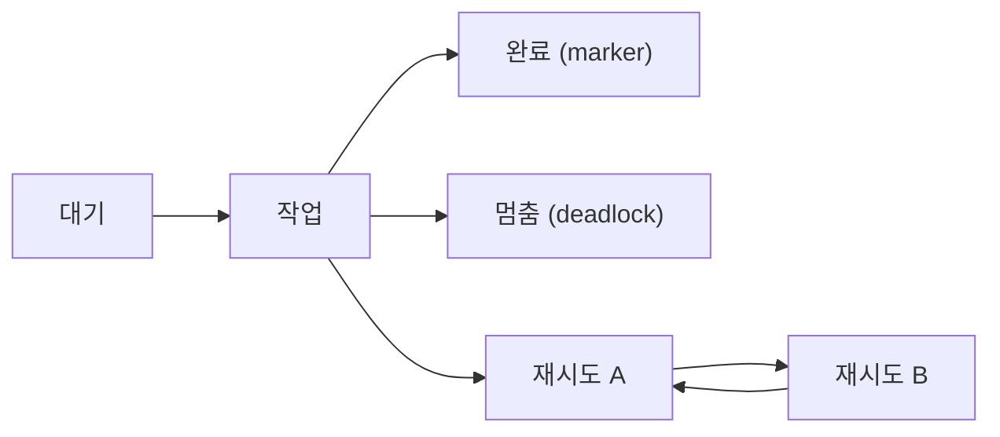

> **기준 출처:** [Supervisory control theory (Wikipedia)](https://en.wikipedia.org/wiki/Supervisory_control_theory) · [Reniers, Cai, arXiv:2404.08469](https://arxiv.org/html/2404.08469) · [Eclipse ESCET 합성 기반 엔지니어링 코스](https://eclipse.dev/escet/sbe-course/module3/synthesis-guarantees.html) / 확인일 2026-11-13
> **시리즈:** [목차](/posts/00-multimode-series/) | 이전 → [07. 위치제어와 힘제어](/posts/07-hybrid-position-force/) | 다음 → [09. Stateflow 로 모드 표현하기](/posts/09-stateflow-modes/)

07편까지는 연속 신호의 이야기였다. 연속 제어에서 재는 것은 오차, 대역폭, 정착 시간처럼 크기를 가진 양이다. 어느 모드를 켤지 고르는 층은 다루는 대상이 다르다. 신호의 크기가 아니라 무슨 사건이 어떤 순서로 일어났는가를 본다. 이 층을 다루는 이론이 이산사건 시스템(discrete event system, DES)의 감독제어(supervisory control theory, SCT)이고, Ramadge–Wonham 틀이라고도 부른다. 다음 편이 이 층을 그리는 표기를 다루므로, 그리기 전에 이 층에서 무엇이 증명 가능한 성질인지를 여기서 정해 둔다.

이 편에 나오는 말은 넷이다.

| 용어 | 뜻 |
| --- | --- |
| 모드 | 그 구간 동안 활성인 제어 법칙 하나. 자유 이동, 구속 이동, 고장 대응이 각각 모드다 |
| 전환 논리 | 지금 어느 모드를 켤지 정하는 규칙의 묶음 |
| guard (전이 조건) | 그 전이가 가능해지는 조건식. `접촉력 > 5 N` 같은 것 |
| 오토마톤 | 상태를 사건 이름표가 붙은 화살표로 이은 그래프. 그 그래프가 만들어 낼 수 있는 이름표의 나열이 이 편의 대상이다 |

## 1. 사건의 열로 적는다

SCT 는 플랜트가 사건을 스스로 만들어 낸다고 가정하고, 그 동작을 제한해 사양을 되도록 많이 만족시키는 감독기(supervisor)를 자동으로 합성한다. Reniers 와 Cai 의 논문은 플랜트를 유한 오토마톤으로 적는다.

$$P = (Q,\ \Sigma,\ \delta,\ q_0,\ Q_m)$$

| 기호 | 뜻 |
| --- | --- |
| $$Q$$ | 유한한 상태 집합 |
| $$\Sigma$$ | 사건 집합. 제어 가능 $$\Sigma_c$$ 와 제어 불가능 $$\Sigma_u$$ 로 나뉜다 (2절) |
| $$\delta$$ | 부분 전이 함수. 어느 상태에서 어느 사건이 나면 어디로 가는가 |
| $$q_0$$ | 초기 상태 |
| $$Q_m$$ | marker 상태 집합 |

마지막 칸 $$Q_m$$ 이 일반적인 FSM 표기에 없던 칸이다. 이 칸 하나가 4절의 봉쇄(blocking)라는 검사 항목을 만든다. ESCET 코스는 marker 상태를 「안정된 상태, 안전한 정박지(safe haven)」로 설명한다. 하던 일이 한 단락 끝난 것으로 볼 수 있는 상태다.

이 오토마톤이 만들 수 있는 사건 이름의 나열 하나를 문자열, 그 집합을 언어라고 부른다. 언어 $$L(P)$$ 는 만들 수 있는 모든 나열이고, 그중 marker 상태에서 끝나는 것의 집합이 $$L_m(P)$$ 이다. 그래서 이 층의 질문은 어떤 나열이 나올 수 있고 어떤 나열을 막을 수 있는가의 형태가 된다.

「supervisory control」이라는 말은 두 가지를 가리킨다. 하나는 후보 제어기를 여러 개 두고 감시 신호를 보며 온라인으로 갈아타는 전환 감독제어로, 연속 신호를 보고 판단한다. 다른 하나가 이 편의 DES 감독제어로, 사건 열만 본다. 이름이 같아 검색 결과가 섞이므로 문헌을 찾을 때 어느 쪽인지 먼저 확인한다. 이 구분은 어느 한 문헌의 문장이 아니라 두 계열의 용법을 나란히 놓은 정리다.

## 2. 제어 가능 사건과 제어 불가능 사건

이 이론에서 가장 먼저 하는 일이 사건 집합을 둘로 나누는 것이다. 이론 전체를 쓰지 않더라도 이 구분은 그대로 쓸 수 있다.

| 구분 | 정의 (arXiv:2404.08469) |
| --- | --- |
| 제어 가능 사건 $$c \in \Sigma_c$$ | 외부 행위자(감독기)가 막을(disable) 수 있다 |
| 제어 불가능 사건 $$u \in \Sigma_u$$ | 막을 수 없다 |

감독기가 할 수 있는 일은 여기서 정해진다. ESCET 코스의 제어 루프 설명으로, 플랜트는 현재 상태에서 가능한 사건을 알리고, 감독기는 사건마다 허용 여부를 정하고, 플랜트는 가능하면서 허용된 사건 중 하나를 실행한다. Reniers 와 Cai 의 논문은 감독기가 허용된 사건 중 무엇이 실제로 일어날지는 정하지 않는다고 적고, Wikipedia 는 감독기에 플랜트가 사건을 일으키도록 강제할 수단이 없다고 적는다.

감독기의 수단은 켜는 것이 아니라 끄는 것 하나다. 점선은 그 수단이 닿지 않는 입력이다.

모드 전환에 대입하면 이런 구분이 된다. 아래는 이 편에서 만든 예시다.

| 제어 가능한 사건 | 제어 불가능한 사건 |
| --- | --- |
| 힘 제어 모드로 들어가라는 지령 | 접촉력이 문턱을 넘음 |
| 구동 허가를 주거나 거둠 | 고장 검출 |
| 다음 단계 진행 허가 | 조작자가 버튼을 누름 |
| 요청을 보류함 | 외부에서 메시지가 도착함 |

이 표는 설계 검토의 질문을 바꾼다. 「이 전이는 언제 일어나나」보다 「이 전이를 막을 수 있나」를 먼저 묻게 된다. 막을 수 없는 사건이 사양을 깨는 자리로 데려갈 수 있다면 그 사건을 막는 규칙은 쓸 수가 없다. 그 자리에 갈 수 있는 상태에 들어가지 않도록 앞에서 막아야 한다. 다음 절의 controllability 조건이 형식적으로 말하는 내용이 이것이다.

## 3. 사양을 따로 적고 감독기를 계산한다

발상은 두 단계다.

1. 플랜트 모델에는 물리적으로 가능한 동작을 그대로 적는다. 금지 사항을 넣지 않는다
2. 사양은 따로 적는다. 「이 두 동작이 동시에 일어나면 안 된다」, 「이 순서로만 진행한다」 같은 요구를 별개의 오토마톤으로 쓴다

감독기는 둘에서 계산한다. 손으로 전이 논리를 짜는 대신, 사양을 어기지 않는 동작 중 가장 넓은 것을 구하는 문제로 바꾸는 것이다. 이때 허용 언어 $$F$$ 가 지켜야 하는 조건이 controllability 다.

$$(\forall s \in \overline{F},\ \forall u \in \Sigma_u)\ \ u \in E_P(s) \Rightarrow su \in \overline{F}$$

| 기호 | 뜻 |
| --- | --- |
| $$\overline{F}$$ | $$F$$ 에 속한 나열의 앞부분을 모두 모은 접두사 닫힘 |
| $$E_P(s)$$ | $$s$$ 다음에 플랜트가 낼 수 있는 사건의 집합 |

허용된 나열 뒤에 막을 수 없는 사건이 일어나도 여전히 허용 범위 안에 있어야 한다는 뜻이다. 막을 수 없는 사건으로 위반이 성립하는 곳은 허용 영역에서 미리 빼야 한다. 제어 가능한 부분 언어들은 합집합에 닫혀 있으므로 가장 큰 것이 존재하고, 이것을 supremal controllable sublanguage 라고 부른다.

가장 큰 것을 따지는 이유가 있다. 가장 안전한 감독기는 아무것도 못 하게 하는 감독기이고, 그것은 쓸모가 없다. 그래서 목표는 안전 자체가 아니라 필요한 만큼만 제한한 안전이다.

ESCET 코스의 합성 설명은 controllability 를 계산 절차로 보여 준다. 제어 불가능 사건 하나로 나쁜 상태에 갈 수 있는 상태는 그 자체로 나쁜 상태가 되어 제거되고, 그 상태로 들어가는 제어 가능 전이는 막힌다. 더 바뀌는 것이 없을 때까지 이 과정을 뒤로 거슬러 반복한다. 막을 수 없는 사건으로 위반에 이르는 자리는 그 앞의 제어 가능한 지점에서 막는다는 것이다.

합성 도구가 내거는 보장은 넷이다.

| 보장 | ESCET 코스의 설명 |
| --- | --- |
| safe | 제어된 시스템이 사용자가 준 요구를 모두 지킨다 |
| controllable | 감독기는 자신이 제어할 수 없는 사건을 절대 막지 않는다 |
| nonblocking | 감독기를 붙인 시스템에 봉쇄 상태가 도달 가능하지 않다 |
| maximally permissive | 앞의 보장을 지키는 데 필요한 만큼만 동작을 제한한다 |

성능, 비용, 에너지 소비, 마모 같은 기준은 모델에 들어가지 않는다. 이런 기준으로 동작을 더 좁히는 일은 합성 뒤에 다른 수단으로 한다고 코스는 적는다. 합성이 답하는 것은 위 네 가지까지다.

## 4. 비봉쇄 — 일을 마칠 수 있는가

논문의 정의는 언어의 등식이다.

$$L(P) = \overline{L_m(P)}$$

| 기호 | 뜻 |
| --- | --- |
| $$L(P)$$ | 이 시스템이 만들어 낼 수 있는 모든 사건 열 |
| $$L_m(P)$$ | 그중 marker 상태에서 끝나는 열 |
| $$\overline{\ \cdot\ }$$ | 접두사 닫힘. 그 집합에 속한 열의 앞부분들을 모두 모은 것 |

만들어 낼 수 있는 모든 나열이 marker 상태에서 끝나는 어떤 나열의 앞부분이라는 뜻이다. 말로 풀면, 지금까지 무엇을 했든 일을 마칠 방법이 아직 남아 있다. ESCET 코스는 상태 단위로 적는다.

| 용어 | 정의 | 겉으로 보이는 증상 |
| --- | --- | --- |
| 봉쇄(blocking) 상태 | 도달 가능하지만 marker 상태로 가는 전이 열이 없는 상태 | — |
| deadlock 상태 | 어떤 전이도 가능하지 않아 더 이상 동작이 없는 상태 | 아무것도 하지 않는다 |
| livelock | 전이는 계속 가능하지만 marker 상태에는 끝내 닿지 못하는 것 | 바쁘게 도는데 진행이 없다 |

deadlock 과 봉쇄는 같은 말이 아니다. 코스는 deadlock 위치가 흔히 봉쇄 위치이기도 하지만, 그 위치가 marker 이면 봉쇄가 아니라고 적는다. marker 상태에서 멈추는 것은 일을 마친 것으로 본다.

이 그림에서 멈춤은 deadlock 이자 봉쇄 상태이고, 재시도 A 와 B 의 왕복은 livelock 이다. 둘 다 모드 그래프의 성질이라 각 모드 안 제어기의 안정성이나 오차와는 별개이고, 연속 제어 쪽에는 대응물이 없다. 각 모드의 제어기가 아무리 잘 설계되어 있어도, 전환 논리에 들어갈 수는 있는데 나올 조건을 아무도 적지 않은 모드가 하나 있으면 시스템은 거기서 멈춘다. 안정성이나 오차 성능으로는 이 결함이 드러나지 않는다.

그래서 합성 도구는 nonblocking 을 보장 항목으로 내걸고, 손으로 그린 전이 논리라면 같은 것을 검사 항목으로 들고 있어야 한다. 그 검사 방법은 [10편](/posts/10-mode-switch-verification/)이 다룬다.

## 5. 이 틀이 주는 것과 다루지 않는 것

합성을 실제로 돌리지 않아도 남는 것이 있고, 돌리더라도 안 되는 것이 있다. 먼저 남는 것이다. 아래 표는 문헌의 문장이 아니라 앞 절들의 개념을 설계 습관으로 옮긴 정리다.

| 남는 것 | 내용 |
| --- | --- |
| 사건 분류 | 모든 전이를 막을 수 있는 것과 없는 것으로 먼저 가른다. 못 막는 사건에 대비가 없으면 그 자리가 구멍이다 |
| 사양과 구현의 분리 | 요구를 전이 논리 안에 녹여 넣지 않고 따로 적는다. 요구가 바뀌었을 때 어디를 고칠지가 분명해진다 |
| 봉쇄라는 검사 항목 | 각 모드가 정상인가와 별개로 어디서든 일을 마칠 수 있는가를 묻는다 |
| 최대 허용이라는 기준 | 제한을 늘리는 것이 늘 좋은 것은 아님을 명시한다. 필요 이상으로 좁힌 논리는 나중에 「왜 안 움직이나」의 원인이 된다 |

다루지 않는 것이다.

| 항목 | 내용 |
| --- | --- |
| 강제 | 감독기는 막기만 한다. 그런데 실제 제어기는 정지 명령을 내리고 구동을 거는 식으로 시켜야 한다. Reniers 와 Cai 의 논문이 이 간극을 다룬다. 감독기가 특정 사건을 강제할 수 있게 하고, 그 강제 가능 사건이 제어 불가능 사건보다 먼저 일어날 수 있게 하는 확장이 같은 논문의 주제다 |
| 시간 | 1절의 오토마톤에는 시간 항목이 없다. 순서만 있다. 최소 체류시간, 확정 지연, 주기 실행처럼 시간이 들어가는 요구는 이 틀 바깥이거나 시간 확장을 따로 써야 한다 |
| 규모 | Ubukata 등은 부품을 합친 전체 상태 공간이 부품 수에 지수로 커지고, 이것이 전통적인 단일(monolithic) 합성의 큰 계산 장벽이라고 적는다. Ubukata 등이 다루는 on-the-fly 방식은 탐색한 부분만 들고 그 경계에서 조금씩 넓혀 간다. 모듈별로 나눠 합성하는 것도 같은 문제에 대한 대응이다 |
| 연속 동역학 | 모드 안에서 도는 제어기의 성능과 안정성은 이 층의 질문이 아니다. 이 층은 어느 것을 켤지만 답한다 |

두 표를 나란히 놓으면 판단이 하나 남는다. 합성을 도입할지는 별개 문제로 두고, 어휘만 빌려도 설계 검토가 달라진다고 본다. 전이 표에 「이 사건은 제어 가능한가」 열을 하나 더하고, 모드 목록 옆에 「여기서 나가는 경로가 있는가」 열을 하나 더하면 2절과 4절의 검사가 성립한다.

같은 그래프를 사람이 그리는 표기는 [09편](/posts/09-stateflow-modes/)이, 도달성과 비결정성을 도구로 검사하는 방법은 [10편](/posts/10-mode-switch-verification/)이, 제어 불가능 사건의 대표인 고장은 [11편](/posts/11-fault-modes-fdir/)이 다룬다.

## 6. 정리

- 모드를 고르는 층은 사건의 순서를 다룬다. 플랜트는 $$P = (Q, \Sigma, \delta, q_0, Q_m)$$ 이고, marker 상태 $$Q_m$$ 이 「일을 마쳤다」의 기준이 되어 이 층 고유의 검사 항목을 만든다
- 사건은 제어 가능과 제어 불가능으로 나뉜다. 감독기는 허용 여부만 정하고 사건을 일으키게 하지는 못한다
- 그래서 설계 질문이 「이 전이는 언제 일어나나」에서 「이 전이를 막을 수 있나」로 바뀐다
- controllability 는 막을 수 없는 사건이 일어나도 허용 범위를 벗어나지 않아야 한다는 조건이다. 합성은 위반에 이르는 상태를 뒤로 거슬러 제거한다
- 사양은 전이 논리에 녹이지 않고 따로 쓴다. 목표는 필요한 만큼만 제한한 안전이고, 그 최대치가 supremal controllable sublanguage 다
- 합성의 보장은 safe, controllable, nonblocking, maximally permissive 넷이다. 성능과 비용은 합성 밖에서 다룬다
- 봉쇄는 marker 상태로 갈 수 없는 상태다. deadlock 이라도 marker 면 봉쇄가 아니고, livelock 은 전이가 계속 일어나는데도 봉쇄다. 각 모드의 제어 성능으로는 드러나지 않는다
- 이 틀에는 강제, 시간, 규모의 한계가 있다. 상태 공간은 부품 수에 지수로 커진다. 합성을 쓰지 않아도 사건 분류와 봉쇄 검사라는 어휘는 빌려 쓸 수 있다

## 참고

- [Supervisory control theory — Wikipedia](https://en.wikipedia.org/wiki/Supervisory_control_theory)
- [M. Reniers, K. Cai, Supervisory Control Theory with Event Forcing (arXiv:2404.08469)](https://arxiv.org/html/2404.08469)
- [Eclipse ESCET, Synthesis-Based Engineering 코스 3.1 Supervisory control loop](https://eclipse.dev/escet/sbe-course/module3/supervisory-control-loop.html)
- [Eclipse ESCET, Synthesis-Based Engineering 코스 3.2 Synthesis guarantees](https://eclipse.dev/escet/sbe-course/module3/synthesis-guarantees.html)
- [Eclipse ESCET, Synthesis-Based Engineering 코스 3.3 Supervisory controller synthesis](https://eclipse.dev/escet/sbe-course/module3/supervisory-controller-synthesis.html)
- [Eclipse ESCET, Synthesis-Based Engineering 코스 2.1 Reachability, deadlock, blocking and livelock](https://eclipse.dev/escet/sbe-course/module2/reachability-deadlock-blocking-livelock.html)
- [T. Ubukata 외, Robust Exploration in Directed Controller Synthesis via Reinforcement Learning with Soft Mixture-of-Experts (arXiv:2602.19244)](https://arxiv.org/html/2602.19244)
