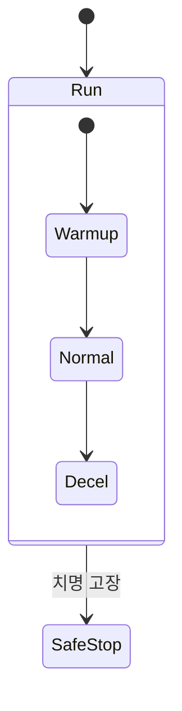

> **기준 출처:** [MathWorks Stateflow 문서](https://www.mathworks.com/help/stateflow/ug/state-decomposition.html) · [MathWorks, Evaluate Transitions](https://www.mathworks.com/help/stateflow/ug/evaluate-transitions.html) · [Yi 외, arXiv:2207.11965](https://ar5iv.labs.arxiv.org/html/2207.11965) / 확인일 2026-11-13
> **시리즈:** [목차](/posts/00-multimode-series/) | 이전 → [08. 감독제어와 이산사건 시스템](/posts/08-supervisory-control-des/) | 다음 → [10. 모드 전환의 검증](/posts/10-mode-switch-verification/)

08편은 모드를 고르는 층을 사건의 순서로 봤다. 그 층을 실제로 그리려면 표기가 필요하고, State 를 나란히 늘어놓는 평평한 FSM 은 모드가 조금만 늘어도 커진다. 이 편은 Stateflow 의 계층, 병렬, History Junction 이 각각 무엇의 중복을 줄이고, 그 대가로 무엇을 그림 밖에 남기는지 본다. 다음 편의 검증은 무엇을 그렸는지가 정해진 뒤에야 할 수 있으므로, 그리는 도구를 여기서 먼저 정리한다. 문법 자체는 [Stateflow 시리즈](/posts/00-stateflow-series/)가 다룬다.

이 편에 나오는 말은 넷이다.

| 용어 | 뜻 |
| --- | --- |
| 모드 | 그 구간 동안 활성인 제어 법칙 하나 |
| FSM (유한 상태 머신) | 상태가 유한 개 있고, 사건이나 조건에 따라 그 사이를 옮겨 다니는 모델 |
| guard (전이 조건) | 그 Transition 이 가능해지는 조건식 |
| reset (전환 순간의 상태 처리) | 모드가 바뀌는 순간 제어기 내부 값(적분 항 등)을 어떻게 할지 정하는 규칙. [06편](/posts/06-state-reset-at-switch/)의 주제다 |

## 1. 평평한 FSM 이 커지는 방식

평평한 FSM 은 두 번 곱해져서 커진다.

**① State 수가 곱으로 늘어난다.** 서로 독립인 관심사가 여러 개 있으면 실제 상태는 그 조합이다. 아래 숫자는 곱셈을 보이려고 만든 예시다.

| 관심사 | 값 | 개수 |
| --- | --- | --- |
| 구동 | 정지, 준비, 운전 | 3 |
| 통신 | 끊김, 연결 | 2 |
| 안전 감시 | 정상, 경고 | 2 |

세 관심사가 서로 독립이면 평평하게 적은 State 는 3 × 2 × 2 = 12 개다. 관심사 하나를 더 붙이면 24 개가 된다.

**② Transition 이 State 마다 복제된다.** 「치명 고장이면 안전 상태로 간다」 같은 공통 규칙 하나를 평평한 FSM 에 적으려면 열두 State 마다 같은 Transition 을 그려야 한다. 규칙이 바뀌면 열두 곳을 함께 고쳐야 하고, 하나를 빠뜨려도 그림은 멀쩡해 보인다. 그래서 두 번째 곱이 첫 번째보다 결함으로 이어지기 쉽다고 본다.

Harel(1987)이 이 문제에 내놓은 것이 기존 FSM 과 상태 전이도의 확장이다. 초록은 계층 구조, 병렬 동작, 구성 요소 사이의 통신을 더해 실시간 다중 컴퓨터 시스템, 통신 프로토콜, 디지털 제어 장치 같은 복잡한 이산사건 시스템의 명세를 간결하고 모듈적으로, 여러 상세 수준에서 읽을 수 있게 하겠다고 적는다. Stateflow 의 계층과 병렬 분해가 이 계열이다. 이 편은 그중 앞의 둘과 History Junction 을 본다.

## 2. 계층 — 공통 Transition 을 위로 올린다

State 안에 substate 를 넣는다. MathWorks 문서는 exclusive(OR) 분해를 서로 배타적인 운전 모드를 기술하는 데 쓰고, 한 번에 substate 하나만 활성이며, substate 테두리가 실선으로 그려진다고 설명한다.

상위 State `Run` 에 붙인 outer Transition 하나가 세 substate 각각에서 나가는 Transition 셋을 대신한다. 1절처럼 평평하게 적었다면 열두 개였다. 규칙이 바뀌면 고칠 곳도 하나다.

근거는 활성 State 의 실행 순서다. MathWorks 의 Chart 실행 예에서 Chart 는 상위 State 의 outer Transition 을 먼저 검사하고, 그것이 유효하지 않을 때 `during` 을 실행하고, inner Transition 을 거친 뒤 활성 substate 로 내려가 그 substate 의 outer Transition 을 검사한다. 상위 State 의 outer Transition 이 유효하면 그 스텝에 substate 쪽 Transition 은 검사되지 않는다는 뜻이다.

여기서 대가가 생긴다. 안쪽 substate 에서 나가는 Transition 과 바깥 State 에서 나가는 Transition 의 조건이 같은 스텝에 함께 참일 수 있고, 그때 어느 쪽이 실행되는지는 그림에 적혀 있지 않다. 위의 실행 순서가 정한다. 자세한 순서는 [Stateflow 08편](/posts/08-chart-execution/), 계층 State 의 규칙은 [Stateflow 04편](/posts/04-hierarchy/)에 있다.

## 3. 병렬 — 곱을 합으로 바꾼다

parallel(AND) 분해는 동시에 성립하는 운전 모드를 기술하는 데 쓰고, 모든 substate 가 동시에 활성이며, 테두리가 점선으로 그려진다. 앞의 예를 세 개의 병렬 State 로 나누면 이렇게 바뀐다.

| | 평평하게 | 병렬로 |
| --- | --- | --- |
| 그리는 State 수 | 3 × 2 × 2 = 12 | 3 + 2 + 2 = 7 |
| 관심사 하나(값 2개)를 더하면 | 24 | 9 |
| 「통신 끊김」을 가리키는 방법 | 그 값을 가진 여섯 조합 | State 하나 |

곱이 합이 되는 것이 이 확장이 하는 일이다. 단순한 표기 절약이 아닌 이유는 마지막 줄에 있다. 평평한 FSM 에서는 「통신이 끊긴 상태」라는 개념 자체를 하나로 지목할 수 없고, 지목할 수 있는 것은 「운전-끊김-정상」처럼 세 관심사가 뭉친 조합뿐이다.

대가는 순서다. 병렬 State 는 동시에 활성이지만 Chart 가 각각을 언제 실행할지 정한다. MathWorks 문서에 따르면 각 State 오른쪽 위에 우선순위 번호가 표시되고, 번호가 낮을수록 먼저 실행되며, 생성 코드도 이 우선순위를 따른다. 번호는 처음에 만든 순서대로 자동으로 붙고, 사용자가 바꾸면 나머지가 상대 순서를 유지한 채 다시 매겨진다.

같은 시간 스텝에서 한 병렬 State 가 다른 병렬 State 가 방금 쓴 값을 읽으면 결과가 이 순서에 달린다. 그림은 병렬인데 의미는 순차인 셈이다. 도구는 그 순서를 숨기지 않고 번호로 보여 주지만, 보여 준다는 것과 검토했다는 것은 다르다. 한 병렬 State 가 쓴 Data 를 다른 병렬 State 가 읽을 때 이 순서가 결과에 어떻게 들어가는지는 [Stateflow 10편](/posts/10-parallel-order/)이 다룬다.

## 4. history — 돌아왔을 때 어디로 들어가나

계층을 쓰면 곧바로 마주치는 문제가 있다. 상위 State 를 나갔다가 다시 들어올 때 default transition 이 다시 실행되어 처음 substate 부터 시작한다. 잠깐 나갔다 온 것뿐인데 처음부터 다시 하게 된다.

History Junction 은 이 진입 지점을 바꾼다. MathWorks 문서의 설명으로, State 안의 History Junction 은 substate 의 활성 이력을 기록하고, 비활성이었던 State 가 다시 활성이 되면 default transition 을 실행하지 않고 substate 가 직전의 활성 상태로 돌아간다. Yi 등의 형식화에서도 History Junction 은 Or 구성 안에 놓여 직전에 활성이던 substate 를 기억한다.

세 가지 진입 방식을 나란히 놓으면 선택이 분명해진다. 「어울리는 경우」 열은 이 편의 판단이다.

| 다시 들어갈 때 | 동작 | 어울리는 경우 |
| --- | --- | --- |
| default transition 으로 | 늘 정해진 substate 부터 | 재진입이 곧 재시작인 절차 |
| History Junction 으로 | 나가기 직전에 활성이던 substate 로 | 잠시 중단됐다 이어서 하는 작업 |
| 특정 substate 를 가리키는 Transition 으로 | 그 Transition 이 가리키는 substate 로 | 나간 이유에 따라 복귀점이 달라야 할 때 |

MathWorks 문서가 이 Junction 의 동작으로 기술하는 대상은 substate 의 활성 이력이다. 이것과 06편의 상태 처리를 겹쳐 놓으면 판단이 둘 나온다(문헌의 문장은 아니다).

- History Junction 이 되살리는 것은 어느 substate 였는가라는 이산 상태로 본다. 그 모드에서 돌던 제어기의 적분 값이나 필터 상태 같은 연속 값을 복귀 순간 무엇으로 둘지는 [06편](/posts/06-state-reset-at-switch/)의 방식으로 따로 정해야 하는 항목이다
- 「직전으로 돌아간다」가 늘 옳은 것도 아니다. 고장으로 빠져나왔던 경우라면 복귀 지점은 빠져나오기 직전이 아니라 안전하게 이어받을 수 있는 지점이어야 할 수 있다. 이 문제는 [11편](/posts/11-fault-modes-fdir/)에서 다시 나온다

History Junction 자체는 [Stateflow 17편](/posts/17-sf-history-junction/)에 정리되어 있다.

## 5. 그림에 보이지 않는 규칙

세 확장을 다 쓰면 그림 한 장이 담는 동작이 훨씬 많아지고, 그만큼 그림에 안 적힌 규칙이 동작을 정하는 몫도 커진다. 2절과 3절의 순서가 그 예다. Yi 등은 Stateflow 에 공식 형식 의미론(formal semantics)이 없어 모델의 성질을 형식적으로 증명하기 어렵고, 공식 동작은 천 쪽이 넘는 사용자 가이드에 비형식적으로만 기술되어 있다고 적는다. 예로 드는 것이 Event 브로드캐스트의 early return 이다. 브로드캐스트 뒤에 남은 Action 을 수행할 문맥이 더 이상 없으면 그 Action 들은 버려진다.

| 그림 밖에서 동작을 정하는 규칙 | 문서의 내용 |
| --- | --- |
| 한 소스에서 나가는 Transition 의 평가 순서 | 만든 순서대로 1 부터 자동 번호. 사용자가 Execution Order 로 바꾸면 나머지가 다시 매겨진다 |
| backtracking | 나가는 Transition 이 모두 무효이거나 terminating junction 으로 끝나지 않으면 이전 State 나 Junction 으로 돌아가 가능한 경로를 다시 평가한다. terminating junction 은 이를 막는다 |
| 계층 사이의 검사 순서 | 상위 State 의 outer Transition 이 substate 보다 먼저 검사된다 (2절) |
| 병렬 State 의 실행 순서 | 오른쪽 위 우선순위 번호 (3절) |

두 Transition 의 조건이 같은 스텝에 함께 참이 될 수 있으면 결과는 이 번호가 정한다. 여기서 설계 규칙 셋을 끌어낼 수 있다. 문헌의 권고가 아니라 위 규칙들에서 따라 나오는 판단이다.

1. 조건을 서로 배타로 쓴다. 두 guard 가 함께 참이 될 수 없게 만들면 평가 순서가 동작에 영향을 주지 않는다
2. 배타로 만들 수 없으면 순서를 명시하고 그 이유를 적는다. 자동으로 매겨진 번호에 기대면 나중에 Transition 하나를 더 그리는 것만으로 동작이 조용히 바뀔 수 있다
3. 실행 순서 규칙에 크게 기대는 표현을 아낀다. Event 브로드캐스트, 깊은 backtracking, 병렬 State 사이의 값 주고받기는 표현력이 크지만 그림만 보고 결과를 예측하기 어렵다

그런 분기를 도구로 찾는 방법은 [10편](/posts/10-mode-switch-verification/)이, 고장 대응 모드를 이 계층 어디에 둘지는 [11편](/posts/11-fault-modes-fdir/)이 다룬다.

## 6. 정리

- 평평한 FSM 은 두 번 곱해져 커진다. 독립 관심사의 조합만큼 State 가 늘고, 공통 규칙이 State 마다 복제된다. 복제된 Transition 은 하나를 빠뜨려도 그림이 멀쩡해 보인다
- 계층(OR 분해)은 공통 Transition 을 상위 State 로 올려 복제를 없앤다. 상위 State 의 outer Transition 이 substate 보다 먼저 검사된다는 순서가 그림 밖에 남는다
- 병렬(AND 분해)은 곱을 합으로 바꾼다. 3 × 2 × 2 = 12 가 3 + 2 + 2 = 7 이 되고, 관심사 하나를 State 하나로 가리킬 수 있게 된다. 실행은 오른쪽 위 우선순위 번호 순서이고, 번호는 만든 순서로 자동으로 붙는다
- History Junction 은 default transition 대신 직전 활성 substate 로 들어가게 한다. 문서가 기술하는 대상은 substate 의 활성 이력이고, 제어기의 연속 상태는 따로 정한다. 직전으로 돌아가는 것이 늘 맞지도 않다
- Stateflow 에는 공식 형식 의미론이 없고, Transition 평가 순서, backtracking, early return 같은 규칙이 그림에 안 보이는 동작을 정한다
- 설계 규칙 셋: guard 를 서로 배타로 쓴다, 못 하면 순서를 명시하고 이유를 적는다, 실행 순서 규칙에 크게 기대는 표현은 아낀다

## 참고

- [D. Harel, Statecharts: A Visual Formalism for Complex Systems, Science of Computer Programming 8(3), 231–274, 1987 (서지와 초록)](https://weizmann.elsevierpure.com/en/publications/statecharts-a-visual-formalism-for-complex-systems/)
- [MathWorks, Specify Substate Decomposition](https://www.mathworks.com/help/stateflow/ug/state-decomposition.html)
- [MathWorks, Execution of a Stateflow Chart](https://www.mathworks.com/help/stateflow/ug/chart-during-actions.html)
- [MathWorks, Execution Order for Parallel States](https://www.mathworks.com/help/stateflow/ug/execution-order-for-parallel-states.html)
- [MathWorks, Resume Prior Substate Activity by Using History Junctions](https://www.mathworks.com/help/stateflow/ug/recording-state-activity-with-history-junctions.html)
- [MathWorks, Evaluate Transitions](https://www.mathworks.com/help/stateflow/ug/evaluate-transitions.html)
- [S. Yi, S. Wang, B. Zhan, N. Zhan, Machine-checked executable semantics of Stateflow (arXiv:2207.11965)](https://ar5iv.labs.arxiv.org/html/2207.11965)
