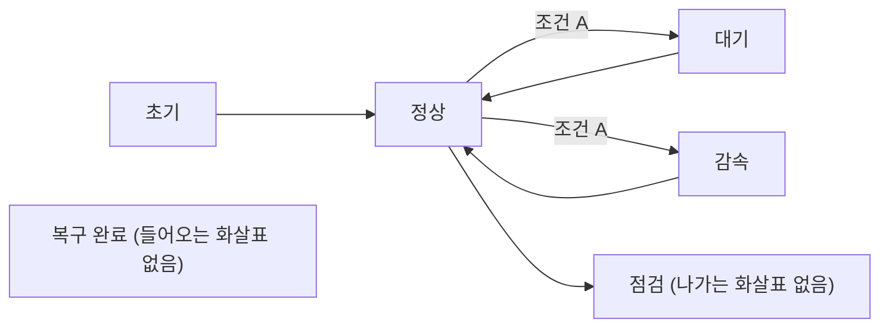

> **기준 출처:** [Eclipse ESCET 코스 2장](https://eclipse.dev/escet/sbe-course/module2/reachability-deadlock-blocking-livelock.html) · [MathWorks Simulink Design Verifier 문서](https://www.mathworks.com/help/sldv/ug/detect-dead-logic.html) · [MathWorks Simulink Coverage 문서](https://www.mathworks.com/help/slcoverage/ug/types-of-model-coverage.html) / 확인일 2026-11-13
> **시리즈:** [목차](/posts/00-multimode-series/) | 이전 → [09. Stateflow 로 모드 표현하기](/posts/09-stateflow-modes/) | 다음 → [11. 고장 모드도 모드다](/posts/11-fault-modes-fdir/)

연속 제어기는 오차, 대역폭, 위상 여유로 잰다. 모드 전환 논리에는 그런 눈금이 없고, 대신 그래프로서 성립하는지를 묻는다. 갈 수 있는가, 나올 수 있는가, 어느 쪽으로 가는가. 09편 끝에서 본 대로 그 답의 일부는 그림 밖의 규칙이 정하므로 눈으로 다 잡히지 않는다. 그래서 이 편은 도구를 든다. 다음 편의 고장 모드는 정의상 거의 실행되지 않는 경로라서, 여기 나오는 검사에 가장 많이 기댄다.

이 편에 나오는 말은 넷이다.

| 용어 | 뜻 |
| --- | --- |
| State, Transition | 그림의 State 와 화살표. 활성인 모드 하나와, 모드를 옮기는 규칙 하나 |
| guard (전이 조건) | 그 Transition 이 가능해지는 조건식 |
| 형식 검증 | 몇 가지 경우를 돌려 보는 대신, 가능한 모든 경우에 대해 성질이 참인지를 수학적으로 판정하는 방식 |
| 반례(counterexample) | 성질이 거짓임을 보이는 구체적인 실행 하나. 형식 검증이 실패했을 때 돌려주는 것 |

## 1. 세 가지 결함

| 결함 | 그림의 예 | 질문 | 검사 수단 |
| --- | --- | --- | --- |
| 도달 불가능 | 복구 완료 | 갈 수 있는가 | 도달성 분석, dead logic 검출 (2절) |
| 봉쇄 | 점검 | 나올 수 있는가 | 비봉쇄 검사 (3절) |
| 비결정성 | 정상에서 같은 조건 A 로 갈리는 두 갈래 | 어느 쪽으로 가는가 | 조건의 배타성, 평가 순서 확인 (4절) |

점검이 marker 가 아니라면 들어간 뒤 일을 마칠 길이 없는 봉쇄 상태다. 셋 다 신호를 아무리 잘 봐도 보이지 않고, 그래프를 훑어야 보인다.

## 2. 도달 불가능 — 그리고 dead logic

ESCET 코스의 정의는 간단하다. 도달 가능한 상태는 그곳에 가는 길이 있는 상태이고, 도달 불가능한 상태는 초기 상태에서 닿을 수 없는 상태다. 상태 공간은 초기 상태에서 시작해 가능한 전이를 따라가며 새 상태를 더하고, 새 상태가 더 나오지 않으면 완성된다. 같은 코스의 퀴즈는 위치가 셋인 오토마톤 셋의 조합이 27개라도 공유 사건의 동기화 때문에 일부는 도달하지 않을 수 있다고 짚는다.

Stateflow 모델에서 이에 해당하는 도구 쪽 개념이 dead logic 이다.

| MathWorks 문서 | 내용 |
| --- | --- |
| 정의 | 시뮬레이션 동안 활성이 될 수 없는 모델 요소 |
| 검출 대상 | 일어날 수 없는 decision coverage 와 condition coverage 결과 |
| 원인 | 경우에 따라 설계 안의 오류에서 생긴다 |
| 분석 모드 | 부분 분석은 active logic 과 미판정 목표를 보고하지 않고 일부 dead logic 을 놓칠 수 있다. 전수 분석은 dead logic 과 함께 active logic 과 미판정 목표도 보고하지만 근사를 쓸 수 있다 |

검출 대상이 coverage 결과라는 점에서 범위가 정해진다. 사람이 눈으로 찾는 것은 대개 들어오는 화살표가 없는 State 인데, 검출 대상은 그보다 넓다. 화살표는 그려져 있는데 그 조건이 참이 되는 경우가 없는 Transition 도 대상에 든다. 예를 들어 한 State 에서 나가는 Transition 의 평가 순서가 1번 `[x >= 0]`, 2번 `[x > 5]` 이면, 2번이 평가되는 것은 1번이 거짓인 `x < 0` 일 때뿐이라 2번의 조건은 평가될 때마다 거짓이다. 그 「참」 결과는 일어날 수 없다. 다만 위 표대로 분석 모드에 따라 놓칠 수 있으므로, 검출 대상이라는 것이 반드시 검출된다는 뜻은 아니다.

dead logic 이 생기는 흔한 원인을 셋으로 나눠 볼 수 있다. 아래 분류는 이 편의 정리다.

| 원인 | 예 |
| --- | --- |
| 앞 조건이 뒤 조건을 덮는다 | 위의 `[x >= 0]` 과 `[x > 5]` |
| 파라미터나 상수 값이 조건을 늘 참(또는 거짓)으로 만든다 | 문턱값이 측정 가능한 범위 밖에 있다 |
| 설계 변경의 잔재 | 없어진 요구에 딸린 분기가 남아 있다 |

세 번째는 지우면 되지만, 앞의 둘은 의도한 동작이 구현되지 않았다는 신호다. 남겨 두는 것 자체에도 비용이 있다. 실행되지 않는 논리는 테스트로 덮이지 않고, 코드로 생성되면 실행되지 않는 코드가 되며, 어느 요구에서 왔는지 설명할 수 없다.

설계 오류 검출은 dead logic 을 정수 오버플로, 0 나눗셈, 배열 범위 초과, 데이터 저장소 접근 위반 등과 함께 아홉 가지 오류 부류 중 하나로 다룬다. 특정 인증 규격이 이 항목을 어떻게 요구하는지는 이 편에서 확인하지 않았다. 도구 사용법은 [Stateflow 22편](/posts/22-sf-formal-verification/)에 있다.

## 3. 빠져나올 수 없음 — deadlock, 봉쇄, livelock

도달성의 반대편 질문이다. 들어간 뒤에 일을 마칠 수 있는가.

| 용어 | ESCET 코스의 정의 | 겉보기 |
| --- | --- | --- |
| deadlock 상태 | 어떤 전이도 가능하지 않아 더 이상 동작이 없는 상태 | 멎어 있다 |
| 봉쇄 상태 | 도달 가능하지만 marker 상태로 가는 전이 열이 없는 상태 | — |
| livelock | 전이는 계속 가능하지만 marker 상태에는 끝내 닿지 못하는 것 | 두 상태를 왕복한다 |

marker 인 deadlock 은 봉쇄가 아니다. deadlock 은 전이가 멈추므로 겉으로 드러나지만, livelock 은 전이가 계속 일어나므로 동작 중인 것처럼 보인다. 그래서 livelock 쪽이 발견하기 더 어렵다. 경계에서 모드가 빠르게 오가는 [04편](/posts/04-chattering-hysteresis-dwell/)의 채터링도 marker 로 가는 길 없이 반복되면 이산 층에서는 livelock 과 같은 모양이 된다.

검사의 원리는 2절의 상태 공간을 다 만든 뒤 각 상태에서 marker 상태로 가는 길이 있는지 보는 것이다. 원리는 단순하고 장벽은 규모다. Ubukata 등은 부품을 합친 전체 상태 공간이 부품 수에 지수로 커지고, 이것이 전통적인 단일 합성의 큰 계산 장벽이라고 적는다. 대응은 모듈별로 나누거나, 전체를 짓지 않고 초기 상태에서부터 필요한 만큼만 넓혀 가는 쪽으로 간다. 감독기 합성의 nonblocking 보장은 [08편](/posts/08-supervisory-control-des/)에서 다뤘다.

2절과 3절을 나란히 놓으면 판단이 하나 남는다(문헌의 문장은 아니다). 빠져나올 수 없는 모드는 잘못 설계해서보다 복귀 조건을 아무도 적지 않아서 생기는 경우가 많다고 본다. 진입 조건은 그 모드가 필요한 이유와 함께 자연스럽게 적히지만, 복귀 조건은 「언제 정상으로 돌아가도 되는가」라는 별도 판단을 요구하기 때문이다.

## 4. 비결정성 — 두 조건이 함께 참일 때

앞의 두 결함은 경로가 없는 경우였고, 이쪽은 경로가 둘인데 규칙이 없는 경우다. ESCET 코스는 비결정성을 한 상태에서 같은 사건에 대해 가능한 전이가 여럿 있는 것으로 정의한다. 다만 두 전이가 같은 상태로 가거나, 두 guard 가 함께 참이 될 수 없으면 비결정적이지 않다고 적는다.

구현은 매 스텝 하나의 답만 낼 수 있으므로 어딘가에서 반드시 정해지고, 정하는 것은 도구다. Stateflow 에서는 한 소스에서 나가는 Transition 에 만든 순서대로 1 부터 번호가 자동으로 붙고, Stateflow 는 이 평가 순서로 각 Transition 을 검사한다. 유효한 Transition 은 조건 라벨이 참이고 경로가 State 에서 끝나는 것이며, 유효하면 소스 State 를 나가 목적지 State 로 들어간다. 그래서 두 조건이 함께 참이면 번호가 앞선 쪽이 실행된다. 번호는 Execution Order 로 바꿀 수 있고, 바꾸면 나머지가 상대 순서를 유지한 채 다시 매겨진다. 같은 문서는 backtracking 도 규정한다. 나가는 Transition 이 모두 무효이거나 terminating junction 으로 끝나지 않으면 이전 State 나 Junction 으로 돌아가 가능한 경로를 다시 평가한다.

| 경우 | 결과를 정하는 것 |
| --- | --- |
| 두 guard 가 함께 참이 될 수 없다 | guard 자체. 순서 번호는 결과에 들어가지 않는다 |
| 함께 참이 될 수 있다 | Transition 의 평가 순서 번호 |
| 앞 번호의 guard 가 뒤 번호의 guard 를 덮는다 | 뒤 Transition 의 참 결과가 일어날 수 없다. 2절의 dead logic 검출 대상이다 |

만든 순서가 동작을 정한다는 점이 위험한 이유는 셋이다.

1. 그림에서 잘 안 보인다. 번호가 표시되긴 하지만 그림을 읽는 사람은 대개 번호보다 화살표를 본다
2. 나중에 추가한 화살표가 순서를 조용히 바꿀 수 있다. 검토를 마친 그림에 Transition 하나를 더 그리는 것만으로 동작이 달라질 수 있다
3. 차이가 드물게만 드러난다. 두 조건이 함께 참이 되는 경우가 드물면 그 드문 경우에만 다르게 동작한다

그래서 처방을 순서대로 시도한다. 아래는 문헌의 권고가 아니라 위 규칙에서 따라 나오는 판단이다.

| 순서 | 처방 | 남는 문제 |
| --- | --- | --- |
| 먼저 | guard 를 서로 배타로 만든다 (`x < 5` / `x >= 5`) | 없다. 순서 규칙이 동작에 영향을 주지 않는다 |
| 다음 | 배타로 못 만들면 순서를 명시하고 이유를 문서에 남긴다 | 사람이 지켜야 한다 |
| 피한다 | 자동으로 매겨진 번호에 기댄다 | 편집할 때마다 바뀔 수 있다 |

## 5. 커버리지 — 무엇을 세는가

얼마나 검사했는지를 수치로 만드는 도구가 커버리지다.

| 지표 | Simulink Coverage 문서의 정의 | 모드 전환으로 옮기면 |
| --- | --- | --- |
| decision | Switch 블록이나 Stateflow State 같은 결정 지점에서, 그 항목을 지나는 전체 경로 중 시뮬레이션이 지난 비율 | 어느 모드에 실제로 들어가 봤는가 |
| condition | 논리 블록의 각 입력과 Stateflow Transition 의 각 조건이 시뮬레이션 중 적어도 한 번 참, 적어도 한 번 거짓이 되었는가 | 각 전이 조건이 켜지고 꺼져 봤는가 |
| MC/DC | 블록은 다른 입력과 무관하게 한 입력의 변화가 출력을 바꾸는가, Transition 은 조건마다 그 조건의 변화가 Transition 을 일으킨 때가 적어도 한 번 있는가 | 복합 조건의 각 항이 결과에 영향을 주는가 |

MC/DC 를 따로 두는 이유는 복합 조건이다. `A && B` 를 참으로 만드는 테스트와 거짓으로 만드는 테스트만 있으면 decision 은 채워질 수 있지만, B 가 결과에 실제로 영향을 주는지는 확인되지 않는다. 조건을 잘못 적어 넣어도 그 테스트는 통과할 수 있다.

문서는 Simulink Coverage 의 MC/DC 가 decision coverage 나 condition coverage 를 완전히 채우지 않을 수 있어서, decision coverage 100% 없이도 MC/DC 100% 가 나올 수 있다고 적는다. 지표 하나로 다른 지표를 대신할 수 없다는 뜻이다.

그리고 decision coverage 의 정의가 「시뮬레이션이 지난 경로의 비율」이므로, 이 수치는 시뮬레이션이 만든 경우만 센다. 여기서 판단이 하나 따라 나온다. 커버리지는 테스트가 그림을 얼마나 훑었는가를 재는 것이지 그림이 맞는가를 재는 것이 아니다. 두 조건이 함께 참인 경우를 만들지 않은 테스트에서는 4절의 순서 문제가 끝내 드러나지 않는다. 도달 불가능한 요소는 채워지지 않는 항목으로 남지만, 그것이 결함인지 테스트가 모자란 것인지는 수치만으로 가려지지 않는다. 지표별 세부는 [Stateflow 21편](/posts/21-sf-coverage/)에 정리되어 있다.

## 6. 속성 증명과 그 결과 읽기

형식 검증과 시뮬레이션은 경쟁하지 않는다. 묻는 질문이 다르다.

Simulink Design Verifier 의 속성 증명은 모델을 형식적으로 분석해 속성을 증명하거나 반증하고, 반증하면 하네스 모델에 반례를 만든다. 반례를 실행해 실패를 재현하고, 모델을 고친 뒤 다시 돌린다. 반례가 곧 재현 시나리오이므로 디버깅에 바로 쓸 수 있다.

| 함정 | 문서의 내용 |
| --- | --- |
| 모순된 가정 | 서로 모순되는 가정을 두지 말라고 적는다. 절대 만족될 수 없는 가정은 분석 전체를 무효로 만들 수 있다 |
| 판정하지 못한 목표 | 설계 오류 검출 결과에는 오류 없음(초록)과 오류 있음(빨강) 외에 판정하지 못함(주황)이 있다. 시간 초과, 자동 스터빙, 분석 엔진의 한계가 원인이다 |

모순된 가정 아래에서는 무엇이든 증명된 것처럼 나온다. 조건을 좁혀 가며 가정을 더하다 보면 실제로 생길 수 있는 일이다. 주황이 남아 있으면 빨강이 0개여도 「오류가 없다」가 아니라 「이 범위에서 찾지 못했다」로 읽어야 한다. 그래서 결과를 읽을 때 판정하지 못한 항목의 수를 함께 본다.

두 방식을 나란히 놓으면 이렇다. 「잘 잡는 것」 아래의 줄은 이 편의 정리다.

| | 형식 검증 | 시뮬레이션 기반 테스트 |
| --- | --- | --- |
| 묻는 것 | 이 성질이 모든 경우에 참인가 | 이 시나리오에서 어떻게 동작하는가 |
| 실패하면 주는 것 | 반례 하나 (하네스 모델) | 파형과 로그 |
| 세는 것 | 증명, 반증, 판정하지 못한 목표 | 시뮬레이션이 지난 경로의 비율 |
| 잘 잡는 것 | 도달 불가능, 봉쇄, 성질 위반, 드물게만 나는 조합 | 타이밍, 연속 동역학과의 상호작용, 성능 |
| 못 하는 것 | 모델 밖의 것 (플랜트의 실제 거동, 실행 시간) | 일어나지 않은 경우. 만들지 않은 시나리오는 검사되지 않는다 |
| 대표 함정 | 모순된 가정, 판정하지 못한 항목을 통과로 읽기 | 커버리지 수치를 품질로 읽기 |

## 7. 정리

- 모드 전환 논리의 결함은 셋이다. 갈 수 없음, 나올 수 없음, 어느 쪽으로 갈지 정해지지 않음. 셋 다 성능이 아니라 그래프의 구조로 잰다
- 도달성은 초기 상태에서 상태 공간을 넓혀 가며 본다. Stateflow 쪽 도구는 일어날 수 없는 coverage 결과를 dead logic 으로 찾고, 덮인 guard 의 참 결과도 검출 대상이다. 다만 부분 분석은 일부를 놓칠 수 있다
- dead logic 의 흔한 원인은 조건 겹침, 파라미터 값, 설계 변경의 잔재다. 앞의 둘은 의도한 동작이 구현되지 않았다는 신호다
- 봉쇄는 marker 로 갈 길이 없는 상태다. marker 인 deadlock 은 봉쇄가 아니고, livelock 은 동작 중처럼 보여 발견이 어렵다. 상태 공간은 부품 수에 지수로 커진다
- 빠져나올 수 없는 모드는 복귀 조건을 적지 않아서 생기는 경우가 많다고 본다
- 비결정성은 같은 사건에 전이가 여럿인 것이다. Stateflow 에서는 Transition 평가 순서 번호가 결과를 정하고, 번호는 만든 순서로 자동으로 붙는다. guard 를 배타로 쓰고, 안 되면 순서를 명시하고 이유를 남긴다
- decision 100% 없이 MC/DC 100% 가 나올 수 있다. 커버리지는 시뮬레이션이 지난 경로만 세고, 훑은 정도이지 맞는지가 아니다
- 속성 증명은 반례를 주지만, 모순된 가정과 판정하지 못한 목표를 함께 읽어야 한다. 시뮬레이션은 만들지 않은 시나리오를 검사하지 못한다

## 참고

- [Eclipse ESCET, Synthesis-Based Engineering 코스 2.1 Reachability, deadlock, blocking and livelock](https://eclipse.dev/escet/sbe-course/module2/reachability-deadlock-blocking-livelock.html)
- [Eclipse ESCET, Synthesis-Based Engineering 코스 2.2 Non-deterministic automata](https://eclipse.dev/escet/sbe-course/module2/non-deterministic-automata.html)
- [Eclipse ESCET, Synthesis-Based Engineering 코스 2.5 Computing state spaces](https://eclipse.dev/escet/sbe-course/module2/computing-state-spaces.html)
- [T. Ubukata 외, Robust Exploration in Directed Controller Synthesis via Reinforcement Learning with Soft Mixture-of-Experts (arXiv:2602.19244)](https://arxiv.org/html/2602.19244)
- [MathWorks, Dead Logic Detection (Simulink Design Verifier)](https://www.mathworks.com/help/sldv/ug/detect-dead-logic.html)
- [MathWorks, What Is Design Error Detection?](https://www.mathworks.com/help/sldv/ug/what-is-design-error-detection.html)
- [MathWorks, Evaluate Transitions (Stateflow)](https://www.mathworks.com/help/stateflow/ug/evaluate-transitions.html)
- [MathWorks, Types of Model Coverage (Simulink Coverage)](https://www.mathworks.com/help/slcoverage/ug/types-of-model-coverage.html)
- [MathWorks, What Is Property Proving?](https://www.mathworks.com/help/sldv/ug/what-is-property-proving.html)
