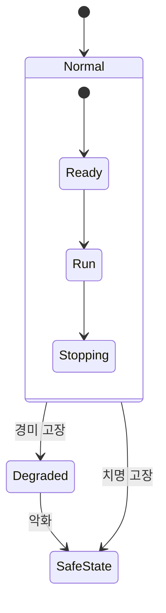

> **기준 출처:** [MathWorks, What Is FDIR?](https://www.mathworks.com/discovery/fdir.html) · [Stolte 외, arXiv:2106.11042](https://arxiv.org/abs/2106.11042) · [Heydari Shahna 외, arXiv:2502.03278](https://arxiv.org/html/2502.03278) / 확인일 2026-11-13
> **시리즈:** [목차](/posts/00-multimode-series/) | 이전 → [10. 모드 전환의 검증](/posts/10-mode-switch-verification/)

고장 대응도 모드 전환이다. 정상 모드에서 고장을 검출하면 다른 모드로 가고, 조건이 맞으면 돌아온다. 그래서 앞 편들의 도구가 그대로 쓰인다. 차이는 둘이다. 고장 경로는 드물게만 실행되어 시뮬레이션으로 잘 밟히지 않으므로 [10편](/posts/10-mode-switch-verification/)의 검사에 가장 많이 기대고, 그 목적지인 안전 상태를 먼저 정의해야 한다.

이 편에 나오는 말은 넷이다.

| 용어 | 뜻 |
| --- | --- |
| 모드 | 그 구간 동안 활성인 제어 법칙 하나 |
| 이중화(redundancy) | 같은 기능을 둘 이상 두어, 하나가 고장 나도 기능이 남게 하는 것 |
| 잔차(residual) | 정상이라면 나왔을 값과 실제 값의 차이. 고장 판정의 재료가 되는 신호 |
| 히스테리시스, 최소 체류시간 | 경계에서 모드가 빠르게 왕복하는 것을 막는 장치. 나갈 조건을 들어올 조건보다 빡빡하게 걸거나, 한 모드에 최소 시간 이상 머물게 한다 ([04편](/posts/04-chattering-hysteresis-dwell/)) |

## 1. FDIR — 검출, 격리, 복구

MathWorks 는 FDIR(fault detection, isolation, and recovery) 로직을 고장에 대해 제어 시스템을 견고하게 만드는 로직으로 설명한다.

| 단계 | MathWorks 의 설명 | 수단의 예 |
| --- | --- | --- |
| 검출 | 센서 고장, 물리 구성 요소의 오작동 같은 고장을 찾는다 | 단순화한 모델의 성능과 실제 거동 비교, 신호가 물리 한계를 넘는지 판정 |
| 격리 | 이상의 원인을 짚고, 검출된 고장의 구체적 성격을 진단한다 | 이중화를 이용해 어느 구성 요소인지 판정 |
| 복구 | 검출된 고장이 있어도 시스템이 불안전한 상태에 들어가지 않게 한다 | 안전 운전 모드로 복귀, 백업 전환, 재구성, 고장 요소 리셋 |

같은 페이지는 Stateflow 로 시스템을 안전 모드에 들어가게 지령해 복구 로직을 구현할 수 있다고 적는다.

로봇 매니퓰레이터의 고장 진단 리뷰(Quamar, Nasir)는 진단을 더 잘게 나눈다. 검출은 오작동이나 고장이 있는지, 격리는 고장 난 구성 요소가 어디인지, 식별(identification)은 고장의 종류와 형태와 크기를 정한다. 진단 뒤 감시 층이 고를 수 있는 조치로는 구동기와 센서 조정으로 고장 신호를 보상하기, 제어기를 미세 조정하거나 재구성하기, 고장 부품을 이중화된 부품으로 바꾸기를 든다. 초기 방식은 예비 모터와 센서 같은 이중화 부품에 기댔고, 대응이 사후적이며 비용과 복잡도가 늘었다고 정리한다.

한 덩어리로 진단이라고 부르지만 셋을 나누는 실익은 얻은 정보에 따라 할 수 있는 대응이 다르다는 데 있다. 아래 대응표는 리뷰의 조치 목록을 정보의 단계에 맞춰 이 편에서 배치한 것이다.

| 여기까지 알았다면 | 할 수 있는 대응 |
| --- | --- |
| 이상이 있다 (검출) | 시스템 전체를 안전한 쪽으로 옮긴다 |
| 어디가 고장인지 안다 (격리) | 그 부분만 떼어 내고 이중화된 쪽으로 갈아탄다 |
| 얼마나, 어떻게 고장인지 안다 (식별) | 남은 구동기와 센서로 보상해 성능을 일부라도 유지한다 |

판정의 재료는 정상 거동과의 차이다. 델타 로봇의 고장 허용 제어 연구(Domínguez, Urrea)는 정상 조건에서 로봇이 지난 경로와 고장 상태에서 지난 경로의 차이를 잔차(residual)라고 부른다. 리뷰는 검출 알고리즘이 미리 정한 문턱이나 기계학습으로 편차를 찾는다고 적고, 모델링 오차가 오경보나 미검출로 이어질 수 있다고 적는다.

잔차 기반 판정이라는 구조에서 따라 나오는 성질이 있다(위 문헌들의 문장은 아니다). 문턱은 양쪽으로 틀린다. 낮게 잡으면 정상인데 고장이라고 하고(오경보), 높게 잡으면 고장인데 못 잡는다(미검출). 오경보로 들어간 안전 모드도 그 자체로 손실이므로, 고장 모드의 진입 조건에는 다른 모드보다 히스테리시스와 확정 지연을 더 세게 거는 경우가 많다고 본다. 판정이 문턱 근처에서 오가면 모드도 따라 오가는데, 이 현상은 [04편](/posts/04-chattering-hysteresis-dwell/)이 다룬다.

## 2. 안전 상태와 고장 허용 방식

Stolte 등은 fail-operational, fail-degraded, fail-safe 같은 말이 자율주행 문헌에서 널리 쓰이지만 정의 없이 쓰이고, 자동차 안전 표준도 대체로 그렇다고 지적한다. 그래서 ISO 26262 와 시스템 공학 용어에 기대어 다섯 용어와 안전 상태를 정의한다.

| 용어 | 정의 (Stolte 외) |
| --- | --- |
| 안전 상태 (safe state) | 시스템이 부당한(unreasonable) 위험을 일으키지 않는 상태 |
| operational | 고장이 없고, 명세된 기능을 공칭 성능 이상으로 내며 안전 상태를 유지한다 |
| fail-operational | 고장 조합이 있어도 명세된 기능을 공칭 성능 이상으로 내며 안전 상태를 유지한다 |
| fail-degraded | 고장 조합이 있을 때 명세된 기능을 공칭 미만의 성능으로 내며 안전 상태를 유지한다 |
| fail-safe | 고장 조합이 있을 때 명세된 기능을 멈추고 잘 정의된 조건으로 옮겨 안전 상태를 유지한다 |
| fail-unsafe | 안전 상태를 유지하지 못한다 |

구분의 기준은 넷이다. 고장이 있는가, 안전 상태를 유지할 수 있는가, 기능을 내는가, 가용 성능이 공칭 성능에 미치는가. 같은 논문이 인용하는 ISO 26262 의 정의에서도 안전 상태는 「고장 시 부당한 위험 수준이 없는 item 의 운전 모드(operating mode)」다. 안전 상태는 규격의 정의로도 모드다.

이 용어들이 정의 없이 쓰이는 경우가 많다는 지적에서, 문서에 쓸 때는 그 문서 안에서 한 번 정의하고 시작하는 편이 안전하다고 본다.

세 방식 중 무엇을 택할지는 제어기가 아니라 위험(hazard)이 정한다. 어울리는 시스템을 판단으로 붙이면 이렇다.

| 방식 | 고장 뒤에 남는 것 | 어울리는 시스템 (판단) |
| --- | --- | --- |
| fail-safe | 기능을 멈추고 잘 정의된 조건으로 간다 | 멈추는 것이 위험을 없애는 시스템 |
| fail-degraded | 기능은 남되 공칭 미만의 성능으로 계속한다 | 즉시 멈출 수 없지만 잠시 버티면 되는 시스템 |
| fail-operational | 공칭 성능 이상으로 기능을 유지한다 | 멈추는 것 자체가 위험한 시스템 |

안전 상태의 정의는 위험으로 되어 있고 정지로 되어 있지 않다. 논문의 자율주행 예에서 fail-safe 동작은 Safe Halt 기능이 맡는다. 정상 주행 기능이 안전 상태를 유지하지 못하면 Safe Halt 가 미리 정한 최소 위험 조건(minimal risk condition)에서 끝나는 최소 위험 기동을 수행한다. 안전 상태에 가는 데에도 동작이 필요한 경우다.

여기서 판단이 하나 나온다(문헌의 주장은 아니다). 「정지」를 안전 상태의 기본값으로 두는 것은 시스템의 성질이 아니라 가정이다. 고정 설비라면 정지가 곧 위험 제거일 수 있다. 그러나 이동 중이거나, 자세를 유지해야 하거나, 외부와 접촉 중인 시스템에서는 정지가 새 위험을 만들 수 있다. fail-operational 이라는 범주가 따로 정의되어 있다는 것이 그런 시스템이 있다는 방증이다. 그래서 설계에서 먼저 적어야 하는 것은 「어떻게 멈출까」가 아니라 「이 시스템에서 안전 상태가 무엇인가」이고, 그것을 적지 못하면 그 아래 전이 논리는 근거가 없다고 본다.

fail-silent 은 이 다섯에 들지 않는다. 논문의 문헌 조사로는 흔히 「고장 시 시스템 출력이 나오지 않음을 보장하는 것」으로 설명되고, 대개 더 큰 시스템의 하위 구성 요소에 쓰이며, 일부 저자는 fail-safe 의 한 형태로 본다.

## 3. 수동 FTC 와 능동 FTC

모드가 생기는지 아닌지가 여기서 갈린다. 중장비 이동 로봇 연구(Heydari Shahna 외)의 정의다. 「대가」 줄은 이 편의 판단이다.

| | 수동(passive) FTC | 능동(active) FTC |
| --- | --- | --- |
| 구조 | 예상되는 고장을 모두 감당하도록 설계한 강인 제어기 하나 | 온라인 진단이 고장을 식별하고 평가한 뒤, 제어기를 동적으로 조정해 안정성과 성능을 유지 |
| 모드 | 제어기가 바뀌지 않는다 | 조정된 제어기가 새 모드가 된다 |
| 시간 | 검출, 진단, 재구성의 지연이 없다 | 그 지연을 진다 |
| 대가 | 상정 범위 전체에 대해 보수적으로 설계하므로 정상 시 성능을 깎는다 | 진단이 필요하고, 진단이 틀리면 잘못된 모드로 간다 |

같은 연구는 가용성(availability)을 목표로 내거는 이유도 적는다. 중장비 이동 로봇은 작업자가 위험 조건에서 완전히 격리되지 않아 더 큰 위험에 노출되므로, 다른 산업 시스템보다 엄격한 안전과 신뢰성 기준을 받는다는 것이다.

논문은 수동 방식이 그 지연을 피한다는 점이 고장 뒤 시스템이 짧은 시간만 안정을 유지할 수 있는 상황에서 결정적이라고 적는다. 이 문장을 뒤집어 읽으면, 능동 방식에서는 검출에서 재구성까지의 시간이 그 여유 안에 들어와야 한다. 그래서 시간 예산을 세우는 것이 설계 항목이 된다. 아래 부등식은 문헌의 식이 아니라 그 문장을 항목별로 풀어 쓴 것이다.

> 검출 지연 + 확정 지연 + 판단과 전환 시간 + 새 모드가 자리 잡는 시간 ≤ 고장 뒤 시스템이 버티는 시간

각 항이 측정 가능한 값이라는 점이 요점이다. 델타 로봇 연구는 재구성 최적화 한 번이 약 0.52 초이고 15 초 궤적 주기의 4% 미만이라는 비율로 실시간 적용성을 논한다. 이 수치는 MATLAB R2023a 시뮬레이션에서 잰 것이다. 숫자 자체보다 비율로 여유를 확인하는 방식이 옮겨 쓸 만하다고 본다.

## 4. 고장 모드를 그리는 자리

고장 모드를 정상 모드와 같은 그림에 그릴지에는 두 압력이 반대로 작용한다. 아래 두 줄과 절충안은 문헌의 권고가 아니라 이 편의 정리다.

| | 이유 |
| --- | --- |
| 같이 그린다 | 고장 대응 Transition 은 거의 모든 정상 모드에서 나간다. 정상 모드가 N 개면 그 Transition 도 N 개가 되고, 규칙이 바뀌면 N 군데를 함께 고쳐야 한다 |
| 따로 그린다 | 고장 모드의 진입 조건은 측정값이 아니라 추정치다. 성격이 다른 것을 같은 층에 섞으면 정상 흐름이 읽히지 않는다 |

[09편](/posts/09-stateflow-modes/)의 계층을 쓰면 첫 번째 압력은 풀린다. 고장 대응 Transition 은 정상 모드를 묶은 상위 State 에서 한 번만 나간다. 아래는 2절의 fail-degraded 와 fail-safe 를 State 로 옮긴 예시다.

정상 모드 셋은 상위 State 안에 묶여 있고, 고장 대응 Transition 은 그 바깥에 등급별로 두 개만 그린다. 두 번째 압력에 대한 절충안은 바깥은 등급으로, 안쪽은 상세로 나누는 것이다. 상위 계층에는 대응 등급(계속, 저하, 안전 상태)만 두어 정상 흐름을 읽을 수 있게 하고, 각 등급 안에서 무엇을 끄고 무엇을 살릴지는 그 안에서 상세화한다. 화살표 수는 계층 덕에 줄고, 정상 그림의 가독성도 지킬 수 있다.

화살표를 나누는 기준의 예로, Heydari Shahna 등은 구동기의 고착(stuck)과 제어 신호 상실을 제어 시스템이 더 이상 동작하지 않는 중대 고장으로 두고, 이때는 운전을 즉시 멈추고 기계적 수리가 필요하다고 적는다. 센서의 고착과 신호 상실은 짧으면 큰 문제 없이 계속 동작할 수 있지만, 지속되면 운전을 멈추고 수리해야 한다고 적는다.

## 5. 복구 — 언제 돌아오는가

FDIR 의 R 은 결정할 것이 많은 단계다. 먼저 문헌에 나오는 복귀 조건이다.

| 복귀 방식 | 문헌의 내용 |
| --- | --- |
| 추가 조치 뒤에만 복귀 | Stolte 등이 인용하는 일부 정의는 fail-safe 시스템이 안전 상태로 간 뒤 그 상태를 유지하고, 외부 리셋 같은 추가 조치가 있어야 벗어난다고 강조한다 |
| 수리 전에는 재개 없음 | 구동기 중대 고장은 기계적 수리가 필요하다 (Heydari Shahna 외) |
| 짧은 고장이면 계속 | 센서 고장이 짧으면 계속 동작할 수 있다 (Heydari Shahna 외) |
| 고장 요소를 리셋하거나 백업으로 전환 | MathWorks 가 드는 복구 기법 |

이것을 복귀 논리의 세 가지 형태로 묶으면 각각의 위험이 보인다. 아래 표는 이 편의 정리다.

| 형태 | 동작 | 위험 |
| --- | --- | --- |
| 자동 복귀 | 고장 조건이 사라지면 스스로 정상으로 | 간헐 고장이면 모드가 왕복한다. 진단이 잡음에 반응하면 그대로 채터링이 된다 |
| 잠금(latch) | 한 번 들어가면 명시적 해제 전까지 유지 | 회복 가능한 고장에서도 가용성을 잃는다 |
| 사람 확인 후 복귀 | 조작자가 원인을 확인하고 해제 | 사람이 있어야 하고, 판단이 느리다 |

자동 복귀를 쓴다면 진입에 걸었던 장치를 복귀에도 걸어야 한다고 본다. 나갈 조건을 들어올 조건보다 빡빡하게 잡는 히스테리시스와, 한 모드에 최소 시간 이상 머물게 하는 최소 체류시간이다. 이 둘이 없으면 1절의 문턱 문제가 그대로 모드 왕복으로 나타난다.

잠금이 맞는 부류도 있다. 위 표의 구동기 중대 고장처럼 기계적 수리가 필요한 고장에서 자동 복귀는 원인이 그대로인 채 다시 시도하는 것과 같다.

복귀 지점을 History Junction 으로 잡으면 돌아오는 것은 직전 활성 substate 다([09편](/posts/09-stateflow-modes/)). 이것을 복구 논의와 겹치면 판단이 둘 나온다. 복귀 지점을 고장 직전 상태로 잡는 것은 편하지만 늘 옳지는 않다. 그리고 그 모드 제어기의 적분 값 같은 연속 상태는 History Junction 과 함께 돌아오지 않으므로, 복귀 순간 그 값을 무엇으로 둘지는 별도 설계 항목이다. 아무것도 정하지 않으면 복귀하는 순간 제어 입력이 계단처럼 바뀔 수 있다. 이 문제는 [06편](/posts/06-state-reset-at-switch/)과 [03편](/posts/03-bumpless-transfer/)의 주제다.

## 6. 고장 목록과 결함 주입

여기까지의 논의는 어떤 고장을 다룰 것인가라는 목록을 전제한다. 그 목록을 만드는 작업에 이름이 있다. 전기 자전거 사례 연구(Bombarda 외)는 FMEA(Failure Modes and Effects Analysis)를 널리 쓰이는 신뢰성 분석 도구로, 잠재적 고장 모드를 찾고 그 원인과 결과를 분석하는 작업으로 설명한다. 같은 연구는 고장을 설계하는 데 필요한 도메인 지식(모터, 배터리)을 얻는 데 든 노력을 사후에 여섯 달로 추정한다. 고장 목록은 저절로 나오지 않는다.

FMEA 와 자주 함께 나오는 FTA(fault tree analysis)는 방향이 반대다. 최상위 위험에서 출발해 그것을 일으키는 원인 조합으로 내려간다. 이 한 줄은 이 편에서 연 문헌으로 확인한 것이 아니라 용어의 위치를 잡기 위한 요약이다.

목록은 시뮬레이션으로 넘긴다. Simulink Fault Analyzer 는 설계를 고치지 않고 결함 주입 시뮬레이션을 수행하고, 그 시뮬레이션을 활용해 FHA 와 FMEA 같은 안전 분석을 할 수 있다고 소개된다. Fault Subsystem 블록에 고장 거동을 모델링하고, 수동으로 주입하거나 조건(conditional)으로 촉발한다. MathWorks 의 FDIR 페이지도 이 도구로 Simulink 신호에 결함을 넣어 FDIR 로직을 시험할 수 있다고 적는다.

설계를 고치지 않는다는 점이 이 방식의 이유다. 고장을 넣어 보려고 모델을 손대면 검증한 것과 실제로 쓰는 것이 달라진다. 드물게만 실행되는 고장 경로를 정적으로 검사하는 방법은 [10편](/posts/10-mode-switch-verification/)에 있다.

## 7. 정리

- FDIR 은 검출, 격리, 복구다. 리뷰 문헌은 진단을 검출, 격리, 식별로 나누고, 진단 뒤의 조치로 보상, 재구성, 교체를 든다. 얻은 정보의 단계마다 할 수 있는 대응이 다르다
- 판정은 정상 거동과의 차이(잔차)와 문턱으로 하고, 모델링 오차는 오경보와 미검출을 만든다. 오경보도 손실이라 고장 진입 조건에는 히스테리시스와 확정 지연을 세게 거는 경우가 많다
- 안전 상태는 부당한 위험이 없는 상태다. fail-operational 은 공칭 성능 이상, fail-degraded 는 공칭 미만으로 기능을 유지하고, fail-safe 는 기능을 멈추고 잘 정의된 조건으로 간다
- ISO 26262 의 정의에서도 안전 상태는 운전 모드이고, 정지가 아니라 위험으로 정의된다. 안전 상태에 가는 데 기동이 필요한 경우도 있다. 「정지」는 기본값이 아니라 가정이다
- 수동 FTC 는 제어기 하나로 버티고, 능동 FTC 는 제어기를 바꾸는 대신 검출, 진단, 재구성의 지연을 진다. 능동 방식은 그 지연의 합이 고장 뒤 버티는 시간 안에 들어와야 한다
- 고장 모드는 계층으로 묶어 공통 Transition 을 하나로 줄이고, 바깥은 대응 등급으로, 안쪽은 상세로 나누는 절충을 쓸 수 있다
- 복귀 조건은 고장마다 다르다. 외부 리셋, 수리, 짧은 고장의 지속 운전이 문헌에 함께 나온다. 자동 복귀를 쓰면 복귀 쪽에도 히스테리시스와 최소 체류시간을 걸고, 연속 상태는 따로 정한다
- 고장 목록은 FMEA 로 만들고 비용이 크다. 목록은 설계를 고치지 않는 결함 주입으로 시험한다

## 참고

- [MathWorks, What Is Fault Detection, Isolation, and Recovery (FDIR)?](https://www.mathworks.com/discovery/fdir.html)
- [M. M. Quamar, A. Nasir, Review on Fault Diagnosis and Fault-Tolerant Control Scheme for Robotic Manipulators (arXiv:2402.02980)](https://ar5iv.labs.arxiv.org/html/2402.02980)
- [C. Domínguez, C. Urrea, Intelligent Fault-Tolerant Control of Delta Robots, Sensors 25(6), 2025 (PMC11946486)](https://pmc.ncbi.nlm.nih.gov/articles/PMC11946486/)
- [T. Stolte 외, A Taxonomy to Unify Fault Tolerance Regimes for Automotive Systems: Defining Fail-Operational, Fail-Degraded, and Fail-Safe (arXiv:2106.11042)](https://arxiv.org/abs/2106.11042)
- [M. Heydari Shahna, P. Mustalahti, J. Mattila, Fault-Tolerant Control for System Availability and Continuous Operation in Heavy-Duty Wheeled Mobile Robots (arXiv:2502.03278)](https://arxiv.org/html/2502.03278)
- [A. Bombarda 외, Failure Modes and Effects Analysis: An Experience from the E-Bike Domain (arXiv:2509.15893)](https://arxiv.org/html/2509.15893)
- [MathWorks, Simulink Fault Analyzer 문서](https://www.mathworks.com/help/fault-analyzer/index.html)
- [MathWorks, Fault Modeling (Simulink Fault Analyzer)](https://www.mathworks.com/help/fault-analyzer/fault-modeling.html)
