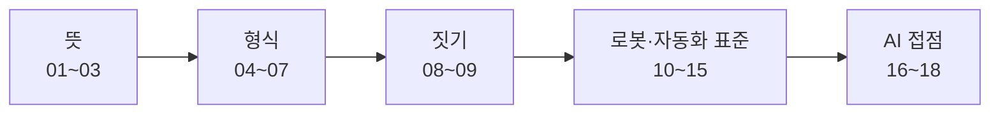

> **기준 출처:** [W3C OWL 2 Primer](https://www.w3.org/TR/owl2-primer/) · [W3C RDF 1.1 Concepts](https://www.w3.org/TR/rdf11-concepts/) · [Gruber, Ontology](https://tomgruber.org/writing/definition-of-ontology.pdf) / 확인일 2026-11-12

## 이 연재가 답하는 질문

요즘 「온톨로지」라는 말은 적어도 세 곳에서 들린다. 논리로 개념을 정의하는 W3C 의 OWL, LLM 에게 붙여 주는 지식그래프, 그리고 데이터 플랫폼이 업무 객체를 묶는 운영 층이다. 같은 말이 같은 것을 가리키는지, 로봇을 만드는 사람에게 어디가 쓸모 있는지를 하나의 자로 재 본다.

## 읽는 순서

### 1부. 뜻 — 무엇을 온톨로지라 부르나

| # | 글 | 무엇을 얻나 |
| --- | --- | --- |
| 01 | [온톨로지란 무엇인가](/posts/01-what-is-ontology/) | 「개념화의 명시적 명세」라는 정의와, 용어집에서 어디부터 온톨로지인지 |
| 02 | [구성 요소](/posts/02-ontology-building-blocks/) | 클래스, 개체, 속성, 공리와 TBox, ABox |
| 03 | [왜 지금 다시 나오나](/posts/03-why-ontology-now/) | 시맨틱 웹부터 LLM 시대까지, 같은 말이 시대마다 가리킨 것 |

### 2부. 형식 — RDF 와 OWL

| # | 글 | 무엇을 얻나 |
| --- | --- | --- |
| 04 | [RDF 트리플](/posts/04-rdf-triples/) | 주어, 술어, 목적어 세 칸과 IRI, Turtle 읽는 법 |
| 05 | [RDFS 와 OWL](/posts/05-rdfs-owl/) | 어휘에서 논리로, OWL 2 의 프로파일 |
| 06 | [**추론과 열린 세계 가정**](/posts/06-reasoning-open-world/) | 「없다」와 「모른다」가 다르다는 것을 실측으로 |
| 07 | [SPARQL, SHACL, 속성 그래프](/posts/07-sparql-shacl-property-graph/) | 묻기와 검사하기, RDF 와 속성 그래프의 차이 |

### 3부. 짓기 — 손으로 만들어 보기

| # | 글 | 무엇을 얻나 |
| --- | --- | --- |
| 08 | [역량 질문부터](/posts/08-competency-questions/) | 범위를 질문으로 정하는 법, 상위 온톨로지 재사용, 흔한 실수 |
| 09 | [**실습 — rdflib 로 로봇 온톨로지 짓기**](/posts/09-rdflib-robot-ontology/) | 65 트리플이 추론 뒤 305 개가 되는 과정과 SHACL 위반 |

### 4부. 로봇과 자동화 표준

| # | 글 | 무엇을 얻나 |
| --- | --- | --- |
| 10 | [IEEE 1872 CORA](/posts/10-ieee-1872-cora/) | 표준이 「로봇」을 장치이자 에이전트로 정의하는 방식 |
| 11 | [KnowRob](/posts/11-knowrob/) | 로봇이 지식을 제어 데이터 구조 아래에서 쓰는 방식 |
| 12 | [SOMA](/posts/12-soma/) | 행동과 작업을 물리 맥락과 사회 맥락으로 나누는 이유 |
| 13 | [OPC UA 정보 모델](/posts/13-opc-ua-information-model/) | 장치가 자기를 서술하는 주소 공간과 로봇 동반 사양 |
| 14 | [AAS 자산관리쉘과 디지털 트윈](/posts/14-aas-digital-twin/) | Submodel 과 semanticId 를 온톨로지의 눈으로 |
| 15 | [**FSM 과 온톨로지**](/posts/15-state-machine-ontology/) | PackML, CiA 402, EtherCAT ESM 을 그래프로 적으면 구조는 담기고 실행 규칙은 빠진다 |

### 5부. AI 와 만나는 곳

| # | 글 | 무엇을 얻나 |
| --- | --- | --- |
| 16 | [지식그래프와 LLM — GraphRAG](/posts/16-knowledge-graph-graphrag/) | LLM 이 뽑은 그래프에 온톨로지가 얼마나 있나 |
| 17 | [Palantir 식 운영 온톨로지](/posts/17-palantir-ontology/) | 객체, 링크, 액션을 OWL 과 나란히 놓기 |
| 18 | [에이전트 도구 스키마는 작은 온톨로지다](/posts/18-tool-schema-ontology/) | MCP 도구 정의를 온톨로지의 자로 재면 빠져 있는 것 |

**급하면** 01, 06, 15, 18 네 편으로 뜻, 열린 세계, 로봇 표준과의 경계, AI 쪽 쓰임을 한 바퀴 돈다.

## 다른 연재와 만나는 곳

- **FSM:** 15편이 다루는 EtherCAT ESM 과 CiA 402 는 통신 연재의 [ESM](/posts/08-esm-state-machine/)과 [CiA 402 드라이브 상태](/posts/13-cia402-drive-state-machine/) 글과 같은 대상이다.
- **에이전트 도구:** 18편의 MCP 도구는 [MCP 기본 요소](/posts/04-mcp-primitives/)와 [MCP 적용법](/posts/03-apply-mcp/)에서 붙이는 쪽을 다룬다.

## 참고

- [W3C OWL 2 Web Ontology Language Primer](https://www.w3.org/TR/owl2-primer/)
- [W3C RDF 1.1 Concepts and Abstract Syntax](https://www.w3.org/TR/rdf11-concepts/)
- [Tom Gruber, Ontology (Encyclopedia of Database Systems)](https://tomgruber.org/writing/definition-of-ontology.pdf)
