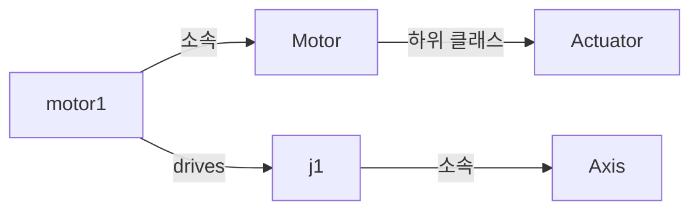

> **기준 출처:** [OWL 2 Primer](https://www.w3.org/TR/owl2-primer/) · [A Description Logic Primer](https://arxiv.org/abs/1201.4089) · [Ontology Development 101](https://protege.stanford.edu/publications/ontology_development/ontology101.pdf) / 확인일 2026-11-12
> **시리즈:** [목차](/posts/00-ontology-series/) | 이전 → [01. 온톨로지란 무엇인가](/posts/01-what-is-ontology/) | 다음 → [03. 왜 지금 다시 나오나](/posts/03-why-ontology-now/)

Gruber(2009)는 온톨로지의 표현 원시어가 대개 클래스(집합), 속성, 관계이고, 그 정의에 뜻과 일관되게 쓰기 위한 제약이 들어 있다고 한다. 이 편은 그 부품을 OWL 2 와 기술 논리(DL)의 이름에 맞춰 늘어놓고 로봇 예로 채운다.

## 1. 네 가지 부품

DL 입문서(Krötzsch 외)는 개념(concept), 역할(role), 개체 이름(individual name)을 두고, 1차 논리로는 각각 단항 술어, 이항 술어, 상수라고 설명한다. OWL 에서는 개념을 클래스, 역할을 속성이라 부른다.

| 이 시리즈 | OWL 2 | DL | 로봇 예 |
| --- | --- | --- | --- |
| 클래스 | Class | concept | `Robot`, `Actuator`, `Motor`, `Axis` |
| 개체 | Individual | individual name | `arm1`, `motor1`, `j1` |
| 객체 속성 | ObjectProperty | role | `hasPart`, `drives` |
| 데이터 속성 | DataProperty | (concrete domain) | `ratedTorqueNm` |
| 공리 | Axiom | axiom | `Motor ⊑ Actuator` |

객체지향의 클래스와 두 군데가 다르다. 클래스는 개체의 집합이어서, OWL 2 Primer 의 말로 소속이 배타적이지 않다. `motor1` 은 `Motor` 이면서 계층과 상관없는 `CatalogItem` 일 수 있다. 그리고 속성은 클래스 안에 들어 있지 않다. `drives` 는 따로 선언하고 어느 클래스와 쓰이는지는 domain 과 range 로 적는다.

## 2. TBox, RBox, ABox

DL 입문서는 공리를 세 묶음으로 나눈다.

| 묶음 | 무엇을 적나 | 로봇 예 |
| --- | --- | --- |
| TBox (terminological) | 개념 사이의 관계 | `Motor ⊑ Actuator` |
| RBox (relational) | 역할의 성질과 역할 사이 관계 | `hasPart` 는 이행적 |
| ABox (assertional) | 이름 붙은 개체의 소속과 관계 | `Motor(motor1)`, `drives(motor1, j1)` |

그림에서 `Motor` 와 `Actuator` 를 잇는 화살표가 TBox, `motor1` 과 `j1` 에서 나가는 화살표가 ABox 다. Ontology 101(Noy, McGuinness)도 온톨로지에 개체를 더한 것을 지식 베이스라 부르며 둘의 경계는 가늘다고 하고, DL 입문서도 논리로는 세 묶음 사이에 원리적인 차이가 없다고 한다. 그래도 나누는 이유는 쓰는 사람이 다르기 때문이다. IEEE 1872-2015 는 로봇과 자동화의 가장 일반적인 개념, 관계, 공리를 정한다고 스스로를 소개한다. 표준이 TBox 를 정하고, 특정 로봇 `arm1` 의 사실은 그 어휘를 쓰는 시스템이 채운다.

## 3. 클래스인가 개체인가

Ontology 101 은 이 결정을 용도에 맡긴다. 지식 베이스에 들어갈 가장 구체적인 항목을 개체로 둔다. 와인과 음식의 궁합만 다루면 특정 와인 상품이 개체지만, 빈티지마다 속성을 적어야 하면 빈티지가 개체가 되고 그 상품은 클래스가 된다. 계층을 이루는 것은 클래스뿐이다.

| 용도 | 「모델 X(6축 로봇)」 | 개체 |
| --- | --- | --- |
| 제품 카탈로그 | 개체 | 모델 X |
| 공장 설비 이력 | 클래스 | 3호기, 4호기 |

## 4. 속성 — 성질 하나가 추론 규칙 하나

OWL 2 Primer 는 속성의 성질을 가족 관계로 보여 준다. 오른쪽 열은 로봇에 옮긴 예다.

| 성질 | 뜻 | Primer 예 | 로봇 예 |
| --- | --- | --- | --- |
| domain, range | 주어와 목적어가 속하는 클래스 | `hasWife`: Man → Woman | `drives`: Actuator → Axis |
| inverse | 방향을 뒤집은 속성 | `hasParent` ↔ `hasChild` | `hasPart` ↔ `isPartOf` |
| symmetric | A→B 이면 B→A | `hasSpouse` | `isConnectedTo` |
| transitive | A→B, B→C 이면 A→C | `hasAncestor` | `hasPart` |
| functional | 주어 하나에 값이 많아야 하나 | `hasHusband` | `mountedOn` (그리퍼 하나는 팔 하나에) |
| inverse functional | 값 하나에 주어가 많아야 하나 | `hasHusband` (남편은 한 사람의 남편) | `drives` (축 하나를 구동하는 모터는 하나) |

`hasPart` 를 이행적이라 하면 `arm1 hasPart gripper1` 과 `gripper1 hasPart fingerL` 에서 적지 않은 `arm1 hasPart fingerL` 이 참이 된다.

domain 과 range 는 검사 규칙이 아니다. Primer 는 domain 이나 range 선언이 지식에 대한 제약이 아니라 추론의 근거라고 경고하고, 나이를 적은 고양이 Felix 가 Person 으로 추론되는 예를 든다. `drives` 의 domain 이 `Actuator` 일 때 `sensor1 drives j1` 을 적으면 오류 대신 `sensor1 : Actuator` 가 나오고, `Sensor` 와 `Actuator` 를 서로소로 선언했을 때에야 모순이 된다. 빠진 값이나 틀린 타입을 거르는 일은 [07편](/posts/07-sparql-shacl-property-graph/)의 SHACL 이 맡는다.

## 5. 공리로 클래스를 정의한다

이름만 있는 클래스도 있고 다른 클래스와 속성으로 정의한 클래스도 있다. Primer 의 예를 DL 표기로 옮기면 이렇다.

| 공리 | Primer 예 | 뜻 |
| --- | --- | --- |
| 하위 클래스 | `Woman ⊑ Person` | 모든 Woman 은 Person |
| 서로소 | `Woman`, `Man` | 둘 다인 개체는 없다 |
| 교집합 | `Mother ≡ Woman ⊓ Parent` | 둘 다 |
| 존재 제약 | `Parent ≡ ∃hasChild.Person` | Person 인 자식이 적어도 하나 |
| 전칭 제약 | `HappyPerson ≡ ∀hasChild.HappyPerson` | 자식이 모두 HappyPerson |
| 기수 제약 | `(≤4 hasChild.Parent)(John)` | Parent 인 자식이 많아야 넷 |

`SixAxisRobot ≡ Robot ⊓ (=6 hasAxis.Axis)` 로 정의하면 추론기가 소속을 찾아 줄 것 같지만 그렇게 간단하지 않다. DL 입문서의 예로, Julia 의 자식이 적어도 셋이라는 공리와 자식으로 John 하나만 적힌 사실은 모순이 아니다. 이름 없는 자식이 있는 세계도 공리를 만족한다. 같은 이유로 축을 여섯 개 적어도 일곱 번째 축이 없다는 보장은 없고, Primer 에 따르면 OWL 은 이름이 다르면 다른 것이라고 가정하지도 않는다. [05편](/posts/05-rdfs-owl/)과 [06편](/posts/06-reasoning-open-world/)에서 다시 본다.

## 6. 흔한 실수 둘

Ontology 101 에서 클래스 계층은 is-a 관계다. A 의 모든 개체가 B 의 개체여야 하고, 「A 는 B 의 일종(kind of)」으로 읽혀야 한다.

| 실수 | Ontology 101 의 예 | 로봇에서 |
| --- | --- | --- |
| 부분 관계를 is-a 로 적는다 | Alsace 는 France 의 하위 클래스가 아니다. Alsace 지역이 프랑스 지역의 일종이다 | `Gripper ⊑ Robot` 은 틀렸다. 그리퍼는 로봇의 일부이므로 `hasPart` 로 적는다 |
| 이름을 클래스로 만든다 | 클래스는 개념을 나타낸다. 동의어 Shrimp 와 Prawn 은 클래스 하나다 | 「서보모터」와 「servo motor」는 클래스 하나에 이름 둘 |

그리퍼 하나를 집어 들고 「이것이 로봇인가」 물어서 아니라면 is-a 가 아니다. 계층을 짓는 나머지 지침은 [08편](/posts/08-competency-questions/)에서 본다.

## 7. 정리

- 부품은 클래스(개체의 집합), 개체, 속성, 공리다. 한 개체가 여러 클래스에 속하고 속성은 클래스 밖에 있다
- 공리는 TBox(개념 관계), RBox(역할 성질), ABox(개체 사실)로 나뉜다. 표준은 대개 TBox 를 정한다
- 속성 성질 하나가 추론 규칙 하나다. domain 과 range 는 검사가 아니라 추론이다
- is-a 는 「~의 일종」이다. 부분 관계는 속성으로 적는다

## 참고

- [T. Gruber, Ontology, Encyclopedia of Database Systems, Springer, 2009](https://tomgruber.org/writing/definition-of-ontology.pdf)
- [W3C, OWL 2 Web Ontology Language Primer (Second Edition), 2012](https://www.w3.org/TR/owl2-primer/)
- [M. Krötzsch, F. Simančík, I. Horrocks, A Description Logic Primer, arXiv:1201.4089](https://arxiv.org/abs/1201.4089)
- [N. F. Noy, D. L. McGuinness, Ontology Development 101: A Guide to Creating Your First Ontology](https://protege.stanford.edu/publications/ontology_development/ontology101.pdf)
- [IEEE SA, IEEE 1872-2015 Standard Ontologies for Robotics and Automation](https://standards.ieee.org/standard/1872-2015.html)
