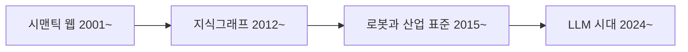

> **기준 출처:** [Gruber, Ontology (2009)](https://tomgruber.org/writing/definition-of-ontology.pdf) · [Hogan 외, Knowledge Graphs](https://arxiv.org/abs/2003.02320) · [Microsoft Research, GraphRAG](https://www.microsoft.com/en-us/research/blog/graphrag-unlocking-llm-discovery-on-narrative-private-data/) · [Palantir, Ontology overview](https://www.palantir.com/docs/foundry/ontology/overview) / 확인일 2026-11-12
> **시리즈:** [목차](/posts/00-ontology-series/) | 이전 → [02. 구성 요소](/posts/02-ontology-building-blocks/) | 다음 → [04. RDF 트리플](/posts/04-rdf-triples/)

온톨로지는 시맨틱 웹 때 이미 나온 말인데 2024년 이후 LLM, 기업 데이터 플랫폼, 로봇 표준 쪽에서 다시 들린다. 흐름마다 가리키는 물건이 달랐다. 이 편은 그 흐름을 연도순으로 놓고, 지금 듣는 「온톨로지」가 어느 뜻인지 가르는 질문 둘을 만든다.

## 1. 시맨틱 웹 — 기계가 읽는 웹

Gruber(2009)에 따르면 시맨틱 웹 표준 스택에서 온톨로지는 명시적인 층이다. 2001년 5월 Scientific American 의 「The Semantic Web」(Berners-Lee, Hendler, Lassila)은 컴퓨터에 의미가 있는 웹 콘텐츠가 새 가능성을 열 것이라는 부제를 달았고, 이후 W3C 표준이 차례로 나왔다.

| 표준 | W3C Recommendation | 이 시리즈 |
| --- | --- | --- |
| OWL | 2004-02-10 | 05편 |
| SPARQL | 2008-01-15 | 07편 |
| OWL 2 | 2009-10-27 (2판 2012-12-11) | 05편 |
| RDF 1.1 | 2014-02-25 | 04편 |
| SHACL | 2017-07-20 | 07편 |

이 흐름의 온톨로지는 논리로 적은 공유 어휘다. OWL 2 의 Direct Semantics 는 기술 논리 SROIQ 와 맞물려 있고, 추론기가 적지 않은 사실을 끌어낸다. 01편 스펙트럼의 오른쪽 끝이다.

## 2. 지식그래프 — 문자열이 아니라 사물

2012년 5월 16일 Google 이 「things, not strings」라는 제목으로 Knowledge Graph 를 발표했다. 검색어를 글자가 아니라 실제 세계의 사물로 이해하겠다는 뜻이고, 발표 당시 5억 개가 넘는 객체와 35억 개가 넘는 사실과 관계를 담았다.

Hogan 등의 서베이(ACM Computing Surveys, 2021)는 지금 쓰는 「knowledge graph」라는 말이 이 발표에서 비롯됐다고 정리하고, 데이터 모델로 RDF 같은 방향 간선 라벨 그래프와 Neo4j 같은 그래프 DB 의 속성 그래프를 든다. 여기서 온톨로지의 자리가 바뀐다. 중심은 사실의 그래프이고, 서베이는 온톨로지와 규칙을 노드와 간선에 붙은 용어의 뜻을 정의하고 추론하는 데 「쓸 수 있는」 수단으로 둔다. 서베이가 소개하는 Freebase 는 논리적 일관성을 강제하지 않는 느슨한 타입 체계를 택했다. 지식그래프와 온톨로지가 같은 말이 아닌 이유다. [07편](/posts/07-sparql-shacl-property-graph/)과 [16편](/posts/16-knowledge-graph-graphrag/)에서 다시 본다.

## 3. 로봇과 산업 표준 — 제조사를 넘는 공통 어휘

| 표준 | 발행 | 공개 페이지가 밝히는 범위 |
| --- | --- | --- |
| IEEE 1872-2015 | 2015-04-10 | 로봇과 자동화의 가장 일반적인 개념, 관계, 공리를 정하는 온톨로지 CORA |
| IEEE 1872.2-2021 | 2022-05-12 | 1872-2015 를 확장해 자율 로봇의 개념, 정의, 공리를 더한다 |
| OPC 40010-1 | v1.02, 2025-09-08 | OPC UA for Robotics, Part 1: Vertical Integration |
| IEC 63278-1:2023 | 2023-12-14 | 자산의 디지털 모델인 자산관리쉘(AAS)의 구조 |

Schlenoff 의 2019년 발표는 IEEE 1872 를 IEEE RAS 의 첫 온톨로지 기반 표준으로 소개한다. 워킹그룹은 자연어 정의를 합의로 먼저 정한 뒤 1차 논리 기반 정의를 만들었고, SUMO 상위 온톨로지에서 내려오는 방식으로 지었다. OPC UA 와 AAS 가 01편의 자에서 어디에 서는지는 [13편](/posts/13-opc-ua-information-model/)과 [14편](/posts/14-aas-digital-twin/)에서 잰다.

> IEEE SA 의 IEEE 1872-2015 페이지는 확인일 기준으로 이 표준을 Inactive-Reserved(2026-03-26)로 표시한다.
{: .prompt-warning }

## 4. LLM 시대 — 그래프를 만드는 LLM, 운영 층이 된 온톨로지

2024년 2월 13일 Microsoft Research 는 GraphRAG 를 소개하며, 기본 RAG 가 흩어진 정보를 공유 속성으로 이어야 하는 질문과 큰 데이터 모음 전체를 요약해야 하는 요청에 약하다고 썼다. GraphRAG 는 LLM 으로 데이터셋에서 지식그래프를 뽑고, 그래프를 계층으로 묶어 미리 만든 요약과 함께 질의 때 맥락으로 준다. 온톨로지가 여기에 어떻게 끼는지는 [16편](/posts/16-knowledge-graph-graphrag/)에서 본다.

Palantir 는 자사 플랫폼의 한 층을 Ontology 라 부르고, 공개 문서에서 디지털 자산을 실제 세계의 대응물과 잇는 조직의 운영 층(operational layer)이라 정의한다. 구성은 의미 요소(객체, 속성, 링크)와 운동 요소(액션, 함수, 동적 보안)다. 개요 문서에는 추론기나 공리 이야기가 없다. [17편](/posts/17-palantir-ontology/)에서 자세히 본다.

## 5. 지금 듣는 「온톨로지」를 가르는 질문 둘

물을 것은 둘이다. 어휘의 뜻이 OWL 같은 형식 언어의 공리로 적혀 있는가, 그 공리에서 적지 않은 사실을 끌어내는 엔진이 있는가.

| 쓰임 | 가리키는 것 | 두 질문에 대해 | 다루는 편 |
| --- | --- | --- | --- |
| 형식 온톨로지 | 논리로 적은 공유 어휘 | 둘 다 전제한다 | 04~07 |
| 지식그래프 | 사실의 그래프와 용어의 뜻 | 쓸 수도 있고 안 쓸 수도 있다 | 07, 16 |
| 로봇과 산업 표준 | 제조사를 넘는 공통 어휘 | IEEE 1872 는 1차 논리 정의를 갖춘다. 나머지는 각 편에서 | 10~15 |
| Palantir 식 운영 층 | 조직의 객체, 링크, 액션 | 개요 문서는 추론을 말하지 않는다 | 17 |

## 6. 정리

- 시맨틱 웹의 온톨로지는 논리로 적은 공유 어휘이고, 지식그래프에서는 용어의 뜻을 정하는 선택 수단이다
- 로봇과 자동화 쪽은 2015년 IEEE 1872 를 시작으로 공통 어휘를 표준으로 냈다
- 2024년 이후 GraphRAG 는 LLM 으로 그래프를 만들고, Palantir 는 운영 층을 Ontology 라 부른다
- 뜻이 논리로 적혀 있는가, 그것으로 추론하는 엔진이 있는가를 물으면 어느 뜻인지 갈린다

## 참고

- [T. Gruber, Ontology, Encyclopedia of Database Systems, 2009](https://tomgruber.org/writing/definition-of-ontology.pdf)
- [T. Berners-Lee, J. Hendler, O. Lassila, The Semantic Web, Scientific American, 2001](https://www.scientificamerican.com/article/the-semantic-web/)
- W3C: [OWL (2004)](https://www.w3.org/TR/owl-features/) · [SPARQL (2008)](https://www.w3.org/TR/rdf-sparql-query/) · [OWL 2 Overview](https://www.w3.org/TR/owl2-overview/) · [RDF 1.1 Concepts](https://www.w3.org/TR/rdf11-concepts/) · [SHACL](https://www.w3.org/TR/shacl/)
- [A. Singhal, Introducing the Knowledge Graph: things, not strings, Google, 2012](https://blog.google/products-and-platforms/products/search/introducing-knowledge-graph-things-not/)
- [A. Hogan 외, Knowledge Graphs, ACM Computing Surveys 54(4), 2021](https://arxiv.org/abs/2003.02320)
- [IEEE 1872-2015](https://standards.ieee.org/standard/1872-2015.html) · [IEEE 1872.2-2021](https://standards.ieee.org/standard/1872_2-2021.html)
- [C. Schlenoff, Structure of the IEEE Robotics and Automation Ontologies, 2019](https://www.ieee-ras.org/images/Standards_strategy_Meeting_19_May_2019/1b-Schlenoff-CORA.pdf)
- [OPC 40010-1 OPC UA for Robotics Part 1](https://reference.opcfoundation.org/Robotics/v100/docs/)
- [IEC 63278-1:2023 Asset Administration Shell, Part 1](https://webstore.iec.ch/en/publication/65628)
- [Microsoft Research, GraphRAG, 2024](https://www.microsoft.com/en-us/research/blog/graphrag-unlocking-llm-discovery-on-narrative-private-data/)
- [Palantir, Ontology overview](https://www.palantir.com/docs/foundry/ontology/overview)
