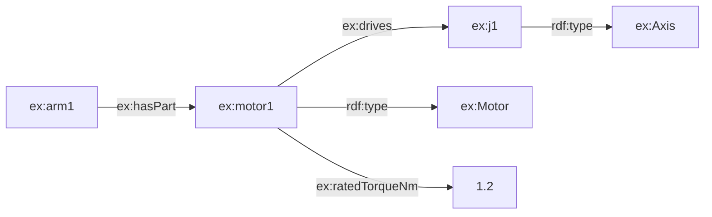

> **기준 출처:** [RDF 1.1 Primer](https://www.w3.org/TR/rdf11-primer/) · [RDF 1.1 Concepts and Abstract Syntax](https://www.w3.org/TR/rdf11-concepts/) · [RDF 1.1 Turtle](https://www.w3.org/TR/turtle/) / 확인일 2026-11-12
> **시리즈:** [목차](/posts/00-ontology-series/) | 이전 → [03. 왜 지금 다시 나오나](/posts/03-why-ontology-now/) | 다음 → [05. RDFS 와 OWL](/posts/05-rdfs-owl/)

02편의 부품을 기계가 읽는 모양으로 적으려면 바닥 데이터 모델이 있어야 한다. W3C 의 RDF(Resource Description Framework)가 그것이다. RDF 1.1 Primer 는 RDF 의 목적을 응용 프로그램 사이에서 뜻을 잃지 않고 정보를 주고받는 것이라고 쓴다. 이 편은 RDF 의 단위인 트리플을 보고, 다음 편은 그 위에 RDFS 와 OWL 을 얹는다.

## 1. 세 칸 — 주어, 술어, 목적어

Primer 에 따르면 RDF 문장 하나는 두 자원 사이의 관계를 나타낸다. 주어와 목적어가 관계를 맺는 두 자원이고 술어가 관계의 성격이다. RDF 1.1 Concepts 는 각 칸에 올 수 있는 것을 정한다.

| 칸 | 올 수 있는 것 | 로봇 예 |
| --- | --- | --- |
| 주어 | IRI, 빈 노드 | `ex:motor1` |
| 술어 | IRI | `ex:drives` |
| 목적어 | IRI, 빈 노드, 리터럴 | `ex:j1`, `"1.2"^^xsd:decimal` |

「motor1 은 j1 을 구동하고, 정격 토크가 1.2 N·m 이고, Motor 다」는 Turtle 로 트리플 셋이다.

```turtle
@prefix ex:  <http://example.org/robot#> .
@prefix xsd: <http://www.w3.org/2001/XMLSchema#> .

ex:motor1  ex:drives         ex:j1 .
ex:motor1  ex:ratedTorqueNm  "1.2"^^xsd:decimal .
ex:motor1  a                 ex:Motor .
```

Turtle 규격에서 술어 자리의 `a` 는 `rdf:type` 을 줄인 것이다. 그래서 「motor1 은 Motor 다」라는 클래스 소속도 트리플이다. 05편에서 볼 「Motor 는 Actuator 의 하위 클래스다」도 `ex:Motor rdfs:subClassOf ex:Actuator` 라는 트리플이다. 02편의 TBox 와 ABox 가 같은 데이터 모델 위에 놓이고, 둘을 가르는 것은 술어다.

## 2. IRI — 전 세계에서 하나인 이름

술어는 늘, 주어와 목적어는 대개 IRI(Internationalized Resource Identifier)다. Primer 는 IRI 가 전역 식별자이므로 다른 사람이 같은 IRI 를 다시 써서 같은 것을 가리킬 수 있다고 하고, 새 IRI 를 지어내기보다 남의 IRI 를 재사용하라고 권한다.

| | C 의 `enum` 값 | IRI |
| --- | --- | --- |
| 유효 범위 | 그 프로그램 | 전역 |
| 같은 이름 충돌 | 프로그램마다 따로 정의 | 네임스페이스로 구분 |
| 줄여 쓰기 | — | `@prefix ex: <…#>` 뒤 `ex:Motor` |

`MOTOR = 3` 은 그 프로그램 안에서만 뜻이 있다. `http://example.org/robot#Motor` 를 두 조직이 함께 쓰면 같은 개념을 말하는 것이 된다. 표준 온톨로지를 재사용하는 일이 이 성질 위에 선다. 웹 주소는 IRI 의 한 형태일 뿐이고, Primer 는 위치나 접근 방법을 함축하지 않는 IRI 형태도 있다고 쓴다. 이 시리즈 예제의 네임스페이스는 예시용으로 정한 `http://example.org/robot#` 이다.

## 3. 리터럴 — 값은 타입까지 포함한다

리터럴은 문자열, 숫자, 날짜 같은 값이다. Primer 의 규칙으로 리터럴은 목적어 자리에만 온다. RDF 1.1 Concepts 에 따르면 리터럴은 어휘 형태(lexical form), 데이터타입 IRI, 그리고 데이터타입이 `rdf:langString` 일 때만 붙는 언어 태그로 이뤄진다.

```turtle
@prefix rdfs: <http://www.w3.org/2000/01/rdf-schema#> .

ex:motor1 ex:ratedTorqueNm "1.2"^^xsd:decimal .
ex:motor1 rdfs:label "모터 1"@ko , "motor 1"@en .
```

두 리터럴은 어휘 형태, 데이터타입 IRI, 언어 태그가 글자 하나까지 같을 때만 같은 리터럴이다. Concepts 의 예로 `"1"^^xsd:integer` 와 `"01"^^xsd:integer` 는 같은 값을 나타내지만 같은 RDF 항은 아니다. 값을 비교하거나 검사할 때 이 차이가 드러난다.

## 4. 빈 노드 — 이름 없는 자원

Primer 는 빈 노드(blank node)를 대수의 변수에 빗댄다. 무언가가 있다고 말하되 그것이 무엇인지는 말하지 않는다. 주어와 목적어 자리에 올 수 있다. 묶음 하나를 가리키고 싶지만 그 묶음에 IRI 를 줄 이유가 없을 때 쓴다.

```turtle
ex:motor1 ex:ratedCondition [ ex:temperatureC 25 ; ex:voltageV 48 ] .
```

대괄호가 빈 노드다. Turtle 규격은 대괄호 안에 술어와 목적어를 늘어놓는 것을 한 노드의 속성들을 적는 흔한 관용구라고 설명한다. [07편](/posts/07-sparql-shacl-property-graph/)의 SHACL 형상 정의에서 이 문법이 계속 나온다.

## 5. 트리플 뭉치는 그래프다

Primer 는 같은 자원이 여러 트리플에서 참조되는 일이 잦아서 트리플을 연결된 그래프로 그릴 수 있다고 쓰고, Concepts 는 RDF 그래프를 트리플의 집합으로 정의한다. 위 트리플에 로봇과 축의 클래스를 보태면 이렇다.



노드는 주어와 목적어, 간선은 술어다. 그래프라서 얻는 것이 둘 있다. 테이블에 열을 추가하는 것처럼 스키마를 먼저 고치지 않고 트리플을 더 붙일 수 있고, 「arm1 의 부품 가운데 축을 구동하는 것」처럼 간선을 따라가는 경로로 물을 수 있다. 이 경로 질의가 07편의 SPARQL 이다.

## 6. 직렬화 — 같은 그래프, 다른 글자

Primer 는 Turtle 계열(N-Triples, Turtle, TriG, N-Quads), JSON-LD, RDFa, RDF/XML 을 소개하며, 같은 그래프를 다르게 적어도 추상 문법의 관점에서는 정확히 같은 트리플이 된다고 쓴다. 파일 형식은 겉모양이고 그래프가 내용이다.

| 형식 | 특징 |
| --- | --- |
| Turtle | 사람이 읽고 쓰기 좋다. 이 시리즈의 예제 형식 |
| N-Triples | 한 줄에 트리플 하나. 줄임이 없다 |
| JSON-LD | JSON 안에 RDF 를 담는다 |
| RDF/XML | XML 로 적는다 |

Turtle 의 줄임 넷만 알면 대부분 읽힌다.

```turtle
@prefix ex: <http://example.org/robot#> .   # 접두어 선언
ex:motor1 a ex:Motor ;                           # a = rdf:type, ';' 같은 주어
      ex:drives ex:j1 ;
      ex:hasTag "A" , "B" .                  # ',' 같은 주어와 술어
```

규격의 설명으로 `;` 는 술어와 목적어만 다른 트리플에서 주어를 되풀이하고, `,` 는 목적어만 다른 트리플에서 주어와 술어를 되풀이한다.

## 7. 정리

- RDF 의 단위는 트리플(주어, 술어, 목적어)이다. 술어는 늘 IRI, 리터럴은 목적어 자리에만 온다
- 클래스 소속(`rdf:type`)도 하위 클래스(`rdfs:subClassOf`)도 트리플이다. TBox 와 ABox 가 같은 모델 위에 있다
- IRI 는 전역 식별자다. 같은 IRI 를 쓰면 같은 것을 가리킨다
- 리터럴은 어휘 형태와 데이터타입까지 같아야 같은 리터럴이다. 이름 없는 묶음은 빈 노드로 적는다
- 트리플 뭉치는 그래프다. 직렬화가 달라도 같은 그래프다

## 참고

- [W3C, RDF 1.1 Primer, 2014](https://www.w3.org/TR/rdf11-primer/)
- [W3C, RDF 1.1 Concepts and Abstract Syntax, 2014](https://www.w3.org/TR/rdf11-concepts/)
- [W3C, RDF 1.1 Turtle, 2014](https://www.w3.org/TR/turtle/)
