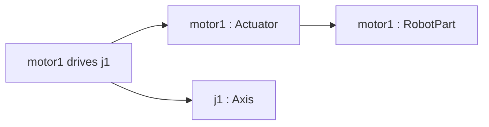
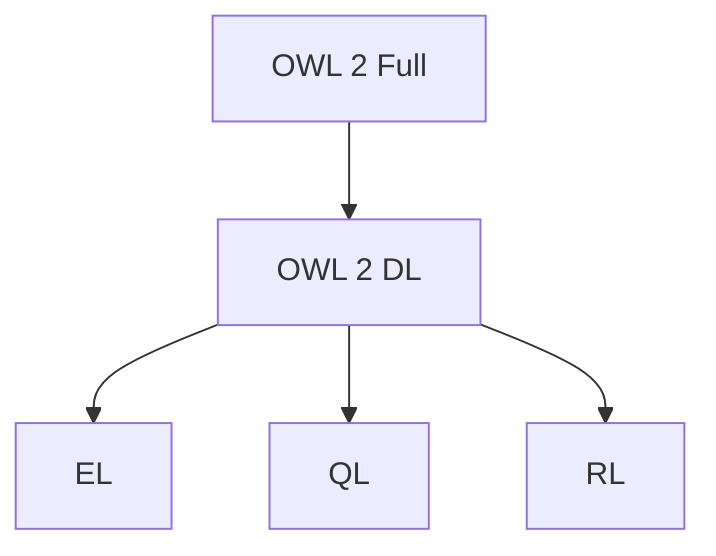

> **기준 출처:** [RDF Schema 1.1](https://www.w3.org/TR/rdf-schema/) · [OWL 2 Primer](https://www.w3.org/TR/owl2-primer/) · [OWL 2 Overview](https://www.w3.org/TR/owl2-overview/) · [OWL 2 Profiles](https://www.w3.org/TR/owl2-profiles/) / 확인일 2026-11-12
> **시리즈:** [목차](/posts/00-ontology-series/) | 이전 → [04. RDF 트리플](/posts/04-rdf-triples/) | 다음 → [06. 추론과 열린 세계 가정](/posts/06-reasoning-open-world/)

04편의 트리플은 사실을 적는 모양만 정한다. 「Motor 는 Actuator 의 일종이다」 같은 낱말의 뜻은 그 위에 얹는 어휘가 적는다. 어휘가 둘 있다. 술어 몇 개짜리 RDFS 와, 거기에 논리를 더한 OWL 이다.

## 1. RDFS — 술어 몇 개로 만드는 사전

RDF Schema 1.1 은 RDFS 를 RDF 의 의미 확장으로, 관련 자원의 묶음과 그 사이 관계를 기술하는 수단으로 소개한다. 규격의 정의를 추론 규칙으로 옮기면 이렇다.

| 술어 | 규격의 정의 | 끌어내는 것 |
| --- | --- | --- |
| `rdfs:subClassOf` | 한 클래스의 모든 개체가 다른 클래스의 개체다. 이행적이다 | `x : A`, `A ⊑ B` 이면 `x : B` |
| `rdfs:subPropertyOf` | 한 속성으로 이어진 자원은 다른 속성으로도 이어진다 | `x p y`, `p ⊑ q` 이면 `x q y` |
| `rdfs:domain` | 술어가 P 인 트리플의 주어는 클래스 C 의 개체다 | `x p y` 이면 `x : C` |
| `rdfs:range` | 술어가 P 인 트리플의 목적어는 클래스 C 의 개체다 | `x p y` 이면 `y : C` |
| `rdfs:label`, `rdfs:comment` | 사람이 읽는 이름과 설명 | 없음 |

로봇 TBox 의 뼈대는 RDFS 만으로 적힌다.

```turtle
ex:Actuator rdfs:subClassOf ex:RobotPart .
ex:Motor    rdfs:subClassOf ex:Actuator .
ex:drives   rdfs:domain ex:Actuator ;
            rdfs:range  ex:Axis .

ex:motor1 ex:drives ex:j1 .        # 사실은 이 한 줄
```



적은 사실은 한 줄인데 `motor1 : Actuator` 는 domain 에서, `motor1 : RobotPart` 는 하위 클래스에서, `j1 : Axis` 는 range 에서 나온다. 01편 스펙트럼의 「엄격한 하위 클래스」가 시작되는 자리가 `rdfs:subClassOf` 다.

RDFS 어휘에는 없는 것도 분명하다. 「Motor 와 Sensor 는 서로소다」, 「hasPart 는 이행적이다」, 「hasPart 의 역은 isPartOf 다」, 「축이 정확히 여섯 개다」를 적을 술어가 없다.

## 2. OWL 이 더하는 것

OWL 2 Primer 는 OWL 2 를 뜻이 형식적으로 정의된 온톨로지 언어로 소개하고, OWL 로 적은 지식은 프로그램이 추론할 수 있다고 쓴다. RDFS 에 없던 것을 OWL 2 Quick Reference 의 Turtle 형태로 보면 이렇다.

```turtle
# 속성의 성질
ex:hasPart  a owl:ObjectProperty , owl:TransitiveProperty ;
            owl:inverseOf ex:isPartOf .
ex:mountedOn a owl:ObjectProperty , owl:FunctionalProperty .

# 클래스 사이의 관계
ex:Sensor owl:disjointWith ex:Actuator .
```

| 클래스 식 | Turtle | 뜻 |
| --- | --- | --- |
| 교집합 | `owl:intersectionOf ( C1 C2 )` | 둘 다 |
| 합집합 | `owl:unionOf ( C1 C2 )` | 적어도 하나 |
| 여집합 | `owl:complementOf C` | C 가 아닌 것 |
| 존재 제약 | `owl:someValuesFrom C` | 값 가운데 C 가 적어도 하나 |
| 전칭 제약 | `owl:allValuesFrom C` | 값이 모두 C |
| 기수 제약 | `owl:qualifiedCardinality n ; owl:onClass C` | C 인 값이 정확히 n 개 |

클래스 식으로 「6축 로봇」을 정의할 수 있다.

```turtle
ex:SixAxisRobot owl:equivalentClass [
    owl:intersectionOf ( ex:Robot
        [ a owl:Restriction ; owl:onProperty ex:hasAxis ;
          owl:qualifiedCardinality 6 ; owl:onClass ex:Axis ] ) ] .
```

개수를 세는 속성이 이행적인 `hasPart` 가 아니라 따로 둔 `hasAxis` 인 이유가 있다. OWL 2 Overview 가 드는 OWL 2 DL 의 문법 조건 하나가 「이행 속성은 개수 제한에 쓸 수 없다」이다.

개체의 동일성도 다룬다. Primer 에 따르면 OWL 은 이름이 다르면 다른 개체라고 가정하지 않는다. 그래서 같음은 `owl:sameAs`, 다름은 `owl:differentFrom` 으로 적고, 셋 이상이 서로 다르다는 것은 `owl:AllDifferent` 와 `owl:members` 로 적는다. 다른 조직이 같은 로봇에 다른 IRI 를 붙였으면 `sameAs` 로 합치고, 적어 둔 축 여섯 개가 서로 다른 축임을 추론기에 알리려면 `AllDifferent` 가 필요하다. 이 문제는 [06편](/posts/06-reasoning-open-world/)에서 이어진다.

## 3. 왜 「논리」인가 — 문법 여럿, 의미론 둘

OWL 2 Overview 는 언어를 문법과 의미론으로 나눈다. 문법은 RDF/XML 이 모든 OWL 2 도구가 지원해야 하는 유일한 형식이고, Functional-Style, Manchester, OWL/XML, Turtle 은 선택이다. 의미론은 둘이다.

| 의미론 | 대상 | 내용 |
| --- | --- | --- |
| Direct Semantics | OWL 2 DL | 기술 논리 SROIQ 의 모델 이론 의미론과 맞물린다. 일정한 문법 조건을 지킨 온톨로지만 해당한다 |
| RDF-Based Semantics | OWL 2 Full | RDF 그래프 자체에 뜻을 준다. 제한 없이 어떤 OWL 2 온톨로지에도 적용된다 |

DL 입문서(Krötzsch 외)에 따르면 SROIQ 에서 공리의 함의는 구조 제한을 지키면 결정 가능하고, RDF 의미론을 OWL 의 표현 전부로 넓히면 추론이 결정 불가능해진다. OWL 2 DL 의 「DL」이 Description Logic 이고, `subClassOf` 는 논리의 포함(⊑), 클래스 식은 논리식이다.

## 4. 프로파일 — 표현력을 덜고 추론 효율을 얻는다

OWL 2 Profiles 는 프로파일을 표현력 일부를 내주고 추론 효율을 얻도록 줄인 OWL 2 라고 정의하고, 셋을 정한다. 그림은 아래로 갈수록 허용하는 문법이 줄어드는 방향이다.



| 프로파일 | 겨냥하는 곳 | 빠지는 것 (일부) |
| --- | --- | --- |
| EL | 클래스나 속성이 매우 많은 온톨로지. 표준 추론 문제를 다항 시간에 푼다 | 전칭 제약, 기수 제약, 합집합, 여집합, 역속성, 함수 속성 |
| QL | 인스턴스 데이터가 매우 많은 응용. 질의를 SQL 로 바꿔 관계형 DB 가 답한다 | 하위 클래스 자리의 존재 제약, 기수 제약, 이행 속성, 함수 속성 |
| RL | 표현력을 너무 잃지 않는 확장 가능한 추론. 규칙 엔진으로 구현한다 | 상위 클래스 자리의 존재 제약과 합집합. 기수 제약은 상위 클래스 자리의 「많아야 0 또는 1」만 |

이 편의 로봇 공리를 대 보면 고르는 기준이 보인다. 이행적인 `hasPart` 는 EL 과 RL 에서 되고 QL 에서는 안 된다. `SixAxisRobot` 의 「정확히 6」은 어느 프로파일에도 없어서 OWL 2 DL 추론기가 있어야 한다. 무엇을 말하고 싶은가와 어떤 엔진에서 돌릴 것인가를 같이 정해야 한다.

Python 의 owlrl 은 RDFLib 위에서 OWL 2 RL 과 기본 RDFS 추론을 구현한 라이브러리이고, 전방 연쇄(forward chaining)로 그래프의 연역적 폐포를 계산한다. [09편](/posts/09-rdflib-robot-ontology/)의 실습이 이 방식이다.

## 5. 정리

- RDFS 는 `subClassOf`, `subPropertyOf`, `domain`, `range` 로 사전을 만든다. 서로소, 속성 성질, 개수는 적지 못한다
- OWL 은 속성 성질, 클래스 관계, 클래스 식, 개체 동일성을 더한다. 이름이 다르면 다르다고 가정하지 않는다
- OWL 2 DL 은 Direct Semantics 로 SROIQ 와 맞물리고, OWL 2 Full 은 RDF-Based Semantics 를 쓴다
- 프로파일 EL, QL, RL 은 표현력을 줄여 추론 효율을 얻는다. 정확한 기수 제약은 어느 프로파일에도 없다

## 참고

- [W3C, RDF Schema 1.1, 2014](https://www.w3.org/TR/rdf-schema/)
- [W3C, OWL 2 Web Ontology Language Primer (Second Edition), 2012](https://www.w3.org/TR/owl2-primer/)
- [W3C, OWL 2 Web Ontology Language Document Overview (Second Edition), 2012](https://www.w3.org/TR/owl2-overview/)
- [W3C, OWL 2 Web Ontology Language Profiles (Second Edition), 2012](https://www.w3.org/TR/owl2-profiles/)
- [W3C, OWL 2 Web Ontology Language Quick Reference Guide (Second Edition), 2012](https://www.w3.org/TR/owl2-quick-reference/)
- [M. Krötzsch, F. Simančík, I. Horrocks, A Description Logic Primer, arXiv:1201.4089](https://arxiv.org/abs/1201.4089)
- [OWL-RL (owlrl) 문서](https://owl-rl.readthedocs.io/)
