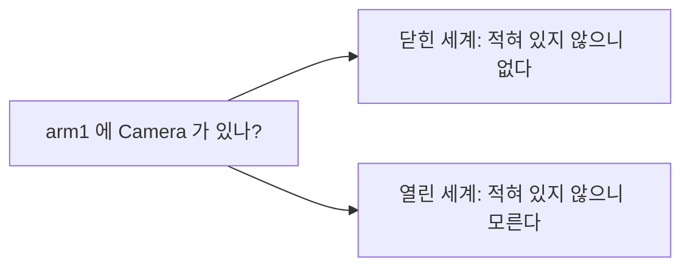

> **기준 출처:** [OWL 2 Primer](https://www.w3.org/TR/owl2-primer/) · [OWL 2 Profiles](https://www.w3.org/TR/owl2-profiles/) · [A Description Logic Primer](https://arxiv.org/abs/1201.4089) / 확인일 2026-11-12
> **시리즈:** [목차](/posts/00-ontology-series/) | 이전 → [05. RDFS 와 OWL](/posts/05-rdfs-owl/) | 다음 → [07. SPARQL, SHACL, 속성 그래프](/posts/07-sparql-shacl-property-graph/)

05편에서 적은 `subClassOf`, `range`, 이행 속성을 받은 추론기가 무엇을 계산하고 무엇은 계산하지 않는지 본다. 예제는 09편 실습의 로봇 그래프다. 로봇 `arm1` 에 축 `j1`~`j6`, 모터 `motor1`~`motor6`, 그리퍼 `gripper1`, 힘/토크 센서 `ft1` 이 붙어 있고, 실측 값은 owlrl 7.6.2 로 돌린 결과다.

## 1. 추론기가 푸는 문제

기술 논리(Description Logic) 입문서는 온톨로지를 한 상황의 완전한 기술이 아니라 그 상황에서 참이어야 하는 공리(axiom)의 집합으로 설명한다. 공리는 개체에 대한 ABox, 개념 사이의 TBox, 역할(속성) 사이의 RBox 로 나눈다. 공리를 모두 만족하는 해석이 모델이고, 모든 모델에서 참인 공리를 그 온톨로지가 함의한다(entail)고 한다. OWL 2 Profiles 가 다루는 표준 추론 문제 다섯은 모두 이 함의의 변형이다.

| 문제 | 묻는 것 | 로봇 예 |
| --- | --- | --- |
| 일관성 (consistency) | 공리를 모두 만족하는 모델이 있는가 | `Sensor` 와 `Actuator` 가 서로소인데 `ft1` 이 둘 다면 비일관 |
| 충족 가능성 (satisfiability) | 이 클래스 식에 개체가 있을 수 있는가 | 위 공리 아래 `Sensor ⊓ Actuator` 는 충족 불가능 |
| 포섭 (subsumption) | 클래스 A 가 B 에 포함되는가 | `ForceTorqueSensor ⊑ RobotPart` 는 적지 않았지만 참 |
| 인스턴스 검사 (instance checking) | 개체 x 가 클래스 C 에 속하는가 | `ft1` 은 `Sensor` 인가. 참 |
| 질의 응답 (conjunctive query answering) | 변수가 든 질의의 답 | `arm1` 의 부품 전부 |

## 2. 미리 계산하나, 물을 때 계산하나

| 방식 | 하는 일 | 대가 | 프로파일 |
| --- | --- | --- | --- |
| 물질화 (materialization) | 규칙을 앞으로 적용해 추론된 트리플을 저장한다 | 저장량이 늘고(09편 실습에서 65 → 305), 데이터가 바뀌면 다시 계산한다 | OWL 2 RL |
| 질의 재작성 (query rewriting) | 질의를 받을 때 온톨로지를 보고 질의를 고쳐 쓴다 | 질의가 무거워진다 | OWL 2 QL |

OWL 2 Profiles 는 RL 을 규칙 기반 엔진으로 구현할 수 있는 부분 언어로 두고 규칙을 트리플 술어 T(s, p, o) 위의 1차 논리 함의로 적는다. QL 은 질의를 SQL 로 다시 써서 관계형 DB 위에서 답하게 한다. owlrl 은 물질화 쪽이다. 규칙이 허용하는 트리플을 들어온 그래프에 반복해서 더한다.

## 3. 열린 세계 가정 — 적혀 있지 않으면 「모른다」

OWL 2 Primer 2절의 구분은 이렇다. DB 에 어떤 사실이 없으면 보통 거짓으로 본다. 닫힌 세계 가정(CWA)이다. OWL 2 문서에서는 그 사실이 그저 빠져 있을 뿐이고 참일 수도 있다. 열린 세계 가정(OWA)이다.



실습에서 추론을 돌린 뒤에도 `ASK { ex:arm1 ex:hasPart ?c . ?c a ex:Camera . }` 는 False 다. 이 False 는 「카메라가 없다」가 아니라 「있다는 사실을 끌어내지 못했다」이다. `arm1 hasPart cam1`, `cam1 a Camera` 두 트리플을 더하면 True 가 되고, `ft1 a Sensor` 같은 앞 결론은 그대로 남는다(실측).

입문서는 이 성질을 단조성(monotonicity)이라 부른다. 공리를 더하면 결론은 늘기만 한다. Hogan 등의 지식그래프 서베이는 다양하고 불완전한 데이터를 큰 규모로 다룰 때 OWA 가 기본 의미론으로 알맞다고 본다.

## 4. 열린 세계가 낳는 결과 셋

**개수를 확신하지 못한다.** 입문서의 예에서 `julia` 의 자녀로 `john` 하나만 적고 「자녀가 셋 이상」이라는 공리를 걸어도 모순이 아니다. 이름 없는 자녀 둘이 있는 모델이 있기 때문이다. 같은 이유로 「축이 정확히 6개」인 `SixAxisRobot` 을 정의하고 축 여섯을 적어도 `arm1` 이 그 클래스라는 결론은 나오지 않는다. 적히지 않은 일곱째 축이 있을 수 있고, 적힌 여섯이 서로 다르다는 보장도 없다(5절).

**빠진 값은 오류가 아니다.** 「모든 Motor 는 정격 토크가 있다」를 OWL 로 적어도 토크가 적히지 않은 `motor3` 는 오류가 되지 않는다. 모델 안에 이름 없는 토크 값이 하나 있으면 공리가 만족된다. 빠진 값을 위반으로 잡는 일은 07편의 SHACL 이 한다.

**domain 과 range 는 검사가 아니라 추론이다.** RDF Schema 1.1 은 `rdfs:domain` 을 「그 속성을 가진 자원은 그 클래스의 개체다」를 말하는 데 쓴다. `drives` 의 domain 이 `Actuator` 일 때 `ft1 drives j1` 을 적으면 owlrl 은 오류 없이 `ft1 a Actuator` 를 더한다. `Sensor owl:disjointWith Actuator` 를 함께 적었을 때만 오류가 그래프에 실린다(실측).

```text
Disjoint classes http://example.org/robot#Sensor and http://example.org/robot#Actuator
have a common individual http://example.org/robot#ft1
```

## 5. 고유 이름 가정 부재 — 이름이 둘이라고 개체가 둘은 아니다

OWL 2 Primer 4.7절은 OWL 이 다른 이름을 다른 개체의 이름으로 가정하지 않는다고 적는다. 다르다는 것은 `owl:differentFrom`, 여럿이면 `owl:AllDifferent` 로 명시하고, 같다는 것은 `owl:sameAs` 로 말한다.

결과는 개수 제약에서 나타난다. 모터 하나가 축을 하나만 구동한다는 제약을 걸고 `motor1` 이 `j1`, `j2` 를 둘 다 구동한다고 적어 본다.

```turtle
ex:Motor rdfs:subClassOf [ a owl:Restriction ;
    owl:onProperty ex:drives ; owl:maxCardinality 1 ] .
ex:motor1 ex:drives ex:j1 , ex:j2 .
```

| 축 여섯에 `owl:AllDifferent` | owlrl 결과 (실측) |
| --- | --- |
| 선언하지 않음 | 오류 없음. `j1 owl:sameAs j2` 가 추론된다 |
| 선언함 | 오류: `'sameAs' and 'AllDifferent' cannot be used on the same subject-object pair` |

선언하지 않으면 추론기는 제약 위반으로 보지 않고 두 이름이 같은 축이라고 결론낸다. OWL 2 RL 규칙 cls-maxc2 가 하는 일이다. RL 은 최대 기수를 0 과 1 로만 허용하므로 「축 5개 이하」 같은 제약은 owlrl 로 실험할 수 없다.

| | DB, 일반 프로그램 | OWL |
| --- | --- | --- |
| 적혀 있지 않은 사실 | 거짓 (CWA) | 모름 (OWA) |
| 다른 이름 | 다른 것 (UNA) | 같을 수도 있음 |
| 사실을 더하면 | 앞 결론이 바뀔 수 있음 | 앞 결론 유지 (단조) |
| 「없다」, 「다르다」를 말하려면 | 적지 않으면 된다 | 서로소, `AllDifferent`, 여집합으로 명시 |

## 6. 정리

- 추론 문제는 일관성, 충족 가능성, 포섭, 인스턴스 검사, 질의 응답이고 모두 「모든 모델에서 참인가」를 묻는다
- 구현은 물질화(RL, owlrl)와 질의 재작성(QL) 두 갈래다
- 열린 세계에서 적혀 있지 않은 것은 모르는 것이다. 개수를 확신하지 못하고, 빠진 값을 오류로 보지 않으며, domain 과 range 는 타입을 추론할 뿐이다
- 이름이 다르다고 다른 개체가 아니다. 최대 기수를 넘는 데이터는 `sameAs` 로 이어지고, 다름은 `AllDifferent` 로 적는다

## 참고

- [W3C, OWL 2 Web Ontology Language Primer (Second Edition)](https://www.w3.org/TR/owl2-primer/)
- [W3C, OWL 2 Web Ontology Language Profiles (Second Edition)](https://www.w3.org/TR/owl2-profiles/)
- [W3C, RDF Schema 1.1](https://www.w3.org/TR/rdf-schema/)
- [M. Krötzsch, F. Simančík, I. Horrocks, A Description Logic Primer (arXiv:1201.4089)](https://arxiv.org/abs/1201.4089)
- [A. Hogan et al., Knowledge Graphs, ACM Computing Surveys 54(4), 2021 (arXiv:2003.02320)](https://arxiv.org/abs/2003.02320)
- [OWL-RL (owlrl) 문서](https://owl-rl.readthedocs.io/)
