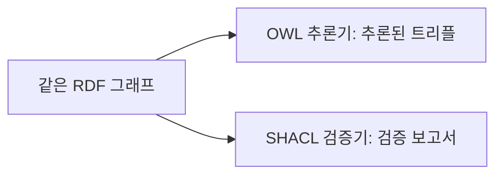

> **기준 출처:** [SPARQL 1.1 Query Language](https://www.w3.org/TR/sparql11-query/) · [SHACL](https://www.w3.org/TR/shacl/) · [Knowledge Graphs](https://arxiv.org/abs/2003.02320) / 확인일 2026-11-12
> **시리즈:** [목차](/posts/00-ontology-series/) | 이전 → [06. 추론과 열린 세계 가정](/posts/06-reasoning-open-world/) | 다음 → [08. 온톨로지 짓는 법](/posts/08-competency-questions/)

06편에서 OWL 은 적혀 있지 않은 것을 「모른다」로 다루고 빠진 값을 오류로 보지 않는다고 했다. 이 편은 그래프에 묻는 SPARQL 과 그래프를 검사하는 SHACL 을 나란히 놓고, RDF 와 다른 그래프 모델인 속성 그래프, 그리고 「지식그래프」라는 말을 정리한다. 예제는 09편 실습의 로봇 그래프다.

## 1. SPARQL — 변수가 든 트리플 패턴을 맞춘다

```sparql
PREFIX ex: <http://example.org/robot#>

# 어떤 모터가 어떤 축을 구동하나
SELECT ?m ?j WHERE { ?m a ex:Motor . ?m ex:drives ?j . }

# arm1 에 카메라가 있나
ASK { ex:arm1 ex:hasPart ?c . ?c a ex:Camera . }
```

| 질의 형태 | 돌려주는 것 (SPARQL 1.1 16절) |
| --- | --- |
| `SELECT` | 패턴에 맞은 변수 바인딩 |
| `CONSTRUCT` | 변수를 트리플 템플릿에 채워 만든 RDF 그래프 |
| `ASK` | 패턴이 맞는지 여부 (참/거짓) |
| `DESCRIBE` | 찾은 자원을 설명하는 RDF 그래프 |

`OPTIONAL` 은 안쪽 패턴이 맞지 않아도 해를 버리지 않고 그 변수만 비워 둔다. 질의 대수에서 이 연산의 이름은 `LeftJoin` 이다. 속성 경로(property path)는 임의 길이의 경로를 따라가고, `elt+` 는 `elt` 를 한 번 이상 따라간 경로다.

```sparql
SELECT (COUNT(DISTINCT ?p) AS ?n) WHERE { ex:arm1 ex:hasPart+ ?p . }
```

실습 그래프에서 이 질의는 추론 없이 16을 돌려준다(실측). `hasPart` 를 이행 속성으로 선언하고 owlrl 로 물질화한 뒤 한 칸으로 센 값과 같다. 질의가 매번 경로를 따라가느냐, 추론기가 미리 저장하느냐의 차이다.

SPARQL 1.1 Entailment Regimes 문서는 그래프에 있는 트리플에만 패턴을 맞추는 기본 평가를 단순 함의(simple entailment)라 부르고, RDFS 나 OWL 2 의 함의를 반영한 답은 따로 정의한다. 그래서 기본 평가에서 `ASK` 의 False 는 「패턴이 그래프에 없다」는 뜻이지 「카메라가 없다」는 판정이 아니다.

## 2. SHACL — 형상으로 검사한다

SHACL(Shapes Constraint Language)은 RDF 그래프를 조건 집합에 대고 검증하는 언어다. 형상(shape) 그래프와 데이터 그래프를 넣으면 검증 보고서가 나오고, `sh:conforms` 는 검증 결과가 하나도 없을 때만 true 다.

```turtle
ex:MotorShape a sh:NodeShape ;
    sh:targetClass ex:Motor ;
    sh:property [
        sh:path ex:ratedTorqueNm ;
        sh:datatype xsd:decimal ;
        sh:minCount 1 ;
        sh:maxCount 1 ;
        sh:message "Motor 에는 정격 토크(ratedTorqueNm)가 정확히 하나 있어야 한다" ;
    ] .
```

| 낱말 | 뜻 |
| --- | --- |
| `sh:targetClass` | 이 클래스의 개체가 검사 대상이다 |
| `sh:path` | 검사할 속성. 경로도 된다 |
| `sh:minCount` / `sh:maxCount` | 값 노드 수가 이보다 적거나 많으면 검증 결과가 생긴다 |
| `sh:datatype` / `sh:class` / `sh:in` / `sh:pattern` | 데이터타입 / 클래스 / 허용 목록 / 정규식 |
| `sh:closed` | true 면 형상에 없는 속성을 쓴 트리플도 결과가 된다 |

`motor3` 의 토크를 빼고 pySHACL 0.40.2 로 검사한 결과다(실측, 일부 줄 생략).

```text
적합(conforms): False
Results (1):
Constraint Violation in MinCountConstraintComponent
	Focus Node: ex:motor3
	Result Path: ex:ratedTorqueNm
```

같은 데이터에 06편의 OWL 추론기는 오류를 내지 않는다. Hogan 등은 이 차이를 의미 스키마(semantic schema)와 검증 스키마(validating schema)로 나눈다. RDFS, OWL 은 새 데이터를 추론하고, 형상은 있는 데이터를 검증한다. 불완전한 데이터에는 OWA 가 기본이지만 「모든 행사에 이름과 장소가 있어야 한다」처럼 일부가 완전하다고 보장하고 싶을 때 검증 스키마를 쓴다는 설명이다.



둘은 함께 쓸 수 있다. SHACL 명세는 RDFS 추론 전체를 요구하지 않고, pySHACL 은 `inference` 옵션(`none`, `rdfs`, `owlrl`, `both`)으로 데이터 그래프를 추론으로 넓힌 뒤 검사한다.

## 3. 속성 그래프 — 간선에도 속성이 붙는다

Hogan 등은 방향 간선 라벨 그래프(RDF 가 이쪽이다)와 속성 그래프를 나란히 설명한다. 속성 그래프는 노드와 간선 모두에 라벨과 속성-값 쌍을 붙이는 모델이고 Neo4j 가 대표적이다. Neo4j 문서에서 관계는 시작 노드, 끝 노드, 방향, 타입 하나를 갖고 관계에도 키-값 속성이 붙는다.

「motor1 이 j1 을 2026년부터 구동한다」로 비교한다.

| | RDF | 속성 그래프 |
| --- | --- | --- |
| 간선에 붙는 것 | 술어 IRI 하나 | 타입 하나와 키-값 속성 |
| 「2026년부터」 | 간선에 직접 못 붙인다. 관계를 노드로 만들고 시점을 그 노드에 단다 | `(motor1)-[:DRIVES {since: 2026}]->(j1)` |
| 이름 | IRI. 설계상 전역 범위 | DB 안의 ID |
| 뜻과 제약 | RDFS, OWL, SHACL (W3C 표준) | Neo4j 의 경우 속성 존재와 데이터타입 제약 |
| 질의 | SPARQL | Cypher, Gremlin 등 |

서베이는 두 모델이 정보 손실 없이 서로 옮겨질 수 있고, 방향 간선 라벨 그래프는 더 단순하고 속성 그래프는 더 유연하다고 정리한다.

## 4. 지식그래프와 온톨로지는 층이 다르다

Hogan 등은 지식그래프를 실세계의 지식을 쌓고 전달하려는 데이터 그래프로 넓게 정의한다. 노드는 관심 대상인 개체를, 간선은 개체 사이의 관계를 나타내고, 그래프 모델은 어느 쪽이든 상관없다. 온톨로지는 그 그래프의 용어에 뜻을 주는 연역적 방법의 하나로 나오고, 임베딩이나 그래프 신경망 같은 귀납적 방법과 구분된다.

| 가진 것 | 용어의 뜻 | 할 수 있는 것 |
| --- | --- | --- |
| RDF 트리플만 | 없음 | SPARQL 질의 |
| RDF + RDFS/OWL | 공리로 적힘 | 질의와 추론 (열린 세계) |
| RDF + SHACL 형상 | 뜻이 아니라 조건 | 질의와 검증 (빠진 값도 위반) |
| 속성 그래프 | 라벨과 DB 제약 정도 | Cypher 같은 질의 |

「지식그래프를 쓴다」는 말은 데이터 그래프가 있다는 뜻까지다. 그 용어를 정한 온톨로지가 있는지, 있다면 추론에 쓰이는 공리로 적혀 있는지는 따로 물어야 한다.

## 5. 정리

- SPARQL 은 변수가 든 트리플 패턴을 맞춘다. `ASK` 의 False 는 「없다」는 판정이 아니고, `hasPart+` 는 추론 없이 이행을 따라간다
- SHACL 은 형상으로 검증한다. `sh:minCount` 로 빠진 값이 위반이 되고, 실측에서 토크가 빠진 `motor3` 가 위반 1건으로 나왔다
- OWL 은 사실을 늘리고 SHACL 은 있는 사실을 판정한다. pySHACL 은 추론 뒤에 검사하는 옵션을 둔다
- 속성 그래프는 간선에도 키-값 속성을 붙인다. RDF 는 이름이 전역 IRI 이고 W3C 표준의 뜻과 제약 층을 쓴다
- 지식그래프는 데이터 그래프를 가리키고, 온톨로지는 그 용어의 뜻을 정하는 층이다

## 참고

- [W3C, SPARQL 1.1 Query Language](https://www.w3.org/TR/sparql11-query/)
- [W3C, SPARQL 1.1 Entailment Regimes](https://www.w3.org/TR/sparql11-entailment/)
- [W3C, Shapes Constraint Language (SHACL)](https://www.w3.org/TR/shacl/)
- [W3C, RDF 1.1 Concepts and Abstract Syntax](https://www.w3.org/TR/rdf11-concepts/)
- [pySHACL](https://github.com/RDFLib/pySHACL)
- [A. Hogan et al., Knowledge Graphs, ACM Computing Surveys 54(4), 2021 (arXiv:2003.02320)](https://arxiv.org/abs/2003.02320)
- [Neo4j, Graph database concepts](https://neo4j.com/docs/getting-started/graph-database/)
