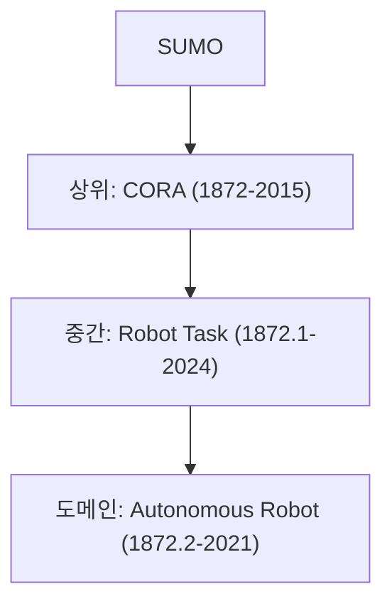

> **기준 출처:** [IEEE 1872-2015](https://standards.ieee.org/ieee/1872/5354/) · [Schlenoff, IEEE RAS 2019 슬라이드](https://www.ieee-ras.org/images/Standards_strategy_Meeting_19_May_2019/1b-Schlenoff-CORA.pdf) · [IEEE1872-owl](https://github.com/srfiorini/IEEE1872-owl/) / 확인일 2026-11-12
> **시리즈:** [목차](/posts/00-ontology-series/) | 이전 → [09. 실습 — rdflib 로 로봇 온톨로지 짓기](/posts/09-rdflib-robot-ontology/) | 다음 → [11. KnowRob](/posts/11-knowrob/)

IEEE 1872-2015 는 로봇공학과 자동화(R&A) 분야의 온톨로지 표준이고, 그 중심인 CORA(Core Ontology for Robotics and Automation)는 이 분야의 가장 일반적인 개념, 관계, 공리를 정한다. 표준 본문은 유료라서 IEEE SA 초록 페이지, Craig Schlenoff 의 2019년 IEEE RAS 발표 슬라이드, 공개 OWL 구현에서 확인한 것만 적는다.

## 1. IEEE 1872 표준들

| 표준 | 이름 | 승인 | 비고 |
| --- | --- | --- | --- |
| IEEE 1872-2015 | Standard Ontologies for Robotics and Automation | 2015-02-16 (발행 2015-04-10) | CORA 와 부속 온톨로지 |
| IEEE 1872.2-2021 | Standard for Autonomous Robotics (AuR) Ontology | 2021-09-23 | 1872-2015 를 확장해 자율 로봇 분야의 개념, 정의, 공리를 더한다고 명시 |
| IEEE 1872.1-2024 | Standard for Robot Task Representation | 2024-02-15 (발행 2024-06-18) | 작업 지식의 표현, 추론, 소통을 위한 온톨로지 |

슬라이드가 정리한 연혁은 이렇다. 2011년 11월 ORA(Ontologies for Robotics and Automation) 워킹그룹이 생겼고, 2014년 7월 초기 표준을 NIST 와 Georgia Tech 의 로봇에 적용했으며, 2015년 4월 투표 그룹 만장일치로 표준이 됐다. 슬라이드는 이것을 IEEE RAS 의 첫 온톨로지 기반 표준이라고 적는다. 당시 워킹그룹은 23개국 175명이었다.

## 2. 상위, 중간, 도메인 세 층

같은 슬라이드는 IEEE 로봇 온톨로지 전체를 세 층으로 나눈다. 아래 층은 바로 위 층의 개념을 특수화한다.

| 층 | 슬라이드의 정의 | 2019년 그림의 예 |
| --- | --- | --- |
| 상위 (Upper) | 로봇 분야 전체에 걸치는 일반 용어의 뜻 | CORA (승인된 표준) |
| 중간 (Middle) | 여러 로봇 도메인에 두루 쓰이는 용어의 뜻 | Robot Task (워킹그룹 진행 중), Sensor (향후 후보) |
| 도메인 (Domain) | 한 도메인에 주로 쓰이는 용어의 뜻 | Autonomous Robot (워킹그룹 진행 중), Industrial, Medical (향후 후보) |

2019년에 워킹그룹 단계였던 Robot Task 와 Autonomous Robot 은 그 뒤 각각 1872.1-2024 와 1872.2-2021 로 표준이 됐다. CORA 자체는 SUMO(Suggested Upper Merged Ontology) 위에 있다. 워킹그룹은 처음부터 SUMO 에서 내려 짓기로 정했다.



## 3. 정의를 정한 순서

1. 자연어 정의를 워킹그룹의 합의로 정한다. 대개 한 사람이 초안을 내고 합의 절차가 시작된다.
2. 합의된 자연어 정의를 소수의 온톨로지 전문가가 1차 논리 정의로 옮긴다.
3. SUMO 용어를 특수화해서 자연어 정의를 빠짐없이 담는다.

슬라이드가 설명하는 순서다. 논리식보다 사람 사이의 합의가 먼저 온다.

## 4. Robot 은 Device 이면서 Agent 다

OWL 구현의 `cora.owl` 에서 클래스 공리를 추리면 다음과 같다. 괄호 안은 각 공리에 주석으로 달린 표준 문서의 공리 번호다.

```text
Robot              ⊑ sumo:Device                  (7.1.1)
Robot              ⊑ sumo:Agent                   (7.1.2)
RobotGroup         ⊑ sumo:Group                   (7.5.1)
RoboticSystem      ⊑ corax:ArtificialSystem       (7.6.1)
RoboticSystem      ≡ SingleRoboticSystem ⊔ CollectiveRoboticSystem   (7.8.3, 둘은 서로소)
RoboticEnvironment ⊑ corax:PhysicalEnvironment    (7.7.1)
```

Robot 은 상위 클래스 둘 아래에 동시에 있다. 객체지향 상속처럼 하나를 고르지 않으므로, SUMO 가 Device 에 대해 정한 공리와 Agent 에 대해 정한 공리가 Robot 에 함께 적용된다.

## 5. Automated Robot 은 종류가 아니라 역할이다

| 용어 | 슬라이드의 정의 (요약) |
| --- | --- |
| Automated Robot | 주어진 작업에서 로봇이 자동 기계처럼 동작하는 역할. 환경 변화에 적응하지 않거나 정해진 계획을 따른다 |
| Teleoperated Robot | 사람 조작자가 감각 피드백을 보며 로봇 밖에서 구동기를 직접 제어하거나 증분 목표를 계속 주는 역할. 조작자가 명령을 멈춰도 마지막 명령은 끝까지 수행한다 |

둘 다 「주어진 작업에서의 역할(role)」로 정의된다. OWL 구현도 이 결정을 따른다. `automatedRobot`, `teleoperatedRobot`, `remotecontrolledRobot`, `semiautonomousRobot`, `fullyautonomousRobot` 은 클래스가 아니라 `agentRobot` 의 하위 속성, 즉 관계다.

부품도 관계로 적는다. `rparts.owl` 의 `robotSensingPart`, `robotActuatingPart`, `robotCommunicatingPart`, `robotProcessingPart` 는 모두 `robotPart` 의 하위 속성이고 치역이 Robot 이다. 어떤 장치가 무엇인가와, 그 장치가 어느 로봇의 어떤 부품 노릇을 하는가를 나눠 적는 셈이다. 이 구분은 12편의 SOMA 에서 다시 나온다.

## 6. 파일로 보는 CORA — IEEE1872-owl

표준의 저작권은 IEEE SA 에 있고, OWL 구현은 별도 저장소에 CC-BY-4.0 으로 공개돼 있다.

| 파일 | 내용 |
| --- | --- |
| `cora-bare.owl` | CORA 의 개념과 관계 분류체계만. SUMO, CORAX 연결 없음 |
| `cora.owl` | cora-bare 를 sumo-cora, rparts, corax 에 연결한 판. README 의 권장 구현 |
| `cora-fullaxiom.owl` | 여기에 SUO-KIF 공리를 가능한 만큼 번역해 더한 판. README 는 주의해서 쓰라고 한다 |
| `corax.owl`, `rparts.owl`, `pos.owl` | 부속 셋: 일반 개념(ArtificialSystem 등), 부품 관계(5절), 위치와 방향(좌표계, 변환 함수) |
| `sumo-cora.owl` | 다른 파일이 쓰는 SUMO 개념만 추린 것 |

README 가 밝힌 번역 방침은 다음과 같다.

- 개념은 OWL 클래스로, 이항 관계는 속성으로, 분할(partition)은 서로소 합집합으로 손으로 옮겼다. 표준의 원래 약속(ontological commitment)을 지키려고 자동 변환 도구를 쓰지 않았다.
- POS 의 3항, 4항 관계와 함수는 OWL 이 직접 표현하지 못해 물화(reification)로 옮겼다.
- OWL 판은 SUO-KIF 판보다 덜 정해져 있어서, IEEE 1872 와 맞지 않는 모델도 허용될 수 있다.

## 7. 주의

> - CORA 는 개념 정의(TBox)만 준다. 「이 공장의 로봇 3호기」 같은 개체는 쓰는 쪽이 채운다. KER 2019 서베이는 IEEE-ORA 가 바로 쓸 수 있는 프레임워크가 아니라 온톨로지일 뿐이고, 일반 개념만 담아 복잡한 응용에 그대로 쓰기에는 너무 일반적이라고 평한다.
> - IEEE SA 페이지 기준 1872-2015 의 상태는 Inactive-Reserved(2026-03-26 부터)다. 1872.1-2024 는 Active 로 표시된다.
{: .prompt-warning }

## 8. 정리

- CORA(상위) 아래에 작업 표현(중간, 1872.1-2024)과 자율 로봇(도메인, 1872.2-2021)이 있고, CORA 는 SUMO 위에 선다.
- 정의는 자연어 합의, 1차 논리, SUMO 특수화 순서로 만들었다.
- `Robot ⊑ Device`, `Robot ⊑ Agent`. 로봇은 장치이면서 에이전트다.
- Automated, Teleoperated 같은 구분과 부품 여부는 클래스가 아니라 역할과 관계로 적는다.
- OWL 구현은 손으로 옮겼고 SUO-KIF 판보다 느슨하다.

## 참고

- [IEEE 1872-2015 (IEEE SA)](https://standards.ieee.org/ieee/1872/5354/)
- [IEEE 1872.2-2021 (IEEE SA)](https://standards.ieee.org/standard/1872_2-2021.html)
- [IEEE 1872.1-2024 (IEEE SA)](https://standards.ieee.org/ieee/1872.1/6993/)
- [C. Schlenoff, Structure of the IEEE Robotics and Automation Ontologies, 2019 (PDF)](https://www.ieee-ras.org/images/Standards_strategy_Meeting_19_May_2019/1b-Schlenoff-CORA.pdf)
- [srfiorini/IEEE1872-owl (GitHub)](https://github.com/srfiorini/IEEE1872-owl/)
- [A. Olivares-Alarcos et al., KER 2019 (PDF)](https://www.aolivaresalarcos.com/pdf/2019-ker_review.pdf)
