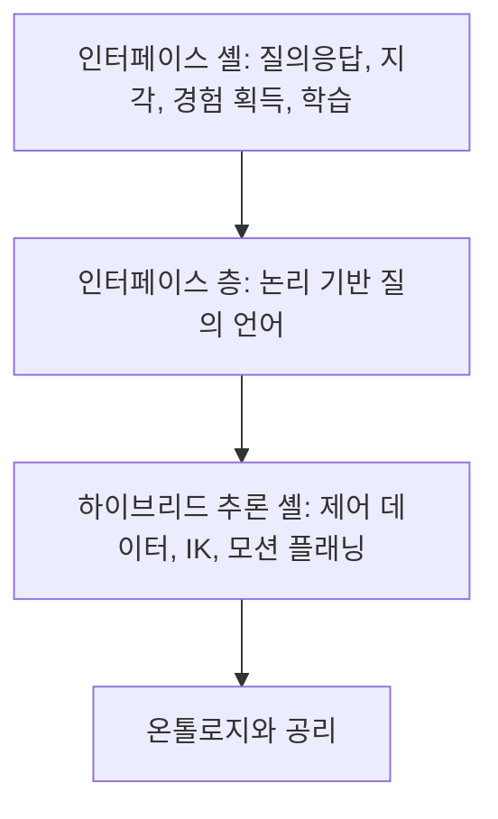

> **기준 출처:** [Beetz 외, KnowRob 2.0 (ICRA 2018)](https://ai.uni-bremen.de/papers/beetz18knowrob.pdf) · [Olivares-Alarcos 외, KER 2019](https://www.aolivaresalarcos.com/pdf/2019-ker_review.pdf) · [knowrob/knowrob](https://github.com/knowrob/knowrob) / 확인일 2026-11-12
> **시리즈:** [목차](/posts/00-ontology-series/) | 이전 → [10. IEEE 1872 CORA](/posts/10-ieee-1872-cora/) | 다음 → [12. SOMA](/posts/12-soma/)

10편의 CORA 가 「로봇이란 무엇인가」에 답하는 표준 어휘라면, KnowRob 은 로봇이 작업 도중 「이 컵을 어떻게 집나」를 묻고 답하는 지식 처리 시스템이다. 브레멘 대학 AI 연구소에서 개발한다. 1세대는 Tenorth 와 Beetz 의 2013년 IJRR 논문, 2세대는 ICRA 2018 의 KnowRob 2.0 논문이 정리한다. 2013년 논문은 초록을 열람하지 못해 서지 정보만 확인했고, 이 글은 2018년 논문과 2019년 KER 서베이를 기준으로 한다.

## 1. 지시와 모션 사이의 간극

KnowRob 2.0 논문은 「컵을 집어」 같은 덜 정해진 지시와, 그 동작에 필요한 상세한 모션 명세 사이의 간극에서 출발한다. 물체는 모양, 무게, 성질(깨지기 쉬움, 뜨거움, 젖음), 그 물체로 할 작업, 집는 위치에 따라 다르게 잡아야 한다. 컵이라면 손잡이가 잡는 부분이고 쏟지 않으려면 세워 들어야 한다는 배경 지식이 있어야 파지와 모션 파라미터가 정해진다.

논문이 식탁 치우기 작업에서 드는 전형적 질의는 이렇다. 컵과 접시는 어디 있나, 물체를 집으려면 어디 서야 하나, 어떻게 뻗나, 그리퍼를 어떻게 놓나, 힘을 얼마나 주나, 어떻게 쥐고 있나. 행동을 블랙박스로 다루는 수준보다 훨씬 낮은 수준의 질문이라, KnowRob 은 제어 프로그램과 밀착해 그 알고리즘 일부를 재사용하고 데이터 구조를 공유한다.

## 2. 온톨로지를 제어 데이터 구조 아래에 둔다

> A unique feature of it is the central position of the symbolic representation of the ontology, even below the data structures of the control system.

논문이 KnowRob 2.0 구조의 고유한 특징으로 꼽는 문장이다. 온톨로지의 기호 표현이 제어 시스템 데이터 구조보다도 아래에 있다.

프로그래머가 데이터 구조에 의미 주석을 달면 제어 시스템이 그 데이터의 의미를 계산할 수 있다. 위쪽 응용에서 보면 1차 시간 구간 논리 지식베이스처럼 보이지만, 상당 부분은 제어 프로그램의 데이터 구조에서 요청 시 만들어지고 역기구학이나 모션 플래닝 같은 로봇 알고리즘으로 계산된다.

## 3. 가상 지식베이스 — 저장하지 않고 계산한다

논문의 예는 로봇 자세다.

| 층 | 무엇이 있나 |
| --- | --- |
| 온톨로지 | `holds(pose(r, ⟨x,y,o⟩), ti)`: 로봇 r 은 시각 ti 에 지도 원점 기준 자세가 ⟨x,y,o⟩ 라고 믿는다 |
| 제어 시스템 | 입자 필터 같은 베이즈 필터가 추정한 자세의 확률 분포 |
| 접지 규칙 | 로봇이 믿는 자세 = 확률이 최대인 자세 |

이런 규칙으로 온톨로지 개념을 제어 데이터 구조에 접지하면, 데이터 구조의 상당 부분이 관계를 요청 시 계산하는 가상 지식베이스(virtual knowledge base)가 된다. 같은 방식으로 「물체가 손에 닿는다」는 모션 플래너가 충돌 없는 경로를 찾으면 참으로 정의할 수 있다. KER 서베이는 이 계산을 온톨로지의 기호 관계에 붙은 계산 메서드, 즉 computable property 로 설명한다.

## 4. 하이브리드 추론 커널의 지식베이스 넷

| 지식베이스 | 내용 |
| --- | --- |
| 내부 세계 (inner world) | 정확한 6D 자세에 놓인 물체의 CAD, 메시 모델과 물리 시뮬레이션. 게임 엔진으로 장면을 보고 행동 결과를 예측한다. 논문의 표현으로 「눈과 손으로 추론」하는 부분 |
| 가상 | 제어 시스템 데이터 구조에서 요청 시 계산 (3절) |
| 논리 | 추상화한 기호 센서, 행동 데이터와 논리 공리, 추론 |
| 일화 기억 | 로봇 자신의 경험 (5절) |

논문은 넷의 내용이 중복되거나 모순될 수 있다고 인정한다. 그래서 정답 하나를 유도하는 대신 가설 여럿을 계산한 뒤 그럴듯함과 일관성을 검사하고, 이를 IBM Watson 의 방식에 빗댄다.

## 5. NEEM — 경험과 서사

KnowRob 2.0 이 만드는 일화 기억이 NEEM(narrative-enabled episodic memory)이다. 로봇이 활동을 수행하거나 관찰할 때마다 하나씩 생긴다.

| 구성 | 내용 |
| --- | --- |
| NEEM experience | 일화의 저수준 시간 색인 기록. 자세, 지각, 제어 신호. 일화를 재생할 수 있다 |
| NEEM narrative | experience 에 연결된 기호 서술. 작업, 맥락, 의도한 목표, 관찰된 효과 |

논문 그림의 서사 단언은 `occurs(ev123, t2)`, `event-type(ev123, detect)`, `perception-result(ev123, obj345)`, `captured-image(ev123, img456)` 같은 모양이다. 서사가 있어서 「컵을 어떻게 집었나」, 「어느 신체 부위를 썼나」 같은 질의로 과거 일화를 찾을 수 있다. 2018년 논문은 로봇과 연구자가 일화 기억을 올리고 분석하는 공개 서비스 openEASE 를 함께 소개한다.

## 6. 구현 언어와 상위 온톨로지

| 항목 | 내용 | 출처 |
| --- | --- | --- |
| 구현 | 주 언어는 SWI-Prolog. OWL 로 적힌 사실은 Prolog 의 RDF 트리플 라이브러리로 메모리에 둔다 | KER 2019 |
| 상위 온톨로지 | 처음에는 Cyc 에서 개념 정의를 가져왔고, 이후 DOLCE+DnS Ultralite(DUL) 쪽으로 옮겨 갔다 | KER 2019 |
| KnowRob 온톨로지 | 로봇과 신체 부위, 물체와 기능, 작업과 행동, 상황 맥락. 「컵은 손잡이가 달린 속 빈 원통 그릇이고 마시기, 섞기, 붓기에 쓴다」 같은 배경 지식 | KnowRob 2.0 |
| 현재 저장소 | C++ 로 구현됐고 규칙 기반 추론에는 여전히 Prolog 를 지원한다. 여러 추론 엔진과 저장 백엔드를 묶는 하이브리드 지식베이스. BSD-3-Clause | GitHub README |

DUL 위에 지은 활동 온톨로지는 다음 편의 SOMA 에서 다룬다.

## 7. 주의

> - KER 2019 서베이는 한계도 적는다. 기호 표현이 얕고 많은 정보가 제어 데이터 구조에 암묵적으로 있어 추상화 계산 비용이 들며, 표현 표준을 제안하지 않았고, 큰 사용자 공동체를 아직 만들지 못했다는 것이다(2019년 시점).
> - 이 글의 구조 설명은 2018년 논문 기준이다. 현재 저장소는 C++ 로 다시 구현됐으므로 세부 구성은 다를 수 있다.
> - openEASE 사이트는 확인일에 접속되지 않았다.
{: .prompt-warning }

## 8. 정리

- KnowRob 은 모호한 지시와 실행에 필요한 상세 정보 사이를 메우는 런타임 지식 처리 시스템이다.
- 온톨로지를 제어 데이터 구조 아래에 두고, 사실을 저장하는 대신 제어 데이터에서 요청 시 계산한다(가상 지식베이스).
- KnowRob 2.0 은 내부 세계, 가상, 논리, 일화 기억 지식베이스를 함께 쓰고, 모순은 가설 여럿과 일관성 검사로 다룬다.
- NEEM 은 저수준 experience 와 기호 narrative 의 짝이다.
- CORA 가 낱말의 뜻을 정하는 표준이라면 KnowRob 은 온톨로지를 로봇 제어 안에서 쓰는 시스템이다.

## 참고

- [M. Beetz et al., KnowRob 2.0 — A 2nd Generation Knowledge Processing Framework for Cognition-Enabled Robotic Agents, ICRA 2018 (PDF)](https://ai.uni-bremen.de/papers/beetz18knowrob.pdf)
- [dblp: KnowRob 2.0, ICRA 2018](https://dblp.org/rec/conf/icra/BeetzBHPBB18)
- [M. Tenorth, M. Beetz, KnowRob, IJRR 32(5), 2013 (서지 정보만 확인)](https://journals.sagepub.com/doi/abs/10.1177/0278364913481635)
- [A. Olivares-Alarcos et al., KER 2019 (PDF)](https://www.aolivaresalarcos.com/pdf/2019-ker_review.pdf)
- [knowrob/knowrob (GitHub)](https://github.com/knowrob/knowrob)
