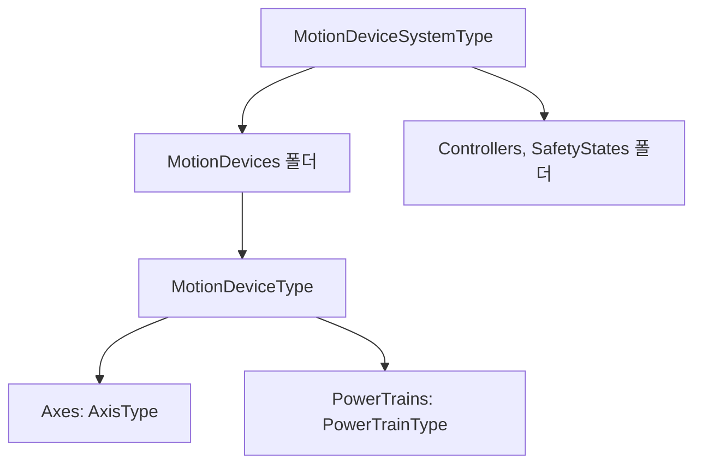

> **기준 출처:** [OPC 40010-1 OPC UA for Robotics Part 1 v1.02](https://reference.opcfoundation.org/specs/OPC-40010-1) · [OPC 10000-3 Address Space Model](https://reference.opcfoundation.org/specs/OPC-10000-3) / 확인일 2026-11-12
> **시리즈:** [목차](/posts/00-ontology-series/) | 이전 → [12. SOMA](/posts/12-soma/) | 다음 → [14. AAS 자산관리쉘과 디지털 트윈](/posts/14-aas-digital-twin/)

이 편은 장치가 자기를 어떻게 서술하는가를 본다. OPC UA 는 흔히 산업 통신 규격으로 소개되지만, Robotics 사양은 OPC UA 의 장점으로 보안 모델, 내결함성 통신과 함께 응용 개발자가 데이터를 의미 있게 표현하는 정보 모델링 프레임워크를 든다. 서버는 값만 주지 않고, 자기가 무엇으로 이루어졌고 어떻게 연결됐는지를 주소 공간(AddressSpace)으로 내놓는다.

## 1. 주소 공간의 낱말

Robotics 사양 4.2.3 절의 요약은 이렇다. 주소 공간의 Object 는 Reference 로 연결된 Node 들로 이루어진다. 모든 Node 는 고유 식별자 NodeId 와 비지역화 이름 BrowseName 을 가진다. 모든 Reference 에는 관계의 의미를 정하는 ReferenceType 이 있고, 구조를 만드는 계층적 참조와 임의 연관을 만드는 비계층적 참조로 나뉜다. 응용은 기존 ReferenceType 의 하위 타입을 만들어 자기 관계를 정의할 수 있다.

| OPC UA | 뜻 | 온톨로지 쪽 대응 |
| --- | --- | --- |
| ObjectType, VariableType | 인스턴스의 구조를 정하는 타입 정의 | 클래스 |
| Object, Variable | 인스턴스. Variable 은 DataType 이 있는 값 | 개체, 데이터 값 |
| Method | 호출할 수 있는 함수 | OWL 에는 없다 |
| ReferenceType | 관계의 종류. 그 자체가 Node 다 | 객체 속성 |
| HasSubtype | 타입 사이의 하위 타입 관계 (Part 3 7.10 절) | `rdfs:subClassOf` |
| NamespaceUri | 전역에서 유일한 이름 공간 문자열 | IRI 접두사 |
| ModellingRule | 타입이 정한 자식이 인스턴스에 반드시(Mandatory) 또는 선택적으로(Optional) 있음 | OWL 에는 없다. SHACL 의 최소 개수 검사에 가깝다 |

## 2. 타입이 먼저 있다

Part 3 의 4.6.1 절은 서버가 Object 와 Variable 의 타입 정의를 반드시 제공하고, 인스턴스를 HasTypeDefinition 참조로 타입에 잇는다고 정한다. 더 구체적인 타입이 없으면 BaseObjectType 같은 기본 타입을 쓴다. 타입 정의에서 Mandatory(6.4.4.4.1 절)로 표시된 자식은 인스턴스에도 같은 BrowsePath 의 Node 로 있어야 한다.

OWL 은 반대다. 개체는 클래스 단언 없이도 있을 수 있고, 어느 클래스에 속하는지는 추론으로 늘어난다(05편, 06편). OPC UA 에서는 타입이 먼저 있고 인스턴스는 그 틀대로 만들어진다. 객체지향의 클래스와 인스턴스에 가깝다.

## 3. Robotics 동반 사양이 다루는 것

동반 사양은 특정 산업을 위한 ObjectType, VariableType, DataType, ReferenceType 을 정의해 기본 모델을 확장한다. OPC 40010-1(v1.02, 2025-09-08)은 모션 장치 시스템 전체를 상위 제어, 평가 시스템에 보여 주는 정보 모델이고, 5절의 사용 사례는 넷이다.

| 사용 사례 | 사양이 주는 데이터 |
| --- | --- |
| 감독 | 운전 상태, 안전 상태, 공정 데이터 |
| 상태 모니터링 | 모터 온도, 부하, 가동 시간. 예지 정비의 입력 |
| 자산 관리 | 주요 부품의 부품 번호, 브랜드, 일련번호 |
| 원격 운전 | 컨트롤러와 작업 제어 수준의 FSM. 프로그램 올리기, 내리기, 시작, 정지 |

## 4. MotionDeviceSystem 에서 Axis 까지

| 타입 | 사양의 정의 | M(필수)과 O(선택) |
| --- | --- | --- |
| MotionDeviceSystemType | 로봇 시스템 전체의 진입점. DeviceSet 에 적어도 하나 있어야 한다 | MotionDevices, Controllers, SafetyStates 폴더 모두 M |
| MotionDeviceType | 독립된 모션 장치 하나(매니퓰레이터, 턴테이블, 리니어 축). 축과 파워트레인을 적어도 하나씩 가진다 | SerialNumber, Manufacturer, Model, ProductCode, MotionDeviceCategory, `ParameterSet.SpeedOverride` 가 M. FlangeLoad, AssetId 는 O |
| AxisType | 모션 장치의 축 하나 | MotionProfile, `ParameterSet.ActualPosition` 이 M. ActualSpeed, ActualAcceleration 은 O |

세 타입 모두 OPC 10000-100(Devices)의 ComponentType 을 상속한다.

## 5. 관계의 종류 — ReferenceType 일곱

| ReferenceType (역이름) | 뜻 |
| --- | --- |
| Controls (IsControlledBy) | 제어하는 객체와 제어받는 객체 |
| Moves (IsMovedBy) | 파워트레인에서, 그 파워트레인만 움직일 때 함께 움직이는 축 전부로 |
| Requires (IsRequiredBy) | 축에서, 그 축만 움직이려면 구동해야 하는 파워트레인 전부로 |
| IsDrivenBy (Drives) | 구동, 전력 공급 관계. 예: 모터 IsDrivenBy 서보 앰프 |
| IsConnectedTo | 기계적 연결. 대칭이라 역이름이 없다. 예: 모터와 기어 |
| HasSafetyStates (SafetyStatesOf) | 안전 기능을 맡는 객체 |
| HasSlave (IsSlaveOf) | 한 축에 함께 토크를 주는 파워트레인 사이의 마스터-슬레이브 관계 |

Requires 는 1:1 일 필요가 없다. 복합 기구학에서는 파워트레인 여럿이 축 하나에 영향을 주고, 파워트레인이 구동하지 않는 가상 축에는 이 참조가 없다. 역이름과 대칭 여부가 ReferenceType 정의에 들어 있으니, OWL 의 역속성과 대칭 속성에 해당하는 정보도 사양 안에 있다.

## 6. 로봇 형태 분류는 열거형 값

`MotionDeviceCategory` 의 DataType 인 MotionDeviceCategoryEnumeration(10.1 절)은 ISO 8373 에 근거한 일곱 값이다. `OTHER(0)`, `ARTICULATED_ROBOT(1)`, `SCARA_ROBOT(2)`, `CARTESIAN_ROBOT(3)`, `SPHERICAL_ROBOT(4)`, `PARALLEL_ROBOT(5)`, `CYLINDRICAL_ROBOT(6)`. 온톨로지라면 하위 클래스로 적을 수도 있는 구분을 속성값으로 둔 것이다.

## 7. 온톨로지와 같은 점, 다른 점

| | OWL 온톨로지 | OPC UA 정보 모델 |
| --- | --- | --- |
| 개체와 타입 | 타입 단언 없이도 개체가 있고, 소속은 추론으로 늘어난다 | 인스턴스는 반드시 TypeDefinition 을 가진다 |
| 필수 여부 | OWL 로는 강제하지 않는다 | ModellingRule 로 사양에 들어 있다 |
| 추론 | 포섭, 분류, 인스턴스 검사 | 없다. 타입 계층과 참조를 따라 탐색한다 |
| 동작 | 없다 | Method 를 호출한다 |
| 값 | 정적인 사실 | Variable 값이 운전 중에 바뀐다 |

같은 점은 타입 계층, 의미가 정해진 참조, 전역 이름 공간이다. 사양 4.2.2 절은 모든 OPC UA 클라이언트가 벤더가 정의한 정보도 찾아서 쓸 수 있어야 한다고 적는다.

## 8. ESI 와 나란히

EtherCAT 의 ESI 도 장치의 자기 서술이다. ETG 설명으로 ESI 는 장치와 함께 오는 XML 파일이고 장치의 네트워크 접근 가능 속성을 서술하며, 설정 도구가 이를 읽어 ENI 를 만든다([13. ESI와 ENI 설정 파일](/posts/13-esi-eni-config-files/)). ESI 는 필드버스 안에서 장치를 설정하기 위한 서술이고, OPC UA Robotics 는 위쪽 시스템이 로봇을 이해하기 위한 서술이다. 다음 편의 AAS 는 여기에 자산의 생애 정보를 더한다.

> 표의 M/O 와 ReferenceType 목록은 v1.02 기준이다. 판이 바뀌면 달라질 수 있다.
{: .prompt-info }

## 9. 정리

- OPC UA 정보 모델은 Node, Reference, TypeDefinition 으로 장치의 구성을 서술한다.
- 타입이 먼저 있고 인스턴스는 타입을 따른다. ModellingRule 이 필수 여부를 정한다.
- Robotics Part 1 은 `MotionDeviceSystemType → MotionDeviceType → AxisType` 계층과 ReferenceType 일곱으로 로봇을 서술한다.
- 클래스, 개체, 속성과 대응되지만 추론이 없고 Method 와 바뀌는 값이 있다.

## 참고

- [OPC 40010-1: OPC UA for Robotics Part 1: Vertical Integration](https://reference.opcfoundation.org/specs/OPC-40010-1)
- [OPC 10000-3: OPC UA Part 3: Address Space Model](https://reference.opcfoundation.org/specs/OPC-10000-3)
- [EtherCAT Technology (ETG)](https://www.ethercat.org/en/technology.html)
