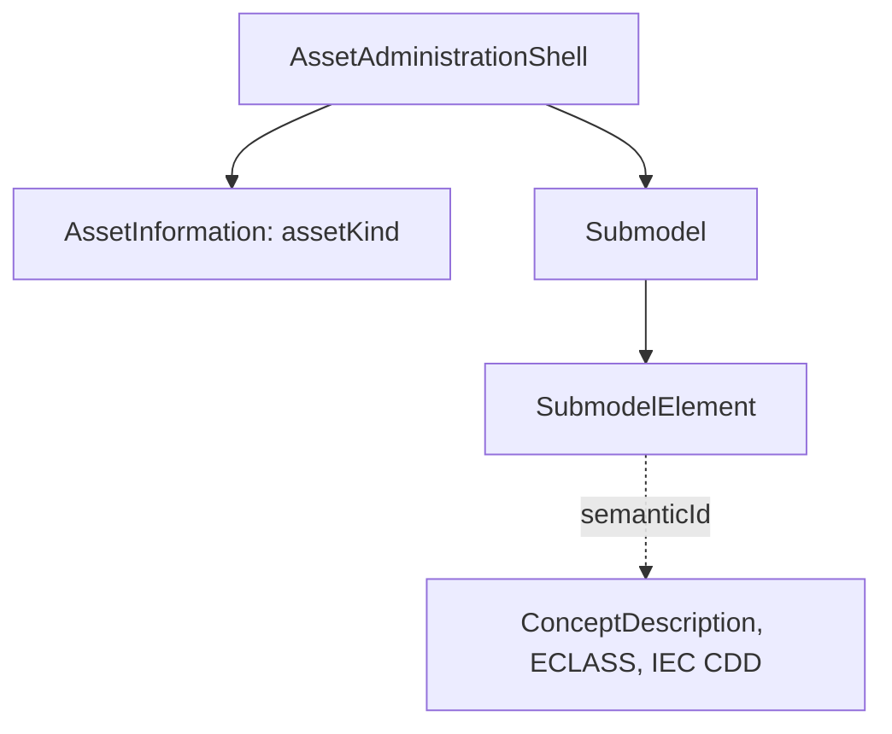

> **기준 출처:** [IDTA-01001-3-0-1 AAS Part 1: Metamodel (V3.0.1)](https://industrialdigitaltwin.org/wp-content/uploads/2024/06/IDTA-01001-3-0-1_SpecificationAssetAdministrationShell_Part1_Metamodel.pdf) · [IDTA AAS 사양](https://industrialdigitaltwin.org/en/content-hub/aasspecifications) · [Bader, Maleshkova 2019](https://arxiv.org/abs/1909.00690) / 확인일 2026-11-12
> **시리즈:** [목차](/posts/00-ontology-series/) | 이전 → [13. OPC UA 정보 모델](/posts/13-opc-ua-information-model/) | 다음 → [15. FSM 과 온톨로지](/posts/15-state-machine-ontology/)

자산관리쉘(Asset Administration Shell, AAS)은 Plattform Industrie 4.0 과 IDTA(Industrial Digital Twin Association)가 만들어 온 사양이고, 구조는 IEC 63278-1(1.0판, 2023-12-14)이 국제표준으로 정했다. 사양의 정의로 AAS 는 「자산의 표준화된 디지털 표현」이고, 디지털 트윈은 「일련의 사용 사례 요구를 충족하기에 충분한 디지털 표현」이다. 사양은 AAS 로 디지털 트윈을 구현하려는 개발자를 독자로 둔다. 이 글은 메타모델 V3.0.1(2024-06)을 읽었다.

## 1. 자산, Type 자산, Instance 자산

| 용어 | 사양의 정의 |
| --- | --- |
| 자산 (asset) | 개인, 조직, 정부에 가치가 있는 물리적, 디지털, 무형의 실체. 장비, 부품, 공정 정의, 소프트웨어 라이선스 등 |
| Type 자산 | 공통 특성을 가진 Instance 자산 집합의 (추상) 표현. 그 집합은 실제로 있을 수도 없을 수도 있다 |
| Instance 자산 | 유일하게 식별되는 특정 자산. 이 기계, 이 부품 |

쉘의 `assetInformation` 은 그 자산이 Type 인지 Instance 인지를 `assetKind` 로 밝힌다. 쉘 사이의 `derivedFrom` 은 한 쉘이 다른 쉘에서 파생됐다는 관계이고, 사양은 이 관계를 Instance 자산의 생애 내내 유지해야 Type 쪽 갱신을 Instance 쪽으로 자동으로 또는 요청 시 전달할 수 있다고 설명한다.

02편의 클래스와 개체 구분이 AAS 에서는 `derivedFrom` 으로 이어진 쉘 두 개로 나타난다.

## 2. 쉘의 구조



| 클래스 | 사양의 설명 |
| --- | --- |
| AssetAdministrationShell | Identifiable 이라 전역 유일 ID 를 가진다. assetInformation 1개, submodel 참조 0개 이상, derivedFrom 0..1 |
| Submodel | 자산의 한 측면. 각 Submodel 은 잘 정의된 영역을 다루고, 표준화되면 템플릿이 된다 |
| SubmodelElement (추상) | 자산을 서술하고 구분하는 요소. HasSemantics 를 상속한다 |
| ConceptDescription | 속성 같은 요소의 의미를 정의한다. `isCaseOf` 로 호환되거나 파생된 외부 정의를 가리킨다 |

SubmodelElement 의 하위 타입은 Property, MultiLanguageProperty, Range, Blob, File, ReferenceElement, RelationshipElement, AnnotatedRelationshipElement, Entity, Operation, Capability, BasicEventElement, SubmodelElementCollection, SubmodelElementList 다. 값, 문서, 관계, 다른 자산(Entity), 호출(Operation), 이벤트가 모두 같은 「요소」로 다뤄진다.

## 3. semanticId — 이름이 아니라 뜻을 가리킨다

사양 4.3.1 절은 식별자의 목적을 둘로 든다. 쉘의 모든 요소를 유일하게 구분하는 것, 그리고 요소를 Submodel 템플릿이나 속성 정의 같은 외부 정의에 연결해 데이터에 의미를 묶는 것이다. 외부 저장소의 예가 ECLASS 와 IEC CDD 다. 4.4.1 절의 정확 일치 예는 이렇다.

```text
Property idShort "ManufacturerName"  semanticId 0173-1#02-AAO677#002
Property idShort "Herstellername"    semanticId 0173-1#02-AAO677#002
→ 이름은 달라도 의미가 정확히 같다
```

idShort 는 주소를 찾는 이름일 뿐이고 의미는 semanticId 가 가리키는 곳에 있다. 사양은 버전만 다른 IRDI(`#002` 와 `#003`)도 같은 의미로 볼 수 있다고 적는다. ECLASS 규칙상 새 버전은 하위 호환이고, 호환이 깨지면 새 IRDI 를 만들기 때문이다. IRDI 앞의 `0173` 은 ECLASS 의 조직 식별자다. 04편의 IRI 처럼 전역에서 하나인 식별자가 회사 사이의 의미 일치를 맡는다.

## 4. Submodel 템플릿

사양 4.5.2 절에 따르면 2020년 11월 첫 템플릿 둘, 명판(nameplate)과 일반 기술 데이터(generic technical data)가 나왔다. 템플릿에는 개념 정의의 식별자가 이미 정해져 있어서, 인스턴스를 만들 때는 의미 참조와 값을 가진 속성만 만들면 된다. 요소가 선택인지 같은 개수 조건도 템플릿이 정한다. 등록된 템플릿은 `submodel-templates` 저장소의 `published` 폴더에 있다(예: Digital Nameplate 3.0.3).

어떤 요소가 어떤 semanticId 로 있어야 하는지 정하는 템플릿은 TBox 에, 값을 채운 Submodel 은 ABox 에 대응한다. 사양도 템플릿이 개념 사전과 온톨로지를 참조할 수 있다고 적는다.

## 5. 같은 메타모델, 여러 직렬화

메타모델은 UML 로 적은 기술 중립 사양이고, 생애 단계에 따라 XML, JSON, RDF, AutomationML, OPC UA 정보 모델로 옮긴다. V3.0 부터 XML, JSON, RDF 매핑 규칙은 스키마와 함께 GitHub 저장소에 있고, 파일 교환용 AASX 패키지는 Part 5 가 맡는다. OPC UA 쪽은 13편의 정보 모델과 만난다.

## 6. Semantic AAS — RDF 로 옮기면

Bader 와 Maleshkova(2019)는 Industrie 4.0 표준화와 시맨틱 웹 연구가 서로의 요구와 용어를 거의 보지 않는다고 진단하고 AAS 를 RDF 로 표현했다.

- 당시 사양의 클래스마다 OWL 클래스를, 속성마다 객체 속성이나 데이터 속성을 만들었다.
- semanticId 만은 속성으로 옮기지 않았다. RDF 에서는 개체의 URI 자체가 그 식별자이기 때문이다.
- RML 매핑, 검증용 SHACL shape, `owl:sameAs` 와 `rdfs:subClassOf` 기반 규칙 추론을 함께 제공했다.
- 늘어나는 부담을 재 보고, 의미 올리기(semantic lifting)가 제한된 장치나 임베디드 장치에서도 감당할 만하다고 결론 냈다.

## 7. OPC UA, AAS, OWL 온톨로지

| | OPC UA (13편) | AAS | OWL 온톨로지 (10~12편) |
| --- | --- | --- | --- |
| 무엇을 서술하나 | 장치의 현재 구성과 값 | 자산의 생애 정보 | 분야의 개념과 공리 |
| 타입과 인스턴스 | ObjectType, Object | Type 쉘, Instance 쉘 (derivedFrom) | Class, Individual |
| 뜻은 어디에 | 동반 사양의 타입 정의 | semanticId 가 가리키는 사전 | 공리 |
| 추론 | 없다 | 메타모델에는 없다 | 있다 |

> 메타모델 세부는 V3.0.1 기준이다(최신 V3.2). Semantic AAS 논문은 2019년 당시 사양을 대상으로 했다.
{: .prompt-info }

## 8. 정리

- AAS 는 자산의 표준화된 디지털 표현이다. Type 자산과 Instance 자산을 `assetKind` 로 구분하고 `derivedFrom` 으로 잇는다.
- 의미는 이름(idShort)이 아니라 semanticId 가 가리키는 ECLASS, IEC CDD 같은 사전에 있다.
- Submodel 템플릿은 TBox, 값을 채운 Submodel 은 ABox 에 대응한다.
- RDF 로 옮기면 개체의 URI 가 식별자 노릇을 하고, 규칙 추론과 SHACL 검증을 붙일 수 있다.

## 참고

- [IDTA-01001-3-0-1 AAS Part 1: Metamodel (PDF)](https://industrialdigitaltwin.org/wp-content/uploads/2024/06/IDTA-01001-3-0-1_SpecificationAssetAdministrationShell_Part1_Metamodel.pdf)
- [IDTA AAS Specifications](https://industrialdigitaltwin.org/en/content-hub/aasspecifications)
- [admin-shell-io/aas-specs-metamodel (GitHub)](https://github.com/admin-shell-io/aas-specs-metamodel)
- [admin-shell-io/submodel-templates (GitHub)](https://github.com/admin-shell-io/submodel-templates)
- [IEC 63278-1:2023 (IEC Webstore)](https://webstore.iec.ch/en/publication/65628)
- [ECLASS Conceptual data model](https://eclass.eu/support/technical-specification/data-model/conceptual-data-model)
- [S. R. Bader, M. Maleshkova, The Semantic Asset Administration Shell, arXiv:1909.00690](https://arxiv.org/abs/1909.00690)
