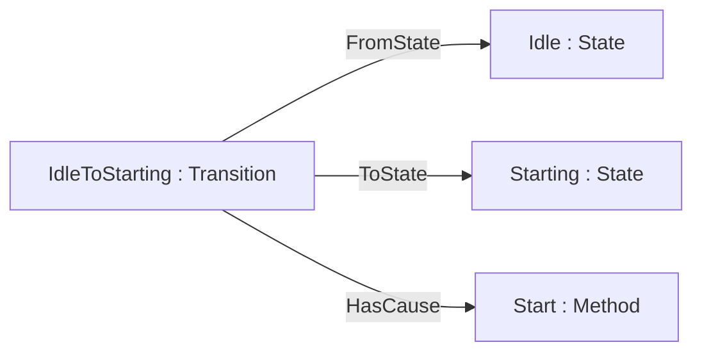

> **기준 출처:** [OPC 10000-16 v1.05](https://reference.opcfoundation.org/Core/Part16/v105/docs/4) · [OPC 30050 PackML](https://reference.opcfoundation.org/specs/OPC-30050/6.3.8) · [ETG Device Protocol Poster](https://www.ethercat.org/download/documents/EtherCAT_Device_Protocol_Poster.pdf) / 확인일 2026-11-12
> **시리즈:** [목차](/posts/00-ontology-series/) | 이전 → [14. AAS 자산관리쉘과 디지털 트윈](/posts/14-aas-digital-twin/) | 다음 → [16. 지식그래프와 LLM](/posts/16-knowledge-graph-graphrag/)

CiA 402 드라이브, EtherCAT ESM, PackML 은 모두 FSM(유한 상태 머신)이다. OPC UA Part 16 의 방법으로 적으면 State 뿐 아니라 Transition 도 개체가 되어 FSM 하나가 작은 그래프가 된다. 그래프는 어느 State 에서 어느 State 로 갈 수 있는지를 담고, 어느 Transition 을 먼저 시험하는지 같은 실행 규칙은 담지 않는다.

## 1. OPC UA Part 16 — Transition 도 개체다

Part 16 은 FSM 을 타입(StateMachineType)과 현재 상태만 담는 인스턴스로 나눈다. State 는 StateType 의 Object, Transition 은 TransitionType 의 Object 다.

| 요소 | Part 16 의 표현 | [02편](/posts/02-ontology-building-blocks/)의 부품으로 |
| --- | --- | --- |
| State | StateType 의 Object. 하위 FSM 을 둘 수 있다 | 개체 |
| Transition | TransitionType 의 Object. FromState 와 ToState 참조를 정확히 하나씩 | 개체 |
| Cause | HasCause 참조. Method 가 대상이 된다 | 객체 속성 |
| Effect | HasEffect 참조. BaseEventType 의 하위 타입을 가리킨다 | 객체 속성 |
| 지금의 상태 | CurrentState 와 LastTransition Variable | 값 |



PackML 의 한 Transition 이다. Transition 이 간선이 아니라 노드라서 Cause 와 Effect 를 매달 수 있다. StateType 과 TransitionType 은 클래스, Idle 과 IdleToStarting 은 개체, FromState 와 HasCause 는 객체 속성이니 [04편](/posts/04-rdf-triples/)의 트리플로 바로 옮겨진다.

## 2. 표준 FSM 셋을 같은 틀에 놓기

CiA 402 와 ESM 은 Part 16 의 FSM 이 아니지만 같은 틀에 놓아 본다.

| FSM | State | Transition 을 일으키는 것 | 현재 상태 |
| --- | --- | --- | --- |
| PackML Execute (OPC 30050) | 12개 (Idle, Starting, Execute, Holding, Held, Complete 등) | Method 호출. Cause 가 없는 Transition 은 서버 내부 로직 | CurrentState |
| CiA 402 | 8개 (Switch on disabled, Ready to switch on, Switched on, Operation enabled, Fault 등) | 상위 제어기의 Controlword, 내부 이벤트 | Statusword |
| EtherCAT ESM | INIT, PRE-OPERATIONAL, BOOT(선택), SAFE-OPERATIONAL, OPERATIONAL | MainDevice 가 AL Control(0x0120)에 쓰는 요청 | AL Status(0x0130) |

각 FSM 은 [CiA 402 드라이브 FSM](/posts/13-cia402-drive-state-machine/), [EtherCAT ESM](/posts/08-esm-state-machine/), [CAN 오류 상태](/posts/08-can-error-states-busoff/) 글에 있다. 나란히 놓으면 세 가지가 보인다.

- **State 이름이 벤더와 무관하다.** 어느 드라이브든 Operation enabled 는 같은 State 다. python-canopen 의 CiA 402 모듈은 Transition 을 (출발 State, 도착 State) 쌍을 키로 하는 표로 둔다
- **판 사이의 차이가 개체의 유무로 드러난다.** OPC 30050 은 ISA-TR88.00.02-2015 에 없는 Transition 5개(Holding 으로 가는 것)를 확장용으로 넣어 모두 19개다
- **Cause 의 모양이 다르다.** Method 호출, Controlword 값, 레지스터 쓰기가 모두 HasCause 의 대상 자리에 놓인다. StartingToExecute 처럼 Cause 가 없는 Transition 은 주소 공간에 드러나지 않는 서버 내부 로직의 몫이다(Part 16)

> OPC 30050 의 이 절은 본문에 Method 가 여섯이라 적고 표에는 7개를 싣는다.
{: .prompt-warning }

## 3. 그래프가 되면 물을 수 있는 것

참조 이름을 RDF 속성 `:fromState`, `:toState` 로 옮겼다고 하자. 도달 가능성은 [07편](/posts/07-sparql-shacl-property-graph/)의 SPARQL 속성 경로로 나온다.

```sparql
SELECT DISTINCT ?s WHERE { :Idle (^:fromState/:toState)+ ?s }
```

괄호가 필요하다. SPARQL 1.1 에서 단항 `+` 는 `^` 와 `/` 보다 먼저 묶이므로, 괄호 없이 쓰면 `+` 가 `:toState` 에만 붙는다.

Part 16 의 「정확히 하나」는 SHACL 의 닫힌 세계 검사가 된다.

```turtle
:TransitionShape a sh:NodeShape ;
    sh:targetClass :Transition ;
    sh:property [ sh:path :fromState ; sh:minCount 1 ; sh:maxCount 1 ] ;
    sh:property [ sh:path :toState ;   sh:minCount 1 ; sh:maxCount 1 ] .
```

| 질문 | 그래프로 답이 나오나 |
| --- | --- |
| 어느 State 까지 갈 수 있나 | 나온다. 속성 경로 |
| 들어오는 Transition 이 없는 State 는 | 나온다. `FILTER NOT EXISTS` |
| 나가는 Transition 이 없는 State 는 | 나온다. `sh:inversePath :fromState` 에 `sh:minCount 1` |
| 동시에 참이 되는 Transition 이 둘인가 | 일부만. 조건식의 뜻이 필요하다 |

## 4. 그래프에 남지 않는 것 — 실행 규칙

> 아래 표는 문헌의 대응표가 아니라 Stateflow 요소를 Part 16 의 틀에 맞대어 본 해석이다.
{: .prompt-info }

| Stateflow | Part 16 의 틀에서 | 빠지는 것 |
| --- | --- | --- |
| State | StateType 의 개체 | entry, during, exit Action 의 내용 |
| Transition | TransitionType 의 개체 | 실행 순서 번호. 같은 출발점의 Transition 은 이 순서로 시험한다 |
| Condition `[...]` | HasCause 의 대상 (이름) | 조건식과 지금의 값 |
| Condition Action, Transition Action | HasEffect 의 대상 (이름) | 실행 시점 (조건이 참인 즉시와 경로 전체가 유효할 때) |
| Junction | 대응 없음 | 막힌 경로에서 되돌아가 다른 경로를 시험하는 backtracking |
| `after()` | 대응 없음 | 시간 |

빠지는 것은 모두 「언제, 어떤 순서로」에 관한 규칙이다. [12편](/posts/12-soma/)의 SOMA 도 OWL 이 순서 추론을 잘 지원하지 않아 전용 추론기를 붙였다.

EtherCAT 도 같다. INIT 에서 PRE-OPERATIONAL 로 가는 Transition 이 그래프에 있어도 장치는 요청을 거부하고 AL Status Code(0x0134)로 사유를 알릴 수 있다. ETG 포스터의 예는 메일박스 설정 오류(0x0016)다.

FSM 을 온톨로지로 적는 일은 설계 문서를 기계가 읽게 만드는 일이지 실행기를 만드는 일이 아니다. 「온톨로지로 FSM 을 검증했다」는 구조를 검증했다는 뜻이다.

## 5. 정리

- Part 16 에서 State 와 Transition 은 둘 다 Object 다. PackML, CiA 402, ESM 이 같은 틀에 놓이고 판 사이의 차이는 개체의 유무로 드러난다
- 도달 가능성과 「정확히 하나」 같은 구조 질문은 SPARQL 과 SHACL 로 답이 나온다
- 실행 순서, 조건의 현재 값, Action 의 실행 시점, backtracking, 시간, 요청 거부는 그래프에 남지 않는다

## 참고

- [OPC 10000-16 State Machines v1.05, §4](https://reference.opcfoundation.org/Core/Part16/v105/docs/4)
- [OPC 30050 PackML, §6.3.8](https://reference.opcfoundation.org/specs/OPC-30050/6.3.8)
- [CiA 402 series](https://www.can-cia.org/can-knowledge/cia-402-series-canopen-device-profile-for-drives-and-motion-control)
- [python-canopen p402](https://canopen.readthedocs.io/en/latest/_modules/canopen/profiles/p402.html)
- [ETG EtherCAT Device Protocol Poster](https://www.ethercat.org/download/documents/EtherCAT_Device_Protocol_Poster.pdf)
- [W3C SPARQL 1.1 Query](https://www.w3.org/TR/sparql11-query/) · [W3C SHACL](https://www.w3.org/TR/shacl/)
- [MathWorks: Transition Between Operating Modes](https://www.mathworks.com/help/stateflow/ug/transitions.html) · [Evaluate Transitions](https://www.mathworks.com/help/stateflow/ug/evaluate-transitions.html)
- [Beßler et al., SOMA, arXiv:2011.11972](https://arxiv.org/abs/2011.11972)
