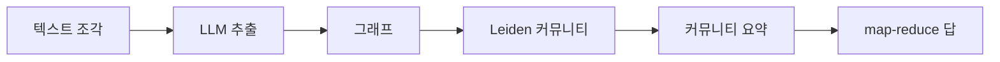

> **기준 출처:** [Edge et al., From Local to Global, arXiv:2404.16130v2](https://arxiv.org/abs/2404.16130) · [Microsoft Research 블로그](https://www.microsoft.com/en-us/research/blog/graphrag-unlocking-llm-discovery-on-narrative-private-data/) · [GraphRAG 문서](https://microsoft.github.io/graphrag/) / 확인일 2026-11-12
> **시리즈:** [목차](/posts/00-ontology-series/) | 이전 → [15. FSM 과 온톨로지](/posts/15-state-machine-ontology/) | 다음 → [17. Palantir 식 운영 온톨로지](/posts/17-palantir-ontology/)

GraphRAG 는 LLM 으로 문서에서 개체와 관계를 뽑아 지식그래프를 짓고, 그 그래프를 덩어리로 나눠 미리 요약해 둔 뒤 그 요약으로 답한다. 이 그래프에도 사전이 있기는 하다. 추출 프롬프트에 넣는 개체 타입 목록이다. 관계 타입, 클래스 계층, 공리는 없다. 파이프라인을 따라간 뒤 온톨로지가 더 들어갈 자리를 본다.

## 1. 기본 RAG 가 약한 질문

기본 RAG 는 질문과 비슷한 텍스트 조각을 찾아 LLM 에 넣는다. Microsoft Research 블로그(2024-02)는 이 방식이 약한 곳을 둘로 적는다.

| 약점 | 블로그의 설명 |
| --- | --- |
| 점 잇기 | 여러 조각에 흩어진 정보를 공유 속성으로 이어야 새 통찰이 나올 때 |
| 전체 보기 | 큰 문서 묶음 전체에 걸친 개념을 요약적으로 이해해야 할 때 |

논문은 두 번째를 전역 감지(global sensemaking) 질문이라 부른다. 논문의 예는 「이 데이터셋의 주요 주제는 무엇인가」처럼 코퍼스 전체를 향한 질문이고, 논문은 이것을 검색이 아니라 질의 중심 요약(query-focused summarization)으로 다룬다.

## 2. 파이프라인

| 단계 | 하는 일 (논문 기준) |
| --- | --- |
| 조각 | 600 토큰 조각, 100 토큰 겹침 |
| 추출 | LLM 이 개체, 관계, claim(개체에 관한 사실 진술)을 뽑는다. 프롬프트는 데이터 도메인에 맞춘 개체 타입과 few-shot 예시를 받는다 |
| 그래프 | 같은 개체와 관계의 인스턴스를 노드와 간선 하나로 모으고 설명을 요약한다. 중복 횟수가 간선 가중치가 된다 |
| 커뮤니티 | Leiden 알고리즘을 계층적으로 적용해 더 나눌 수 없을 때까지 하위 커뮤니티를 찾는다 |
| 요약 | 아래 층부터 위로 커뮤니티 요약을 만든다. 실험의 C0 이 최상위, C3 이 아래 층이다 |
| 답 | 커뮤니티 요약마다 부분 답을 병렬로 만들고(map) 하나로 합친다(reduce) |

실험 규모는 팟캐스트 대본 약 100만 토큰에서 노드 8,564개와 간선 20,691개, 뉴스 기사 약 170만 토큰에서 노드 15,754개와 간선 19,520개다. LLM 을 심판으로 써서 벡터 RAG 와 비교했고, 포괄성 승률은 72~83 %(팟캐스트)와 72~80 %(뉴스), 다양성 승률은 75~82 %와 62~71 % 였다. 최상위 요약(C0)만 쓰면 원문을 같은 방식으로 요약할 때보다 문맥 토큰이 97 % 넘게 줄면서 벡터 RAG 대비 포괄성 72 %, 다양성 62 % 승률을 유지했다.

공개 구현의 문서는 질의 방식을 넷으로 나눈다. 코퍼스 전체 질문용 Global Search, 특정 개체에서 이웃으로 퍼지는 Local Search, 거기에 커뮤니티 정보를 더한 DRIFT Search, 기본 RAG 로 충분할 때의 Basic Search 다.

## 3. 이 그래프에 온톨로지는 얼마나 있나

| 물음 | GraphRAG 의 그래프 (논문 기준) |
| --- | --- |
| 개체와 관계(ABox) | 있다. 노드는 개체, 간선은 관계 |
| 개체 타입 목록 | 있다. 추출 프롬프트에 넣는다 (예시 프롬프트는 ORGANIZATION, PERSON) |
| 관계 타입 | 없다. 관계는 (출발 개체, 도착 개체, 관계 설명 문장, 강도 점수)로 뽑는다 |
| 클래스 계층과 공리 | 없다 |
| 같은 개체 판정 | 이름의 정확한 문자열 일치. 더 느슨한 매칭은 프롬프트나 코드를 조금 고쳐 쓸 수 있다고 적는다 |
| 추론 | 없다. 커뮤니티 탐지(그래프 알고리즘)와 LLM 요약이 있다 |

사전은 개체 타입 목록 한 장이다. Hogan 등의 지식그래프 서베이는 스키마, 식별(identity), 맥락의 역할을 나눠 보고, 지식을 표현하고 뽑는 기법을 연역적 기법과 귀납적 기법으로 나눠 설명한다. 그 말로 옮기면 GraphRAG 의 그래프는 LLM 이 귀납적으로 뽑은 그래프이고, 스키마는 얇고, 식별은 문자열에 기대고, 연역적 층은 없다.

## 4. 온톨로지가 더 낄 수 있는 자리

> 아래 세 자리는 논문의 주장이 아니다. 논문이 적은 추출 방식에 이 시리즈의 도구를 맞대어 본 해석이다.
{: .prompt-info }

| 자리 | 논문의 방식 | 온톨로지로 더하면 | 다룬 편 |
| --- | --- | --- | --- |
| 추출 어휘 | 개체 타입 목록 | 관계 타입 목록과 각 관계의 주어, 목적어 타입을 프롬프트에 준다 | [08편](/posts/08-competency-questions/) |
| 개체 통합 | 정확한 문자열 일치 | 개체마다 IRI 를 주고, 같은 것을 가리키는 두 이름은 `owl:sameAs` 로 묶는다 | [04편](/posts/04-rdf-triples/), [06편](/posts/06-reasoning-open-world/) |
| 검사 | 없음 | 뽑힌 그래프를 RDF 로 옮겨 SHACL 형상으로 검사한다 | [07편](/posts/07-sparql-shacl-property-graph/) |

OWL 2 Primer 는 두 이름이 같은 개체를 가리킨다고 선언할 수 있고, 그러면 추론기가 한쪽의 정보를 다른 쪽에도 적용한다고 설명한다. SHACL 은 RDF 그래프를 조건 집합에 비춰 검사하는 언어다. 세 자리 모두 LLM 이 뽑기 전이나 뽑은 직후에 있다. 온톨로지가 답을 만드는 것이 아니라 LLM 이 만든 그래프를 일관되게 붙잡는다.

## 5. 틀린 답에 대해 층마다 막는 것

| 층 | 막는 것 | 못 막는 것 |
| --- | --- | --- |
| 그래프와 커뮤니티 요약 | 흩어진 사실을 못 잇는 것, 전체를 못 보는 것 | 뽑힌 사실 자체가 틀린 것 |
| 온톨로지 (타입, IRI) | 같은 것을 다른 이름으로 부르는 것, 관계 이름이 제각각인 것 | 문서에 없는 사실 |
| 검사 (SHACL) | 모양이 틀린 트리플 | 모양은 맞고 내용이 틀린 트리플 |

이 표도 해석이다. 어느 층도 문서에 없는 사실을 지어내는 것을 구조로 막지 못한다. 남는 것은 출처 확인이다. Microsoft 블로그는 GraphRAG 가 답마다 원문으로 가는 출처(provenance)를 함께 주고, 사람이 그것으로 답을 빠르게 감사할 수 있다고 적는다. LLM 을 감싸는 루프와 하네스 쪽 이야기는 [에이전틱 엔지니어링 목차](/posts/00-agentic-series/)에 있다.

## 6. 정리

- GraphRAG 는 조각, LLM 추출, 그래프, Leiden 커뮤니티, 상향 요약, map-reduce 답 순서로 동작하고 코퍼스 전체를 향한 질문을 노린다
- 그래프의 사전은 개체 타입 목록뿐이다. 관계 타입, 계층, 공리, 추론이 없고 같은 개체는 문자열로 판정한다
- 온톨로지가 더 낄 자리는 추출 어휘, 개체 통합(IRI, `owl:sameAs`), 검사(SHACL)다. 모두 LLM 이 만든 것을 붙잡는 자리다
- 문서에 없는 사실을 지어내는 것은 어느 층도 구조로 막지 못하고, 출처 확인이 그 몫을 한다

## 참고

- [D. Edge et al., From Local to Global: A Graph RAG Approach to Query-Focused Summarization, arXiv:2404.16130](https://arxiv.org/abs/2404.16130)
- [Microsoft Research, GraphRAG: Unlocking LLM discovery on narrative private data](https://www.microsoft.com/en-us/research/blog/graphrag-unlocking-llm-discovery-on-narrative-private-data/)
- [Microsoft GraphRAG 문서](https://microsoft.github.io/graphrag/)
- [A. Hogan et al., Knowledge Graphs, ACM Computing Surveys 54(4), 2021](https://arxiv.org/abs/2003.02320)
- [W3C OWL 2 Primer](https://www.w3.org/TR/owl2-primer/)
- [W3C SHACL](https://www.w3.org/TR/shacl/)
