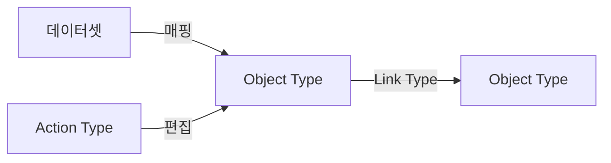

> **기준 출처:** [Palantir Foundry: Ontology overview](https://www.palantir.com/docs/foundry/ontology/overview) · [Core concepts](https://www.palantir.com/docs/foundry/ontology/core-concepts) · [Action types](https://www.palantir.com/docs/foundry/action-types/overview) / 확인일 2026-11-12
> **시리즈:** [목차](/posts/00-ontology-series/) | 이전 → [16. 지식그래프와 LLM](/posts/16-knowledge-graph-graphrag/) | 다음 → [18. 에이전트 도구 스키마는 작은 온톨로지다](/posts/18-tool-schema-ontology/)

데이터 플랫폼 쪽에서 쓰는 「온톨로지」의 예로 Palantir Foundry 의 Ontology 를 본다. 공개 문서의 정의는 조직의 운영 층(operational layer)이다. 부품 대부분은 OWL 의 부품과 짝이 맞는다. 다른 점은 객체를 바꾸는 Action Type 이 정식 부품이라는 것, 그리고 부품 목록에 공리와 추론기가 없다는 것이다. 이 글은 Palantir 공개 문서에 적힌 것만 다룬다.

## 1. 정의 — 데이터 위의 운영 층

문서에 따르면 Ontology 는 플랫폼에 통합된 디지털 자산(데이터셋, 가상 테이블, 모델) 위에 앉아 그것들을 실세계 대응물에 잇는다. 대응물은 공장, 장비, 제품 같은 물리 자산부터 고객 주문, 금융 거래 같은 개념까지다. 많은 경우 조직의 디지털 트윈 노릇을 한다고도 적는다. [14편](/posts/14-aas-digital-twin/)에서 자산 단위로 쓰던 디지털 트윈이라는 말이 여기서는 조직 전체에 붙는다.

## 2. 부품 — 의미 요소와 운동 요소

문서는 부품을 의미 요소(객체, 속성, 링크)와 운동 요소(액션, 함수, 동적 보안)로 나눈다.

| 부품 | 문서의 정의 | [02편](/posts/02-ontology-building-blocks/)의 부품으로 |
| --- | --- | --- |
| Object Type | 실세계 개체나 사건의 스키마 정의. Object 는 인스턴스 하나, Object Set 은 여럿 | 클래스와 개체 |
| Property | 실세계 개체나 사건이 가진 특성의 스키마 정의 | 데이터 속성 |
| Shared Property | 여러 Object Type 에 쓸 수 있는 속성 | 클래스와 따로 정의하는 속성 |
| Link Type | 두 Object Type 사이 관계의 스키마 정의. Link 는 그 인스턴스 | 객체 속성 |
| Interface | Object Type 의 모양과 능력을 서술하는 타입. 다른 Interface 여럿을 확장할 수 있다 | 상위 클래스와 비슷한 자리 |
| Action Type | 객체, 속성값, 링크에 대한 변경 묶음의 정의. 제출 때의 부수 효과를 포함한다 | 대응 부품 없음 |
| Function | 입력 파라미터를 받아 출력을 내는 코드 로직 | 대응 부품 없음 |

## 3. Action Type — 쓰기가 부품이다

Action Type 은 객체, 속성값, 링크를 한 번에 바꾸는 변경 묶음과 부수 효과를 정의한다. 실행하면 변경이 Ontology 에 반영되고 writeback 데이터셋에 남는다. 문서의 예는 직원의 관리자를 바꾸는 액션으로, 두 관리자에게 알림을 보내는 부수 효과와 인사 담당만 실행할 수 있게 하는 검증을 붙인다. 같은 로직과 검증을 모든 사용자 화면에서 쓸 수 있다.

앞 편들의 온톨로지는 사실을 적고 추론하고 질의하는 쪽이었다. [15편](/posts/15-state-machine-ontology/)의 OPC UA Method 처럼 쓰기 쪽 부품이 정보 모델에 들어온 예는 있었지만, Palantir 는 쓰기를 온톨로지의 정식 부품으로 둔다.

에이전트 쪽에도 그대로 나온다. AIP Agent Studio 의 Action 도구는 에이전트가 온톨로지 편집을 실행하게 하고 자동 실행이나 사용자 확인 뒤 실행으로 설정할 수 있다. Object query 도구는 LLM 이 접근할 수 있는 Object Type 을 정한다. 도구 정의는 [18편](/posts/18-tool-schema-ontology/)에서 다룬다.

## 4. OWL 온톨로지와 나란히

| 물음 | OWL 온톨로지 | Palantir Ontology (공개 문서 기준) |
| --- | --- | --- |
| 클래스와 개체 | Class, Individual | Object Type, Object |
| 관계 | 객체 속성 | Link Type. 문서는 정의를 두 데이터셋의 조인에 비유한다 |
| 계층 | 클래스 계층. 추론기가 따라 나오는 사실을 끌어낸다 | Interface. 모양과 능력에 대한 계약 |
| 이름 | IRI | 기본 키. 객체마다 고유해야 하고 결정적인 값이 권장된다 |
| 개체가 생기는 곳 | 적은 사실과 추론 | backing datasource 의 행, 또는 액션 |
| 없는 사실 | 모른다 (열린 세계) | 문서에 명시 없음 |
| 쓰기 | 없음 | Action Type |
| 계산 | 추론기 | Function (코드) |

OWL 2 Primer 는 데이터베이스와 달리 OWL 2 에서는 빠진 사실이 참일 수도 있다고 설명한다. Palantir 문서는 이 문제를 말하지 않는다. 객체가 데이터셋의 행이나 액션으로만 생긴다는 점에서 데이터베이스 쪽에 가깝다고 판단된다.

이름에서도 갈린다. Gruber 는 기본 키가 모델링 과정의 산물일 뿐 영역의 무언가를 가리키지 않는다고 적고 온톨로지를 구현과 무관한 의미 수준의 명세로 둔다. 기본 키로 식별되는 Palantir 의 Object 는 이 점에서 데이터 모델 쪽이다.

## 5. 그래서 온톨로지인가

Gruber 는 같은 글에서 온톨로지를 쓰임으로 정의되는 공학의 도구이자 산물로 보고, 검색 API 가 질의 낱말의 용어집만 제공해도 그것이 온톨로지 노릇을 한다고 적었다. 이 자로 재면 Palantir Ontology 는 온톨로지다. 조직의 사물과 관계를 Object Type 과 Link Type 으로 명시해 적었고, 그 위의 응용이 같은 어휘와 같은 액션 로직을 쓴다.

동시에 [05편](/posts/05-rdfs-owl/)과 [06편](/posts/06-reasoning-open-world/)의 형식 논리 온톨로지는 아니다. 부품 목록에 공리와 추론기가 없고 계산은 Function 이라는 코드가 맡는다. 결함이라기보다 목적의 차이로 판단된다. 문서가 내세우는 것은 운영, 곧 지금 상태를 읽고 바꾸는 일이다.

「Palantir 가 온톨로지를 쓴다」는 말을 들으면 세 가지를 되묻는다. 사전이 있나(있다. Object Type, Link Type, Interface), 논리로 적혀 있나(아니다. 스키마와 코드다), 무엇을 하려나(운영. 읽고 바꾸고, 그 변경을 여러 화면과 에이전트가 같이 쓴다).

## 6. 정리

- Palantir 문서는 Ontology 를 데이터셋과 모델을 실세계 대응물에 잇는 조직의 운영 층으로 정의한다
- 의미 요소는 클래스, 데이터 속성, 객체 속성과 짝이 맞고, 운동 요소(Action Type, Function)는 짝이 없다
- Action Type 으로 쓰기가 정식 부품이 됐고 에이전트 도구에도 그대로 쓰인다
- 이름은 기본 키, 계산은 코드이고 공리와 추론기는 없다. 쓰임으로는 온톨로지가 맞고, 형식 논리 온톨로지는 아니다

## 참고

- [Palantir: Ontology overview](https://www.palantir.com/docs/foundry/ontology/overview) · [Core concepts](https://www.palantir.com/docs/foundry/ontology/core-concepts)
- [Palantir: Action types overview](https://www.palantir.com/docs/foundry/action-types/overview)
- [Palantir: Object types overview](https://www.palantir.com/docs/foundry/object-link-types/object-types-overview) · [Create an object type](https://www.palantir.com/docs/foundry/object-link-types/create-object-type)
- [Palantir: Link types overview](https://www.palantir.com/docs/foundry/object-link-types/link-types-overview) · [Interfaces overview](https://www.palantir.com/docs/foundry/interfaces/interface-overview)
- [Palantir: AIP Agent Studio tools](https://www.palantir.com/docs/foundry/agent-studio/tools)
- [T. Gruber, Ontology, Encyclopedia of Database Systems, 2009](https://tomgruber.org/writing/definition-of-ontology.pdf)
- [W3C OWL 2 Primer](https://www.w3.org/TR/owl2-primer/)
