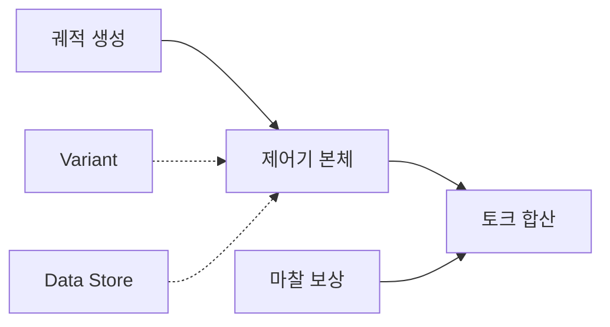
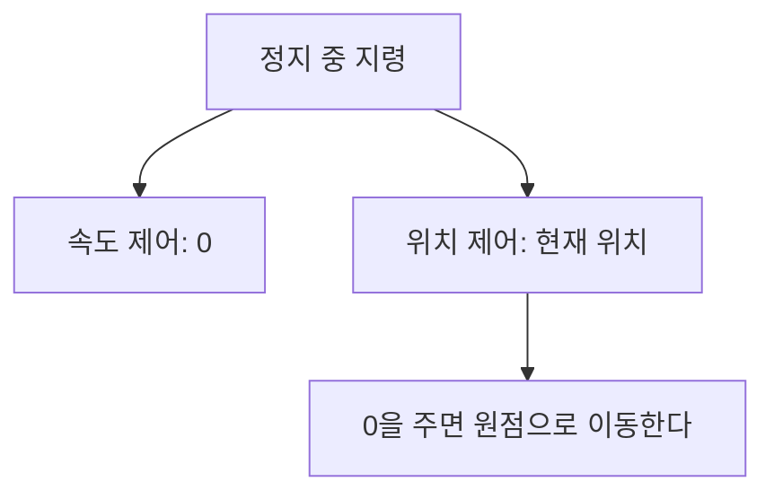

> **기준 출처:** [MathWorks Variant Subsystem](https://www.mathworks.com/help/simulink/slref/variantsubsystem.html) · Data Store Basics와 Data Store Write 레퍼런스 · quinticpolytraj와 Rotational Friction 레퍼런스 / 확인일 2026-11-13
> **시리즈:** [목차](/posts/00-mp-series/) | 이전 → [09. 샘플 시간과 솔버](/posts/09-sample-time-solver/) | 다음 → [11. Variant — 다 넣어 두고 고르면 켜지는 구조](/posts/11-simulink-variant/)

## 1. 이 글의 범위

제어기를 Simulink로 만들 때는 무엇을 계산하는가보다 어떻게 조립하는가에서 먼저 막힌다. 아래 네 가지가 그 조립을 정한다.

| 기제 | 정하는 것 | 층 |
| --- | --- | --- |
| Variant | 하나의 모델에서 무엇을 켜고 끌지 | 구조 |
| Data Store | 블록끼리 값을 어떻게 주고받을지 | 구조 |
| 궤적 생성 | 지령을 어떤 모양으로 만들지 | 알고리즘 |
| 마찰 보상 | 물리적 방해를 어떻게 미리 상쇄할지 | 알고리즘 |



궤적 생성은 제어기 앞에서 지령을 만들고 마찰 보상은 제어기 출력에 피드포워드로 더해진다. 점선의 둘은 신호를 만들지 않고 어떤 블록이 들어가며 어떻게 이어지는지를 정한다.

## 2. Variant — 다 넣어 두고 고르면 일부만 켜진다

Variant Subsystem은 여러 선택지를 담고 조건이 참인 하나만 활성화한다. 블록 구분은 [08편](/posts/08-hierarchy-conditional-execution/)에서 다뤘다. 결과물을 가르는 것은 활성화 시점(Variant activation time)이다.

| 값 | 언제 정해지나 | 생성 코드 |
| --- | --- | --- |
| `update diagram` | 모델을 갱신할 때 | 활성 선택지만 들어간다 |
| `code compile` | C 전처리기가 정한다 | 모든 선택지가 `#if`와 `#elif`로 감싸져 들어간다 |
| `startup` | 실행 시작 때 | 모든 선택지가 일반 `if`로 들어간다 |

하나의 소스로 여러 제품을 내려면 `code compile`, 시뮬레이션만 할 거면 `update diagram`이다. 이 밖에 `update diagram analyze all choices`와 `runtime`이 있다. `code compile`과 `startup`에서는 선택지가 atomic으로 취급된다. 예제 문서는 Treat as atomic unit을 켜라고 안내하고 Variant Assembly Subsystem 문서는 자동으로 켜진다고 적으므로 설정 창에서 확인한다.

- 조건은 expression 모드에서 변수의 식으로 쓴다. 변수를 `Simulink.VariantControl`로 만들면 활성화 시점을 변수에 붙일 수 있고, 한 블록이 이런 변수를 여럿 쓰면 활성화 시점이 모두 같아야 한다.
- 활성 선택지의 포트는 Simulink가 모델 컴파일 때 자동으로 배선한다.
- 선택지가 하나도 맞지 않을 때 자리를 비우려면 `EmptyChoice`를 켠다. 이때 출력 포트는 0을 낸다.

주석 처리와의 차이, 저장 클래스, 함정과 확인 방법은 [11편](/posts/11-simulink-variant/)에서 다룬다.

## 3. Data Store — 편하지만 순서를 사람이 책임진다

Data Store는 신호선 없이 전역 변수처럼 값을 주고받는다. 세 블록의 구성은 [07편](/posts/07-stateful-blocks-datastore/)에서 다뤘고 여기서는 조립할 때 따라오는 대가만 본다.

MathWorks 문서에 따르면 읽기가 쓰기보다 먼저 일어나면 지연이 생겨 읽기는 이전 스텝의 값을 얻는다. 신호선과 달리 Data Store는 계산 순서를 강제하지 않는다. 같은 스텝에 두 Write가 같은 저장소에 쓰면 결과를 예측할 수 없다.

| 할 일 | 내용 |
| --- | --- |
| 우선순위를 준다 | 읽기와 쓰기를 atomic 서브시스템이나 Model 블록에 넣고 Priority로 순서를 정한다 |
| 진단을 켠다 | read before write, write after read, write after write 진단으로 의도하지 않은 순서를 잡는다 |
| 정렬 방식 변경에 주의한다 | task-based sorting으로 바꾸면 Data Store 블록의 상대 순서가 달라질 수 있다. Upgrade Advisor가 알려 준다 |

Data Store Memory 블록을 어디에 두느냐가 저장소의 범위를 정한다. 최상위에 두면 모든 계층에서 보이고 서브시스템 안에 두면 그 아래에서만 보인다. 최상위 저장소 가운데 한 서브시스템 안에서만 쓰이는 것을 그 안으로 내리면 로직을 건드리지 않고 모듈 경계가 생긴다.

> **진단이 조용하다고 문제가 없는 것은 아니다.** 실측: 버리는 최소 모델에 Data Store Memory 하나와 같은 스텝에 쓰는 Data Store Write 둘을 두고 진단을 켠 채 돌렸다. 문서가 결과를 예측할 수 없다고 한 바로 그 상황인데 경고는 0건이었다. 원인(저장소 범위, 정렬 방식, 진단 경로의 차이 등)은 확인하지 못했다. 경고 0건을 근거로 쓰려면 먼저 그 검사기가 문제를 낼 수 있음을 보여야 한다.
{: .prompt-warning }

## 4. 궤적 생성 — 왜 5차 다항식인가

위치를 직선으로 이으면 속도와 가속도가 계단처럼 튄다. 차수가 오를수록 맞출 수 있는 경계 조건이 늘어난다.

| 차수 | 맞출 수 있는 경계 조건 | 결과 |
| :-: | --- | --- |
| 1차 | 위치 2개 | 속도가 불연속이다 |
| 3차 | 위치 2개, 속도 2개 | 가속도가 불연속이라 충격이 생긴다 |
| 5차 | 위치 2개, 속도 2개, 가속도 2개 | 가속도까지 연속이다 |

5차 다항식은 계수가 6개라 시작과 끝의 위치, 속도, 가속도 6개를 모두 지정할 수 있다. 양 끝에서 속도와 가속도가 0인 이동이면 정규화 시간 `s = t / T`에 대해 다음 꼴이다.

```text
q(t) = q0 + (qf - q0) * (10 s^3 - 15 s^4 + 6 s^5),   0 <= s <= 1
```

가속도가 0에서 출발해 0으로 끝나므로 기계에 가는 충격이 줄어든다. MathWorks의 `quinticpolytraj`도 속도와 가속도 경계 조건의 기본값이 0이다.

같은 생성기라도 제어 모드에 따라 멈췄을 때의 지령이 다르다.



위치 제어에서 0은 정지가 아니라 원점 지령이다. 안전과 직결되므로 모드 전환 때 생성기의 초기값을 확인한다.

## 5. 마찰 보상 — 왜 미리 빼 주나

관절이 움직일 때 실제 토크는 지령대로 나오지 않고 마찰이 먼저 일부를 먹는다. 표준 모델은 쿨롱 마찰과 점성 마찰을 더한다.

```text
tau_friction = tau_c * sign(v) + b * v
               (쿨롱, 건마찰)     (점성, 속도 비례)
```

| 성분 | 성질 | 흔한 대응 |
| --- | --- | --- |
| 쿨롱 | 속도의 부호만 따르는 상수, 0 부근에서 불연속 | PID로 잡기 어려워 피드포워드로 미리 더한다 |
| 점성 | 속도에 비례 | 속도 피드포워드 |
| 정지(static) | 움직이기 직전의 문턱 | 비선형이라 별도 알고리즘이 필요하다 |

Simscape의 Rotational Friction 블록은 마찰 토크를 Stribeck, 쿨롱, 점성 성분의 합으로 두고 쿨롱 항을 쌍곡탄젠트로 근사해 0 속도를 매끄럽게 지나게 한다. 보상기에서 `sign(v)`를 그대로 쓰면 0 부근에서 보상 토크가 부호를 오가며 떨릴 수 있어 같은 근사를 쓰는 경우가 많다.

관절의 관성이 자세나 부하에 따라 바뀌면 마찰로 인한 추종 오차도 달라진다. iScience(2025)의 연구는 Stribeck 모델에 관성 항을 더해 보상 성능을 높였다.

보상 블록을 쿨롱, 점성, 관성 갈래로 나누면 파라미터를 따로 맞출 수 있다. 계수가 0이면 그 항의 보상도 0이므로 측정값을 넣기 전에는 그 경로가 사실상 꺼져 있다. 블록이 있다는 것만으로 보상이 동작한다고 볼 수 없다.

## 정리

- Variant는 무엇을 넣을지, Data Store는 어떻게 이을지, 궤적 생성은 어떤 모양으로 줄지, 마찰 보상은 물리를 어떻게 빼 줄지를 정한다.
- Variant의 활성화 시점이 생성 코드에 남는 선택지를 정한다.
- Data Store의 순서는 우선순위와 진단으로 관리하고 경고 0건을 그대로 믿지 않는다.
- 5차 다항식은 양 끝의 위치, 속도, 가속도를 모두 맞춰 충격을 줄인다.
- 쿨롱 마찰은 피드포워드로, 점성 마찰은 속도 피드포워드로 보상하고 관성 변화도 고려한다.

## 확인 문제

1. `update diagram`과 `code compile`에서 생성 코드에 남는 선택지는 각각 무엇인가.
2. 진단이 켜진 모델에서 경고가 0건일 때 그것을 문제 없음의 근거로 쓰려면 먼저 무엇을 보여야 하는가.
3. 위치 제어 모드의 정지 중 지령을 0으로 두면 어떤 일이 생기는가.

## 참고

- [MathWorks — Variant Subsystem](https://www.mathworks.com/help/simulink/slref/variantsubsystem.html)
- [MathWorks — Data Store Basics](https://www.mathworks.com/help/simulink/ug/data-store-basics.html)
- [MathWorks — Model Global Data by Creating Data Stores](https://www.mathworks.com/help/simulink/ug/model-global-data-using-data-stores.html)
- [MathWorks — Data Store Write](https://www.mathworks.com/help/simulink/slref/datastorewrite.html)
- [MathWorks — Control and Display Execution Order](https://www.mathworks.com/help/simulink/ug/task-basd-sorting.html)
- [MathWorks — quinticpolytraj](https://www.mathworks.com/help/robotics/ref/quinticpolytraj.html)
- [MathWorks — Rotational Friction](https://www.mathworks.com/help/simscape/ref/rotationalfriction.html)
- [A friction compensation approach of a 6 axis hybrid robot by considering joint inertia change (iScience, 2025)](https://pmc.ncbi.nlm.nih.gov/articles/PMC11987701/)
