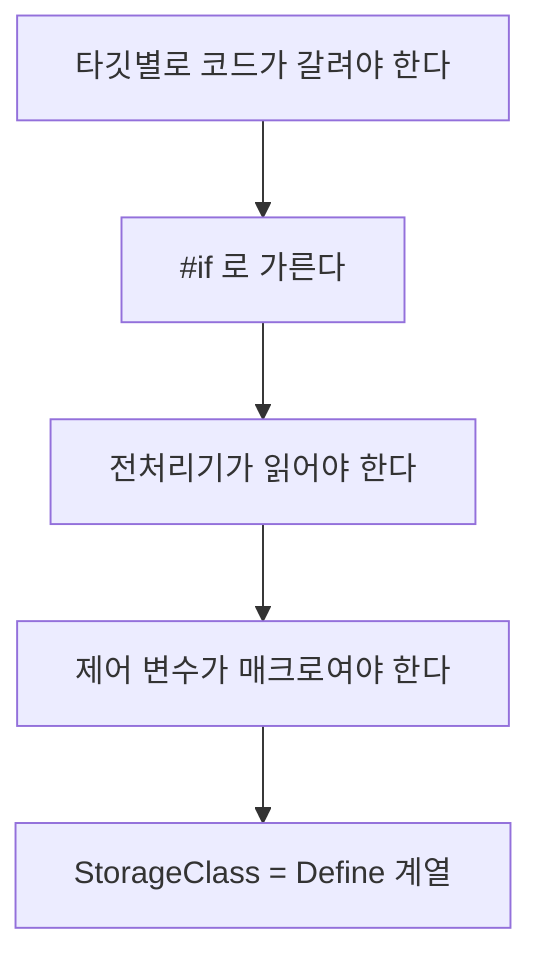
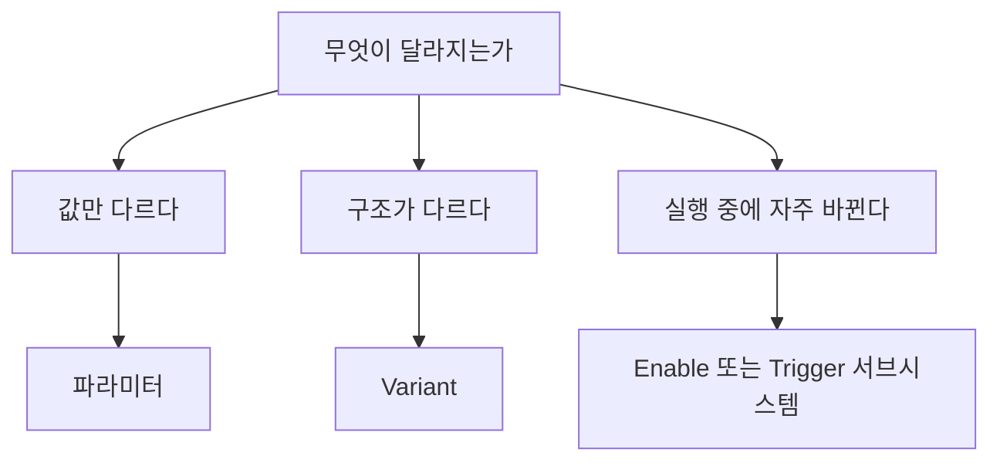

> **기준 출처:** [MathWorks Variant Subsystem](https://www.mathworks.com/help/simulink/slref/variantsubsystem.html) · Variant Source 레퍼런스 · Activate Variant During Different Stages · Prepare Variant-Containing Model for Code Generation · Simulink.VariantControl / 확인일 2026-11-13
> **시리즈:** [목차](/posts/00-mp-series/) | 이전 → [10. 제어기를 조립하는 네 가지 기제](/posts/10-simulink-controller-assembly/) | 다음 → [Stateflow 01. Chart 구성 요소](/posts/01-sf-chart-elements/)

## 1. 이 글의 범위

Variant는 이 조건이면 이 블록, 아니면 저 블록이라는 구성을 모델에 미리 다 넣어 두고 변수 하나로 고르게 하는 장치다. [10편](/posts/10-simulink-controller-assembly/)의 Variant 절을 확장해 주석 처리와의 차이, 종류, 조건식, 활성화 시점과 저장 클래스, 함정, 확인 방법을 본다.

## 2. 주석 처리와의 차이

제품이 여러 종류인데 모델이 하나라면 안 쓰는 기능을 꺼야 한다. 가장 쉬운 방법은 주석 처리(Comment Out)다. 동작은 하지만 나머지 전부에서 차이가 난다.

| | 주석 처리 | Variant |
| --- | --- | --- |
| 바꾸는 법 | 모델 파일을 열어 우클릭한다 | 변수 값 하나를 바꾼다 |
| 왜 껐는가 | 남지 않는다. 회색이라는 사실만 남는다 | 조건식이 블록에 붙어 있다 |
| 선택지 수 | 켜고 끄기 둘 | 여러 개 |
| 기계로 확인 | 사람이 눈으로 본다 | `CompiledActiveChoiceBlock`으로 읽힌다 |
| 딸린 손질 | 결과를 받던 자리를 상수로 바꾸는 식의 수정 범위가 기록되지 않는다 | 조건 하나에 묶인다 |
| 생성 코드 | 그 기능이 아예 나오지 않는다 | 설정에 따라 모든 선택지가 나오고 `#if`로 갈린다 |

> 같은 선택이면 동작은 같다. 주석 처리된 블록과 비활성 선택지는 둘 다 실행에서 빠진다. 차이는 누가, 어떻게, 어디에 기록하며 정하느냐에 있다.
{: .prompt-info }

## 3. 종류

| 블록 | 쓰는 자리 | 모양 |
| --- | --- | --- |
| Variant Subsystem | 덩어리 전체를 갈아끼울 때 | 안에 선택지 서브시스템이 여러 개 |
| Variant Source | 신호 하나의 출처를 고를 때 | 입력 여럿, 출력 하나 |
| Variant Sink | 신호 하나를 어디로 보낼지 고를 때 | 입력 하나, 출력 여럿 |

그 밖에 Variant Model과 Variant Assembly Subsystem이 있다. 두 블록을 같이 쓰는 경우가 많다. 기능 덩어리를 Variant Subsystem으로 감싸고 그 결과를 받던 자리를 Variant Source로 두어 꺼졌을 때의 기본값을 준다.

## 4. 조건식

expression 모드(기본)에서는 선택지마다 참이나 거짓이 되는 식을 적는다.

```text
선택지 A 의 조건 :  Target == TargetEnum.TypeA
선택지 B 의 조건 :  Target ~= TargetEnum.TypeA
```

`Target`은 모델 워크스페이스나 기본 워크스페이스의 변수다. 열거형을 쓰면 `Target == 3` 대신 `Target == TargetEnum.TypeA`가 되어 읽힌다. 조건들이 동시에 참이 되면 안 되므로 보통 `==`와 `~=`로 짝을 맞춘다.

변수를 `Simulink.VariantControl` 객체로 만들면 활성화 시점을 변수에 붙일 수 있다. 블록은 이 객체에서 활성화 시점을 상속받고, 한 블록이 이런 변수를 여럿 쓰면 활성화 시점이 모두 같아야 한다.

## 5. 활성화 시점

| 값 | 언제 정해지나 | 생성 코드에 |
| --- | --- | --- |
| `update diagram` | 모델을 갱신하거나 시뮬레이션할 때 | 활성 선택지만 |
| `update diagram analyze all choices` | 위와 같고 비활성 선택지도 검사한다 | 활성 선택지만 |
| `code compile` | C 전처리기가 정한다 | 모든 선택지가 `#if`와 `#elif`로 감싸져 들어간다 |
| `startup` | 실행 파일이 시작될 때 | 모든 선택지가 일반 `if`로 들어간다 |
| `runtime` | 실행 중 | 실행 중 전환을 지원한다 |

`code compile`이면 컴파일러가 활성 선택지만 컴파일하고, 다른 선택지를 쓸 때 코드를 다시 생성할 필요가 없다. 코드는 한 번 생성하고 빌드 때 선택만 바꾼다. 하나의 소스로 여러 제품을 만드는 구조가 여기서 나온다. 조건은 Embedded Coder 라이선스와 `ert.tlc` 같은 ERT 계열 System target file이다. 이때 선택지는 atomic으로 취급되는데, 예제 문서는 Treat as atomic unit을 켜라고 안내하고 Variant Assembly Subsystem 문서는 자동으로 켜진다고 적으므로 설정 창에서 확인한다.

### 제어 변수의 저장 클래스

활성화 시점만 바꿔서는 부족하고 제어 변수가 매크로로 나가야 한다. 저장 클래스(StorageClass)는 모델 변수가 C 코드에서 어떤 모습이 될지 정한다.

| 값 | 생성 코드에서 |
| --- | --- |
| `Auto` | 기본 파라미터 동작이 `Inlined`이면 값이 박히고 이름이 사라진다 |
| `Define` | 헤더에 `#define NAME 값`으로 남는다 |
| `ImportedDefine` | 사용자가 준 헤더의 `#define`을 쓴다 |
| `CompilerFlag` | 컴파일 옵션 `-DNAME=값`으로 넘긴다 |

`#if`는 전처리기가 처리한다. 전처리기는 컴파일 전에 소스를 텍스트로 훑는 단계라 C 변수를 볼 수 없고 매크로만 본다. 제어 변수가 `Auto`이면 값이 숫자로 녹아 없어져 `#if`를 쓸 재료가 생기지 않는다.

```c
#define Target 4          /* 전처리기가 읽을 수 있는 형태 */
#if Target == 4
    /* 이 부분만 컴파일러에 넘어간다 */
#endif
```



빌드할 때 `-DTarget=4`처럼 값을 넘기는 방식은 `CompilerFlag`에 해당한다. 반대로 `startup`은 `Define` 계열과 `Const` 계열을 지원하지 않는다. 실행 시작 때 값을 받을 변수가 필요하기 때문으로 판단된다.

> `#if` 생성은 실측 환경에 Embedded Coder가 없어 직접 확인하지 못했다. 이 절의 생성 코드 설명은 MathWorks 문서 기준이다.
{: .prompt-warning }

시작은 `update diagram`으로 하고 코드 생성 단계에서 `code compile`로 바꿔도 된다. 활성화 시점이 바뀌면 컴파일 방식이 달라지므로 바꾼 뒤 다시 검증한다.

## 6. EmptyChoice — 아무것도 켜지지 않음을 허용하기

보통은 활성 선택지가 없으면 오류가 난다. 특정 제품에만 있는 기능이라면 `EmptyChoice`를 켠다. 조건이 전부 거짓이면 그 자리가 통째로 비고 출력 포트는 0을 낸다. R2025a부터 이름이 Built-in empty choice로 바뀌었고 expression 모드이면서 `default` 선택지가 없을 때만 쓸 수 있다.

```text
EmptyChoice = on
  선택지 FeatureX   조건: Target == TargetEnum.TypeA
  -> TypeA 이면 켜짐 / 나머지 타깃이면 아무것도 없음
```

선택지가 하나만 있어도 되므로 있다와 없다 구조를 가장 간단하게 만든다.

## 7. 실전 함정

스크립트로 모델을 다뤄 보면 드러나는 것들이다.

| 함정 | 대응 |
| --- | --- |
| Variant Source에 입력 포트 수 파라미터가 없다 | 포트는 조건 목록의 항목마다 하나씩 생긴다 |
| 프로그램으로 줄 때 조건은 문자열의 셀 배열이다 | `{'A == 1', 'A ~= 1'}`로 준다. struct 배열은 `InlineVariantInvalidVC`로 거부된다 |
| 포트가 0개인 서브시스템도 Variant가 된다 | 전역 변수로만 대화하는 덩어리도 감싼다. `EmptyChoice`와 쓰면 포트 정합 문제가 없다 |
| Variant Subsystem도 `BlockType`은 `SubSystem`이다 | `get_param(blk,'Variant')`가 `'on'`인지로 구분한다 |
| 기존 블록을 Variant로 바꿀 때 내용이 날아갈 수 있다 | 원본을 복사해 선택지로 넣고 원본을 지운다. 바꾼 뒤 하위 블록 수를 대조한다 |
| 비활성 쪽이 참조하는 변수도 선언되어 있어야 한다 | 주석 처리 중에 선언까지 지웠다면 Variant로 켜는 순간 해소 실패로 컴파일이 막힌다 |
| 참조는 이름으로만 기록된다 | 같은 이름의 파일이 경로에 여럿이면 경로 순서가 승자를 정한다. Simulink 조회는 대소문자를 구분하고 `which`는 구분하지 않는다 |

## 8. 확인하는 법

그림이 회색인지로 판정하지 않고 컴파일된 모델을 읽는다.

```matlab
set_param(model, 'SimulationCommand', 'update');      % 컴파일
act = get_param(variantBlock, 'CompiledActiveChoiceBlock');
%  빈 문자열  -> 아무 선택지도 켜지지 않음 (EmptyChoice)
%  선택지 경로 -> 그것이 활성
```

타깃 값마다 한 번씩 돌려 표로 만들면 A에서만 켜진다는 사실이 기계가 읽는 결과로 남는다. 켜졌다는 것이 동작한다는 뜻은 아니므로 입력을 일부러 조건에 걸리게 만들어 출력이 달라지는지도 확인한다.

## 9. 언제 쓰고 언제 안 쓰나



제품마다 있고 없는 기능이 갈리거나 하나의 소스로 여러 실행 파일을 낼 때 Variant를 쓴다. 숫자만 다른 것을 Variant로 가르면 선택지만 늘고 얻는 것이 없다. 구조가 달라지는가가 갈림선이다.

## 정리

- 활성화 시점은 `update diagram`(시뮬레이션), `code compile`(`#if`, 제품군), `startup`(시작 시점)으로 고른다.
- `code compile`에는 Embedded Coder와 매크로가 되는 저장 클래스가 필요하다.
- 확인은 그림 색이 아니라 `CompiledActiveChoiceBlock`으로 한다.
- 값만 다르면 파라미터이고 구조가 달라져야 Variant다.

## 확인 문제

1. 주석 처리와 Variant가 같은 출력을 내는데도 Variant를 쓰는 이유를 두 가지 쓰라.
2. `code compile`에서 제어 변수의 저장 클래스가 `Auto`이면 어떤 문제가 생기는가.

## 참고

- [MathWorks — Variant Subsystem](https://www.mathworks.com/help/simulink/slref/variantsubsystem.html)
- [MathWorks — Variant Source](https://www.mathworks.com/help/simulink/slref/variantsource.html)
- [MathWorks — Activate Variant During Different Stages of Simulation and Code Generation Workflow](https://www.mathworks.com/help/simulink/var/activate-variant-during-different-stages-of-simulation-and-code-generation-workflow.html)
- [MathWorks — Prepare Variant-Containing Model for Code Generation](https://www.mathworks.com/help/simulink/var/prepare-model-containing-variants-for-code-generation.html)
- [MathWorks — Create a Simple Variant Model](https://www.mathworks.com/help/simulink/var/workflow-for-implementing-variants.html)
- [MathWorks — Simulink.VariantControl](https://www.mathworks.com/help/simulink/slref/simulink.variantcontrol.html)
